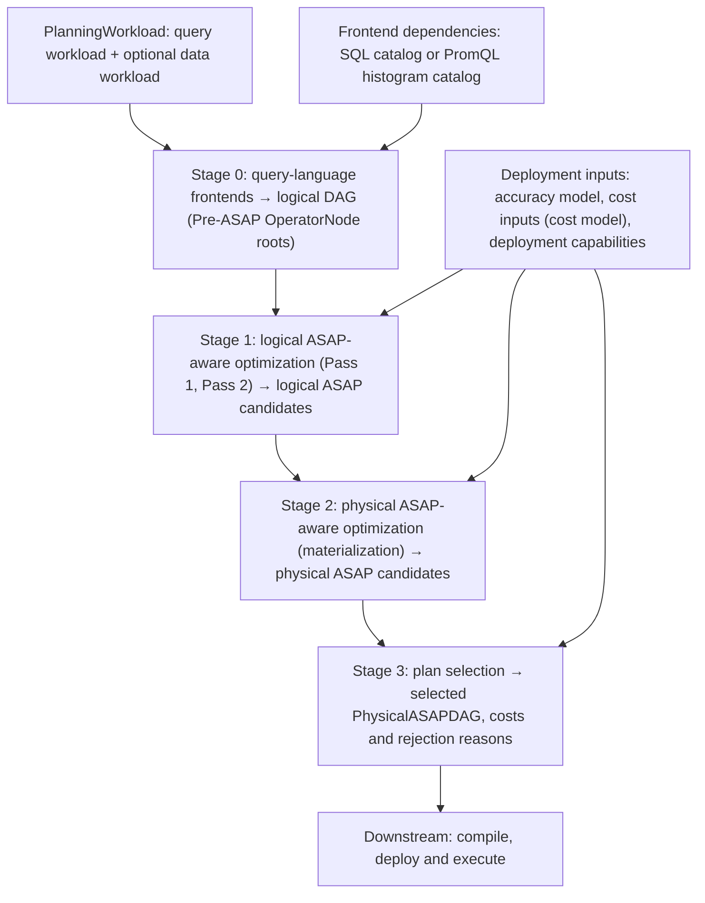

# ASAPPlanner design overview

ASAPPlanner is a reusable planning library. It converts queries, workload
requirements and the deployment's inputs into one selected physical plan
that may use Approximate Streaming Analytics Primitives (sketches and exact
summaries). It does not deploy or execute the plan; downstream systems such
as ASAPQuery-backend run it.

For the integration workflow, start with [ASAPPlanner input, output, and
workflows](input-output-workflow.md). The stages are defined in the
[planning stages design](../proposals/planner-layering.md).

## Planner component flow

Stages 1 and 2 enumerate candidates without comparing them. Stage 3 rejects
the candidates that miss a query's accuracy target or latency bound, whose
evaluation of a repeating query takes longer than its repeat interval, or that
the deployment cannot run, and selects one of the rest under the deployment's
cost model. Missing accuracy evidence never certifies a candidate: a
candidate whose output has no guarantee is rejected for an approximate
target.

## Module map

| Area | Main crate or module | Responsibility |
|---|---|---|
| Shared IR | `asap-types` | The unified operator IR (`ir`: one `OperatorNode` before and after ASAP optimization), schemas, workloads, guarantees, and exported plan data |
| Front-end common | `frontend-common` | Name-based `UnresolvedOp` tree shared by the front ends, and `resolve_root` into the operator IR |
| Query frontends | `frontend-sql`, `frontend-promql`, `frontend-metricsql` | Stage 0: parse source languages and produce canonical Pre-ASAP queries |
| Logical ASAP-aware optimization | `logical-asap-optimization` | Stage 1: per-computation candidates (Pass 1), ASAP-aware CSE (Pass 2), the analytical accuracy model |
| Physical ASAP-aware optimization | `physical-asap-optimization` | Stage 2: materialization and physical operator implementation |
| Plan selection | `plan-selection` | Stage 3: accuracy and latency checks, costing and selection; the planning models and the Stage 1 to Stage 3 driver |
| Planner facade | `planner` | `e2e_plan`: Stage 0 followed by Stages 1–3 |
| Executor | `executor` | Stage 4: runs a `PhysicalASAPDAG` over `asap_sketchlib` summaries; no stage crate depends on it |
| Developer inspection | `devtools` | `stage_pipeline` and the Stage Viewer documents, corpus coverage tools |
| End-to-end validation | `integration-tests` | Verify behavior across frontends, stages and execution |

## Inputs and outputs

Planner inputs are intentionally broader than a query string. Selection
depends on query recurrence, data arrival and per-source facts, accuracy and
latency requirements, and the deployment's cost model and capabilities.
Missing facts stay unknown rather than being treated as zero.

The output is the selected plan (`PlanOutput`: one plan root per query and
Stage 3's `Selection` with every candidate's cost or rejection reason).
Downstream owns concrete storage layout, placement, sharding, serving and
operational feedback, and must not silently change Planner-owned semantics.

## Further reading

- [Planning stages design](../proposals/planner-layering.md)
- [Parsing and canonicalization](parse-and-canonicalize.md)
- [Pre-ASAP IR](../concepts/pre-asap-ir.md)
- [Post-ASAP IR](../concepts/post-asap-ir.md)
- [Accuracy guarantees](../proposals/asap-aware-mapping/end-to-end-accuracy-guarantees.md)
- [Physical-plan integration](physical-plan-integration.md)
- [ASAPPlanner planner-runtime contract](planner-runtime-contract.md)
- Historical: [ASAP-aware mapping](asap-aware-mapping.md), [Searching over plans](asap-aware-plan-search.md), [Analytical resource cost](../proposals/asap-aware-mapping/analytical-resource-cost.md)
