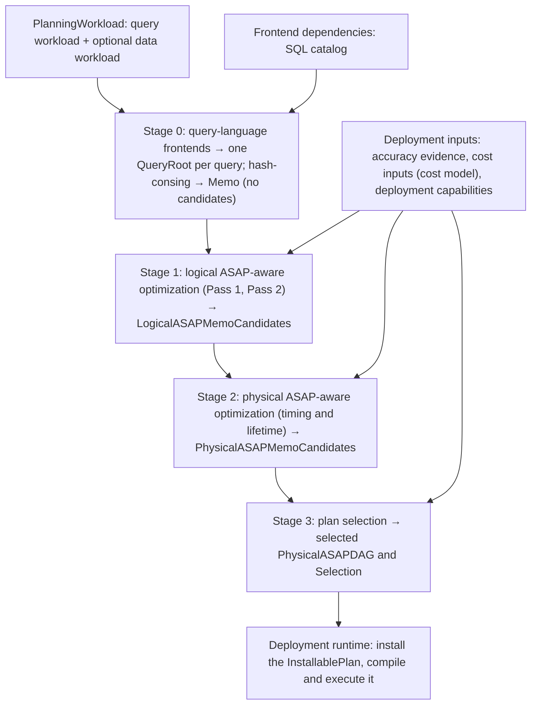

# ASAPPlanner design overview

ASAPPlanner is a reusable planning library. It converts queries, workload
requirements and the deployment's inputs into one selected physical plan
that may use Approximate Streaming Analytics Primitives (sketches and exact
summaries). It does not deploy or execute the plan; a deployment runtime
runs it.

For the integration workflow, start with [ASAPPlanner input, output, and
workflows](input-output-workflow.md). The stages are defined in the
[planning stages design](../proposals/planner-layering.md).

## Planner component flow



**Stage 0** is everything before an implementation choice: each query's
frontend lowers it into one logical root, and hash-consing
(`memo_of_queries`) merges the roots' equal sub-expressions into memo groups.
Its output is the `Memo` with no candidates (`PlanningRun::stage0_memo`,
`RunUntil::Stage0`). The frontend crates and `stage0-memo` are its two steps.

Stages 1 and 2 enumerate candidates without comparing them. Stage 3 rejects
the candidates that miss a query's accuracy target or latency bound, whose
evaluation of a repeating query takes longer than its repeat interval, or that
the deployment cannot run, and selects one of the rest under the deployment's
cost model. Missing accuracy evidence never certifies a candidate: a
candidate whose output has no guarantee is rejected for an approximate
target.

## Module map

| Area | Main crate or module | Responsibility |
|---|---|---|
| Shared IR | `asap-types` | The unified operator IR (`ir`: one `OperatorNode` before and after ASAP optimization), schemas, workloads, guarantees, the types one stage hands the next (`stages`) and exported plan data (`plan`) |
| Front-end common | `frontend-common` | Name-based `UnresolvedOp` tree shared by the front ends, and `resolve_root` into the operator IR |
| Query frontends | `frontend-sql`, `frontend-promql`, `frontend-metricsql` | Stage 0, lowering: parse source languages and produce canonical Pre-ASAP queries |
| Stage 0 hash-consing | `stage0-memo` | Stage 0, hash-consing: the memo groups of the workload's query roots |
| Logical ASAP-aware optimization | `stage1-pass1-per-computation-candidates`, `stage1-pass2-reuse-candidates` | Stage 1: per-computation candidates (Pass 1), ASAP-aware CSE (Pass 2) |
| Physical ASAP-aware optimization | `stage2-physical-optimization` | Stage 2: each logical candidate's timing and lifetime, the physical edges and the pruned alternatives |
| Plan selection | `stage3-plan-selection` | Stage 3: accuracy and latency checks, costing and selection; builds the selected `PhysicalASAPDAG` |
| Shared accuracy model | `accuracy` (`asap-accuracy`) | Per-algorithm estimators, each operator's error contract, the deployment's measured accuracy (`AccuracyEvidence`) |
| Shared cost model | `cost` (`asap-cost`) | Resource-usage estimation and the cost models (`CostInputs`, `CostModel`, `plan_cost`) |
| Planner facade | `planner` | `e2e_plan`, `plan_installable` and `run_planning`: calls Stage 0 to Stage 3 in turn (no stage calls another); `installable_plan_of` |
| Executor | `executor` | Stage 4: runs a `PhysicalASAPDAG` over `asap_sketchlib` summaries; no stage crate depends on it |
| Command line | `planner-cli` | `asap_planner`: a workload's stages as text or as the Plan Viewer document; its end-to-end and snapshot tests |
| Developer inspection | `devtools` | Corpus coverage tools, the planner fuzzer, the benchmark lane |
| End-to-end validation | `integration-tests` | Verify behavior across frontends, stages and execution |

## Inputs and outputs

Planner inputs are intentionally broader than a query string. Selection
depends on query recurrence, data arrival and per-source facts, accuracy and
latency requirements, and the deployment's cost model and capabilities.
Missing facts stay unknown rather than being treated as zero.

The output is the selected plan: `PlanOutput` holds the `PhysicalASAPDAG`
(one root per query) and the solver's optimality gap; `PlanningRun::selection`
holds the same plan beside Stage 3's `Selection` (the accepted accuracy per
query, the pruned candidates and the selection MILP's size and times).
The deployment runtime owns concrete storage layout, placement, sharding,
serving and operational feedback, and must not silently change
Planner-owned semantics.

## Key types through the stages

One chain of the current public types, from the queries to an executed
plan. Each stage is a function of the previous stage's output; the facade
(`asap_planner::run_planning`, `crates/planner/src/run.rs`) calls them in
turn. The stage-boundary types are in `asap_types::stages`
(`crates/types/src/stages/`).

```text
Vec<QueryRoot>                                  frontends (Stage 0, lowering)
  │ asap_stage0_memo::memo_of_queries(roots, accuracy_targets, data)
  ▼
Memo (MemoGroups, no candidates)                Stage 0, hash-consing
  │ asap_stage1_pass1_per_computation_candidates::pass1_memo(memo, exclusions)
  ▼
Memo (each MemoGroup's CandidateForMemoGroups)  Stage 1, Pass 1
  │ asap_stage1_pass2_reuse_candidates::generate_logical_asap_memo_candidates(
  │     pass1, entries, evidence, exclusions, search_space_pruning)
  ▼
LogicalASAPMemoCandidates                       Stage 1, Pass 2
  │ asap_stage2_physical_optimization::generate_physical_asap_memo_candidates(
  │     logical, data, exclusions)
  ▼
PhysicalASAPMemoCandidates                      Stage 2
  │ asap_stage3_plan_selection::select_plan(
  │     physical, entries, data, cost_inputs, final_results_cache)
  ▼
(PhysicalASAPDAG, Selection)                    Stage 3
  │ asap_planner::installable_plan_of(plan, entries)
  ▼
InstallablePlan { wire_version, dag, query_texts }
  │ .materialized_views() → Vec<MaterializedView>
  │ .raw_data_retention() → Vec<RawDataRetention>
  │ asap_executor::physical_planner::compile(&dag, &views, &roots)
  ▼
CompiledPhysicalDAG
  │ .instantiate(store: Arc<dyn DataStore>)
  ▼
PhysicalDAG                                     Stage 4, execution
  │ .execute(roots, RunContext) for a query run,
  │ .execute_ingestion(roots, RunContext) for an ingestion-time refresh
  ▼
each root's batches
```

| Type | What it holds | Where |
|---|---|---|
| `Memo` | The memo groups, each query's root over them (`MemoQuery`) and each group's candidates; one type for Stage 0 and Stage 1 | `types/src/stages/logical/memo/mod.rs` |
| `MemoGroup` | One distinct logical sub-expression: its expression, the groups that read it, the queries that reach it and its candidates | `types/src/stages/logical/group/mod.rs` |
| `CandidateForMemoGroup` | One way to implement a group: `expression`, `logical_properties` (θ), `input_requirements`, `fused_groups`, `origin` (`OriginOfCandidateForMemoGroup`) | `types/src/stages/logical/candidate/mod.rs` |
| `LogicalASAPMemoCandidates` | Pass 2's memo, its logical edges (`LogicalEdge`), the pruned logical candidates, each group's evaluation grid and, per query, the groups it may read only exactly | `types/src/stages/logical/memo_candidates.rs` |
| `SearchSpacePruning` | Which exact search-space pruning rules run (today `threshold_theta`, read by Pass 2); set through `PlanSearchSettings::search_space_pruning`, default every rule | `types/src/stages/search_space_pruning.rs` |
| `PhysicalASAPMemoCandidates` | The logical candidates, every `PhysicalCandidate` (`logical_candidate_id`, `PhysicalProperties`: `ExecutionTiming` and `Lifetime`), the physical edges (`PhysicalEdge`) and the pruned alternatives (`PrunedCandidate<PhysicalCandidate>`) | `types/src/stages/physical/` |
| `Selection` | Stage 3's report: `accepted_accuracy_per_query`, `pruned_candidates`, the selected plan's cost per second and latency, the MILP's size and times | `stage3-plan-selection/src/report.rs` |
| `RetentionShare` | Stage 3's internal MILP variable for $h_v$, how long a candidate kept across evaluations retains its output, as a share of its longest need; not public | `stage3-plan-selection/src/milp/retention.rs` |
| `PhysicalASAPDAG` | The selected plan: nodes with their timing, lifetime and `retention_ms`, edges, one root per query; `plan_id()` is its content id | `types/src/plan/physical_asap_dag.rs` |
| `InstallablePlan` | What a runtime installs: `wire_version`, `dag`, `query_texts`; `installable_plan_of` refuses a plan the executor cannot compile | `planner/src/installable/mod.rs` |
| `MaterializedView` | One stored output of the plan: `node_id`, `plan_id()` (with `node_id`, its address in one installed plan), `view_state_key()`, `refresh()`, `coverage()`, `inputs`, `retention_ms()` | `types/src/plan/materialized_view/mod.rs` |
| `ViewStateKey` | What a view's stored state is, in any plan: `definition_id`, `window`, `logical_properties`; a store keys states by it and the concrete selection | `types/src/plan/materialized_view/view_state_key.rs` |
| `SelectedPlanReport` | `plan_installable`'s report beside the plan: cost per second, `predicted_usage`, the assumed data facts, the optimality gap | `planner/src/installable/mod.rs` |
| `CompiledPhysicalDAG`, `PhysicalDAG`, `DataStore` | The executor's compiled plan, its instance bound to a store, and the store interface a runtime implements (raw data and materialized views) | `executor/src/physical_planner/`, `executor/src/plan/mod.rs`, `executor/src/sources/data_store.rs` |

### Names to avoid

- "price" for a cost: use "cost" (`ResourceUnitCost`, `plan_cost`).
- "candidate" alone when the stage matters: say `CandidateForMemoGroup`
  (logical, Stages 1–2) or `PhysicalCandidate` (Stages 2–3).
- Deleted names that older docs still use: `LogicalMemo`, `CandidateMemo`
  (both now `Memo`); `ImplementationCandidate` (`CandidateForMemoGroup`);
  `CandidateOrigin` (`OriginOfCandidateForMemoGroup`); `ProducerRequirement`
  (`PhysicalEdge`); `CandidateConfiguration` (`PhysicalProperties`);
  `Materialization`, `MatAt*` (`PhysicalProperties` with `Lifetime`);
  `PhysicalWorkloadPlan` (`select_plan` returns the `PhysicalASAPDAG`);
  `PlanSelectionSettings` (`CostInputs`).
- "Stage 0" for the frontends alone: Stage 0 is lowering and hash-consing,
  and its output is the `Memo`.

## Further reading

- [Planning stages design](../proposals/planner-layering.md)
- [Parsing and canonicalization](parse-and-canonicalize.md)
- [Pre-ASAP IR](../concepts/pre-asap-ir.md)
- [Post-ASAP IR](../concepts/post-asap-ir.md)
- [Accuracy guarantees](../proposals/asap-aware-mapping/end-to-end-accuracy-guarantees.md)
- [Physical-plan integration](physical-plan-integration.md)
- [ASAPPlanner planner-runtime contract](planner-runtime-contract.md)
- Historical: [ASAP-aware mapping](asap-aware-mapping.md), [Searching over plans](asap-aware-plan-search.md), [Analytical resource cost](../proposals/asap-aware-mapping/analytical-resource-cost.md)
