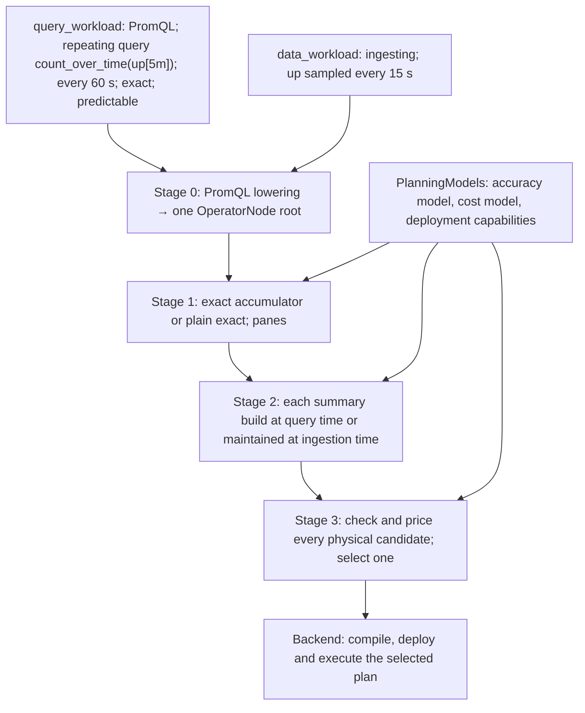

# ASAPPlanner input, output, and workflows

## Overview

This document is for library integrators such as ASAPQuery-backend, not users
submitting queries through a backend.

ASAPPlanner is a **planning library**. Its input is a planning workload plus
the deployment's inputs: its accuracy model, plan selection settings (the
cost model) and capabilities. Its output is one selected physical plan for
the workload, with every alternative it considered and why each was not
selected.

### Input fields at a glance

| Input | Fields | Required |
|---|---|---:|
| `PlanningWorkload.query_workload` | Query language and one-time/repeating query workloads | Yes |
| `PlanningWorkload.data_workload` | How the data arrives, and facts about each source | No implicit default. Set `None` when unavailable; a PromQL query with a bare instant selector needs a nonzero `sample_interval` on the metric it reads. |
| Frontend-specific dependencies (outside `PlanningWorkload`) | `SqlCatalog` for SQL; when needed, `HistogramCatalog` for PromQL | `SqlCatalog` is required for SQL lowering |
| `PlanningModels` | Accuracy model and evidence, `CostInputs` (cost model 1, 2 or 3, resource speed, measured operation costs), `DeploymentCapabilities` | `PlanningModels::builtin()` uses `BuiltinAccuracyModel`, no evidence, cost model 1 with illustrative unit costs, and a deployment that supports everything |

Frontend lowering (Stage 0) and Stages 1–3 run inside the workflow; they are
not additional inputs. See [Inputs](#inputs) for the nested workload fields
and [frontend dependencies](#frontend-specific-dependencies).

### Output at a glance

| Output | Fields or contents | Meaning |
|---|---|---|
| `PlanOutput` | `plans`: one `QueryPlan { entry_index, root }` per query; `selection`: Stage 3's `Selection` (`selected`, `plan`, `costs`, `accepted`, `rejected`, `front`), set by the default pass `Stage1ToStage3Pass`; standalone scalar queries in `scalar_roots` and `scalar_plans` | The selected plan; `physical_asap_dag()` exports it as one `PhysicalASAPDAG` |
| `Stage1ToStage3Run<Id>` (from `run_stage1_to_stage3`) | Every stage's candidates: Pass 1's per-computation candidates, the logical candidates, the physical candidates, Stage 2's pruned candidates, and the selection | For callers that inspect or display the alternatives |

The selected plan is a planning artifact. ASAPPlanner does **not** deploy
it; downstream systems compile it, choose placement and storage, deploy state
and execute queries.

```text
PlanningWorkload + frontend dependencies + PlanningModels
                        |
                        v
     ASAPPlanner: Stage 0 → Stage 1 → Stage 2 → Stage 3
                        |
                        v
        PlanOutput: selected plan, costs and rejection reasons
```

---

## Running example: a recurring PromQL query

Suppose a dashboard evaluates `count_over_time(up[5m])` once a minute, and
`up` receives a sample every 15 seconds:



"Predictable" says the query is known in advance; it is independent of its
one-minute recurrence. Whether maintaining the count as data arrives is
cheaper than recomputing it at every evaluation is Stage 3's comparison of
Stage 2's candidates under the deployment's cost model.

For contrast, a one-time SQL query needs a catalog but need not supply data
arrival facts: `data_workload` can be `None`, and the data is then treated as
of unknown arrival with no source facts.

---

## Inputs

### `PlanningWorkload`

A frontend receives one `PlanningWorkload`. Query demand and facts about the
queried data are separate because they have different sources and update
cycles:

```rust
struct PlanningWorkload {
    query_workload: QueryWorkload,
    data_workload: Option<DataWorkload>,
}
```

| Field | Required | Purpose |
|---|---:|---|
| `query_workload` | Yes | Contains the source language and every one-time or repeating query. |
| `data_workload` | Optional | There is no automatic default: explicitly set `None` when unavailable. A PromQL or MetricsQL query with a bare instant selector needs a nonzero `sample_interval` on the metric it reads. |

#### `query_workload: QueryWorkload`

`QueryWorkload` describes query demand. It deliberately does not describe
whether source data is still arriving.

```rust
struct QueryWorkload {
    language: QueryLanguage,
    query_batch: Option<Vec<BatchEntry>>,
    repeating_queries: Option<Vec<RepeatingEntry>>,
}
```

| Field | Required | Purpose |
|---|---:|---|
| `language` | Yes | Source language shared by every entry: PromQL, a SQL dialect, DataFusion, or Elastic DSL. It selects the frontend. A workload in several languages is several `PlanningWorkload`s, one per language, which `stage_pipeline` plans together (repeated `--workload`). |
| `query_batch` | Optional | Finite one-time query entries. `None` means there is no batch portion. |
| `repeating_queries` | Optional | Recurrent query entries. `None` means there is no repeating portion. |

Both entry collections may be present. `QueryWorkload::entries()` normalizes
them into one ordered stream: batch entries first, followed by repeating
entries. If both are absent, lowering produces no query roots.

##### `query_batch: Option<Vec<BatchEntry>>`

```rust
struct BatchEntry {
    query: Query,
    requirements: QueryRequirements,
    predictability: Predictability,
    invocations: u64,
    execute_at: Option<TimestampMs>,
}
```

| Field | Required | Purpose | Why it matters / example |
|---|---:|---|---|
| `query` | Yes | Raw query text in `QueryWorkload.language`. | `count(up)` determines the expression to lower and plan. |
| `requirements` | Yes | Accuracy and response-latency requirements. Defaults mean exact accuracy and unspecified latency. | An explicit ε target permits approximate candidates; the exact default does not. |
| `predictability` | Yes as a field; `Unknown` is allowed | Whether the query is ad hoc, known in advance, or unknown. `known_at` records when a predictable query became known. | A report known at 10:00 and scheduled for 11:00 could have its summary prepared before execution. `AdHoc` or `Unknown` does not establish that eligibility. |
| `invocations` | Yes, nonzero | Number of executions in this finite batch. | Ten executions can amortize one summary build differently from one execution. |
| `execute_at` | Optional | Known execution time. | The prepared case above also needs an execution time; without it no preparation window can be established. |

##### `repeating_queries: Option<Vec<RepeatingEntry>>`

```rust
struct RepeatingEntry {
    query: Query,
    demand: RepeatedDemand,
    requirements: QueryRequirements,
    predictability: Predictability,
}
```

| Field | Required | Purpose | Why it matters / example |
|---|---:|---|---|
| `query` | Yes | Raw query text in `QueryWorkload.language`. | `rate(up[5m])` determines the expression to lower and plan. |
| `demand` | Yes | A nonzero fixed interval, fixed interval with evaluation phase, nonempty explicit schedule, or evidence-backed estimated rate. | A query every minute produces more expected reads over a horizon than one every hour. |
| `requirements` | Yes | Accuracy and response-latency requirements. | An exact dashboard query cannot use an approximate summary solely because it is cheaper. |
| `predictability` | Yes as a field; `Unknown` is allowed | Records whether future executions are known in advance; independent of recurrence. | Current planner code does not use this field for repeating entries; set `Unknown` if no predictability claim is available. |

##### Shared entry fields

`BatchEntry` and `RepeatingEntry` both contain `QueryRequirements` and
`Predictability`. The event time a query reads (its range and offset) is in
its query text. The nested requirement fields expand as follows:

| Structure | Field | Meaning |
|---|---|---|
| `QueryRequirements` | `accuracy` | An `AccuracyTarget`; omitted, it is `AccuracyTarget::exact()`. Set ε (and δ) when approximation is allowed. |
| `QueryRequirements` | `max_latency_ms` | An optional finite, non-negative maximum in milliseconds for one evaluation; omitted, there is no bound. Either way, a repeating query's evaluation must not take longer than its repeat interval. |

Frontend lowering produces one Pre-ASAP `Rc<OperatorNode>` root for each normalized
query entry. The caller must retain each root's association with its workload
entry for later recurrence and materialization planning.

#### `data_workload: Option<DataWorkload>`

`DataWorkload` describes the data being queried: how it arrives, and what
is known about each source.

```rust
struct DataWorkload {
    arrival: DataArrival,
    sources: BTreeMap<String, SourceFacts>, // key: PromQL metric or SQL table
}
enum DataArrival {
    AtRest,
    Ingesting { rows_per_second: f64 },
    Mixed { rows_per_second: f64 },
    Unknown,
}
struct SourceFacts {
    series_count: Option<u64>,
    metric_type: Option<MetricType>,
    values_non_negative: bool,
    sample_interval: Option<DurationMs>,
    stream_norms: Option<StreamNorms>,
    max_distinct_per_evaluation: Option<u64>,
    distinct_values_per_label: BTreeMap<String, u64>,
    distinct_values_per_label_set: Vec<LabelSetDistinctValues>,
    rows_held: Option<u64>,
}
struct LabelSetDistinctValues {
    labels: Vec<String>,
    distinct_values: u64,
}
```

| Field | Required | Purpose and behavior when unavailable |
|---|---:|---|
| `arrival` | Present; may be `Unknown` | Distinguishes data at rest, ingesting data, and mixed data. Ingestion-time builds are possible only for ingesting or mixed data. |
| `rows_per_second` | With `Ingesting`/`Mixed` | Rows arriving per second over all sources, used to price scans and continuous maintenance. It must be finite and non-negative. A source with no `series_count` + `sample_interval` of its own is priced at its series share of it when every source declares `series_count`, else at all of it. |
| `series_count` | Optional | Series in the source. Plan selection bounds a query's number of values `G`, and its input row count, by the series counts of the sources it reads (each branch of an `or` counted); unknown, they stay unbound. |
| `metric_type` | Optional | Declared Prometheus type; a counter proves samples non-negative. Never inferred from a name. `rate`, `increase` or `irate` over a metric declared a gauge still plans, with a warning from the PromQL frontend (`counter_function_over_gauge_warnings`), which `stage_pipeline` reports. |
| `values_non_negative` | Optional; default `false` | Declares every sample non-negative, for a gauge as well as a counter. It is the sign a relative-error bound needs to carry through `sum` and `avg` (a per-series DDSketch quantile under `avg by`, say); without it, and for a gauge, that bound is unknown. |
| `sample_interval` | PromQL and MetricsQL; nonzero | How often each series of the metric is sampled. Bare instant selectors over it use it as their selection horizon; without it, such a query fails to lower. |
| `stream_norms`, `max_distinct_per_evaluation` | Optional | Bounds that Count-Min/Count Sketch and HLL/UnivMon guarantees are bound with. |
| `distinct_values_per_label` | Optional; default empty; each count nonzero | Distinct values each label (PromQL) or column (SQL) takes, e.g. `{"host": 1000, "job": 10}`. Plan selection prices a `by (k1, k2, ...)` aggregate or summary, and a partitioned sort or limit, at the product of its keys' counts, at most the `series_count` (series, or groups of rows) of the sources it reads and the rows it reads per evaluation. Over several sources a key's counts add. No count is assumed for a key some source read does not declare: the grouping is priced at the smaller of that `series_count` and those rows. Each count must be an upper bound, counting a missing label (or a NULL) as one more value: when every key of a grouped result declares one, their product (at most the series read) also bounds `G`, which sizes per-group sketches for a whole-result target; otherwise `G` keeps its series bound, or none for SQL. |
| `distinct_values_per_label_set` | Optional; default empty; each set two or more distinct labels, its count nonzero and at most the product of its labels' declared counts | Distinct combinations a set of labels (or columns) takes together, for labels that depend on each other, e.g. `[{"labels": ["service", "endpoint"], "distinct_values": 625}]` when each of 625 endpoints is in one of 25 services. For a grouping over one source whose keys are one row's unchanged labels, the per-label product above becomes the smallest product of declared set and label counts whose labels cover the keys: `by (service, endpoint)` is 625 groups, not 25 x 625, and `by (region, service, endpoint)` at most 4 x 625. A set covering more labels than the keys also bounds them. Nothing is inferred from the per-label counts (no functional dependency is assumed). Over several sources, or for keys a join or binary operator pairs from different rows, only the per-label counts apply; a key a relabeling rewrites is not bounded by any declared set. The same bound gives `G` for a whole-result target. A count above its labels' product is an input error naming the source. |
| `rows_held` | Optional; nonzero | Rows the source holds at rest. A query-time scan reads at most these; a scan with no window above it (a SQL query without a time predicate) reads all of them. |

Every fact is declared: the planner has no clock, so a caller drops facts
that no longer hold before planning. Unavailable data facts stay unknown. Planner does not reinterpret
them as zero ingestion, zero cardinality, or a favorable distribution, and
pricing assumes no default: a scan whose source declares neither an arrival
rate (`rows_per_second`, or `series_count` with `sample_interval`) nor
`rows_held` (required when it has no window) fails planning with an error
naming the source and the missing fact.

### Frontend-specific dependencies

These inputs are supplied alongside `PlanningWorkload`, rather than nested
inside it:

| Frontend | Additional lowering inputs |
|---|---|
| PromQL | An optional `HistogramCatalog` when histogram semantics must be resolved |
| SQL | `SqlCatalog`; single-query APIs also receive the accuracy target and optionally an explicit SQL dialect |
| MetricsQL | No catalog; the single-query API receives the query text and accuracy target directly |

They are explicit frontend function arguments, not one generic
`FrontendContext` type.

### Planning evidence inputs

**A model is planning logic; evidence is a scoped fact used by that logic.**
For example, `BuiltinAccuracyModel` knows how to combine error bounds, while
an operand-domain contract tells it whether a particular product or quotient
of absolute-error estimates has a bound. The former can be provided by a built-in default; the
latter cannot be fabricated by one.

| Input | Where it enters / default | Why it matters |
|---|---|---|
| Accuracy model | `PlanningModels` (`AccuracyModel`; `BuiltinAccuracyModel` by default) | Composes candidate guarantees and checks them against requested accuracy. The model does not itself provide missing data-domain facts. |
| Accuracy/domain evidence | `PlanningModels` (`AccuracyEvidenceProvider`; `NoAccuracyEvidence` by default) | Input ranges, nonempty populations and similar facts can certify or rule out particular approximations. Missing facts remain unknown. |
| Cost model | `CostInputs.cost_model` (cost model 1 by default) | Turns each valid candidate's resource usage into a choice. The illustrative unit costs are not a measured deployment cost. |
| Measured cost evidence | `CostInputs.measured_operation_costs` | Measured CPU time per unit of each operator kind, at ingestion or query time, replaces the formulas for the nodes it prices (a sketch interpolated between measured sizes); the other nodes' formulas are scaled by one calibration factor fitted from the measured ones. |
| Runtime capabilities | `DeploymentCapabilities` (`supported_summaries`, `raw_data_retained`, `query_time_results_retained`) | Prevents choosing a summary, raw-data scan or kept state the intended executor cannot provide. |

For example, the query `quantile_over_time(0.9, data[5m]) /
quantile_over_time(0.5, data[5m])` does not tell Planner whether the windows
are nonempty or their values strictly positive. Such domain facts help prove
that the denominator is nonzero and derive an approximation error bound;
they are not themselves the complete accuracy proof. A declared constraint or
backend observation must cover the relevant data, not just an earlier window.

Evidence is input; a derived guarantee or rejection reason is output. Missing
facts do not establish either validity or invalidity: Planner cannot claim a
guarantee that depends on them, so Stage 3 rejects, with its reason, a
candidate whose output has no guarantee for an approximate target.

---

## Output

### `PlanOutput`

`PlanOutput` holds the selected plan and Stage 3's record of the selection:

* `plans`: one plan root per query, in `QueryWorkload::entries()` order;
* `selection.selected`: the id of the selected physical candidate, and
  `selection.plan` its roots;
* `selection.costs`: each valid candidate's resource usage and, under cost
  models 1 and 2, its cost per second;
* `selection.accepted`: per valid candidate and query, the accuracy metric
  Stage 3 accepted;
* `selection.rejected`: every other candidate with its reason, whether it
  failed a check or lost under the cost model;
* `selection.front`: the Pareto front under cost model 3's Pareto objective.

Planner selects because it now has the inputs a backend used to own: the
deployment declares its cost model, measurements and capabilities, and every
alternative stays visible in `selection` and in `Stage1ToStage3Run`.

## Workflows

```text
PlanningWorkload + frontend dependencies + PlanningModels
    -> Stage 0: frontend lowering, one root per normalized query entry
    -> Stage 1: Pass 1 per-computation candidates, Pass 2 sharing, panes, reuse
    -> Stage 2: one physical candidate per materialization assignment
    -> Stage 3: check, measure and select
    -> PlanOutput
```

| Purpose | Operation | Result |
|---|---|---|
| Plan a workload end to end | `asap_planner::e2e_plan` | `PlanOutput` |
| Plan already-lowered roots and inspect every stage | `asap_plan_selection::run_stage1_to_stage3` | `Stage1ToStage3Run`, whose `stage3_plan_selection` is the `Selection` |
| Inspect a workload's stages as a document | `stage_pipeline` (devtools) | The stage document the [Stage Viewer](../../user_guide_docs/stage-viewer.md) shows |

The integration associates each lowered root with a caller-owned `Id` and its
workload entry (accuracy target, latency bound, recurrence); `Id` correlates
results, not query semantics. See the
[public library reference](../../develop_docs/library-api.md) for arguments.

## Replanning (future support)

> **Status: Future support.** ASAPPlanner does not currently define an
> end-to-end replanning or deployment-transition contract.

Today, a caller can rerun planning when workload, evidence, capabilities, or
costs change, but Planner does not relate the result to the previous plan.
Future support must define plan identity and compatibility across runs.
Deployment diffing, migration, activation, and rollback remain downstream
responsibilities.

## Related documents

* [Planner pipeline](../concepts/planner-pipeline.md)
* [Pre-ASAP IR](../concepts/pre-asap-ir.md)
* [Post-ASAP IR](../concepts/post-asap-ir.md)
* [Planner/runtime responsibilities](planner-runtime-contract.md)
* [Planning stages design](../proposals/planner-layering.md)
* [Public library reference](../../develop_docs/library-api.md)
