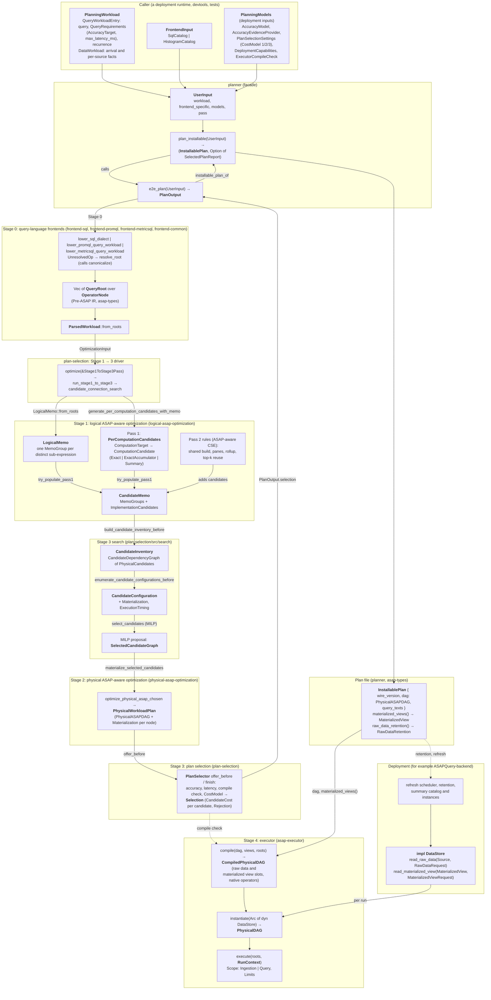
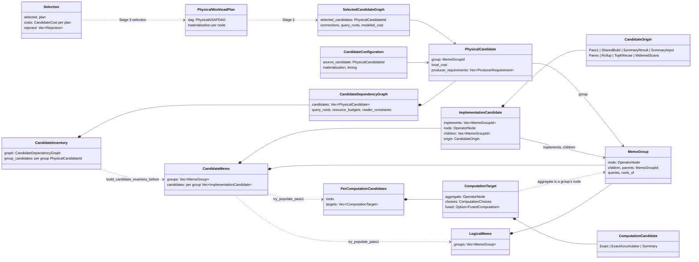

# ASAPPlanner system architecture

**Audience:** developers and designers who need to know which component owns
a concept, what each key type holds, and how the types relate.

This page places the key types and entry points of every component in one
picture. [Section 1](#1-components-and-their-interfaces) follows a workload
from the caller to the deployment. [Section 2](#2-structures-inside-stages-13)
shows how the structures inside Stages 1–3 relate to one another.
[Section 3](#3-name-decoder) gives each name its plain meaning, says where it
comes from in the literature, and says which other names it is easily confused
with. Paths are relative to `crates/`.

## 1. Components and their interfaces

Read the figure top to bottom:

- **Inputs.** The caller passes the workload, the frontend's catalog and the
  deployment inputs (`PlanningModels`) in one `UserInput`
  (`planner/src/lib.rs`).
- **Stage 0** lowers each query to a `QueryRoot` over `OperatorNode`, the
  Pre-ASAP IR (`asap-types`, `types/src/ir/operator/node.rs`), and binds the
  roots to their workload entries (`ParsedWorkload`).
- **The driver** (`plan-selection/src/search/pipeline.rs`, `route.rs`) runs
  Stages 1–3 over one memo. Stage 3's search asks Stage 2 to build a physical
  plan for each proposal; the stages are not a straight pipeline.
- **Stage 1** builds the memo (`LogicalMemo`), the per-computation choices
  (Pass 1), and the `CandidateMemo` with every way to implement each
  sub-expression; Pass 2 rules add the cross-query ways.
- **Stage 3 search** lowers the memo to a graph of `PhysicalCandidate`s, adds
  each candidate's materialization and timing (`CandidateConfiguration`), and
  solves a MILP for a proposal (`SelectedCandidateGraph`).
- **Stage 2** turns a proposal into a `PhysicalWorkloadPlan`: a timed
  `PhysicalASAPDAG` with a `Materialization` per node.
- **Stage 3 selection** (`PlanSelector`, `plan-selection/src/lib.rs`) rejects
  plans that miss an accuracy target or latency bound or that the executor
  cannot compile, costs the rest under the `CostModel`, and returns the
  `Selection`.
- **Plan file.** `plan_installable` turns the selection into an
  `InstallablePlan` (`planner/src/installable.rs`): the DAG with pane chains
  expanded and `retention_ms` set, plus the query texts. A runtime reads the
  views to keep (`materialized_views()`) and how long to keep raw data
  (`raw_data_retention()`) from it.
- **Executor.** `compile` lowers the DAG once to native operators with
  raw data slots (at `Scan`s) and materialized view slots; `instantiate` binds
  them to the run's `DataStore`; `execute` runs it in an ingestion or query
  run (`executor/src/physical_planner`, `executor/src/sources`).
- **Deployment.** The deployment implements `DataStore` over its raw data and
  its stored views, and refreshes and retains views as the plan says. The
  Planner never sees storage or instances.

No stage crate depends on the executor. Of the library crates, only the
facade `planner` calls it, for the compile check that Stage 3 runs
(`PlannerExecutorCompileCheck`); `devtools` and the integration tests also
use it.

## 2. Structures inside Stages 1–3

An arrow `A *-- B` means A contains B; `A --> B` means A refers to B by id;
`A ..> B` means A is produced from B, or (for `ComputationTarget`) holds the
same node as B.

The same sub-expression is one `MemoGroup` in every structure, so the
structures meet at the group:

| Level | One per | Structure | Stage |
| --- | --- | --- | --- |
| A distinct sub-expression of the workload | sub-expression | `MemoGroup` (in `LogicalMemo`, then `CandidateMemo`) | 1 |
| A way to compute one aggregate measure | measure × option | `ComputationCandidate` (in `ComputationTarget`) | 1, Pass 1 |
| A way to implement one group over child groups | group × option | `ImplementationCandidate` (in `CandidateMemo`) | 1, Pass 1 and 2 |
| That way, with its own cost and input slots | group × option | `PhysicalCandidate` (in `CandidateDependencyGraph`) | 3 search |
| That way, with its materialization and timing | option × materialization | `CandidateConfiguration` | 3 search |
| One choice per group for the whole workload | proposal | `SelectedCandidateGraph` | 3 search |
| A whole-workload timed physical plan | plan | `PhysicalWorkloadPlan` | 2 |
| The chosen plan, with every plan's cost or rejection | workload | `Selection` | 3 selection |

## 3. Name decoder

| Name | Plain meaning | Defined in | From the literature | Easily confused with |
| --- | --- | --- | --- | --- |
| `OperatorNode` | One operator of the IR, before and after ASAP optimization | `types/src/ir/operator/node.rs` | | |
| `QueryRoot` | One query's root: an operator or a scalar expression | `types/src/ir/operator/query.rs` | | |
| `MemoGroup` | One distinct sub-expression of the workload, shared by every query that contains it | `logical-asap-optimization/src/memo.rs` | Cascades/Volcano memo group | `GroupKeys` (SQL/PromQL GROUP BY) |
| `LogicalMemo` | The workload with identical sub-expressions merged: the groups only, no choices | `logical-asap-optimization/src/memo.rs` | Cascades memo | plain memoization caches (`TimingMemo`, `ExpansionMemo`), unrelated |
| `ComputationTarget` | One aggregate measure that has options besides exact | `logical-asap-optimization/src/per_computation_candidates.rs` | | |
| `ComputationCandidate` | One way to compute a measure: exact, exact accumulator, or a summary | same | | `ImplementationCandidate` |
| `PerComputationCandidates` | Every measure's options (Pass 1's output; also called the Pass 1 inventory) | same | | `CandidateInventory` |
| `CandidateMemo` | The memo with every way to implement each group | `logical-asap-optimization/src/memo/candidates.rs` | Cascades memo with group expressions | |
| `ImplementationCandidate` | One way to implement a group (or several fused groups) over child groups | same | Cascades group expression (the code does not use that term) | `ComputationCandidate`, `PhysicalCandidate` |
| `CandidateOrigin` | The pass or rule that produced an implementation candidate | same | | |
| Pass 2 | ASAP-aware common subexpression elimination: share a build, split into panes, roll up, reuse top-k | `logical-asap-optimization/src/asap_aware_cse.rs` | MQO, CSE | |
| `CandidateInventory` | The memo lowered to the search graph | `plan-selection/src/search/candidates/inventory.rs` | | `PerComputationCandidates` ("inventory") |
| `PhysicalCandidate` | One executable way to implement a group: its own cost and its input slots | `plan-selection/src/search/candidates/graph.rs` | | the docs' "physical ASAP candidates" (whole-workload `PhysicalWorkloadPlan`s) |
| `ProducerRequirement` | One input slot of a candidate and the producers that may fill it ("suppliers") | same | | |
| `CandidateConfiguration` | A candidate with one materialization and timing | `plan-selection/src/search/candidates/configurations.rs` | | `PaneConfiguration` (a pane width) |
| `SelectedCandidateGraph` | One MILP proposal: one candidate per group and how they connect | `plan-selection/src/search/candidates/graph.rs` | | `Selection` |
| `CandidatePriceOption`, `JointPriceProfile` | A candidate's cost profile for each set of producers feeding it; "price" in these names means cost per second | `plan-selection/src/search/milp/direct_price_options.rs` | | |
| `PhysicalWorkloadPlan` | One whole-workload timed physical plan: a `PhysicalASAPDAG` with a materialization per node | `physical-asap-optimization/src/lib.rs` | | `PhysicalCandidate` |
| `Materialization` | When a node's output is computed and kept: `NotMaterialized`, `MatAtIngestion`, `MatAtQuery`, `MatAtQueryKeptAcrossEvaluations` | `types/src/physical/materialization.rs` | | |
| `Selection` | Stage 3's result: the selected plan, every plan's cost, every rejection | `plan-selection/src/lib.rs` | | `SelectedCandidateGraph` |
| `CostModel` | How resource usage becomes cost: usage over time, provisioned capacity, or cluster capacity (cost models 1, 2, 3) | `plan-selection/src/lib.rs` | | |
| `PhysicalASAPDAG` | The exported plan DAG: nodes with materialization, edges, roots | `types/src/ir/physical_export.rs` | | the glossary's "physical plan" (deployment-owned) |
| `MaterializedView` | A node whose output is kept across evaluations, with its refresh, coverage and retention | `types/src/ir/materialized_view.rs` | Materialized views (databases) | |
| `InstallablePlan` | The plan file a runtime installs: the DAG and the query texts | `planner/src/installable.rs` | | |
| `CompiledPhysicalDAG` | The DAG lowered to native operators, with input slots and no readers | `executor/src/physical_planner/compiled.rs` | | |
| `DataStore` | The deployment's raw data and stored views, as one run reads them | `executor/src/sources/data_store.rs` | | |
| `RunContext`, `Scope` | One run: ingestion or query, its window or evaluation time, memory limits, cancellation | `executor/src/runtime/context.rs` | | |

Names to avoid in new code and prose:

- **"price"** for cost. Say "cost". The code names above that contain "price"
  are kept for now and mean cost.
- **"alternative", "variant", "site"** without saying what they are an
  alternative to or a site of. No code type uses them; prefer the specific
  name ("implementation candidate of group G").
- **"candidate"** alone. Say which one: computation, implementation, physical
  (per group) or a whole-workload plan.
