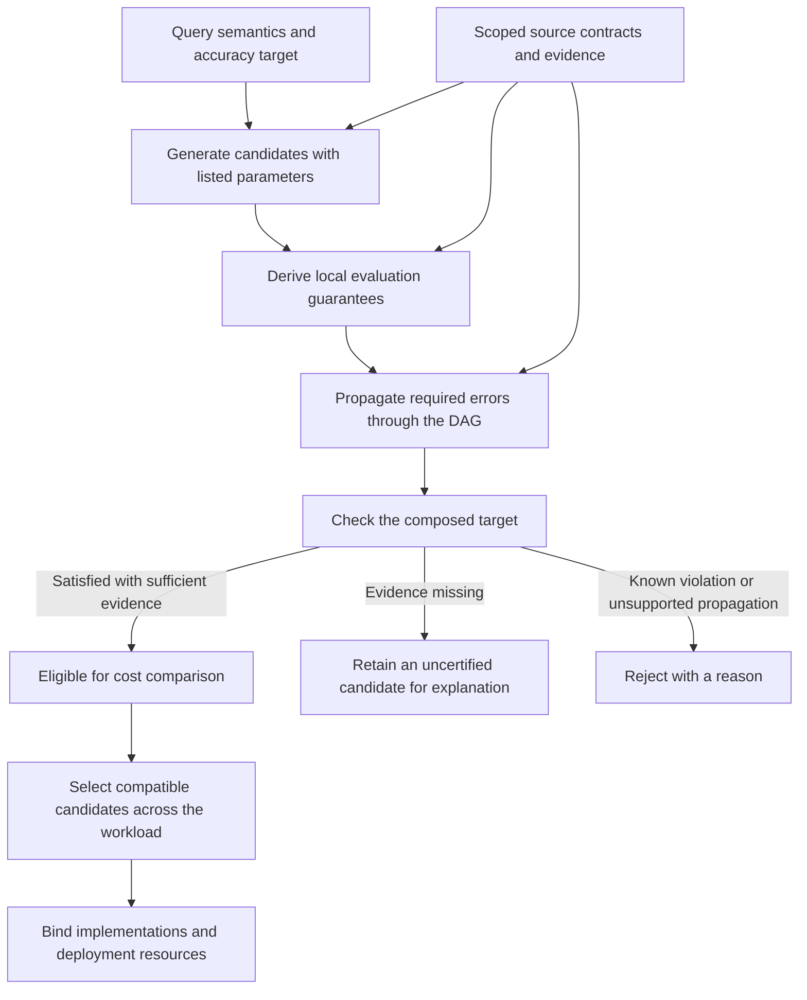
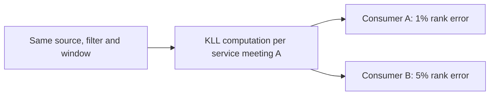

# Accuracy model design

## Purpose and ownership

The accuracy model answers whether a candidate computation can satisfy the
query's accuracy requirement, and what parameters and evidence it needs to do
so. Its unit of reasoning is the result of a computation, including the errors
of its inputs. A locally accurate sketch does not automatically make an entire
query accurate.

Planner owns the interpretation of accuracy targets, estimator models, error
propagation, readout requirements and candidate legality. Deployments provide
source contracts and evidence with a defensible scope. Cost models compare
resource costs; runtime implementations execute the selected semantics and
must honor the conditions attached to them.

This design applies to exact and approximate computation, composed queries and
shared DAGs. HLL is one estimator within this design, not a separate selection
system. Ingestion time and query time change where computation runs, not what
its accuracy guarantee means.

## Requirements, guarantees and evidence

These three concepts have different roles:

| Concept | Meaning | Owner |
|---|---|---|
| Accuracy target | What the caller requires of the result | Query requirements and aggregate intent |
| Result guarantee | What a particular computation can establish | Estimator models and error propagation in Planner |
| Evidence | Facts or trusted contracts needed to establish that guarantee | Source or deployment evidence provider |

`AccuracyTarget` is the authoritative requirement type:

- `AccuracyTarget::exact()` requires zero error and zero failure probability.
- `AccuracyTarget::max_error(ε)` constrains the error magnitude in the relevant metric; it does not specify a failure-probability budget.
- `.failure_probability(δ)` adds a failure-probability bound, so the target constrains both error magnitude and failure probability.
- `.accuracy_metric(m)` optionally fixes the metric ε is stated in; when it is unset, a guarantee in any metric that meets ε and δ is accepted.
- `.accuracy_scope(s)` sets which output values the (ε, δ) statement covers at once (below); the default is the whole result.

The target at a query root applies to the values its scope covers. An
aggregate's own target guides its local candidate construction. Nested local
targets do not replace the root requirement: the composed result must satisfy
it as well.

### Scope

A scope says which values of one evaluation's result must all be within ε at
once, with probability at least 1 − δ:

| `AccuracyScope` | JSON | Values covered (`V`) |
|---|---|---|
| `PerValue` | `"per_value"` | Each value on its own: `V = 1` |
| `WholeResult` (default) | `"whole_result"` | Every value of the result: `V = G`, the values one evaluation returns; unbound when neither every group key's distinct values nor, for a PromQL instant vector, the series count is declared, and always for a range vector and an ungrouped SQL result |
| `GroupsWithRecordShareAtLeast(share)` | `{"groups_with_record_share_at_least": 0.05}` | Every group (result row) holding at least `share` of the records the query aggregates in one evaluation: `V = min(⌊1 / share⌋, G)`, bound even when `G` is not; a smaller group is not covered |

The record-share scope is for queries that watch only their large groups, for
example an anomaly detector reading per-group distinct counts. `share` is a
fraction in (0, 1]; JSON rejects any other value, and one built in Rust
covers an unbound number of values, so its target stays unmet. More
than `⌊1 / share⌋` groups cannot each hold `share` of the records, so at most
100 groups qualify at 1% and 20 at 5%, whatever the number of groups. When a
row reads several aggregations, its group must hold the share of each one's
records. Groups below the share are not covered, so a guarantee over a
share meets a target over a larger share but not a per-value target, and only
a per-value guarantee is restated over a scope.

A scope bounds only the failure probability; the error bound is unchanged.
Every estimator produces a per-value guarantee (for a grouped
query, one per group: a Kmv or HLL distinct count per group, a KLL or DDSketch
quantile per group, a Count-Min or Count Sketch frequency per key, a Hydra
estimate per subpopulation; an exact value fails with probability 0). Stated
over a scope, a per-value failure probability `δ` becomes `V · δ` by the union
bound, without assuming independence, so a sketch shared by several groups
(Hydra, a keyed Count-Min) is covered the same way
(`AccuracyScope::max_values_covered` gives `V`). A guarantee whose own failure probability is
unknown (generic HLL) serves no query with an accuracy target
(`RootPruneReason::NoGuarantee`), and a top-k readout is admitted on its
heap size and its value guarantee alone (the contracts table).

Pass 2 gives each sketch readout the error and per-value failure probability
`δ / max(V, R)` it must meet, with `R` the readout group's values per
evaluation (the series its scans read): a `max` over 1000 readouts returns
one value yet fails when any readout does, so the union bound gives δ over
every readout read;
Pass 1's candidate takes the first requirement level and Pass 2 adds a copy
per further level. A readout several queries reach gets the union of their
levels. Pass 2 sizes nothing: a state has one build per listed θ, and each
edge checks the guarantee of its producer's θ at the required failure
probability, so a build several readers share serves the readers whose
levels its θ meets. Stage 3 only checks the guarantee; it never resizes. At equal
δ, the scope covering the most values is the strictest: every group (`G`,
when `G` is above 100), then a 1% share (100), then a 5% share (20), then a
single value (1). A whole-result target with an unbound `G`
enlarges nothing and stays unmet. A grouped result's `G` is bound by the
distinct values its sources declare for its group keys
(`SourceFacts.distinct_values_per_label`, and
`distinct_values_per_label_set` for labels that depend on each other): the
smallest product of declared label and label-set counts covering the keys, at
most the series read. With each of 625 endpoints in one of 25 services and
`(service, endpoint)` declared at 625, `by (service, endpoint)` returns at
most 625 values, not 25 x 625. A key counts only when it is a source column passed through
unchanged; a relabeled or computed key leaves `G` unbound. So a sketch meets a whole-result target over SQL groups when
every grouping column's distinct values are declared, and over 25 services
and 25 endpoints requires each group's sketch to meet `δ / 625`. Nothing declared
leaves `G` unbound; no default stands in for it.

An `AccuracyGuarantee` contains an error metric, an error-bound expression, a
failure-probability expression and provenance. The metric is essential:

| Metric | Quantity bounded |
|---|---|
| Absolute value | Distance from the true value, in its units |
| Relative value | Distance normalized by the magnitude of the true value |
| Rank | Quantile rank displacement normalized by population size |
| Cardinality | Relative error of a distinct count |
| Frequency | Point-frequency error normalized by the stream's L1 norm |
| L2 frequency | Point-frequency error normalized by the stream's L2 norm |
| TopK membership | Whether the selected key set equals the true TopK set |

For example, a small quantile rank error does not imply a small error in the
quantile's numeric value. Converting metrics requires an explicit justified
rule and any evidence that rule needs.

Bounds and probabilities can remain symbolic. An unknown population size,
normalization factor or failure probability stays unknown; it is not replaced
by zero. Provenance records that a value is exact, or the sketch evaluation with its
estimator parameters and contract.
This makes an accuracy decision explainable without reconstructing it from
query text or cost estimates.

## Planning flow



Candidate generation, certification, selection and deployment binding are
separate decisions. A candidate may remain in the plan space while awaiting
evidence. Current selection excludes candidates marked as missing accuracy
evidence; being present in that space does not authorize execution.

Planner can use an optimistic lower bound while enumerating candidates to
avoid discarding a potentially useful plan solely because evidence is missing.
That bound is a feasibility test, not the candidate's certificate. The original
unknowns remain in its guarantee. Known violations and unsupported propagation
rules are not repaired by optimistic enumeration.

The default target comparator checks only the dimensions requested by the
target; an epsilon-only comparison does not itself check delta. The separate
missing-evidence gate still matters during selection. A successful accuracy
check also does not prove that a runtime implements the plan, that stored state
is ready, or that a complete deployment cost is available.

## Local estimator models and parameter lists

A local model describes a specific evaluation of a specific estimator with
committed parameters and applicable assumptions. A family name or a parameter
such as HLL precision is not, by itself, a confidence certificate.

Planner does not size parameters for a target. Each algorithm has a listed
set of parameters θ; Planner derives the guarantee of each listed θ at the
required failure probability and checks it against the requirement.
Implementation limits or conservative probability bounds can make a listed θ
insufficient for a requirement; that θ then serves no reader that needs more.

The built-in models currently include:

| Model | Current accuracy contract and limits |
|---|---|
| Exact computation | Exact over exact inputs under the supported operation's semantics; approximate inputs still require error propagation |
| KLL | Normalized rank error from the empirical 99% calibration `2.296 / k^0.9723`, fitted on Apache DataSketches' C++ KLL (`a9b42755072b`); below a failure probability of 0.01 that error is scaled by the Gaussian quantile ratio `z(1 − δ/2) / z(1 − 0.01/2)`, a model rather than a measurement, and the guarantee names that contract apart |
| DDSketch | Relative value error from alpha under the supported estimator/domain contract; operators sensitive to sign or range require additional domain evidence |
| Generic HLL | RSE magnitude with unknown failure probability; not a general confidence theorem |
| CMS | L1-normalized frequency bound from width and depth; does not by itself certify TopK membership |
| CountSketch | L2-normalized frequency bound and median concentration bound, requiring valid odd depth |
| KMV | Provable distinct-count bound from the `k` smallest hashes |
| UnivMon | Exact unit-update total for the supported evaluation; no universal guarantee for all its statistics |
| Other families/evaluations | No default certificate where no accuracy model is registered |

This table describes Planner's registered contracts, not independent
mathematical verification of every estimator or permission to substitute
another implementation with the same algorithm name. In particular, a named
empirical calibration is different from an arbitrary benchmark's maximum
observed error; both its confidence and applicability must remain explicit.

The θ lists are each algorithm's predefined parameter list, `parameter_list`
(`crates/types/src/summary_type/parameter_lists.rs`), weakest first. Pass 1
and Pass 2 add one build per listed θ, and the logical-edge check keeps an
edge only when the guarantee of the producer's θ, at the readout's required
failure probability, is within the required error. Where an error bound grows
as the failure probability shrinks (a KLL's `k`), the same θ meets a reader
at 1e-2 and misses one at 1e-6; no θ is resized for a reader. Accuracy
validation is independent of cost: the guarantee is derived from the
committed parameters, and the cost model never grants accuracy authority.

## Propagating errors through a DAG

The accuracy crate supplies theoretical guarantees (`theoretical_guarantee`),
each operator's error contract (`error_propagation`) and the comparison limit
of a target (`target_limit`); the deployment's measurements
(`AccuracyEvidence::measured_guarantee`) take precedence over a theoretical
guarantee. Only a sketch readout introduces error. Every other operator
passes its inputs' errors on through a contract, and the contracts are
conservative: an operator with no contract for a metric fails the edge of an
input whose error is in that metric (`RootPruneReason::MetricRule`), so an
approximate value is never treated as exact.

A contract is a linear bound: the consumer's output error is at most
`Σ β_i · ε_i` over its inputs' errors `ε_i`, valid while each input stays
within its validity cap `b_i`. The principal contracts are:

| Operator | Contract |
|---|---|
| Sort, TimeRange, TimeShift, Concat, a readout, a finalize, a summary merge | `β = 1` in any metric |
| Filter on columns copied from a source (labels and keys) | `β = 1` in any metric; a filter comparing a computed value has none |
| Project | Judged on the items reading a computed value (labels, the time and the series identity are copied): `β = 1` in any metric for a copied column; absolute error, `β = 1`, for `abs`, `clamp`, `clamp_min`, `clamp_max` (also PromQL's `promql_` functions) and a negation; relative error, `β = 1`, for a product with or quotient by a nonzero constant |
| Aggregate or exact-accumulator build of counts, min, max, avg | Counts `β = 0`; min and max absolute or relative with `β = 1`; avg absolute with `β = 1`; only when every group-by key is copied from a source (a `by` key as listed; for `without`, every column but the time, the sample value and the excluded ones); none with measure filters or `HAVING`, or with a key reading an estimate |
| `+`, `-` | Absolute error, `β = 1` |
| `/` | Relative error, `β = 1/(1 − b)` on both operands, the denominator capped at `b` |
| `*` | Relative error, `β = (1 + b, 1)`, the right operand capped at `b` |
| Sum, comparison, ranking, counter rate or increase, any other function | No contract: the edge of an approximate input fails |
| Top-k over a sketch | Checked: the heap size is at least `k`, and the readout's value guarantee meets the requirement; membership has no check of its own |

`b` is `RELATIVE_OPERAND_VALIDITY_CAP`, 0.1, the weakest error of every
algorithm's list, so it never excludes a listed θ. For relative errors `x`
and `y` with `y ≤ b`, `(1 + x)(1 + y) − 1 ≤ (1 + b)·x + y`, and a ratio of
relative errors `a` over `b` is within `(a + b)/(1 − b)`. A relative bound
below 1 keeps zero at zero and keeps the sign, so a zero denominator gives the
same non-finite answer exactly and approximately. The ratio rule relies on
each operand's own relative guarantee (for DDSketch, its estimator contract:
one-signed values within the mapping's range). A sum or difference of
relative errors has no relative bound (cancellation), and a rank error (KLL)
has no value bound, so neither passes through division. Likewise, an exact
sum above approximate values retains their uncertainty: exact arithmetic does
not recover information lost below it.

Probability is not propagated through operators. A query's failure
probability is split into a per-value one for each readout; a composed query
whose readouts' failure events add up (a ratio of two quantiles) reads each at
a level of a failure-probability grid, and the levels sum within the query's
per-value failure probability by the union bound, without assuming
independence between child errors. Estimator-local assumptions, such as
independent bucket hashing, must be stated separately. Shared DAG nodes do
not create independent errors merely because several consumers reference
them, and sharing does not justify reducing the failure budget. Per-result
guarantees also do not imply a simultaneous guarantee across every query or
evaluation time in a dashboard.

## Readout requirements for composed queries

Pass 2 gives each readout the accuracy it is required to meet. A query's
target error is divided by the factors `β` of the consumers on the path from
the readout to the query root, and capped by the validity caps on the way: the
largest error the readout's output may have for that query.

- A query whose path reads one readout gives one requirement level: the
  target divided by the path's factor, at the target's failure probability per
  value.
- A composed query (several readouts, such as a ratio) gives every level of
  the error grid (10%, 5%, 2%, 1%, 0.5%, 0.2%, 0.1%) and the failure-probability
  grid (powers of ten from 1e-2 down to 1e-5, continued down to the first
  one at or below a tenth of the query's per-value failure probability) not
  looser than the cap. The logical-edge check then
  keeps the levels a producer's θ meets.
- A readout reached by several queries gets the union of their levels.
- A count reads no value (`β = 0`): the readouts below it get no level
  through it.
- A query whose target sets a failure probability with no per-value one
  (`n_q` or the readout's values per evaluation unknown) gives no level. A
  readout no query gives a level is pruned
  (`RootPruneReason::ValuesPerEvaluationUnknown`); one another query gives a
  level stays, and the query reads its group only exactly.

The metric rule cuts a readout's edge when no query reaching it accepts its
metric, a union over the queries. Per query, Pass 2 also lists the groups it
reaches through a consumer without a contract for its target's metric
(`LogicalASAPMemoCandidates::exact_only_groups_of_query`): with Q0 =
`p99 / p50` and Q1 = `p99 / p50 > 1` sharing the ratio, Q0 may read the
DDSketch readouts while Q1 reads the ratio and every group below it only
exactly. Stage 3 must enforce the list per query; Pass 2 only computes it.

An exact target gets no approximate level. A model with only a fixed 1%
failure contract cannot meet a level that needs a smaller failure probability;
another supported configuration or candidate is needed.

## Evidence and trust boundaries

`AccuracyEvidence` supplies the deployment's measured guarantees. The evidence must cover the population to which the
claimed guarantee applies: sources, filters, grouping, evaluation windows and
all merged tumbling windows. Evidence for a narrower population cannot silently certify
a wider one. Data-workload facts are declared: the planner has no clock, so the caller
drops facts that no longer hold before planning.

Source contracts are assertions that the source or deployment must establish
and enforce. They are not inferred from observed cardinality or sampled value
ranges. A source-specific deployment should supply those facts, rather than
reimplement estimator mathematics or candidate legality.

ERP benchmark results can inform resource costs and measured behavior.
A measured maximum error does not establish a failure probability. Benchmark
preference for cost estimation must therefore remain separate from accuracy
certification. If a model uses an empirical accuracy calibration, the contract
must identify its confidence level and scope rather than silently promoting
an observation into a guarantee.

### Example: HLL distinct counts

HLL's guarantee is its relative standard error, `1.04 / √m` for `m` buckets,
with an unknown failure probability. Its readout's metric is relative error,
but no failure probability can be evaluated, so a distinct count read from
HLL serves no query with an accuracy target
(`RootPruneReason::NoGuarantee`); KMV's distinct count, whose bound does not
depend on the number of distinct items, serves such a query. Missing evidence
leaves generic HLL confidence unknown. Invalid or infeasible contracts cannot
authorize the result.

## Sharing across consumers

Accuracy reconciliation considers semantically compatible consumers with
different accuracy requirements. A looser consumer may reuse a tighter
consumer's computation when the supported reconciliation rule proves that the
requirements, grouping and row identity permit it.

This creates an explicit reuse candidate and a dependency on the tighter
computation. It does not change ordinary common-subexpression equality, merge
queries with different semantics, or weaken the tighter consumer's target.
Global selection still coordinates compatible choices and accounts for shared
cost. The current reconciliation strategy does not reconcile exact and
approximate requirements merely by ordering their epsilon values.

### Example: two consumers of the same grouped quantile

Suppose two queries compute the 95th-percentile latency from the same source,
filter, time window and `service` grouping. They have identical output columns
and differ only in accuracy requirements:

| Consumer | Requested result | Rank error target | Failure-probability target |
|---|---|---|---|
| A | p95 latency per service | 1% | 1% |
| B | p95 latency per service | 5% | 1% |

Planner can propose building the tighter KLL computation required by A and
letting B read that same result. A result certified to 1% rank error also meets
B's 5% rank-error target, at the same confidence. The `service` grouping
provides the stable row identity required by the current reconciliation rule.
These percentages bound rank displacement, not latency-value error.



B's own candidate, a θ meeting only B, remains available. Global selection compares
that candidate with the reuse candidate and preserves the dependency on A's
tighter computation if it chooses reuse. Sharing is therefore an explicit
planning choice, not an unconditional rewrite or two separately charged builds.

This reconciliation does not apply if B instead asks for p99, uses a different
window or filter, or groups by another key: those queries differ in semantics,
not just accuracy. Nor does this example justify serving B at a failure target
of 0.1%; A's 1% failure guarantee would not meet it. A separate supported reuse
rule or a different estimator configuration would be needed in those cases.

When the consumers' failure targets differ, each reads the shared KLL at
its own required failure probability: a θ whose guarantee meets both
requirements serves both, and one meeting only the looser does not serve
the tighter consumer. No θ is resized for sharing.

## Organization and extension contract

The `asap_accuracy` crate separates these responsibilities:

```text
accuracy/src/
├── lib.rs              # Re-exports: the public interfaces
├── evidence.rs         # AccuracyEvidence: the deployment's measured accuracy
├── error_propagation.rs # error_propagation: each operator's error contract per
│                       # metric; metrics_carried
├── metric_rule.rs      # accepted_metrics, metrics_accepted_on_inputs (the
│                       # metric rule)
├── readout.rs          # readout_metric, sketch_readout_metric,
│                       # readout_metric_of_candidate: the metric of a
│                       # readout's error
├── readout_caps.rs     # readout_levels: caps through the error contracts, each
│                       # readout's required-accuracy levels; MAX_ERROR_LEVELS
├── logical_edge.rs     # producer_satisfies_logical_requirements (α^log);
│                       # target_limit, the requirement comparison
└── guarantee/
    ├── mod.rs          # theoretical_guarantee (one lookup at a failure
    │                   # probability per algorithm)
    ├── binomial.rs     # binomial_upper_tail
    ├── kll.rs
    ├── ddsketch.rs
    ├── hll.rs          # Generic HLL (unknown failure probability)
    ├── cms.rs
    ├── count_sketch.rs
    ├── cardinality.rs  # KMV model
    └── univmon.rs
```

Each estimator module owns its local accuracy formulas: the guarantee of a
listed θ at a failure probability. Unit tests sit next to the file they
test. The unified entry point delegates to these models; it does not
contain a second copy of their mathematics. Serializable guarantee and metric
types live in `asap-types` so planning, explanations and downstream binding
share the same contract.

Adding an estimator or an operator's error contract requires:

1. A precisely defined error metric, estimator/evaluation semantics and assumptions.
2. A θ list and a guarantee derived from each listed θ at a required failure probability, including unsupported parameter domains.
3. Explicit evidence requirements, population scope and provenance.
4. Propagation rules where supported; rejection or retained unknowns elsewhere.
5. Tests from target and evidence through the guarantee at the required failure probability, error propagation and selection, including missing evidence and infeasible targets.

Algorithm-specific mathematics belongs behind this common contract. It does
not require a new selection rule for every sketch. A deployment's measured
guarantees (`AccuracyEvidence`) carry the same obligation to justify
metrics, assumptions and propagation.

For implementation details, see the [accuracy crate](../../../crates/accuracy/src/lib.rs),
[guarantee representation](../../../crates/types/src/accuracy/guarantee.rs), and
[accuracy propagation companion](../../develop_docs/end-to-end-accuracy-guarantees.md).
