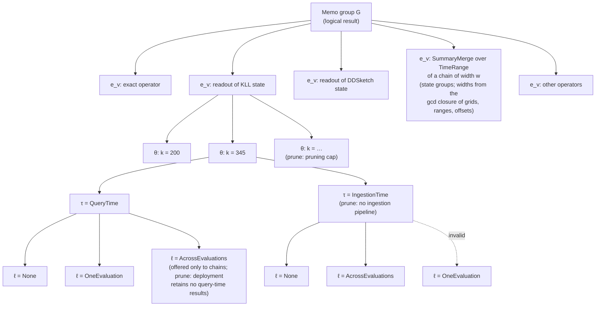

# Memo groups, properties and requirements

This document explains how the optimizer represents alternatives, checks whether they can be composed, and selects an executable plan. It follows the optimization problem formulation (paper, "Optimization Problem Formulation") for the baseline model and labels additional design work **Extension (#1207)**.

The Rust blocks are interface sketches, not compilable code. Paths name today's code; issue numbers name the work that changes it.

## 1. Model and running example

A **workload** contains query expressions, their evaluation schedules, and their accuracy targets. A **memo group** represents one logical result or one intermediate state family over specified input data. A **candidate** is one way to compute that result: one operator over input groups, together with its properties.

Input groups leave producer choices open. Selecting a candidate does not select its entire input plan. Each consumer input chooses a producer separately, and several inputs may choose the same producer.

The expression includes the operator's arguments, including the summary family. In this design, KLL and DDSketch states belong to separate state groups. A final-result group can offer readout candidates that use either family. So the decision tree's first level (Section 2) chooses the expression, family included; a state group never mixes families.

### Running example

Query A requests the p95 latency over one minute with a rank-error target. Query B requests p99 divided by p50 over the same input with a relative-error target. Both run every ten seconds.

| Group | Result | Candidate expressions |
|---|---|---|
| G1 | Raw latency input | `Scan latency[1m]` |
| G2 | KLL state over G1 | `SummaryAgg[KLL](G1)` with `k = 200` or `k = 345` |
| G2′ | DDSketch state over G1 | `SummaryAgg[DDSketch](G1)` with `alpha = 0.01` or `alpha = 0.02` |
| G3 | Query A output | `SummaryEstimate[q=0.95](G2)` |
| G4 | p99 latency | `SummaryEstimate[q=0.99](G2′)` |
| G5 | p50 latency | `SummaryEstimate[q=0.50](G2′)` |
| G6 | Query B output | `Divide(G4, G5)` |

KLL and DDSketch states are separate groups because the family is part of the expression. The metric rule of Section 4 decides which consumer may read which: KLL bounds **rank** error, which does not bound a quantile's value error or a ratio's relative error, so B's operands read the DDSketch state (relative value error), and A reads the KLL state.

G4 and G5 choose a G2′ producer independently. If both choose the same retained physical producer, they reuse one computed state when their schedules and windows are compatible. An unmaterialized candidate may instead execute separately in different contexts; Section 5 explains that distinction.

### Notation used by the baseline model

Symbols are collected here and in the sections that use equations. The prose and code use descriptive names.

| Symbol | Meaning |
|---|---|
| $\mathcal W$, $\mathcal Q$, $H$ | Workload, query set, and common evaluation horizon |
| $\mathcal T_q$, $A_q$ | Query evaluation schedule and accuracy target |
| $G$, $G_q$ | Memo group and query-output group |
| $v$, $u$, $c$, $i$ | Candidate, producer candidate, consumer candidate, and consumer input index |
| $e_v$, $p_v$ | Candidate expression and properties |
| $\boldsymbol\theta_v$, $\tau_v$, $\ell_v$ | Parameter configuration, execution timing, and result lifetime |
| $\mathcal I(c)$, $G_{c,i}$ | Consumer input indices and required group for one input |
| $r_{c,i}$ | Logical and physical requirements of one input |
| $\mathcal C$ | Physical candidate set |
| $\alpha^{\mathrm{log}}_{u,c,i}$, $\alpha^{\mathrm{phys}}_{u,c,i}$ | Fixed logical and physical compatibility indicators |

The candidate and property definitions are:

$$
v=(e_v,p_v), \qquad e_v=\operatorname{op}_v(G_{v,1},\ldots,G_{v,n_v}).
$$

$$
p_v=(p_v^{\mathrm{log}},p_v^{\mathrm{phys}}),\qquad
p_v^{\mathrm{log}}=\boldsymbol\theta_v,\qquad
p_v^{\mathrm{phys}}=(\tau_v,\ell_v).
$$

The formulation's text defines the producer set after the requirement check, and its notation table before it. This document follows the table and constraints (G)–(H), and names the filtered set separately:

$$
P_{c,i}=G_{c,i}\cap\mathcal C,
\qquad
P^{\mathrm{adm}}_{c,i}
=\{u\in P_{c,i}:\alpha^{\mathrm{log}}_{u,c,i}=\alpha^{\mathrm{phys}}_{u,c,i}=1\}.
$$

$$
\mathcal E=\{(u,c,i):c\in\mathcal C,\ i\in\mathcal I(c),\ u\in P_{c,i}\}.
$$

Here, group membership denotes the physical candidates belonging to that group. Property satisfaction means that both checks succeed; it is not a universal numerical ordering.

## 2. Properties and input requirements

A property describes what a candidate delivers. An input requirement describes what a consumer can accept. Workload requirements such as final accuracy and latency apply to the composed plan.

### Property dimensions

This is the single reference table for property dimensions. Stage descriptions below explain when these choices are made without repeating their definitions.

| Dimension | Values and meaning | Code reference or target |
|---|---|---|
| Parameters | A predefined configuration list per family: KLL and KMV `k`; DDSketch `alpha`; HLL `precision`; CMS and CountSketch `width` and `depth`; heap variants also `heap_size`; UnivMon its sizing parameters. The lists are today's sizing over ε = 0.1 down to 0.001; KMV's and UnivMon's distinct-count entries stop at ε = 0.01. UnivMon's list is the product of its 7 L2 column counts and its 4 distinct-count heap sizes, plus the baseline, so the per-parameter maximum of an L2 floor and a distinct-count floor is dominated by a listed entry. A heap variant combines each width × depth with heap sizes from the 1-2-5 series 10, 20, 50, …, 10 000: a top-k consumer's floor is heap_size ≥ k, and the smallest listed heap that meets it is the next step up, at most 2.5× too large. A sketch build's parameters must be in its family's list; exact operators have no sketch parameters. Hydra and the other families Pass 1 does not size have empty `parameter_list`s, so no build of theirs is a valid candidate until their error models exist (#1228). | `SketchParams` in `crates/types/src/ir/schema/sketch.rs`; predefined lists are the #1203 target |
| Timing | `IngestionTime` or `QueryTime` | `ExecutionTiming` |
| Lifetime | `None`: discard after the consuming execution; `OneEvaluation`: retain until consumers within that evaluation finish; `AcrossEvaluations`: retain across evaluations in the specified period. A non-`None` lifetime means materialized. | `Lifetime`; #1200 |
| Storage medium — Extension | `Memory` or `Disk`, carried by a materialized lifetime | `StorageMedium` |

Error guarantees are derived from parameters and the statistic being read. They include an error metric, a bound, and a failure probability; exact computation introduces no approximation error. The same state may support different readouts, so its guarantee must be interpreted for the relevant statistic.

The properties are the formulation's, $p_v^{\mathrm{log}}=\boldsymbol\theta_v$ and $p_v^{\mathrm{phys}}=(\tau_v,\ell_v)$; in code, `LogicalProperties { parameters }` and `PhysicalProperties { timing, lifetime }`.

**Tumbling windows are expressions, not properties.** A tumbling-window chain is its own memo group, `SummaryTumblingWindowChain[w](X)`, with the window width $w$ as an operator argument (Section 3, "Chain groups"). Every grid is anchored at phase 0 (the epoch), so the width alone fixes it. A query over a range reads the chain through `TimeRange` and `TimeShift` groups and merges the selected windows with `SummaryMerge`. No property carries the width, and two queries with different ranges or offsets share one chain group. Sliding merge/subtraction layouts remain future work; how many windows a chain retains is $h_v$ (Section 5).

### Logical requirements

The proposed `LogicalRequirements` stores a **parameter floor** $\boldsymbol\theta^{\min}$: the weakest parameters whose ε is at most the applicable input error cap, or a direct need such as heap_size ≥ k for a top-k. The floor is any value of the family's parameter type and need not be in the family's list; a listed producer satisfies it when $\boldsymbol\theta_u \succeq \boldsymbol\theta^{\min}$. Section 4 defines the cap and distinguishes validity from pruning. It does not allocate a fixed share of the query's error budget to each input.

For KLL, a larger `k` satisfies a smaller minimum `k`. For DDSketch, a smaller `alpha` can be stronger. Multi-parameter families require the family's comparison rule, including parameters needed for failure guarantees. A single floor is valid only if the accepted configurations form an upward-closed set with a representable least element. Otherwise, compatibility must use an explicit admissible set or predicate; it must not invent a unique minimum.

The required input group's identity already constrains the state family and data/window semantics. An exact producer satisfies an approximation floor only if it is also a valid producer of that group and input type.

### Physical requirements

Physical requirements are derived from the consumer's timing and execution context, rather than stored redundantly. Stage 2 checks timing against lifetime (the table below). Stage 3 checks alignment per context (below), with the schedule of the context the consumer runs in.

| Consumer timing | QT, None | QT, OneEvaluation | QT, AcrossEvaluations | IT, None | IT, AcrossEvaluations |
|---|---|---|---|---|---|
| QueryTime | Allowed | Allowed | Allowed | Rejected | Allowed |
| IngestionTime | Rejected | Rejected | Rejected | Allowed | Allowed |

QT means QueryTime; IT means IngestionTime. Alignment, data coverage, and retention checks still apply to allowed combinations.

**Alignment.** There is no physical schedule property. When a result can be read follows from its lifetime and, for a chain, its window width:
- **None** and **OneEvaluation**: the result is computed inside one evaluation context κ (Section 5) and read there. A OneEvaluation result belongs to one context: queries with equal recurrence and range evaluation are evaluated together, and that evaluation's consumers share the result. When it runs is the context's schedule, and Stage 3 chooses it through $x_{\kappa,v}$, just as for ℓ = None. Sharing across differently scheduled queries through a gcd schedule is not offered: it is rarely beneficial and wastes runs.
- **AcrossEvaluations** is offered only to chain candidates, `SummaryTumblingWindowChain[w](X)`: the input is cut into tumbling windows (k·w, (k+1)·w], with the grid anchored at phase 0 (the epoch). Windows are left-open and right-closed like a PromQL range, which `m[r]` evaluated at t reads as (t − r, t]. Each window is built when it ends and can be read from then on. A `TimeRange` over the chain selects the windows that lie fully inside (t − range, t], so a consumer can read a range whose ends lie on window boundaries. With w = 10 s, a `[1m]` query evaluated every 30 s at phase 0 merges 6 windows; one evaluated at phase 15 s cannot, because its range ends inside a window; with that query in the workload, the gcd closure also offers w = 5 s, which both can read. Every other candidate, including the `TimeRange` and `TimeShift` groups over a chain, is computed within one evaluation.

A grid phase is not needed: a phase is absorbed by the width, because width candidates come from the gcd closure of the queries' grids, ranges and offsets (Section 3). For example, phases 0 and 5 s with w = 10 s give w = 5 s. Alignment alone does not ensure sufficient retained history; that is $h_v$ (Section 5).

**Why a chain needs a declared phase.** Take `sum_over_time(m[5m])` evaluated every 60 s, and a 60 s chain with windows (12:00:00, 12:01:00], (12:01:00, 12:02:00], …

| Case | Evaluation at | Data needed | Windows |
|---|---|---|---|
| Phase 0 declared | 12:05:00 | (12:00:00, 12:05:00] | exactly the 5 windows (12:00, 12:01] … (12:04, 12:05]: the merge is correct |
| No phase declared; the engine actually evaluates at second 17 | 12:05:17 | (12:00:17, 12:05:17] | (12:00, 12:01] holds only 43 s of the range and (12:05, 12:06] only 17 s: merging only full windows misses (12:00:17, 12:01:00] and (12:05:00, 12:05:17]; adding the partial windows counts (12:00:00, 12:00:17] and (12:05:17, 12:06:00] too. Both answers are wrong |
| Phase 15 s declared | 12:05:15 | (12:00:15, 12:05:15] | the widths divide gcd(60 s, 5 m, 15 s) = 15 s; with w = 15 s the range is exactly 20 windows |

Prometheus staggers rule-group evaluations by a hash of the group, so a fixed interval without a declared phase does not mean phase 0. One rule decides both sides: `QueryRecurrence::evaluation_grid_ms` returns `None` for a `FixedInterval` without a phase. Pass 2 then offers that query no chain width, and `delivers_on` lets it read no chain. Workloads declare the phase with `FixedIntervalAt { interval, evaluation_phase }` to use chains.

An evaluation context κ is described by the workload's own recurrence and range evaluation (Section 5). Let a chain producer have tumbling width $w$. A consumer running in κ can read the producer when $w$ divides every evaluation time of κ:

| Producer lifetime, or κ's recurrence for a chain producer with ℓ = AcrossEvaluations | Required alignment |
|---|---|
| None | Always: runs in κ |
| OneEvaluation | The result belongs to κ |
| `FixedIntervalAt { interval, evaluation_phase }`, range step $s$ | $w \mid \gcd(\text{interval}, s, \text{phase})$, the evaluation grid; $s$ counts only for a range evaluation of more than one step |
| `Scheduled(times)` | $w$ divides every time (and $s$) |
| `OneTime { execute_at: Some(t) }` | $w \mid t$ (and $s$) |
| `FixedInterval` without a phase, `OneTime { execute_at: None }`, `EstimatedRate`, `Unknown` | Never: the evaluation times are not known, and `evaluation_grid_ms` is `None` |
| AcrossEvaluations on a candidate that is not a chain | Not offered: only chain candidates are materialized across evaluations |

The evaluation grid is `QueryRecurrence::evaluation_grid_ms(range_evaluation)` in `crates/types/src/workload/mod.rs`, which Pass 2's chain widths and `delivers_on` both use. One-off queries are supported: each is a context of its own recurrence, run `invocations` times.

### Invalid combinations

The checked constructor rejects one combination:

| Combination | Reason |
|---|---|
| IngestionTime with OneEvaluation | No query evaluation lifetime at ingestion time |

A tumbling grid's width is an argument of the chain operator, part of the expression, and its phase is 0, so no property repeats or extends it.

### Decision tree and order of decisions

A memo group's candidates are the leaves of a tree. The first level chooses the expression $e_v$ (operator and family); each later level decides one property dimension. A path from the root to a leaf is one physical candidate.



| Level | Decides | Stage | Values offered | Pruned when |
|---|---|---|---|---|
| 1 | expression $e_v$, including a merge over a chain of width $w$ | Pass 1 and Pass 2 rules | each way to compute the group; chain widths from the gcd closure of the reaching queries' grids, ranges and offsets | no reaching query has a known grid (no chain is offered) |
| 2 | $\boldsymbol\theta_v$ | Pass 1 | the family's predefined list | the pruning cap (Section 4); dead-candidate elimination (Section 3) |
| 3 | $\tau_v$ | Stage 2 | QueryTime, IngestionTime; IngestionTime for a counter state only when the source's out-of-order bound is known (Stage 2) | the source has no ingestion pipeline; QueryTime over raw rows the deployment does not retain |
| 4 | $\ell_v$ | Stage 2 | None, OneEvaluation, AcrossEvaluations; AcrossEvaluations only for chain candidates, and Disk only where the deployment offers it | invalid with $\tau_v$; the deployment retains no query-time results |

The planner does not check whether an executor implements an operator or family: every candidate the rules produce is offered, and an executor that lacks one is extended. A value outside a dimension's declared value set (AcrossEvaluations on a candidate that is not a chain, Disk where the deployment has no disk storage) is not offered, so it is not recorded as pruned.

The tree does not decide which producer each consumer input reads ($y$), in which context a candidate with ℓ = None or OneEvaluation runs (Section 5), or how much an AcrossEvaluations candidate retains ($h_v$). Those are Stage 3 choices.

**The order does not change the candidate set.** The leaves are the product of the dimensions' values minus invalid combinations and pruned values. Each prune rule reads only the value it removes and values decided above it, so any order that keeps each prune rule below the dimensions it reads yields the same leaves.

**The order changes how many nodes enumeration visits:** $\sum_d \prod_{d' \le d} \lvert \text{values left at } d' \rvert$. Dimensions that prune much go early; dimensions that multiply without pruning go late. The order above follows four rules:

1. **Logical before physical.** Stage 1 hash-conses groups and computes $\alpha^{\log}$ once, before Stage 2 multiplies each logical candidate by its physical alternatives.
2. **Strong prunes early.** The pruning cap and dead-candidate elimination act before physical properties multiply the tree.
3. **Dependent dimensions adjacent.** $\tau \to \ell$ rejects the invalid combination at the first level that can detect it.
4. **Deployment-wide prunes as early as possible.** Without an ingestion pipeline the IngestionTime subtree is pruned once per candidate; moving $\tau$ above $\boldsymbol\theta$ would prune it once per group, with the same leaves.

Alternative orders worth measuring: $\tau$ first, when most sources lack an ingestion pipeline; and requirement-driven (top-down) enumeration, which visits fewer nodes but must take the union of all consumers' requirements so that sharing is not lost.

## 3. Pipeline: interfaces and rules

| Stage | Input | Output | Responsibility |
|---|---|---|---|
| Stage 0 | Query IR | `Memo` (groups without candidates) | Hash-cons logical expressions |
| Stage 1, Pass 1 | Group DAG | `Memo` | Add initial logical candidates and intermediate groups |
| Stage 1, Pass 2 | Memo | `LogicalASAPMemoCandidates` | Add rollup, top-k and chain alternatives, set parameter floors, eliminate dead candidates, and compute logical edges |
| Stage 2 | Logical memo candidates | `PhysicalASAPMemoCandidates` | Expand physical alternatives and compute compatibility |
| Stage 3 | Physical memo candidates | `DagOfSelectedCandidates` | Select implementations, dependencies, and executions |
| Realizer/export | Selected DAG | `PhysicalASAPDAG` | Build and export the executable graph |

Enumeration follows the decision tree in Section 2. Accuracy pruning uses only the caps of Section 4.

Rules add groups through `find_or_add_group` and candidates through `add_candidate`. They match group expressions, avoid duplicating an existing expression/property pair, and do not copy consumers to make a new producer visible. After logical generation finishes, edge construction records the possible producer choices.

### Stage 0: groups

`memo_of_queries` in `crates/stage0-memo` builds the groups bottom-up from the queries' nodes: each node's operator, over its children's groups, goes through `Memo::find_or_add_group`, so identical sub-expressions are one group; each query's root is then added with `Memo::add_query`. Stage 0 and Stage 1 share one type, `Memo`: Stage 0 returns it with every group's candidate list empty, and Stage 1 fills the lists.

```rust
pub struct MemoGroupId(pub u32);

pub struct MemoGroup {
    /// What it computes: one operator with its arguments. Each `MemoGroupId`
    /// in it is an input group, never this group's own id.
    pub expression: Operator<MemoGroupId>,
    /// Derived once when the group is created, from its input groups'
    /// `expression` and `group_properties` (optd/TiDB-style); never changes.
    pub group_properties: GroupProperties,
    pub parents: Vec<MemoGroupId>,
    pub queries: Vec<usize>,
    // Empty after Stage 0; populated by Stage 1.
    pub candidates: Vec<CandidateForMemoGroup>,
}

pub struct GroupProperties {
    pub schema: Schema,
    pub result_kind: OperatorResultKind,
    /// What an aggregate group covers: a summary state, a chain, a merge
    /// over a chain's windows, or an exact `Aggregate` result; `None` for
    /// any other group.
    pub aggregate_coverage: Option<SummaryCoverage>,
    /// Whether two equal expressions return the same rows for the same
    /// input rows, so they may be one group (not an unordered `LIMIT`).
    pub shareable_when_equal: bool,
}

/// What a summary state or exact aggregate computes, with every lifted
/// selection removed.
pub struct SummaryStateDefinition {
    /// The group the operators below read: the first input under the
    /// SummaryAgg (or Aggregate) that is not Filter / TimeRange / TimeShift
    /// / direct-column Project. `None` only when a Scan's predicates are
    /// lifted; the Scan, with its residual predicates, is then the last
    /// unlifted operator.
    pub input_group: Option<MemoGroupId>,
    /// The operators not lifted into the selection, listed top down from
    /// the SummaryAgg (or Aggregate), each with only its residual arguments. `None` marks
    /// an operator's main input (the next unlifted operator, or input_group);
    /// `Some(g)` is another input group it reads, such as the group a scalar
    /// subquery in a Filter reads. Two states may merge only if input_group
    /// and these operators are equal.
    pub unlifted_operators: Vec<Operator<Option<MemoGroupId>>>,
}

pub struct SummaryCoverage {
    pub(crate) definition: SummaryStateDefinition,
    /// Union of boxes over the output rows of the operators' input.
    pub(crate) selection: Vec<SelectionBox>,
}

impl SummaryCoverage {
    pub(crate) fn derive_from_inputs(
        operator: &Operator<MemoGroupAsInput<'_>>,
    ) -> Result<Self, CoverageError>;
    /// A hash of the `SummaryStateDefinition`; equal definitions in one
    /// memo get equal ids.
    pub(crate) fn definition_id(&self) -> String;
}

pub struct Memo {
    // Private: groups are added only through `find_or_add_group`, so the
    // hash-consing index covers every group.
    groups: Vec<MemoGroup>,
    pub query_roots: Vec<QueryRoot<MemoGroupId>>,
    // Private: the groups `find_or_add_group` may return, by expression hash.
    groups_by_expression_hash: HashMap<u64, Vec<MemoGroupId>>,
}

impl Memo {
    pub fn groups(&self) -> &[MemoGroup];
    /// Adds a query with this root; its groups and those below list it.
    pub fn add_query(&mut self, root: QueryRoot<MemoGroupId>) -> usize;
}
```

How the definition and selection are derived, with examples: `docs/design_docs/proposals/asap-primitive-schema.md` §4.2.2.

The rules read an operator's inputs through one trait, so the same rules derive a front-end node's schema and a group's `GroupProperties`:

```rust
pub(crate) trait OperatorInput: Sized {
    fn schema(&self) -> &Schema;
    fn result_kind(&self) -> OperatorResultKind;
    /// The input's own operator, its children as inputs again.
    fn operator(&self) -> Operator<Self>;
    fn aggregate_coverage(&self) -> Option<&SummaryCoverage>;
}
// Front-end node trees; aggregate_coverage is None.
impl OperatorInput for Rc<OperatorNode> { … }
/// A memo group read as an input: its group_properties and expression.
pub(crate) struct MemoGroupAsInput<'m> { memo: &'m Memo, group_id: MemoGroupId }
impl OperatorInput for MemoGroupAsInput<'_> { … }

// The existing rules, generic over the input; existing names kept.
impl<I: OperatorInput> Operator<I> {
    pub(crate) fn output_schema(&self) -> Result<Schema, SchemaDerivationError>;
    pub(crate) fn output_kind(&self) -> OperatorResultKind;
    pub(crate) fn validate_inputs(&self) -> Result<(), SchemaDerivationError>;
    pub(crate) fn is_shareable_when_equal(&self) -> bool;
}
fn derive_group_properties(
    memo: &Memo,
    expression: &Operator<MemoGroupId>,
) -> Result<GroupProperties, SchemaDerivationError>;
```

Aggregate coverage exists only in the memo: a node tree has none, and `SummaryCoverage` has no type parameter. The executor reads only `definition_id` from the plan.

A group is its expression: one operator, with its arguments, over input groups. Hash-consing compares and hashes the expression directly, so two expressions are one group when their operators and arguments are equal and their input groups are the same. θ is not an operator argument, so builds that differ only in θ share one group. An expression whose copies may return different rows (an unordered `LIMIT`) always gets a new group.

Everything that was computed on operator-node trees is computed on groups. `find_or_add_group` derives `GroupProperties` once, when the group is created, with `derive_group_properties`: the rules that check operator nodes (schema derivation, input validation, merge check), applied to the expression over `MemoGroupAsInput`s, which read only the input groups' `expression` and `group_properties`, never a node tree:

- `schema` and `result_kind` from the operator and its input groups' schemas and result kinds; a scalar subquery reads the referenced group's schema.
- `aggregate_coverage`, for a summary state or an exact `Aggregate` result: walking down from the SummaryAgg or Aggregate through the input groups' expressions while each is a Filter, a TimeRange, a TimeShift (without `@` or with `@ T`; `@ end()` and `@ start()` are not lifted, see below) or a direct-column Project, lifting their predicates into the selection; a TimeRange or TimeShift becomes an interval on the timestamp column (below). The group below them is the definition's `input_group`. A Scan's predicates (PromQL label matchers, SQL filters, including absolute timestamp filters) are lifted too; the Scan with its residual predicates is then the last unlifted operator and `input_group` is `None`. The operators not lifted, each with its residual arguments, are `unlifted_operators`. A chain `SummaryTumblingWindowChain[w](X)` has the definition of a build over X and leaves the timestamp column unconstrained; a `TimeRange` or `TimeShift` over a chain constrains it as over raw rows. A merge's coverage comes from its inputs' stored coverage; a merge is valid only over inputs with equal definitions and disjoint selections, or over one time-indexed state. So the coverage of `SummaryMerge(TimeRange(TimeShift(Chain[w](X))))` equals that of `SummaryAgg(TimeRange(TimeShift(X)))`, and `add_candidate` accepts the merge in the original state group.
- The checks that read an input's operator (a merge over a time-indexed state reads a `TimeRange` over a chain; a selected build) read the input group's `expression`.
- `shareable_when_equal`: a `LIMIT` is shareable over a `Sort` with the same partitions (the input group's `expression`); a `Dedup` on every column (the input group's schema).

`add_candidate` derives a candidate's properties with the same `derive_group_properties` and requires its schema and result kind to equal the group's. `OperatorNode` recursively contains chosen child nodes and therefore describes a fixed plan fragment; `Operator<MemoGroupId>` contains input group IDs and leaves their implementations open. A candidate needs its own expression because a group may offer several ways to compute the same result.

Removing the one-field `CandidateExpression` wrapper is possible but not adopted.

#### Column lineage

Every output column of a group has a **lineage**: the source column its values are copied from, or none when the column is computed. It is a group property, derived once from the input groups' lineage (as optd's column-reference property is), and it replaces the table qualifier that schema fields carried. A schema field keeps only its name, type and nullability; a front end resolves a qualified name such as `f.src` with its own binding scope while it lowers the query, and the IR never needs the qualifier again.

```rust
pub struct GroupProperties {
    pub schema: Schema,                          // fields: name, type, nullability; no table qualifier
    pub result_kind: OperatorResultKind,
    /// One entry per output column, in schema order.
    pub column_lineage: Vec<ColumnLineage>,
    pub aggregate_coverage: Option<SummaryCoverage>,
    pub shareable_when_equal: bool,
}

/// A column of a source (a Scan's table or metric), by name.
pub struct SourceColumn {
    pub source: String,
    pub column: String,
}

/// Where an output column's values come from.
pub enum ColumnLineage {
    /// Copied unchanged from a column of a source.
    SourceColumn(SourceColumn),
    /// Computed by an operator: a measure, an expression, a summary state or readout.
    Computed,
}

/// Aggregate coverage keys its selections by the same type. The timestamp
/// column is one of the columns; there is no separate time field.
pub struct SelectionBox {
    pub columns: BTreeMap<SourceColumn, Constraint>,
}

/// A constraint on one column of a selection.
pub enum Constraint {
    In(Vec<ScalarValue>),
    NotIn(Vec<ScalarValue>),
    /// Each end is `Included`, `Excluded` or `Unbounded`.
    Interval {
        lower: Bound<IntervalConstraintLimit>,
        upper: Bound<IntervalConstraintLimit>,
    },
}

/// An end of an interval. Two limits compare only within one variant.
pub enum IntervalConstraintLimit {
    /// A constant: `Float64(10.0)` for `price > 10`; `Timestamp(ms since the
    /// epoch)` for `@ T` or a SQL timestamp literal.
    FixedValue(ScalarValue),
    /// The evaluation time t plus this many ms (negative: before t); only on
    /// the timestamp column.
    EvaluationTimePlusMs(i64),
}
```

A repeatedly evaluated query covers different absolute times at every evaluation, so its group's coverage is written relative to the evaluation time t (`EvaluationTimePlusMs`); an `@ T` modifier or a SQL timestamp filter is absolute (`FixedValue(Timestamp)`). Both are intervals on the timestamp column, compared and lifted like any other column constraint; a value column such as `price` uses `FixedValue` ends. A PromQL range `m[r]` evaluated at t reads the samples in (t − r, t]: left-open, right-closed.

| Query fragment | `lower` | `upper` |
|---|---|---|
| `m[5m]` | `Excluded(EvaluationTimePlusMs(-300_000))` | `Included(EvaluationTimePlusMs(0))` |
| `m[5m] offset 1h` | `Excluded(EvaluationTimePlusMs(-3_900_000))` | `Included(EvaluationTimePlusMs(-3_600_000))` |
| `m[5m] @ end()` or `@ start()`, instant query | as `m[5m]`: both equal t, and the PromQL front end lowers them as no `@` | |
| `m[5m] @ end()` or `@ start()`, range query | not lifted: the `TimeShift` stays in `unlifted_operators` | |
| `m[5m] @ 1700000000` | `Excluded(FixedValue(Timestamp(1_699_999_700_000)))` | `Included(FixedValue(Timestamp(1_700_000_000_000)))` |
| SQL `WHERE ts >= '2026-11-01'` | `Included(FixedValue(Timestamp(..)))` | `Unbounded` |
| SQL `WHERE price > 10` (column `price`) | `Excluded(FixedValue(Float64(10.0)))` | `Unbounded` |

A range-evaluated query evaluates its expression at every step t of [start, end]. `@ end()` and `@ start()` pin a subtree to one end of that interval, so the subtree reads the same rows at every step while a plain `m[5m]` reads different rows at every step; the two are not equal coverage, and the `@` subtree is not shared. Evaluating `@` subtrees once per request and sharing them is future work (#1251).

**Derivation, per operator** (from the input groups' `column_lineage`):

| Operator | Output column lineage |
|---|---|
| `Scan` | each column: `SourceColumn(SourceColumn { source, column })` |
| `Filter`, `TimeRange`, `TimeShift`, `Sort`, `Limit`, `Dedup` | the input's, unchanged |
| `Project` | a column item, renamed or not: that input column's lineage; an expression item: `Computed` |
| `Aggregate`, `SummaryAgg`, readouts | group-by keys: the input's lineage of that key; measures, states and values: `Computed` |
| `SummaryTumblingWindowChain` | `window_end` (column 0): `Computed`; keys: the input's lineage of that key; state: `Computed` |
| `Join` | the left input's columns, then the right input's |
| `SetOp`, `Concat` | per column: the inputs' lineage if they all agree, else `Computed` |
| `BinaryOp` (vector match) | label columns: the matched side's lineage; the value: `Computed` |

**What reads it:**
- **Summary coverage.** A selection constrains columns keyed by their `SourceColumn` lineage, not by (qualifier, name). A predicate on a `Computed` column is not lifted; it stays in `unlifted_operators`. A merge's group keys must have equal lineage.
- **Candidate checks.** `add_candidate` compares a candidate's schema with its group's exactly: names, types, nullability, order. There is no qualifier to compare, so a readout renamed to the group's column name matches.

**Example 1: a SQL aggregate and its summary candidate.**

```sql
SELECT f.src, approx_distinct(f.dst) FROM flows f WHERE f.proto = 'tcp' GROUP BY f.src
```

| Group | Expression | Output columns | `column_lineage` |
|---|---|---|---|
| G1 | `Scan flows` | `src, dst, proto, ts` | `flows.src, flows.dst, flows.proto, flows.ts` |
| G2 | `Filter(proto = 'tcp')(G1)` | `src, dst, proto, ts` | same as G1 |
| G3 | `Aggregate(by src; approx_distinct(dst))(G2)` | `src, approx_distinct(dst)` | `flows.src, Computed` |
| G4 | `SummaryAgg[HLL](by src; dst)(G2)` | `src, state` | `flows.src, Computed` |
| G5 | `SummaryEstimate[cardinality](G4)` | `src, cardinality` | `flows.src, Computed` |
| — | candidate of G3: `Project(src, cardinality AS approx_distinct(dst))(G5)` | `src, approx_distinct(dst)` | `flows.src, Computed` |

The candidate's schema equals G3's, so `add_candidate` accepts it. Before lineage, G3's key carried the qualifier `flows` and the renaming `Project` could not keep it on one column while renaming another, so this candidate was rejected.

**Example 2: renames keep lineage.**

```sql
SELECT source, count(*) FROM (SELECT f.src AS source FROM flows f) GROUP BY source
```

The inner `Project` renames `src` to `source`; its lineage stays `flows.src`. Two summary states, one grouped by `source` here and one grouped by `src` in another query, have keys of equal lineage, so a merge of the two may pass the group-key check. Compared by (qualifier, name), `source` and `flows.src` looked like different columns.

**Example 3: the same name from two sources.**

```sql
SELECT s.region, count(*) FROM sales s JOIN users u ON s.user = u.id GROUP BY s.region
```

After the join, `region` may exist on both sides. The front end resolves `s.region` to the left input's column while lowering; in the IR the two columns have lineage `sales.region` and `users.region`, so a selection on `sales.region` is never confused with one on `users.region`.

**Example 4: PromQL label matchers.** `quantile_over_time(0.9, latency{job="api"}[1m])` and the same with `job="web"`. Each Scan's `job` column has lineage `latency.job`. The lifted matchers become selections `latency.job ∈ {api}` and `latency.job ∈ {web}`: disjoint selections on the same column, so the two KLL states may merge.


### Stage 1, Pass 1: initial candidates

Implementation locations: `crates/logical-asap-optimization/src/pass1/per_computation_candidates.rs` and `memo_population.rs`. The #1203 target gives every intermediate result its own group; candidates contain one operator rather than private operator chains.

| Alternative | Added representation |
|---|---|
| Exact | Exact candidate in the result group |
| Exact accumulator | Accumulator-state group plus a finalize candidate in the result group |
| Summary | One state group per supported family; one build candidate per listed parameter configuration; separate readout candidates |

Pass 1 candidates carry no parameter floors, not even a top-k's heap_size ≥ k: Pass 2 sets every floor once all candidates exist.
| Fused build | Several operators of one sub-DAG pattern, in one appearance of the sub-expression, fused into one candidate operator; `fused_groups` lists the groups of the operators it replaces |

```rust
pub struct CandidateForMemoGroupId {
    pub group: MemoGroupId,
    /// Position in the group's `candidates` list.
    pub index_in_group: usize,
}

impl Memo {
    /// The group of `expression` (operator, arguments and input groups),
    /// added if new. Fails when the expression breaks the node rules
    /// (schema derivation, input validation, merge check).
    pub fn find_or_add_group(
        &mut self,
        expression: Operator<MemoGroupId>,
    ) -> Result<MemoGroupId, SchemaDerivationError>;

    /// Adds `candidate` to `group`, or returns the id of the candidate there
    /// with the same expression and logical properties. The candidate's
    /// expression is checked by the same node rules as a group's, and its
    /// output schema and kind must equal the group's; a rejected candidate
    /// leaves the memo unchanged.
    pub fn add_candidate(
        &mut self,
        group: MemoGroupId,
        candidate: CandidateForMemoGroup,
    ) -> Result<CandidateForMemoGroupId, CandidateError>;

    pub fn candidate(&self, id: CandidateForMemoGroupId) -> &CandidateForMemoGroup;

    /// Replaces candidate `id`'s input requirements r^log_{c,i}, one per
    /// input group. The only way to change a candidate's r^log: Pass 2 sets
    /// each parameter floor from the input's caps and direct needs after the
    /// rules have run. Panics when the vector does not have one entry per
    /// input group.
    pub fn set_input_requirements(
        &mut self,
        id: CandidateForMemoGroupId,
        input_requirements: Vec<LogicalRequirements>,
    );
}

pub enum CandidateError {
    /// The candidate's expression fails the node rules (schema derivation,
    /// input validation, merge check).
    Schema(SchemaDerivationError),
    /// Its output schema or output kind differs from the group's: it does
    /// not compute the group's result.
    OutputDiffersFromGroup { group: MemoGroupId },
}

pub struct CandidateExpression {
    pub operator: Operator<MemoGroupId>,
}

pub struct CandidateForMemoGroup {
    pub expression: CandidateExpression,
    pub logical_properties: LogicalProperties,
    /// r^log_{c,i}, one per input group; changed only through
    /// `Memo::set_input_requirements`.
    pub input_requirements: Vec<LogicalRequirements>,
    /// The groups of the operators this candidate fuses: a sub-DAG pattern
    /// of several operators, in one appearance of the sub-expression,
    /// computed by this one operator. Empty for a candidate that fuses
    /// nothing.
    pub fused_groups: Vec<MemoGroupId>,
    // Diagnostic provenance; not a planning decision.
    pub origin: OriginOfCandidateForMemoGroup,
}

pub struct LogicalProperties {
    parameters: Option<SketchParams>,
}

impl LogicalProperties {
    /// Rejects parameters missing on a sketch build (a chain included),
    /// present on an exact operator, or not in the family's list (which
    /// also rejects another family's parameters).
    pub fn new(
        expression: &CandidateExpression,
        parameters: Option<SketchParams>,
    ) -> Result<Self, LogicalPropertiesError>;

    pub fn parameters(&self) -> Option<&SketchParams>;
}

pub fn parameter_list(family: SketchAlgorithm) -> &'static [SketchParams];

pub struct LogicalRequirements {
    parameter_floor_for_required_accuracy: Option<SketchParams>,
}

impl LogicalRequirements {
    /// Any floor of the family's parameter type, listed or not.
    pub fn new(parameter_floor_for_required_accuracy: Option<SketchParams>) -> Self;

    pub fn parameter_floor_for_required_accuracy(&self) -> Option<&SketchParams>;
}

pub fn producer_satisfies_logical_requirements(
    producer: &LogicalProperties,
    requirement: &LogicalRequirements,
) -> bool;
```

The floor representation has the applicability condition stated in Section 2. Creating requirements also needs the input family's configuration domain; a constructor without that context can validate only the information encoded in its argument. Error-model interfaces are grouped with accuracy in Section 4.

**Fused groups.** A fused candidate computes, as one operator, a sub-DAG pattern of several operators in one appearance of the sub-expression; `fused_groups` lists the groups of the operators it replaces. Reusing a common sub-expression across appearances is Pass 2's reuse, not fusion. Fusion rules:
- top-k (a sort and limit over an aggregate, as one heap summary);
- sum over sum, min over min, max over max (distributive aggregates, as one aggregate).

Hydra is not a fusion: it is a rollup strategy of the finest-common-group rule (Pass 2, Example 4).

TODO: revisit each fused candidate's inputs and outputs to check that the fusing rules are correct.

Migration targets: remove private `root_node` chains, duplicate `input_groups`, and `accuracy_budget_parts`. The proposed predefined parameter lists replace sizing one candidate per budget partition.

### Stage 1, Pass 2: reuse rules and logical edges

Pass 2 (`crates/stage1-pass2-reuse-candidates`) runs these steps in order:

| Step | What it does | Why it is here |
|---|---|---|
| 1. Rollup from the finest common group | Adds candidates that compute a coarser group from a finer one, and synthesizes one finest common group per cluster of equal definitions | Its candidates are new consumers that later steps must see |
| 2. Top-k reuse | Reads a compatible larger top-k result with an exact-input requirement | Same reason |
| 3. Reach, caps and floors | Computes which queries reach each candidate along candidate edges, the validity and pruning caps (Section 4), and each input's parameter floor, written with `Memo::set_input_requirements` | Needs every consumer added by steps 1 and 2 |
| 4. Dead-candidate elimination | Removes candidates no query can use, transitively, and records the root cause of each | Needs the floors; keeps step 5 from building windows for dead candidates |
| 5. Chain groups | Adds tumbling-window chain groups and the merges that read them, with widths from the queries that reach each state group | Needs the reach of step 3, including rollup consumers, and only the survivors of step 4 |
| 6. Logical edges | Records every (producer, consumer, input) and whether it satisfies the input's logical requirement | Runs on the final memo |

Rules match group expressions, add groups with `find_or_add_group` and candidates with `add_candidate`, and never copy consumers to make a new producer visible.

#### Rollup from the finest common group

One rule computes a coarse group $G_c$ from a finer group $G_f$. It covers coarser SQL aggregates, coarser summary states, filtered sketch rollups, rollups of finalized values, and scan widening. $G_c$ can be computed from $G_f$ when all of these hold:

1. **Equal definition.** Both have an `aggregate_coverage` and equal `definition`s: the same computation over the same input rows, apart from the selection.
2. **Rows are a subset.** $G_c$'s selection is inside $G_f$'s. Where it is narrower, the narrowing constrains only columns that are group-by keys of $G_f$ (matched by column lineage), so a compensating `Filter` over $G_f$'s output can select those rows. A `Filter` over state rows keeps them states.
3. **Keys are coarser.** $G_c$'s keys are a subset of $G_f$'s keys, by lineage.
4. **A rollup exists.** States roll up with `SummaryMerge(group_by)`. Finalized values roll up as follows; anything else rolls up only from states:

   | Finer measure | Coarser measure |
   |---|---|
   | sum | sum |
   | count | sum |
   | min / max | min / max |
   | avg, quantile, top-k, distinct count | only from states |
5. **Equal time constraints.** The constraints on the timestamp column are equal. A longer range is read from a shorter one's windows through a shared chain (below), not by this rule.

The candidate added to $G_c$ is `Rollup(by keys of Gc)(Filter(compensation, Gf))`, without the `Filter` when the selections are equal. The compensation must use only key columns because each output row of $G_f$ has already combined all raw rows of its key: a predicate on any other column, or on a computed value, cannot separate them.

**Finest common group.** For every cluster of at least two groups with equal definitions and equal time constraints, the rule synthesizes one group $G^*$ that every member can roll up from:
- its selection is, per column, the union of the members' constraints;
- its keys are the union of the members' keys, plus every column on which some member's selection is narrower than $G^*$'s, so each member's compensation uses only $G^*$'s keys.

$G^*$ is added with `find_or_add_group`, so it is an existing group when one matches, and each member gets a rollup candidate from it. Only this finest group is synthesized; intermediate groupings are not enumerated. $G^*$ is no query's output: Stage 3 selects it only when it is cheaper, and it is eliminated in step 4 when nothing reads it.

A Scan has no aggregation, so for scans every column is a key and the rollup step is empty: the finest common Scan reads the union of the members' label or column selections, and each member reads it through a compensating `Filter`/`Project`.

**Example 1: filtered sketch rollup.** F = `quantile by (job, host)(…latency[5m])`, C = `quantile by (host)(…latency{job="api"}[5m])`.

| Group | Expression | Coverage (definition, selection) | Keys | Candidates |
|---|---|---|---|---|
| G1 | `Scan latency` | | | |
| G2 | `TimeRange(5m, G1)` | | | |
| G3 | `SummaryAgg[KLL, by job, host](G2)` | D, `ts` ∈ (t − 5m, t] | job, host | builds |
| G4 | `Scan latency{job="api"}` | | | |
| G5 | `TimeRange(5m, G4)` | | | |
| G6 | `SummaryAgg[KLL, by host](G5)` | D, `ts` ∈ (t − 5m, t], `job` ∈ {api} | host | builds; **`SummaryMerge(by host)(G7)`** |
| G7 | `Filter(job = "api", G3)` | | | its own expression; output is states |

The definitions are equal, the narrowing `job ∈ {api}` is on a key of G3, {host} ⊆ {job, host}, and KLL states merge. G3 is already the finest group of the cluster {G3, G6}, so $G^*$ = G3. A query `quantile by (host)(…latency{status="500"}[5m])` gets no such candidate: `status` is not a key of G3, and every state already mixes status 200 and 500 samples.

**Example 2: rollup of a finer finalized sum.** F = `sum by (job, instance)(rate(x[1m]))`, C = `sum by (job)(rate(x[1m]))`.

| Group | Expression | Keys | Candidates |
|---|---|---|---|
| G3 | `rate(x[1m])` per series | | |
| G4 | `Aggregate(by job, instance; sum)(G3)` | job, instance | exact; finalize of an exact accumulator state |
| G5 | `Aggregate(by job; sum)(G3)` | job | exact; finalize of an exact accumulator state; **`Aggregate(by job; sum)(G4)`** |

Both are exact `Aggregate` groups with equal definitions and selections, so they have `aggregate_coverage` too. Stage 3 chooses by cost between reading F's finalized result (cheap when it is materialized) and merging accumulator states.

**Example 3: finest common group that no query asks for.** Q1 = `quantile by (host)(latency[5m])`, Q2 = `quantile by (job)(latency{host="xxx"}[5m])`.

| Group | Expression | Coverage (definition, selection) | Keys | Candidates |
|---|---|---|---|---|
| G1 | `SummaryAgg[KLL, by host](TimeRange 5m, Scan latency)` | D, all | host | builds; **`SummaryMerge(by host)(G*)`** |
| G2 | `SummaryAgg[KLL, by job](TimeRange 5m, Scan latency{host="xxx"})` | D, `host` ∈ {xxx} | job | builds; **`SummaryMerge(by job)(G3)`** |
| **G\*** | `SummaryAgg[KLL, by job, host](TimeRange 5m, Scan latency)` | D, all | job, host | builds |
| G3 | `Filter(host = "xxx", G*)` | | | its own expression |

The hull of {all, host ∈ {xxx}} is all; the keys are {host} ∪ {job} ∪ {host}, where the last `host` is the column on which G2 is narrower. Stage 3 chooses between two KLL builds and one build of G\* with job × host states.

**Rollup by subpopulation readout (Hydra).** When $G^*$ is built with an algorithm that answers any subset of its keys directly (the Hydra algorithms: `HydraKll`, `HydraCms`, `HydraCountSketch`; a capability in `SummaryTypeCapability`), a member does not need a `SummaryMerge`: its **readout group** gets a candidate that reads the subpopulation straight from $G^*$'s state. A KLL rollup happens at the state level (merge the states, then read); a Hydra rollup happens at the readout level (read each subpopulation from one shared structure). This needs `SummaryEstimate` to name the keys it reads the subpopulation by (`subpopulation_keys`), which it cannot express today; both are added when Hydra is back in scope.

**Example 4: Hydra as a rollup strategy.** Q1 = `quantile by (job)(0.99, latency[5m])`, Q2 = `quantile by (host)(0.99, latency[5m])`, Q3 = `quantile by (job, host)(0.99, latency[5m])`; 10 jobs, 1 000 hosts, 5 000 (job, host) pairs present.

| Group | Expression | Candidates |
|---|---|---|
| G2 | `TimeRange(5m, Scan latency)` | |
| S_jh (= G\*) | `SummaryAgg[by job, host](G2)` | one `Sketch(Kll)` build per θ (one KLL per pair); one `Sketch(HydraKll)` build per θ (one shared structure) |
| S_j | `SummaryAgg[by job](G2)` | `Sketch(Kll)` builds; **`SummaryMerge(group_by job)(S_jh)`** (valid when S_jh is built with KLL) |
| S_h | `SummaryAgg[by host](G2)` | `Sketch(Kll)` builds; **`SummaryMerge(group_by host)(S_jh)`** (KLL) |
| R_jh ← Q3 | `SummaryEstimate(p99)(S_jh)` | reads S_jh |
| R_j ← Q1 | `SummaryEstimate(p99)(S_j)` | reads S_j; **`SummaryEstimate(p99, subpopulation_keys: [job])(S_jh)`** (valid when S_jh is built with Hydra) |
| R_h ← Q2 | `SummaryEstimate(p99)(S_h)` | reads S_h; **`SummaryEstimate(p99, subpopulation_keys: [host])(S_jh)`** (Hydra) |

Stage 3 chooses among:

| Plan | Built | States | Extra work per query |
|---|---|---|---|
| ① separate | S_jh, S_j, S_h with KLL | 5 000 + 10 + 1 000 KLLs | none |
| ② KLL and merge | S_jh with KLL; S_j, S_h merged from it | 5 000 KLLs | Q1 merges 5 000 KLLs into 10, Q2 into 1 000 |
| ③ Hydra | S_jh with HydraKll; all three read it | one structure, its size set by θ, not by the number of pairs | one subpopulation query per group |

With many pairs and queries ③ is cheapest; with few pairs ① or ② can be. Hydra's error per subpopulation follows from its θ and enters (K) on the edges like any readout's.

#### Reach, caps and floors

A query reaches a candidate when a path of candidate edges leads from the query's output group to it; this is the reach $a_{q,v}$, computed top down after steps 1 and 2 so that rollup consumers count. Section 4 defines the caps from it. Each input's floor is the strongest of the floor for its cap (`floor_for_cap` in `asap-accuracy`) and any direct need such as heap_size ≥ k under a top-k. `Memo::set_input_requirements` writes it; nothing else changes a candidate's r^log.

#### Dead-candidate elimination

A candidate that is not a query output is **dead** when it never had a consumer, or when every edge to a consumer fails: the producer is below the input's floor, the metric rule forbids the edge (Section 4), or the consumer is dead. Elimination repeats until nothing changes. Dead candidates get no logical edges and Stage 2 does not expand them; each is recorded with its root causes:

```rust
pub struct LogicalASAPMemoCandidates {
    pub memo: Memo,
    pub edges: Vec<LogicalEdge>,
    pub pruned: Vec<PrunedLogicalCandidate>,
}

/// A candidate eliminated by Pass 2.
pub struct PrunedLogicalCandidate {
    pub candidate: CandidateForMemoGroupId,
    /// Every cause: one per failing edge it is cut off by, so mixed causes
    /// (a floor on one edge, the metric rule on another) are all listed.
    pub causes: Vec<PruneCause>,
}

/// One path from the candidate, through consumers that are themselves
/// eliminated, to the edge that fails. One shortest path per failing edge.
pub struct PruneCause {
    /// The eliminated consumers on the path, nearest first.
    pub through_pruned_consumers: Vec<CandidateForMemoGroupId>,
    pub root: RootPruneReason,
}

pub enum RootPruneReason {
    /// The producer's parameters are weaker than the consumer input's floor.
    BelowAccuracyFloorRequirement {
        consumer: CandidateForMemoGroupId,
        input: usize,
        floor: SketchParams,
    },
    /// The consumer's error contract carries none of the producer's metrics.
    MetricRule {
        consumer: CandidateForMemoGroupId,
        input: usize,
        producer_metric: AccuracyMetric,
        consumer_carries: Vec<AccuracyMetric>,
    },
    /// The candidate never had a consumer and is not a query output. A
    /// candidate whose consumers were eliminated is traced to their causes.
    NoConsumer,
}
```

**Example: ratio of quantiles.** `quantile_over_time(0.99, m[5m]) / quantile_over_time(0.5, m[5m])` with relative error 0.05.

| Group | Expression | Candidates |
|---|---|---|
| G1 | `Scan m` | |
| G2 | `TimeRange(5m, G1)` | |
| G3 | `SummaryAgg[KLL](G2)` | #0 … #6: k = 132 … 2863 |
| G3′ | `SummaryAgg[DDSketch](G2)` | #0 … #6: alpha = 0.1, 0.05, 0.02, 0.01, 0.005, 0.002, 0.001 |
| G4 | p99 | #0 exact; #1 `SummaryEstimate[q=0.99](G3)`; #2 `SummaryEstimate[q=0.99](G3′)` |
| G5 | p50 | #0 exact; #1 `SummaryEstimate[q=0.5](G3)`; #2 `SummaryEstimate[q=0.5](G3′)` |
| G6 | `Divide(G4, G5)` | #0, the query output |

The Divide carries only relative error. Its inputs' cap is 0.05 / 1.111 = 0.045 (Section 4), so the DDSketch readouts' floor is alpha ≤ 0.02. Pass 2 records:

```
G4#1 SummaryEstimate[q=0.99](G3)
  G4#1 → G6#0 input 0: MetricRule { producer_metric: Rank, consumer_carries: [Relative] }
G5#1 SummaryEstimate[q=0.5](G3)
  G5#1 → G6#0 input 1: MetricRule { producer_metric: Rank, consumer_carries: [Relative] }
G3#0 SummaryAgg[KLL] k=132          (and likewise G3#1 … G3#6)
  G3#0 → G4#1 → G6#0 input 0: MetricRule { producer_metric: Rank, consumer_carries: [Relative] }
  G3#0 → G5#1 → G6#0 input 1: MetricRule { producer_metric: Rank, consumer_carries: [Relative] }
G3′#0 SummaryAgg[DDSketch] alpha=0.1  (and likewise G3′#1, alpha=0.05)
  G3′#0 → G4#2 input 0: BelowAccuracyFloorRequirement { floor: alpha 0.02 }
  G3′#0 → G5#2 input 0: BelowAccuracyFloorRequirement { floor: alpha 0.02 }
```

The KLL builds' own edges satisfy their consumers; they are dead because their only consumers are, and the trace leads through those consumers to the metric rule. The exact candidates and the DDSketch builds with alpha ≤ 0.02 survive.

#### Chain groups

A state group whose expression is `SummaryAgg(TimeRange(W, TimeShift*(X)))` can be computed from a chain of tumbling windows over X:

```rust
// The chain: one row per window and key, (window_end, keys…, state): a State
// with a time index. Column 0, `window_end`, is the time index, computed
// (lineage `Computed`); the build's own time column is dropped; the unique
// key is (window_end, keys). No range and no window count: how much it
// retains is h_v.
SummaryTumblingWindowChain { child: X, family, input, reduction, grouping, filter,
                             tumbling_window_width_ms: u64 }
// Merges every input state, or regroups them; no window-selection field.
SummaryMerge { children, group_by }
```

`TimeRange` and `TimeShift` accept a time-indexed state: over a chain, `TimeRange(W)` at evaluation time t selects the windows lying fully inside (t − W, t], and `TimeShift(o)` moves that interval to (t − o − W, t − o]. A `TimeRange` over a chain must be a range (`TimeRangeKind::Range`); an instant one is a validation error. This needs w to divide W and o, and t to lie on the grid; the widths below and `delivers_on` (Section 2) ensure both. The `TimeRange` and `TimeShift` groups over a chain have only their own expression as a candidate and are computed within one evaluation; only the chain is materialized across evaluations.

**The rule, for each width w of a state group S:**
1. Walk down from S: `SummaryAgg` → `TimeRange(W)` → zero or more `TimeShift`s → X.
2. `find_or_add_group(SummaryTumblingWindowChain[w](X))` → $G_w$. The shifts are stripped, so queries with different ranges and offsets over the same X get the same $G_w$.
3. Re-wrap the stripped shifts and then the `TimeRange` around $G_w$, in their original order, each with `find_or_add_group`.
4. `add_candidate(S, SummaryMerge(…))` over the outermost re-wrapped group. Its coverage equals S's (Section 3, Stage 0), so the candidate is accepted.

There is one chain per width, shared by every state group over the same X and family.

**Widths.** Each query q that reaches S (step 3) and repeats with a known evaluation grid $g_q$ (`evaluation_grid_ms` is `Some`) gives the width $\gcd(g_q, W, o_1, \ldots)$, with the offsets $o_j$ on its path; S's widths are the gcd closure of these. Queries without a known grid give none, so a group read only by such queries gets no chain. `@` modifiers:
- `@ end()` and `@ start()` in an instant query equal t; the front end lowers them as no `@`, so they need nothing here.
- `@ end()` and `@ start()` in a range-evaluated query are not lifted (Section 3), so the walk stops at their `TimeShift` and the state group gets no chain.
- `@ T` (absolute) contributes no widths: S gets a merge only over chains that other queries' widths created, and only for widths that divide T. Whether reusing the chain is cheaper than computing the result once and materializing it is Stage 3's choice; its retention need is in Section 5.

**Example: three queries share one chain.** A = `sum_over_time(m[5m])`, B = `sum_over_time(m[5m] offset 1h)`, C = `sum_over_time(m[1h])`, each `FixedIntervalAt { 60 s, phase 0 }`. The widths are gcd(60 s, 5m) = gcd(60 s, 5m, 1h) = gcd(60 s, 1h) = 60 s.

| Group | Expression | Candidates |
|---|---|---|
| G1 | `Scan m` | |
| G3a | `SummaryAgg[Sum](TimeRange(5m, G1))` | build; **`SummaryMerge(Ga)`** |
| G3b | `SummaryAgg[Sum](TimeRange(5m, TimeShift(1h, G1)))` | build; **`SummaryMerge(Gb)`** |
| G3c | `SummaryAgg[Sum](TimeRange(1h, G1))` | build; **`SummaryMerge(Gc)`** |
| **Gw** | `SummaryTumblingWindowChain[Sum, w = 60 s](G1)` | one build per θ |
| Ga | `TimeRange(5m, Gw)` | its own expression |
| Gs | `TimeShift(1h, Gw)` | its own expression |
| Gb | `TimeRange(5m, Gs)` | its own expression |
| Gc | `TimeRange(1h, Gw)` | its own expression |

At t = 12:00, Ga selects the 5 windows (11:55, 11:56] … (11:59, 12:00], Gb the 5 windows (10:55, 10:56] … (10:59, 11:00], and Gc 60 windows. Each sample updates one chain instead of three, and the chain retains max(5m, 1h + 5m, 1h) = 65m, 65 windows (Section 5).

**Example: the rule step by step, for B.** Before the rule:

| Group | Expression |
|---|---|
| G1 | `Scan m` |
| G2 | `TimeShift(1h, G1)` |
| G3 | `TimeRange(5m, G2)` |
| G4 | `SummaryAgg[Sum](G3)`: B's state group, one build candidate |

1. Walk down from G4: `SummaryAgg` reads G3; G3 is `TimeRange(W = 5m)` over G2; G2 is `TimeShift(1h)` over G1; G1 is not a shift. So W = 5m, the shifts are [`TimeShift(1h)`], X = G1.
2. `find_or_add_group(SummaryTumblingWindowChain[Sum, w = 60 s](G1))` → Gw. A and C get the same Gw.
3. `find_or_add_group(TimeShift(1h, Gw))` → Gs; `find_or_add_group(TimeRange(5m, Gs))` → Gb.
4. `add_candidate(G4, SummaryMerge(Gb))`.

After the rule, G4 has two candidates, the build and `SummaryMerge(Gb)`; G2 and G3 stay. With widths {30 s, 60 s}, steps 2–4 run once per width, giving two chains and two merge candidates in G4; Stage 3 chooses.

#### Logical edges

```rust
fn apply(memo: &mut Memo) -> Result<(), Pass2RuleError>;

pub struct LogicalEdge {
    pub producer_candidate_id: CandidateForMemoGroupId,
    pub consumer_candidate_id: CandidateForMemoGroupId,
    pub input_index_of_consumer: usize,
    pub satisfies_logical_requirement: bool,
}
```

An edge satisfies the logical requirement when the producer meets the input's floor and the consumer's error contract carries the producer's metric (Section 4).

### Stage 2: physical alternatives

`enumerate_candidate_configurations` in `crates/stage2-physical-optimization/src/catalog/configurations.rs` expands each logical candidate that survived Pass 2 using the dimensions and checks in Section 2. It offers ℓ = AcrossEvaluations only to chain candidates; the other candidates never get that value, and nothing is recorded for them. It creates no new logical candidates. Each logical edge is expanded between the relevant physical alternatives.

Stage 2 reads the logical candidates, the data workload (per-source arrival, below) and the deployment's capabilities:

```rust
// crates/stage2-physical-optimization/src/catalog/mod.rs
pub fn generate_physical_asap_memo_candidates(
    logical: &LogicalASAPMemoCandidates,
    data: &DataWorkload,
    capabilities: &DeploymentCapabilities,
) -> PhysicalASAPMemoCandidates;   // Stage 2 cannot fail
```

#### Data arrival

```rust
// crates/types/src/workload/mod.rs
pub enum DataArrival {
    /// Every row is already stored; no build runs at ingestion time.
    AtRest,
    /// Rows keep arriving while the queries run.
    Ingesting { rows_per_second: f64, max_out_of_order_ms: Option<u64> },
    /// Older rows are stored and new rows keep arriving.
    Mixed { rows_per_second: f64, max_out_of_order_ms: Option<u64> },
    /// Not declared: no build runs at ingestion time.
    Unknown,
}
```

`max_out_of_order_ms` bounds how late a row may arrive relative to the newest row of its series.

**Counter states at ingestion time.** A counter state (`rate`, `increase`, `irate`) needs each series' samples in timestamp order to detect resets. It may still run at ingestion time: the ingestion data plane keeps a per-series reorder buffer that holds `max_out_of_order_ms` of rows and releases them in order. The buffer's memory, about rows per second × out-of-order bound × bytes per row, is part of that build's cost. For `rate(c_total[5m])` with 100,000 samples/s, a 2 s bound and 16 B per row, the buffer is about 100,000 × 2 × 16 B ≈ 3.2 MB. When `max_out_of_order_ms` is `None`, a PromQL source is taken to arrive in order (bound 0, no buffer); a SQL source gets no ingestion-time counter build, because SQL rows have no ordering guarantee.

**Filtered builds at ingestion time.** A filtered build needs no extra rule. α^phys already requires an ingestion-time build's input to be produced at ingestion time; the build reads each input row with all its columns and evaluates the filter before updating the state. For SQL `sum(x) FILTER (WHERE region = 'eu')` over `Join(events, hosts)`, the build runs at ingestion time only when the join does; it then reads each joined row, checks `region`, and adds `x` for the rows that pass.

#### Prune reasons

Stage 2 records every alternative it rejects, with one of these reasons; Stage 3 adds its own.

| Reason | Rejects |
|---|---|
| `NoIngestionPipeline` | IngestionTime when the source has no ingestion pipeline |
| `RawDataNotRetained` | QueryTime over raw rows the deployment does not retain |
| `QueryTimeResultsNotRetained` | QueryTime with ℓ = OneEvaluation or AcrossEvaluations when the deployment retains no query-time results |
| `InputHasNoBuildableProducer` | a candidate for which some input has no surviving producer that satisfies α^phys |
| `ReachesNoQueryOutput` | a candidate from which no admissible path leads to a query root |

The planner does not check executor support, so no reason names it.

```rust
// crates/types/src/physical/properties.rs
pub enum ExecutionTiming {
    IngestionTime,
    QueryTime,
}

pub enum StorageMedium {
    Memory,
    Disk,
}

pub enum Lifetime {
    None,
    OneEvaluation(StorageMedium),
    AcrossEvaluations(StorageMedium),
}
pub struct PhysicalProperties {
    timing: ExecutionTiming,
    lifetime: Lifetime,
}
impl PhysicalProperties {
    /// Rejects only (IngestionTime, OneEvaluation).
    pub fn new(
        timing: ExecutionTiming,
        lifetime: Lifetime,
    ) -> Result<Self, PhysicalPropertiesError>;
    pub fn timing(&self) -> ExecutionTiming;
    pub fn lifetime(&self) -> Lifetime;
    pub fn is_materialized(&self) -> bool;
}

impl PhysicalCandidate {
    /// Whether a consumer running in `context` can read this producer
    /// (Section 2's alignment table): for a chain producer with
    /// ℓ = AcrossEvaluations, w (the chain operator's width) divides every
    /// evaluation time of the context (`evaluation_grid_ms`); true for ℓ = None, and for OneEvaluation in the
    /// same context.
    pub fn delivers_on(&self, memo: &Memo, context: &ExecutionContext) -> bool;
}
/// α^phys: timing and lifetime only (Section 2's table). Alignment is
/// checked per context in Stage 3 with `delivers_on`.
pub fn producer_satisfies_physical_requirements(
    producer: &PhysicalCandidate,
    consumer: &PhysicalCandidate,
) -> bool;
pub struct PhysicalCandidateId(pub usize);
pub struct PhysicalEdgeId(pub usize);

pub struct PhysicalCandidate {
    pub logical_candidate_id: CandidateForMemoGroupId,
    pub physical_properties: PhysicalProperties,
}
pub struct PhysicalEdge {
    pub producer_candidate_id: PhysicalCandidateId,
    pub consumer_candidate_id: PhysicalCandidateId,
    pub input_index_of_consumer: usize,
    pub satisfies_logical_requirement: bool,
    pub satisfies_physical_requirement: bool,
}
pub struct PhysicalASAPMemoCandidates {
    pub logical_candidates: LogicalASAPMemoCandidates,
    pub physical_candidates: Vec<PhysicalCandidate>,
    pub pruned_candidates: Vec<PrunedCandidate<PhysicalCandidate>>,
}
/// A rejected alternative and why; the candidate names its group
/// through its logical candidate, so no separate group field.
pub struct PrunedCandidate<C> {
    pub candidate: C,
    pub reason: PruneReason,
}
impl PhysicalASAPMemoCandidates {
    /// Query roots are read from `logical_candidates`, not copied.
    pub fn new(
        logical_candidates: LogicalASAPMemoCandidates,
        physical_candidates: Vec<PhysicalCandidate>,
        edges: Vec<PhysicalEdge>,
        pruned_candidates: Vec<PrunedCandidate<PhysicalCandidate>>,
    ) -> Self;
    pub fn edges(&self) -> impl Iterator<Item = (PhysicalEdgeId, PhysicalEdge)>;
    pub fn admissible_edges_into(
        &self,
        consumer: PhysicalCandidateId,
        input_index_of_consumer: usize,
    ) -> &[PhysicalEdgeId];
    pub fn admissible_edges_out_of(
        &self,
        producer: PhysicalCandidateId,
    ) -> &[PhysicalEdgeId];
}
```

`PhysicalCandidateId` indexes an emitted candidate. A pruned alternative is stored as its `PhysicalCandidate` value, which has no ID, so diagnostics can explain each prune. The admissible-edge accessor returns edge IDs, not the unfiltered producer set from Section 1. `delivers_on` takes a candidate and the memo rather than bare properties because a tumbling grid's width is an argument of the chain operator in the candidate's expression.

Migration targets include replacing `Materialization` and duplicated physical fields with checked properties, and replacing `ReaderConstraint::{IncompatibleOutputs, AllowedOutputs}` with compatibility and alignment checks. `ReaderConstraint::{MinimumQueryReaders, HighestSharedQueryMaterialization}` are deleted too; see Section 5.

### Stage 3: baseline selection and realization

The baseline uses the formulation's variables and constraints. Stage 3 adds no candidates or potential dependencies.

| Variable | Meaning |
|---|---|
| $x_v$ | Candidate selected |
| $y_{u,c,i}$ | Producer supplies the specified consumer input |
| $z_{q,v}$ | Candidate supplies the query output |
| $t_v$ | Topological rank |

| Constraint | Meaning | Encoding |
|---|---|---|
| (A) | One producer per selected consumer input | $\sum_{u\in P_{c,i}}y_{u,c,i}=x_c$ |
| (B) | Chosen producers are selected | $y_{u,c,i}\le x_u$ |
| (C) | One output per query | $\sum_{v\in G_q}z_{q,v}=1$ |
| (D) | Output candidates are selected | $z_{q,v}\le x_v$ |
| (E) | Acyclic dependencies | $t_u+1\le t_c+\lvert\mathcal C\rvert(1-y_{u,c,i})$ |
| (F) | Selected candidates are used | $x_v\le\sum_{(v,c,i)\in\mathcal E}y_{v,c,i}+\sum_{q:v\in G_q}z_{q,v}$ |
| (G) | Logical compatibility | $y_{u,c,i}\le\alpha^{\mathrm{log}}_{u,c,i}$ |
| (H) | Physical compatibility | $y_{u,c,i}\le\alpha^{\mathrm{phys}}_{u,c,i}$ |
| (I) | Domains | $x_v,y_{u,c,i},z_{q,v}\in\{0,1\}$; $0\le t_v\le\lvert\mathcal C\rvert-1$ |

Constraints are applied for every relevant candidate, input, query, or potential edge. An implementation may allocate edge variables only on admissible edges, making (G) and (H) implicit without changing the baseline feasible set.

The baseline objective charges each selected candidate a fixed cost over the common horizon:

$$
\min\sum_{v\in\mathcal C}w_vx_v.
$$

The cost includes input reading, the candidate's own computation, and lifetime-dependent retention. It excludes producers' computation, which is charged at those producers. This objective assumes execution frequencies and retention costs are fixed before optimization and independent of the selected consumers. When that assumption does not hold, use the execution extension in Section 5; do not silently reuse the same cost coefficient.

```rust
struct SelectionVariables {
    x: Vec<Variable>,
    y: HashMap<PhysicalEdgeId, Variable>,
    z: HashMap<(QueryId, PhysicalCandidateId), Variable>,
    t: Vec<Variable>,
}

// Schematic constraint-building entry points; signatures omitted.
// input_satisfaction_constraints: (A)
// producer_selection_constraints: (B)
// query_coverage_constraints: (C), (D)
// acyclicity_constraints: (E)
// utilization_constraints: (F)
// Compatibility is enforced when allocating y on admissible edges.

pub struct SelectedEdge {
    pub producer: SelectedNodeId,
    pub consumer: SelectedNodeId,
    pub input_index_of_consumer: usize,
}

pub struct DagOfSelectedCandidates {
    pub candidate_of_node: Vec<PhysicalCandidateId>,
    pub edges: Vec<SelectedEdge>,
    pub node_of_output_reference: Vec<SelectedNodeId>,
}
```

The realizer uses the selected dependencies to build the executable graph. Export carries each node's timing and lifetime. Under the context extension, multiple selected execution nodes may refer to the same physical candidate; realization must preserve their contexts rather than merge them solely by candidate ID.

## 4. Accuracy and safe pruning — Extension (#1207)

The formulation checks logical requirements per edge. This extension also checks composed accuracy at each query root. This section gives the error model and its MILP encoding; error is not a property dimension.

### Local propagation

For a consumer, an error function bounds output error from input errors:

$$
\varepsilon_c\le g_c(\varepsilon_{c,1},\ldots,\varepsilon_{c,n}).
$$

Use **beta** for local input factors and **lambda** only for factors composed to a query root:

$$
g_c(\varepsilon_{c,1},\ldots,\varepsilon_{c,n})
\le\sum_i\beta_{c,i}\varepsilon_{c,i}.
$$

| Operation and metric | Applicable bound or condition |
|---|---|
| Exact pass-through (column `Project`, `Sort`, `TimeRange`, `TimeShift`, `Concat`, readouts, finalize, `SummaryMerge`) | Preserves the input guarantee only when it preserves the metric's semantics; β = 1 in any metric |
| `Filter` whose predicate reads only columns copied from a source (lineage `SourceColumn`: labels and keys, which are exact) | β = 1 in any metric: it selects whole rows and never compares an approximate value |
| abs, clamp, clamp_min, clamp_max, negation | Absolute error, β = 1 (1-Lipschitz) |
| Sum/difference, absolute error | Sum of the operands' absolute error bounds |
| Sum over a known number of values | Sum of their bounds; a common per-value bound can be multiplied by that count |
| min / max aggregate | Absolute or relative error, β = 1 |
| avg aggregate, absolute error | β = 1 |
| Ratio, relative error | Requires nonzero true denominator and denominator relative error below one; bound given below |
| Product, relative error | (1 + b) for the left operand and 1 for the right, whose relative error is capped at b: $(1+x)(1+y)-1\le(1+b)x+y$ when $y\le b$ |
| sum / avg, relative error | Holds when the values are known to be nonnegative; not offered until that sign information is an input of the error model |

A constant contract is unconditional: it needs no row count or sign. A filter does not automatically preserve every accuracy guarantee; a `Filter` that compares an approximate value (an alert threshold such as `quantile_over_time(…) > 0.5`) has no contract. Group counts may need metadata beyond the expression syntax. Each factor must follow from the operator's error contract.

**Metric rule.** Every local guarantee states its metric: absolute (in value units, or a multiple of a stream norm), relative, or rank. A factor $\beta_{c,i}$ is defined for one input metric and one output metric. An input whose metric the consumer's error contract cannot convert gives no edge ($\alpha^{\log} = 0$); the conversion is never assumed. For example, a relative-error ratio cannot read a KLL quantile (rank error) unless a declared distribution assumption supplies the conversion.

For a ratio, let the operand relative-error bounds be $\varepsilon_X$ and $\varepsilon_Y$. If the numerator's relative error is defined and the denominator is nonzero, then:

$$
\varepsilon_{X/Y}\le
\frac{\varepsilon_X+\varepsilon_Y}{1-\varepsilon_Y}.
$$

Choosing a fixed validity cap $b<1$ for the denominator gives a linear upper bound within that region. The design fixes $b = 0.1$, for a ratio's denominator and a product's right operand alike: 0.1 is the weakest ε in every family's list, so the cap itself never excludes a listed configuration and only raises β by about 11%:

$$
\varepsilon_Y\le b
\quad\Longrightarrow\quad
\varepsilon_{X/Y}\le\frac{1}{1-b}(\varepsilon_X+\varepsilon_Y).
$$

Both local factors are then `1 / (1 - b)` = 1.111. This is a sufficient bound, not an exact equality or a claim that all feasible nonlinear plans remain represented.

Interface:

```rust
pub struct ErrorPropagation {
    /// β_{c,i} per input, for that input's metric.
    pub factor_per_input: Vec<f64>,
    /// b_{c,i} per input: the cap under which the linear bound holds; None
    /// when the bound holds everywhere (e.g. a ratio caps only its denominator).
    pub validity_cap_per_input: Vec<Option<f64>>,
}

impl LogicalRequirements {
    /// g_c's linear bound for errors in `metric`, each input's and the
    /// output's. `None` when the consumer has no error contract for `metric`:
    /// an input whose error is in `metric` then gives no edge (metric rule).
    pub fn error_propagation(
        consumer: &Operator<MemoGroupId>,
        metric: AccuracyMetric,
    ) -> Option<ErrorPropagation>;
}
```

`factor_per_input` holds the local β factors and `validity_cap_per_input` the per-input caps, aligned by input index. An operator without an error contract for a metric returns `None`; no factor is guessed. Every contract keeps the metric: the input's and the output's are the same. For the ratio query of Section 3, `error_propagation(Divide, Relative)` is `Some { factor_per_input: [1.111, 1.111], validity_cap_per_input: [None, Some(0.1)] }`, and the absolute and rank calls return `None`. The key-only `Filter` contract reads the input group's column lineage.

### Query composition and root checks

An **error source** is one local approximation event with a stated metric and guarantee. Let $s$ index such sources in a selected, acyclic plan. Let $\varepsilon_s$ and $\delta_s$ be its bound and failure probability. Define $\lambda_{q,s}$ as the sum, over paths from that source to the query output, of products of local beta factors. Define $a_{q,s}$ as a binary indicator that query q's selected dependency graph uses that source.

The intended root conditions are:

$$
\sum_s\lambda_{q,s}\varepsilon_s a_{q,s}\le\varepsilon_q,
\qquad
\sum_s\delta_s a_{q,s}\le\delta_q.
$$

Here, $\varepsilon_q$ and $\delta_q$ are the query target's error and failure limits. Repeated paths can amplify error and therefore contribute to lambda. A shared failure event is counted once in the union bound; distinct readout events need distinct source identities unless a joint guarantee is available.

**MILP encoding.** Path factors $\lambda_{q,s}$ depend on which edges are selected, so the MILP does not use them directly. It carries an error bound per selected candidate instead, which needs no path enumeration and is the same for every query reading that candidate:

$$
E_c \ge \varepsilon^{\mathrm{loc}}_c + \sum_{i} \beta_{c,i} F_{c,i},
\qquad
F_{c,i} \ge E_u - M_{c,i}\,(1 - y_{u,c,i}) \quad \forall (u,c,i)\in\mathcal E,
$$

$$
D_c \ge \delta^{\mathrm{loc}}_c + \sum_{i} H_{c,i},
\qquad
H_{c,i} \ge D_u - (1 - y_{u,c,i}) \quad \forall (u,c,i)\in\mathcal E,
$$

$$
E_v \le \varepsilon_q + M_q\,(1 - z_{q,v}),
\qquad
D_v \le \delta_q + (1 - z_{q,v})
\qquad \forall q,\ v\in G_q. \tag{K}
$$

- $E_c, F_{c,i}, D_c, H_{c,i} \ge 0$ are continuous. $\varepsilon^{\mathrm{loc}}_c$ and $\delta^{\mathrm{loc}}_c$ are the candidate's own guarantee (zero for an exact operator); $\beta_{c,i}$ and the metric rule come from `error_propagation`.
- $M_{c,i}$ is any upper bound on $E_u$ over the producers of input $i$ (their largest feasible bound); $M_q$ likewise for the root. Exactly one $y_{u,c,i} = 1$ per selected input (constraint (A)), so $F_{c,i}$ equals the chosen producer's error bound.
- A producer reached by two paths contributes on both, which is the worst-case sum. The failure probabilities add by a union bound; a failure event reached twice is counted twice, which is conservative. This affects only the error bounds, not cost: the objective counts each selected candidate once through $x_v$. Being conservative can only make the MILP pass over a cheaper plan that would in fact meet the target; it never accepts one that does not. Counting a shared failure event once needs failure-event identities, left for later.
- Under the context extension (Section 5), the variables are indexed by context, $E_{\kappa,c}$, and the edges by $y_{\kappa,u,c,i}$.

$\lambda_{q,c,i}$ is still used, but only for the pruning caps below, where a fixed lower bound suffices.

### Validity caps and pruning caps

A **validity cap** ensures that a chosen local bound applies. A **pruning cap** removes an alternative only when its nonnegative contribution alone exceeds every query target it could serve. Neither reserves an error-budget share for one input.

For an input whose error can be expressed in the same metric, let $Q_{c,i}$ be the queries that could use it. Let $\lambda_{q,c,i}$ denote that input's query-level factor, and let $b_{c,i}$ denote its validity cap, or infinity when no cap is required. With fixed positive factors, a safe cap is:

$$
\operatorname{cap}_{c,i}
=\min\left(b_{c,i},\ \max_{q\in Q_{c,i}}
\frac{\varepsilon_q}{\lambda_{q,c,i}}\right).
$$

A zero factor gives no pruning restriction for that query. If a factor depends on the eventual plan, use a proven lower bound over all feasible downstream alternatives for this pruning test, or defer pruning. Using an arbitrary path's larger factor could discard a feasible plan. The maximum over queries protects alternatives that can serve at least one query.

Compute the parameter floor from this cap only under the ordering condition in Section 2. `floor_for_cap` in `asap-accuracy` maps a cap to the weakest listed configuration whose ε meets it, for a family and statistic; Pass 2 takes the strongest of it and any direct need such as heap_size ≥ k. For example, with relative error 0.05 at a ratio, each operand's cap is 0.05 / 1.111 = 0.045 and the denominator's is min(0.1, 0.045) = 0.045, so DDSketch's floor is alpha ≤ 0.02. Validity information is available when the consumer's error model is established; query-sensitive pruning follows logical generation and reachability analysis. Root checks still couple all contributing errors and determine feasibility.

## 5. Execution contexts and other selection extensions — #1207

These extensions go beyond constraints (A)–(I) and the formulation's fixed-cost assumption. They are separated here so that the baseline reads on its own.

### Execution identity

An AcrossEvaluations candidate, always a chain, has its own computation: each window is built when it ends. A candidate with ℓ = None runs inside an execution that needs it. For example, a finalize candidate used by queries A (every 10 s) and C (every 15 s) may execute in both evaluation contexts even though Stage 2 enumerates it only once. A OneEvaluation candidate also runs inside one evaluation context κ, and that evaluation's consumers share the result.

A **context** identifies a class of executions with a common owner and schedule across the accounting horizon. It is not necessarily one timestamp. An evaluation context reuses the workload's own description of when queries run, their `QueryRecurrence` and `RangeEvaluation`: queries with equal ones are evaluated together and share its OneEvaluation results. Queries A and B of the running example, both every 10 s at phase 0, form one context; a one-off query forms the context of its `OneTime` recurrence. `QueryRecurrence` holds an `f64` (`EstimatedRate`) and cannot be hashed, so contexts are deduplicated by equality and `ExecutionContextId` indexes the list of distinct contexts.

```rust
pub struct ExecutionContextId(pub usize);

pub enum ExecutionContext {
    Evaluation {
        recurrence: QueryRecurrence,
        range_evaluation: Option<RangeEvaluation>,
    },
    IngestionPipeline(RefreshWindowId),
    Materialized(PhysicalCandidateId),
}
```

A chain of ℓ = None and OneEvaluation candidates inherits its consuming context. Encountering an AcrossEvaluations producer switches to that producer's own computation context when traversing its inputs. The context identifies where the operation runs; `delivers_on` with the context decides whether a chain producer can supply it.

| Extended variable | Meaning |
|---|---|
| $x_v^{\mathrm{mat}}$ | AcrossEvaluations candidate selected |
| $x_{\kappa,v}$ | Candidate with ℓ = None or OneEvaluation executes in context kappa |
| $y_{\kappa,u,c,i}$ | Input edge selected for a consumer execution in context kappa |
| $h_v$ | Selected retention amount for an AcrossEvaluations producer |

The unindexed edge variable belongs to the baseline only. In the extension, every edge is indexed by its consumer's context, including the dedicated computation context of an AcrossEvaluations consumer. This avoids silently switching between two meanings of `y`.

Activation, input satisfaction, utilization, output selection, and acyclicity must be defined for these execution instances. One binary per context/candidate assumes at most one reusable execution of that candidate within that context. If two uses require independent computations, the context or execution identity must distinguish them.

### Cost and retention

To avoid confusing per-execution costs with the baseline's horizon-wide cost, use separate coefficient names:

| Symbol | Definition |
|---|---|
| $W_v^{\mathrm{mat}}$ | Fixed computation and access cost over the horizon for an AcrossEvaluations candidate (a chain), one build per window, excluding variable retention |
| $c_{\kappa,v}$ | Cost of one execution in the specified context of a candidate with ℓ = None or OneEvaluation, including a OneEvaluation result's storage within that evaluation |
| $\rho_\kappa$ | Fixed number or expected number of context executions over the common horizon, from the existing evaluation counting in `crates/cost/src/execution_demand.rs` (a one-off query's is its `invocations`) |
| $h_v$ | Retention amount in a declared unit, such as retained windows |
| $\pi_v$ | Horizon-wide retention cost per unit of retained amount |
| $\operatorname{need}_{\kappa,v,c,i}$ | Retention amount producer v needs to serve this consumer input in this context: the time horizon the queries served by that context read, e.g. a 5m range over 10 s tumbling windows needs 30 windows. Query latency is ignored for now |

A proposed linear objective is:

$$
\min\left(
\sum_{v\text{ across evaluations}}W_v^{\mathrm{mat}}x_v^{\mathrm{mat}}
+\sum_{\kappa,\ v\text{ None or OneEvaluation}}\rho_\kappa c_{\kappa,v}x_{\kappa,v}
+\sum_{v\text{ across evaluations}}\pi_v h_v
\right).
$$

A selected input edge imposes the corresponding retention lower bound:

$$
h_v\ge\operatorname{need}_{\kappa,v,c,i}\,y_{\kappa,v,c,i}.
$$

The need is fixed per edge from the time horizon of the queries it serves, so constraint (R) is linear. For a chain it is the reading path's offset plus range: in the example of Section 3, the edge to A's path needs 5m, B's 1h + 5m and C's 1h, so $h_v$ for the shared 60 s chain is at least 65m, 65 windows. `@ end()` and `@ start()` in an instant query need the range, as no `@` does; in a range query they read no chain. An `@ T` path needs the end of the horizon − T + range; when the horizon is unbounded the need is too, and that merge candidate is not offered. It ignores query latency: a result is assumed read as soon as its evaluation starts, so a slow consumer that reads later does not extend the horizon. Modeling that needs the latency design, which is out of scope (Section 5). The retention unit (windows, or seconds of data) and an upper bound on $h_v$ are fixed per candidate when Stage 2 builds it.

### No consumer-count policies

Today's `ReaderConstraint` (`crates/types/src/stages/physical/graph.rs`) is deleted with all four variants (decided 2026-11-06). `IncompatibleOutputs` and `AllowedOutputs` are replaced by the alignment check of Section 2. `MinimumQueryReaders` (keep a candidate only if enough queries reach it) and `HighestSharedQueryMaterialization` (materialize where sharing stops) are left to the cost model: materializing for one query, or below the point where sharing stops, costs more and is not chosen. There is no constraint (J).

### Out of this design

Latency bounds (L) and resource budgets need an execution and critical-path model, and accounting units, that this document does not define. They are left to a later design; no interface for them is part of this one.

## Appendix A. Enumerating DAGs for debugging

This is an inspection tool for small memos, not a planning stage. The MILP selects a plan without listing all alternatives.

A logical DAG has one selected root candidate, one compatible producer per input of every reached candidate, no unused nodes, and no cycles. Producer choices are per consumer input, not per group. Two consumers can choose different candidates of the same group; choosing the same candidate shares one logical node.

Rust-style pseudocode follows. Helpers such as `cartesian_product` are schematic; `reaches` follows the stored consumer-to-producer dependency direction and is reflexive. This direction makes the cycle test precise.

```rust
/// One logical DAG: its nodes and, for each node's inputs, the chosen producer.
#[derive(Clone)]
struct LogicalDag {
    root: CandidateForMemoGroupId,
    /// For each node c in the DAG, one producer per input i, in input order.
    producers: BTreeMap<CandidateForMemoGroupId, Vec<CandidateForMemoGroupId>>,
}

/// Every logical DAG rooted at `root_group`, each exactly once.
fn logical_dags(memo: &Memo, root_group: MemoGroupId) -> Vec<LogicalDag> {
    let mut all = Vec::new();
    for root in candidates_of(memo, root_group) {
        let dag = LogicalDag { root, producers: BTreeMap::new() };
        expand(memo, dag, VecDeque::from([root]), &mut all);
    }
    all
}

/// Choose producers for the inputs of every node in `pending`, in FIFO order.
/// Each DAG is reached by exactly one sequence of choices, so none repeats.
fn expand(
    memo: &Memo,
    dag: LogicalDag,
    mut pending: VecDeque<CandidateForMemoGroupId>,
    all: &mut Vec<LogicalDag>,
) {
    let Some(consumer) = pending.pop_front() else {
        all.push(dag); // Every reached input has a producer.
        return;
    };
    let candidate = memo.candidate(consumer);
    let inputs: Vec<MemoGroupId> = candidate.expression.operator.children().copied().collect();
    // Every way to choose one producer per input of `consumer`: the product over i
    // of the admissible producers in G_{c,i}.
    for choice in cartesian_product(inputs.iter().enumerate().map(|(i, &group)| {
        candidates_of(memo, group)
            .filter(|&u| {
                producer_satisfies_logical_requirements(
                    &memo.candidate(u).logical_properties,
                    &candidate.input_requirements[i],
                )
            })
            .collect::<Vec<_>>()
    })) {
        // In the stored consumer-to-producer direction, this would close a cycle.
        if choice.iter().any(|&u| reaches(&dag, u, consumer)) {
            continue;
        }
        let mut next = dag.clone();
        next.producers.insert(consumer, choice.clone());
        let mut next_pending = pending.clone();
        for &u in &choice {
            // A producer already in the DAG is shared, not expanded again.
            if !next.producers.contains_key(&u) && !next_pending.contains(&u) && u != next.root {
                next_pending.push_back(u);
            }
        }
        expand(memo, next, next_pending, all);
    }
}

fn candidates_of(
    memo: &Memo,
    group: MemoGroupId,
) -> impl Iterator<Item = CandidateForMemoGroupId> + '_ {
    (0..memo.groups()[group.0 as usize].candidates.len())
        .map(move |index_in_group| CandidateForMemoGroupId { group, index_in_group })
}

/// Whether `from` reaches `to` through the producers chosen so far
/// (true when `from == to`, so a candidate never reads itself).
fn reaches(dag: &LogicalDag, from: CandidateForMemoGroupId, to: CandidateForMemoGroupId) -> bool;

/// Print one DAG as an indented tree; a node read a second time is printed as a
/// reference to its first occurrence, so sharing is visible.
fn print(memo: &Memo, dag: &LogicalDag) {
    fn node(
        memo: &Memo,
        dag: &LogicalDag,
        c: CandidateForMemoGroupId,
        depth: usize,
        seen: &mut HashSet<CandidateForMemoGroupId>,
    ) {
        let candidate = memo.candidate(c);
        if !seen.insert(c) {
            println!("{}↑ G{}[{}] (shared)", "  ".repeat(depth), c.group.0, c.index_in_group);
            return;
        }
        println!("{}G{}[{}] {} {:?}", "  ".repeat(depth), c.group.0, c.index_in_group,
                 candidate.expression.operator.name(), candidate.logical_properties);
        for &u in dag.producers.get(&c).into_iter().flatten() {
            node(memo, dag, u, depth + 1, seen);
        }
    }
    node(memo, dag, dag.root, 0, &mut HashSet::new());
}
```

For a workload, choose one root candidate per query and initialize the pending queue with the distinct chosen roots. Deduplicate that queue before expansion so a shared root is processed once.

Before accuracy filtering, the running example has two alternatives for A (the two G2 builds) and four for B: G4 and G5 choose independently between the two G2′ builds. Joint enumeration therefore has eight choices. These are structural choices only; constraint (K) decides which meet each target.

| B's p99 producer | B's p50 producer | State sharing within B |
|---|---|---|
| `alpha = 0.01` | `alpha = 0.01` | One logical state candidate |
| `alpha = 0.01` | `alpha = 0.02` | Two state candidates |
| `alpha = 0.02` | `alpha = 0.01` | Two state candidates |
| `alpha = 0.02` | `alpha = 0.02` | One logical state candidate |

The printer marks repeated candidates as references rather than expanding them twice. Physical sharing and cost additionally depend on lifetime and execution context.

For an acyclic candidate-dependency space, a tree-expansion count bounds the number of DAGs:

$$
N(G)=\sum_{v\in G}N(v),\qquad
N(v)=\prod_i\sum_{u\in P^{\mathrm{log,adm}}_{v,i}}N(u).
$$

Here, $P^{\mathrm{log,adm}}_{v,i}$ is the set of logically compatible producers for that input, and a leaf has count one. The bound overcounts shared subgraphs. For a cyclic memo, this recurrence is not well-founded; use cycle-aware enumeration or an explicitly bounded unfolding instead.

For physical inspection, replace logical candidates and compatibility checks with physical candidates and admissible edges. Under the execution-context extension, candidate-level listing alone is not a list of executable plans: instantiate contexts and apply alignment, retention, root-accuracy, and other enabled constraints before comparing results with Stage 3.
