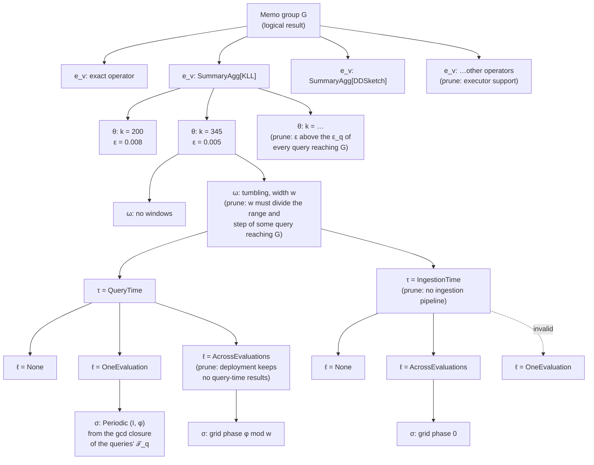

# Memo groups, properties and requirements

This page defines the memo's data structures in the terms of the optimization problem formulation: workloads, memo groups, candidates, properties and property requirements. It also gives the decision tree Stage 1 and Stage 2 walk to enumerate candidates, and each stage's interfaces (section 3). Where tracking issue #1207 extends the formulation, the extension is marked **(#1207)**.

## Notation

| Notation | Definition |
|---|---|
| $\mathcal W = \{(q, \mathcal T_q, A_q) \mid q \in \mathcal Q\}$ | workload over an evaluation horizon $H$: each query expression $q$, its evaluation schedule $\mathcal T_q \subseteq [0, H)$, and its accuracy target $A_q$ |
| $\mathcal Q$ | set of queries, each with one final output |
| $G$ | memo group: a logical result or an intermediate state family over specified input data, independent of parameter configurations |
| $G_q$ | memo group of query $q$'s final result |
| $v = (e_v, p_v)$ | candidate of a memo group: an expression with its properties |
| $e_v = \operatorname{op}_v(G_{v,1}, \dots, G_{v,n_v})$ | expression: operator $\operatorname{op}_v$ with its operator arguments (e.g. the summary family), over input memo groups $G_{v,i}$ |
| $p_v = (p^{\log}_v, p^{\mathrm{phys}}_v)$ | properties: logical and physical |
| $p^{\log}_v = \boldsymbol\theta_v$ | summary algorithm parameters, e.g. sketch size; **(#1207)** also the window layout $\omega_v$ |
| $p^{\mathrm{phys}}_v = (\tau_v, \ell_v)$ | execution timing and lifetime; **(#1207)** also the schedule $\sigma_v$ when $\ell_v \ne$ None |
| $(\varepsilon_v, \delta_v)$ | error bound and failure probability of $\boldsymbol\theta_v$ for the statistic $\operatorname{op}_v$ reads; derived, not a property |
| $c \in G_c$, $u \in G_u$ | consumer candidate and its group; producer candidate and its group. This page says *consumer* for $c$ and *query* $q$ (or its execution context $\kappa$) for who needs a result on a schedule; it does not use "reader" |
| $\mathcal I(c)$ | input indices of consumer $c$ |
| $G_{c,i}$ | memo group required by input $i$ of consumer $c$ |
| $r_{c,i} = (r^{\log}_{c,i}, r^{\mathrm{phys}}_{c,i})$ | property requirement of input $i$ of consumer $c$ |
| $p(u) \succeq r_{c,i}$ | producer $u$'s properties satisfy the requirement: $p^{\log}(u) \succeq r^{\log}_{c,i} \land p^{\mathrm{phys}}(u) \succeq r^{\mathrm{phys}}_{c,i}$ |
| $\alpha^{\log}_{u,c,i}$, $\alpha^{\mathrm{phys}}_{u,c,i}$ | fixed indicators of $p^{\log}_u \succeq r^{\log}_{c,i}$ and $p^{\mathrm{phys}}_u \succeq r^{\mathrm{phys}}_{c,i}$ |
| $\mathcal C$ | physical candidates, each with a fixed parameter configuration, timing and lifetime |
| $P_{c,i}$ | physical candidates in the required input group, $G_{c,i} \cap \mathcal C$, before checking requirements |
| $\mathcal E$ | potential dependencies $\{(u, c, i) \mid c \in \mathcal C,\ i \in \mathcal I(c),\ u \in P_{c,i}\}$ |
| $x_v$, $y_{u,c,i}$, $z_{q,v}$, $t_v$ | MILP variables: candidate selected; producer $u$ supplies input $i$ of $c$; $v \in G_q$ supplies $q$'s result; topological rank |
| (A)–(I) | MILP rows: input satisfaction, producer selection and sharing, query coverage, output selection, acyclicity, utilization, logical requirements ($y \le \alpha^{\log}$), physical requirements ($y \le \alpha^{\mathrm{phys}}$), domains |
| $w_v$ | fixed cost: $C_{\text{read}}(v) + C_{\text{compute}}(v)$ plus $C^{\text{one}}_{\text{retain}}(v)$ or $C^{\text{across}}_{\text{retain}}(v)$ by $\ell_v$ |
| $\Pi$, $V_\Pi$ | selected physical ASAP DAG and its node set; $\operatorname{Cost}(\Pi) = \sum_{v \in \mathcal C} w_v x_v$ |
| **(#1207)** $\kappa$ | execution context of a candidate with $\ell_v$ = None: a query evaluation $\kappa_q$, an ingestion pipeline $I_r$, or a materialized candidate's computation $\kappa_m$ |
| $g_c$ | error propagation function of consumer $c$: $\varepsilon_c \le g_c(\varepsilon_{c,1}, \dots, \varepsilon_{c,n})$ |
| $\lambda_{q,c,i}$ | propagation factor of input $i$ of $c$ to query $q$'s result, read off $q$'s expression |
| $\text{cap}_{c,i}$ | error cap of input $i$ of $c$: the smaller of $g_c$'s validity cap and the pruning cap |
| **(#1207)** (K), (R), (L), budgets | accuracy at each query root, $\sum_u \lambda_{q,u}\varepsilon_u a_{q,u} \le \varepsilon_q$ and $\sum_u \delta_u a_{q,u} \le \delta_q$; retention $h_v$; latency; resource budgets |

## Example

Workload: query A, `quantile_over_time(0.95, latency[1m])`, and query B, `quantile_over_time(0.99, latency[1m]) / quantile_over_time(0.50, latency[1m])`. Both are evaluated every 10 s ($\mathcal T_A = \mathcal T_B = 10\,\text{s}\cdot\mathbb Z$) with accuracy target $A_q$: rank error 0.01.

```
G1   Scan latency[1m]
       candidate: v1 = Scan                         p^phys = (QueryTime, None)
G2   KLL state over G1                              one group, whatever θ
       candidates: v2 = SummaryAgg[KLL](G1)  θ = {k = 200}   ε = 0.008   δ = 0.01
                   v3 = SummaryAgg[KLL](G1)  θ = {k = 345}   ε = 0.005   δ = 0.01
                   (Stage 2 expands each into its (τ, ℓ) alternatives)
G3 = G_A   SummaryEstimate[q=0.95](G2)
G4         SummaryEstimate[q=0.99](G2)
G5         SummaryEstimate[q=0.50](G2)
G6 = G_B   Divide(G4, G5)      r^log on each input: cap = min(validity cap of /, ε_B / λ)
```

The ε values are illustrative.

- G2 is one memo group: the KLL state over `latency[1m]`. Its parameter configurations are candidates of G2, not separate groups. The family KLL is an argument of $\operatorname{op}_v$.
- G3, G4 and G5 are consumers of G2: their candidates' expressions read G2 as $G_{c,1}$. G2 does not store them.
- A meets 0.01 with either θ. B adds its two operands' errors (0.016 with `k = 200`, 0.010 with `k = 345`) and needs `k = 345` for both, so a plan where G3's, G4's and G5's candidates all read v3 builds one KLL state.

## 1. Properties and property requirements

### Properties

A property is a value a candidate has. Properties are products of dimensions: one field per dimension, never a flat enum that lists the combinations. Invalid combinations are rejected by the checked constructor.

What is computed is the expression $e_v$, not a property: the operator, its arguments (including the summary family), and its input groups. A memo group's candidates differ in their properties, and, when rules add other ways to compute the same result, in their expressions.

| Dimension | Values | Part of | Code |
|---|---|---|---|
| Parameter configuration $\boldsymbol\theta_v$ | per family, from a predefined list: KLL `k`; DDSketch `alpha`; CMS / CountSketch `width × depth`; CMS / CountSketch with heap `width × depth × heap_size`; UnivMon `heap_size × rows × cols × layers`; HLL `precision`; KMV `k`. None for an exact operator | $p^{\log}_v$ | `SketchParams` inside `SketchKind` ([`sketch.rs`](../../../crates/types/src/ir/schema/sketch.rs)), sized by `size_params` per `accuracy_budget_parts` today |
| **(#1207)** Window layout $\omega_v$ | none; or tumbling windows of width $w$ and count $n$, with $w$ from the gcd closure of the ranges and steps of the queries that reach the group. Later: sliding windows by merge or by subtraction | $p^{\log}_v$ | `SummaryTumblingWindowChain` arguments, added by Pass 2 ([`window_candidates.rs`](../../../crates/logical-asap-optimization/src/pass2/memo/window_candidates.rs)) |
| Execution timing $\tau_v$ | IngestionTime, QueryTime | $p^{\mathrm{phys}}_v$ | `ExecutionTiming` ([`execution_data_state.rs`](../../../crates/types/src/ir/properties/execution_data_state.rs)) |
| Lifetime $\ell_v$ | None, OneEvaluation, AcrossEvaluations; **(#1207)** a materialized lifetime carries its medium, Memory or Disk | $p^{\mathrm{phys}}_v$ | `Materialization` on main; `Lifetime`, `Medium` in #1214 ([`physical/`](../../../crates/types/src/physical)) |
| **(#1207)** Schedule $\sigma_v$ | only when $\ell_v \ne$ None: Periodic (interval, phase) for OneEvaluation; tumbling-window grid phase for AcrossEvaluations | $p^{\mathrm{phys}}_v$ | schedule groups `z[m, G]` in the MILP today ([`cost_terms.rs`](../../../crates/plan-selection/src/milp/cost_terms.rs)); a property in #1200 PR 2 |

Lifetime None means the output is discarded after its consumer's execution completes. OneEvaluation retains the result until all its consumers within one evaluation finish. AcrossEvaluations retains it throughout the evaluation period, so later evaluations reuse it. A candidate is materialized when $\ell_v \ne$ None; this is derived, not stored.

The error bound $(\varepsilon_v, \delta_v)$ is not a dimension: it is a function of $\boldsymbol\theta_v$ and the statistic $\operatorname{op}_v$ reads, derived when needed (`local_guarantee` in [`estimators`](../../../crates/accuracy/src/estimators/mod.rs)). An exact candidate has $(0, 0)$.

Invalid combinations of $p^{\mathrm{phys}}$, rejected by `PhysicalProperties::new` (#1200; #1214 implements the first, the others come with $\sigma$ in #1200 PR 2):

| Combination | Why |
|---|---|
| (IngestionTime, OneEvaluation) | there is no evaluation at ingestion time |
| $\ell$ = None with a schedule | where an unmaterialized result runs is its consumer's execution context $\kappa$, not a property |
| $\ell \ne$ None without a schedule | a materialized result must say on which times or grid it is delivered |
| OneEvaluation with a grid, AcrossEvaluations with a periodic schedule | each lifetime has one kind of schedule |
| a phase at or above the grid width or interval, or interval 0 | the phase is taken modulo the width or interval |
| IngestionTime with a grid phase ≠ 0 | ingestion-time grids are anchored at the epoch today: the plan carries no origin |

Valid $(\tau, \ell)$: (QueryTime, None), (IngestionTime, None), (QueryTime, OneEvaluation), (QueryTime, AcrossEvaluations), (IngestionTime, AcrossEvaluations), each materialized one for each medium.

### Property requirements

Each input $i$ of consumer $c$ names a producer group $G_{c,i}$ and a property requirement $r_{c,i} = (r^{\log}_{c,i}, r^{\mathrm{phys}}_{c,i})$. Logical satisfaction checks configuration requirements; physical satisfaction checks whether the producer's timing and lifetime jointly support the required access. For a monotone size parameter, $\succeq$ reduces to numerical dominance, e.g. $k_u \ge k_{\text{required}}$ for KLL.

The workload's accuracy target $A_q$ is not an input requirement **(#1207)**: a per-input bound would fix each input's share of the query's budget. Row (K) bounds each query's composed error at its root instead. What stays in $r^{\log}$ is what depends only on the consumer.

#### Error propagation and the error cap

Each consumer $c$ has an error propagation function $g_c$ that bounds its output error by its input errors:

$$\varepsilon_c \le g_c(\varepsilon_{c,1}, \dots, \varepsilon_{c,n}).$$

Composing them from each query's root down gives the query's error, and the accuracy target $A_q$ is $g_q(\dots) \le \varepsilon_q$ at the root.

| Consumer | $g_c$ | Linear |
|---|---|---|
| single readout, `Project`, filter | $\varepsilon_{c,1}$ | yes |
| `sum by` over $n$ series (absolute error) | $n\,\varepsilon_{c,1}$ | yes |
| $X + Y$, $X - Y$ (absolute error) | $\varepsilon_X + \varepsilon_Y$ | yes |
| $X / Y$ (relative error) | $\dfrac{\varepsilon_X + \varepsilon_Y}{1 - \varepsilon_Y}$ | no |

Each $g_c$ is a sum of its inputs' errors, each times a constant **propagation factor** $\lambda_{c,i}$: $g_c = \sum_i \lambda_{c,i}\,\varepsilon_{c,i}$ (for a non-linear $g_c$, within its validity cap, below). The factors come from the query expression itself: each operator and its arguments, e.g. `sum by` over $n$ series has factor $n$. No measurement or optimization is involved. A query's factor for input $i$ of $c$ multiplies the factors along the path in $q$'s expression from that input to $q$'s root, and adds over paths when the input reaches the root more than once:

$$\lambda_{q,c,i} = \sum_{\text{paths } c = c_0 \to c_1 \to \dots \to c_m = \text{root of } q} \lambda_{c_0,i}\,\lambda_{c_1,i_1} \cdots \lambda_{c_m,i_m}.$$

Row (K) is $\sum \lambda_{q,c,i}\,\varepsilon_u\,y \le \varepsilon_q$ with these factors, so the weights sit on $(q, c, i)$. Two queries reading one group through different expressions have different factors. Failure probabilities add by a union bound and need no factor.

From $g_c$ come two caps on an input's error, both checked per edge as part of $r^{\log}_{c,i}$:

1. **Validity cap: correctness, non-linear consumers only.** A non-linear $g_c$ is bounded by its linear form only in a region, e.g. $\varepsilon_Y \le$ cap for a ratio, where $\frac{\varepsilon_X+\varepsilon_Y}{1-\varepsilon_Y} \le \frac{1}{1-\text{cap}}(\varepsilon_X+\varepsilon_Y)$, so both factors are $\frac{1}{1-\text{cap}}$ (1.11 for cap 0.1). Without the cap, row (K) could accept a plan whose true error is unbounded. A linear $g_c$ is exact everywhere and has no validity cap.
2. **Pruning cap: efficiency only, every consumer, linear ones included.** An input whose error alone breaks every target it could serve is in no feasible plan: $\lambda_{q,c,i}\,\varepsilon_u > \varepsilon_q$ for every query $q$ that may reach $c$. Removing such edges removes no feasible plan, since row (K) rejects them anyway; it keeps them out of $\mathcal E$ and the MILP. It is the per-edge form of Pass 1's "drop a $\boldsymbol\theta$ whose $\varepsilon$ alone exceeds every reading query's target", and prunes more because it uses each consumer's own $\lambda$.

$$\text{cap}_{c,i} = \min\Bigl(\text{validity cap of } g_c,\ \max_{q \text{ that may reach } c} \frac{\varepsilon_q}{\lambda_{q,c,i}}\Bigr), \qquad \alpha^{\log}_{u,c,i} = 0 \text{ when } \varepsilon_u > \text{cap}_{c,i}.$$

For a monotone size parameter, $\varepsilon_u \le \text{cap}_{c,i}$ is a minimum size, e.g. $k_u \ge k_{\text{required}}$ for KLL.

**What stays at the root.** A per-input cap cannot replace row (K): with several inputs, $\varepsilon_X + \varepsilon_Y \le \varepsilon_q$ couples them, and one cap per input would fix each input's share in advance (the rejected budget shares). The caps only prune; row (K) decides.


| Requirement | Stated by | Values | Constrains | Checked by |
|---|---|---|---|---|
| Accuracy target $A_q$ | the workload, per query | metric: absolute (in the value's units, or times the stream's L1 or L2 norm), relative, rank; bound $\varepsilon_q$; failure probability $\delta_q$; scope: per value, whole result, or groups above a share of the records | $\boldsymbol\theta_u$ of every approximate candidate $q$ depends on, through $(\varepsilon_u, \delta_u)$ | row (K) **(#1207)** |
| Error cap $\text{cap}_{c,i}$, in $r^{\log}_{c,i}$ | every consumer, per input, from $g_c$ and the targets of the queries that may reach it | the smaller of the validity cap (non-linear $g_c$ only) and the pruning cap; for a monotone size parameter, a minimum size $k_u \ge k_{\text{required}}$ | $\boldsymbol\theta_u$ | $\alpha^{\log}$, row (G): validity cap for correctness of (K), pruning cap for efficiency |
| Window, in $r^{\log}_{c,i}$ **(#1207)** | a consumer that reads windows, per input | the range and step of the queries that reach the consumer | $\omega_u$: the width must divide both | $\alpha^{\log}$, row (G) |
| Summary family, in $r^{\log}_{c,i}$ | a consumer that reads summary state | a family | usually already fixed by $G_{c,i}$, whose $\operatorname{op}$ names the family | $\alpha^{\log}$, row (G) |
| Consumer timing and evaluation, in $r^{\mathrm{phys}}_{c,i}$ | the consumer, per input | when it reads (ingestion or query time) and from which evaluation (same or later) | $\tau_u$, $\ell_u$ | $\alpha^{\mathrm{phys}}$, row (H) |
| Consumer schedule, in $r^{\mathrm{phys}}_{c,i}$ **(#1207)** | the consumer's execution context $\kappa$, from the $\mathcal T_q$ of its query | the context's interval and phase $(I_\kappa, \varphi_\kappa)$; the producer must deliver on them, $T_\kappa \subseteq T_{\sigma_u}$ | $\sigma_u$ | $\alpha^{\mathrm{phys}}$, row (H) |
| Deployment capability | the deployment and data | the source has an ingestion pipeline; the executor supports the family; query-time results may be kept across evaluations | $\tau$, $\operatorname{op}$, (QueryTime, AcrossEvaluations) | candidate generation: such candidates are not in $\mathcal C$ |
| Latency, resource budgets **(#1207)** | the workload | per-query latency bound; memory and CPU budgets | the whole plan | rows (L) and budgets |

Accuracy metrics that may be added later, when a primitive needs them: top-k recall or precision, and a false-positive rate for membership summaries.

How requirements map to properties:

```
A_q (workload)               ──► θ_u of every approximate input   (through ε_u, δ_u; row (K))
error cap      r^log         ──► θ_u            (validity cap from g_c; pruning cap from ε_q / λ_{q,c,i})
window         r^log         ──► ω_u
consumer timing r^phys       ──► τ_u, ℓ_u
consumer schedule r^phys     ──► σ_u
deployment                   ──► τ, op, ℓ   (not generated)
latency, budgets             ──► every dimension, through w_v
```

## 2. Decision tree of properties

Each memo group's candidates are the leaves of a tree. The first level chooses the expression $e_v$; every later level decides one property dimension. A path from the root to a leaf is one physical candidate in $\mathcal C$.



The levels, top to bottom:

| Level | Decides | Stage | Values offered | Pruned when | Code |
|---|---|---|---|---|---|
| 1 | expression $e_v$ ($\operatorname{op}_v$ with its family) | Stage 1, Pass 1 and Pass 2 rules | each way to compute the group | the executor cannot build the family | Pass 1 ([`per_computation_candidates.rs`](../../../crates/logical-asap-optimization/src/pass1/per_computation_candidates.rs)); Pass 2 rules ([`rules/`](../../../crates/logical-asap-optimization/src/pass2/memo/rules)) |
| 2 | $\boldsymbol\theta_v$ | Stage 1, Pass 1 | the family's predefined list | $\varepsilon_v$ alone exceeds the $\varepsilon_q$ of every query that reaches the group | Pass 1 sizing per `accuracy_budget_parts` ([`memo_population.rs`](../../../crates/logical-asap-optimization/src/pass1/memo_population.rs)); a predefined list in #1203 PR 2 |
| 3 | $\omega_v$ **(#1207)** | Stage 1, Pass 2 | tumbling widths from the gcd closure of the ranges and steps of the queries reaching the group | no such query's range and step is a multiple of the width | Pass 2 ([`window_candidates.rs`](../../../crates/logical-asap-optimization/src/pass2/memo/window_candidates.rs), [`state_groups.rs`](../../../crates/logical-asap-optimization/src/pass2/memo/state_groups.rs)) |
| 4 | $\tau_v$ | Stage 2 | QueryTime; IngestionTime | the source has no ingestion pipeline | `enumerate_candidate_configurations` ([`configurations.rs`](../../../crates/physical-asap-optimization/src/catalog/configurations.rs)) |
| 5 | $\ell_v$ | Stage 2 | None, OneEvaluation, AcrossEvaluations | invalid with $\tau_v$; the deployment keeps no query-time results across evaluations | same function, with `DeploymentCapabilities::query_time_results_retained` |
| 6 | $\sigma_v$ **(#1207)** | Stage 2 | the gcd closure $\Sigma$ of the schedules $\mathcal T_q$ of the queries reaching the group | only offered when $\ell_v \ne$ None | Stage 3 MILP today; Stage 2 in #1200 PR 2 |

What the tree does not decide, because it is a choice of the MILP over $\mathcal C$ and $\mathcal E$:
- **Which producer each consumer input reads:** $y_{u,c,i}$. Two consumers of one group may read different leaves, e.g. one reads `k = 200` and another `k = 345`.
- **Where an unmaterialized candidate runs (#1207):** a candidate with $\ell_v$ = None runs inside each reading context $\kappa$.
- **How much a materialized candidate retains (#1207):** $h_v$, from the longest range among the queries its selected consumers serve, row (R).

### Order of decisions

**The order does not affect correctness.** The leaves are the product of the dimensions' value sets, minus the invalid combinations and the pruned values. Every prune rule depends only on the value it removes and on values decided above it, so any order that decides a pruned dimension after the dimensions its prune rule reads yields the same $\mathcal C$.

**The order affects the efficiency of enumeration.** The number of nodes visited is $\sum_{d} \prod_{d' \le d} |\text{values kept at } d'|$, so a dimension that prunes much should come early, and a dimension whose values multiply without pruning should come late. Four considerations set the order above:

1. **Logical before physical.** $e_v$, $\boldsymbol\theta_v$ and $\omega_v$ change the result's values or error; $\tau_v$, $\ell_v$ and $\sigma_v$ change only when and how long it is computed and kept. Deciding $p^{\log}$ first lets Stage 1 hash-cons groups and compute $\alpha^{\log}$ once, before Stage 2 multiplies each logical candidate by its $p^{\mathrm{phys}}$ alternatives.
2. **Strong prunes early.** The operator is pruned by the executor, and $\boldsymbol\theta_v$ by the accuracy targets, before the window and physical levels multiply them.
3. **Dependent dimensions adjacent.** $\ell_v$ is constrained by $\tau_v$, and $\sigma_v$ exists only when $\ell_v \ne$ None and its kind follows $\ell_v$. Deciding $\tau \to \ell \to \sigma$ prunes each invalid combination at the first level where it can be detected.
4. **Deployment-wide prunes as early as they can go.** Without an ingestion pipeline, the IngestionTime subtree is pruned once per candidate. Moving $\tau$ above $\omega$ would prune it once per group instead; this is an alternative order with the same leaves.

Alternative orders worth comparing:
- **$\tau$ first.** Where most sources have no ingestion pipeline, deciding timing at the group level prunes half the tree before $\boldsymbol\theta$ and $\omega$ multiply it.
- **$\boldsymbol\theta$ last among logical dimensions.** $\boldsymbol\theta$ has the most values. Deciding $\omega$ before $\boldsymbol\theta$ visits fewer nodes when many widths are pruned by the queries' ranges.
- **Requirement-driven (top-down) vs producer-driven (bottom-up).** Top-down enumeration starts from each consumer's $r_{c,i}$ and offers only the values it accepts; bottom-up offers every value and lets $\alpha$ filter $\mathcal E$. Top-down visits fewer nodes but must union the requirements of all consumers of a group, so that sharing between consumers is not lost.

## 3. Data structures and interfaces per stage

This section gives the target interface of each stage after the formulation refactor (#1207). Each stage's boundary type carries the notation that stage defines, and no stage reads a notation a later stage defines: logical stages carry no physical properties.

| Stage | Input | Output (boundary type) | Notation it defines | Sub-issue |
|---|---|---|---|---|
| Stage 0: frontends, hash-consing | queries | `DagOfLogicalMemoGroups` | $G$, query roots | — |
| Stage 1, Pass 1 | `DagOfLogicalMemoGroups` | `Memo` | $v = (e_v, p^{\log}_v)$, $r^{\log}_{c,i}$, $\theta$ list | #1203 |
| Stage 1, Pass 2 | `Memo` | `LogicalASAPMemoCandidates` | rule-added candidates; logical edges with $\alpha^{\log}$ | #1203, #1201 |
| Stage 2 | `LogicalASAPMemoCandidates` | `PhysicalASAPMemoCandidates` | $p^{\mathrm{phys}}_v = (\tau, \ell, \sigma)$, $r^{\mathrm{phys}}_{c,i}$, physical edges $\mathcal E$ with $\alpha^{\mathrm{phys}}$ | #1200, #1201 |
| Stage 3 | `PhysicalASAPMemoCandidates` | `DagOfSelectedCandidates` | contexts $\kappa$; cost $w_v$ (`asap-cost`); $x$, $y$, $z$, $t$, $h$; rows (A)–(K), (R), (L), budgets | #1204 |
| Realizer, export | `DagOfSelectedCandidates` | `PhysicalASAPDAG` | — | #1200 (export fields) |

### Stage 0: frontends and hash-consing

No change. One group per distinct logical sub-expression; the queries' roots point at groups.

```rust
// crates/types/src/stages/memo.rs
pub struct MemoGroupId(pub u32);

/// G: one logical result or one state family over specified input data.
pub struct MemoGroup {
    pub logical_node: Rc<OperatorNode>,   // expression; no physical fields (#1200)
    pub child_groups: Vec<MemoGroupId>,   // producer groups G_i
    pub parents: Vec<MemoGroupId>,        // derived: consumers' groups
    pub queries: Vec<usize>,              // derived: queries that reach it
}

pub struct DagOfLogicalMemoGroups {
    pub groups: Vec<MemoGroup>,
    pub query_roots: Vec<QueryRoot<MemoGroupId>>,
}
```

### Stage 1, Pass 1: candidates of each group

Pass 1 adds every way to compute each group as candidates. Every intermediate result is its own group (no private nodes), and a summary family's sizes are candidates of one state group.

```rust
// crates/types/src/stages/candidates.rs
pub struct CandidateForMemoGroupId { pub group: MemoGroupId, pub index: usize }

pub struct Memo {
    pub groups: Vec<MemoGroup>,
    pub query_roots: Vec<QueryRoot<MemoGroupId>>,
    pub candidates: Vec<Vec<CandidateForMemoGroup>>,   // by group
}
impl Memo {
    /// Hash-consing: the group with this expression, added if new.
    pub fn find_or_add_group(&mut self, expression: Operator<MemoGroupId>) -> MemoGroupId;
    pub fn add_candidate(&mut self, group: MemoGroupId, candidate: CandidateForMemoGroup) -> CandidateForMemoGroupId;
    pub fn candidate(&self, id: CandidateForMemoGroupId) -> &CandidateForMemoGroup;
}

/// v = (e_v, p_v^log)
pub struct CandidateForMemoGroup {
    pub expression: CandidateExpression,              // e_v
    pub logical_properties: LogicalProperties,        // p_v^log
    pub input_requirements: Vec<LogicalRequirement>,  // r^log_{c,i}, one per input group
    pub fused_groups: Vec<MemoGroupId>,
    /// Which rule added it. Not in the formulation: kept for `stage_pipeline --text`
    /// and the viewer (approved 2026-11-05).
    pub origin: OriginOfCandidateForMemoGroup,
}
/// e_v = op_v(G_{v,1}, …, G_{v,n}): one operator, its children are groups.
pub struct CandidateExpression { pub operator: Operator<MemoGroupId> }

pub struct LogicalProperties {
    representation: Representation,       // family and θ, from the predefined list
    window_layout: Option<WindowLayout>,  // ω_v
}
impl LogicalProperties {
    pub fn new(representation: Representation, window_layout: Option<WindowLayout>) -> Result<Self, InvalidLogicalProperties>;
    /// (ε_v, δ_v) for `statistic`, derived through `local_guarantee`.
    pub fn error_bound(&self, statistic: &SketchStatistic) -> Option<AccuracyGuarantee>;
}
pub enum Representation { Exact(ExactKind), Summary(SketchKind) }
pub enum WindowLayout { Tumbling { width_ms: u64, count: u32 } }

pub struct LogicalRequirement {
    pub family: Option<SketchAlgorithm>,
    pub window: Option<WindowRequirement>,  // range and step of the queries reaching the consumer: a width must divide both
    pub error_cap: Option<f64>,             // cap_{c,i}: min(validity cap of g_c, pruning cap)
}
/// α^log_{u,c,i}
pub fn satisfies(producer: &LogicalProperties, requirement: &LogicalRequirement) -> bool;

/// g_c as propagation factors λ_{c,i}, read from the consumer's operator and
/// arguments, and the validity cap (None when g_c is linear).
/// Approved 2026-11-05.
pub struct ErrorPropagation { pub factor_per_input: Vec<f64>, pub validity_cap: Option<f64> }
pub fn error_propagation(consumer: &Operator<MemoGroupId>) -> ErrorPropagation;
```

The validity cap is known when the consumer is created. The pruning cap needs $\lambda_{q,c,i}$ and the queries that may reach $c$, so it is filled in when Pass 2 builds the logical edges.

Deleted: `root_node` with private nodes, `input_groups` (the expression's children), `accuracy_budget_parts`, the `SharedBuild` and `SummaryResult` origins.

Concepts not in the formulation: `origin: OriginOfCandidateForMemoGroup` (Pass1, SummaryInput, TumblingWindows, Rollup, TopKReuse, WidenedScans) records which rule added a candidate; nothing in planning reads it.

### Stage 1, Pass 2: rules and logical edges

Rules add candidates to existing groups, or add groups. A rule never copies a consumer. After the last rule, Pass 2 builds the logical edges once.

```rust
// crates/logical-asap-optimization/src/pass2
/// A rule: reads the memo, adds candidates or groups.
fn apply(memo: &mut Memo) -> Result<(), Pass2RuleError>;

// crates/types/src/stages/logical_memo_candidates.rs
/// (u, c, i) over logical candidates: u is a candidate of G_{c,i}.
pub struct LogicalEdge {
    pub producer: CandidateForMemoGroupId,
    pub consumer: CandidateForMemoGroupId,
    pub input: usize,
    pub satisfies_logical_requirement: bool,   // α^log
}
pub struct LogicalASAPMemoCandidates {
    pub memo: Memo,
    pub edges: Vec<LogicalEdge>,               // grouped by (consumer, input)
}
```

### Stage 2: physical candidates and edges

Stage 2 expands each logical candidate into one physical candidate per valid $(\tau, \ell, \sigma)$, gives each input its physical requirement, and turns each logical edge into the physical edges between the two candidates' physical alternatives.

```rust
// crates/types/src/physical/properties.rs
pub enum ExecutionTiming { IngestionTime, QueryTime }
pub enum Medium { Memory, Disk }
pub enum Lifetime { None, OneEvaluation(Medium), AcrossEvaluations(Medium) }
pub enum Schedule {
    Periodic { interval_ms: u64, phase_ms: u64 },  // OneEvaluation
    TumblingWindowGrid { phase_ms: u64 },          // AcrossEvaluations
}
/// p_v^phys = (τ, ℓ, σ); `new` rejects the invalid combinations (Section 1).
pub struct PhysicalProperties { timing: ExecutionTiming, lifetime: Lifetime, schedule: Option<Schedule> }
impl PhysicalProperties {
    pub fn new(timing: ExecutionTiming, lifetime: Lifetime, schedule: Option<Schedule>) -> Result<Self, InvalidPhysicalProperties>;
    pub fn timing(&self) -> ExecutionTiming;
    pub fn lifetime(&self) -> Lifetime;
    pub fn schedule(&self) -> Option<&Schedule>;
    pub fn is_materialized(&self) -> bool;          // ℓ ≠ None
}

/// r^phys_{c,i}; `new` rejects (IngestionTime, Later).
pub struct PhysicalRequirement {
    consumer_timing: ExecutionTiming,
    reads_from: Evaluation,
    /// (I_κ, φ_κ) of the consumer's execution context, from its query's T_q;
    /// None for a non-periodic query.
    consumer_schedule: Option<EvaluationSchedule>,
}
/// A periodic evaluation schedule φ + I·ℤ.
pub struct EvaluationSchedule { interval_ms: u64, phase_ms: u64 }
pub enum Evaluation { Same, Later }
/// α^phys_{u,c,i}
pub fn satisfies_physical(producer: &PhysicalProperties, requirement: &PhysicalRequirement) -> bool;

// crates/types/src/stages/physical
pub struct PhysicalCandidateId(pub usize);
pub struct PhysicalEdgeId(pub usize);

/// One physical alternative of a logical candidate.
pub struct PhysicalCandidate {
    pub logical: CandidateForMemoGroupId,             // e_v and p_v^log
    pub properties: PhysicalProperties,               // p_v^phys
    pub input_requirements: Vec<PhysicalRequirement>, // r^phys_{c,i}
}
/// (u, c, i) over physical candidates.
pub struct PhysicalEdge {
    pub producer: PhysicalCandidateId,
    pub consumer: PhysicalCandidateId,
    pub input: usize,
    pub satisfies_logical_requirement: bool,    // α^log
    pub satisfies_physical_requirement: bool,   // α^phys
}
pub struct PhysicalASAPMemoCandidates {
    pub logical: LogicalASAPMemoCandidates,
    pub candidates: Vec<PhysicalCandidate>,     // C
    pub query_roots: Vec<QueryRoot<MemoGroupId>>,
    pub pruned_candidates: Vec<PrunedCandidate<PhysicalCandidateKey>>,
    // edges stored per (consumer, input); see `edges()`
}
impl PhysicalASAPMemoCandidates {
    pub fn edges(&self) -> impl Iterator<Item = (PhysicalEdgeId, PhysicalEdge)>;             // E
    pub fn admissible_edges_into(&self, consumer: PhysicalCandidateId, input: usize) -> &[PhysicalEdgeId]; // P_{c,i}
    pub fn admissible_edges_out_of(&self, producer: PhysicalCandidateId) -> &[PhysicalEdgeId];
}
```

Deleted: `Materialization`, `PhysicalCandidate::{timing, materialization, operator_node}`, `producer_candidates_per_input` as the interface, `compatible_timing`, the reader constraints `ReaderConstraint::{IncompatibleOutputs, AllowedOutputs}` (now $\alpha^{\mathrm{phys}}$ through $\sigma$), `may_keep_across_evaluations_per_sole_reader_query`.

### Stage 3: the MILP

Stage 3 reads the physical candidates and edges and selects the DAG. Variables and rows are named after the formulation.

```rust
// crates/plan-selection/src/milp/model.rs
/// κ: where an ℓ = None candidate runs. Only those candidates are indexed by it.
/// `ContextId` indexes the workload's contexts; the id types inside are illustrative.
pub struct ContextId(pub usize);
pub enum Context {
    QueryEvaluation(QueryId),               // κ_q
    IngestionPipeline(RefreshWindowId),     // I_r
    Materialized(PhysicalCandidateId),      // κ_m: inside a materialized m's computation
}

struct SelectionVariables {
    x_materialized: Vec<Variable>,                                     // x_v, ℓ ≠ None
    x_in_context: HashMap<(ContextId, PhysicalCandidateId), Variable>, // x_{κ,v}, ℓ = None
    y: HashMap<(Option<ContextId>, PhysicalEdgeId), Variable>,         // y_{u,c,i} on admissible edges
    z: Vec<Variable>,                                                  // z_{q,v}
    t: Vec<Variable>,                                                  // t_v, cyclic components only
    h: Vec<Variable>,                                                  // h_v, ℓ ≠ None
    latency: LatencyVariables,                                         // (L)
}
fn input_satisfaction_rows(..);   // (A) Σ_u y_{u,c,i} = x_c
fn producer_selection_rows(..);   // (B) y_{u,c,i} ≤ x_u
fn query_coverage_rows(..);       // (C), (D)
fn acyclicity_rows(..);           // (E)
fn utilization_rows(..);          // (F)
fn consumer_constraint_rows(..);  // (J): MinimumQueryReaders, HighestSharedQueryMaterialization over reach
fn accuracy_rows(..);             // (K) Σ λ_{q,u} ε_u a_{q,u} ≤ ε_q, Σ δ_u a_{q,u} ≤ δ_q
fn retention_rows(..);            // (R) h_v ≥ need_{c,i} · y_{v,c,i}
fn latency_rows(..);              // (L)
fn resource_budget_rows(..);      // budgets (#1207)
// Objective: min Σ w_v x_v + Σ ρ_κ w_v x_{κ,v} + Σ π_v h_v

// crates/types/src/stages/physical/graph.rs (unchanged)
pub struct SelectedEdge { pub producer: SelectedNodeId, pub consumer: SelectedNodeId, pub input: usize }
pub struct DagOfSelectedCandidates {
    pub candidate_of_node: Vec<PhysicalCandidateId>,
    pub edges: Vec<SelectedEdge>,                  // decoded from y = 1
    pub node_of_output_reference: Vec<SelectedNodeId>,
}
```

(G) $y \le \alpha^{\log}$ and (H) $y \le \alpha^{\mathrm{phys}}$ are not rows: $y$ exists only on admissible edges. Deleted: `ResultSlot`, `slot_of`, the `e` binaries, schedule groups `z[m, G]`, `N[q]`, `A[q, parts]`, and `p[ctx, c]` for materialized candidates.

### Realizer and export

The realizer builds the plan from `DagOfSelectedCandidates`; each node's physical properties come from its `PhysicalCandidate`. The export writes timing and lifetime (and later the schedule) per node of `PhysicalASAPDAG`, changed together with the backend.

## 4. Rules: how each pass and stage adds candidates

A rule reads the memo and adds to it only through the interfaces of section 3:
- `Memo::find_or_add_group(expression)` for a group, so an expression that already exists returns its group (hash-consing);
- `Memo::add_candidate(group, CandidateForMemoGroup { expression, logical_properties, input_requirements, fused_groups })` for a candidate $v = (e_v, p^{\log}_v)$ with its $r^{\log}_{v,i}$.

A rule never copies a consumer and never edits an existing candidate: every consumer of a group sees a new candidate of that group through $\mathcal E$. Rules match over groups and their candidates' expressions, never over a consumer's private operators. The order of the rules below is the order the code runs them; it affects which groups exist when a later rule matches, not which plans are valid.

### Stage 0: hash-consing

| Rule | Code | Matches | Adds |
|---|---|---|---|
| Hash-consing | `hash_consed` ([`stage0.rs`](../../../crates/logical-asap-optimization/src/stage0.rs)) | every operator node of every query root | one `MemoGroup` per distinct expression; `query_roots` point at $G_q$. No candidates. |

### Stage 1, Pass 1: ways to compute each group

Pass 1 adds, for each group a query computes, every way to compute it. Each intermediate result of a way to compute is its own group (`find_or_add_group`), so `Project ← SummaryEstimate ← SummaryAgg` is three groups, each with a one-operator candidate.

| Way to compute | Code | Adds |
|---|---|---|
| Exact | [`per_computation_candidates.rs`](../../../crates/logical-asap-optimization/src/pass1/per_computation_candidates.rs), [`memo_population.rs`](../../../crates/logical-asap-optimization/src/pass1/memo_population.rs) | a candidate with the exact operator; $\boldsymbol\theta_v$ none, $(\varepsilon_v, \delta_v) = (0, 0)$ |
| Exact accumulator | same | a state group `ExactAggregate(kind)` over the input group, one candidate; a `FinalizeExactAccumulator` candidate in the result's group reading it |
| Summary, per family the executor supports | same | a state group `SummaryAgg[family]` over the input group, with **one candidate per $\boldsymbol\theta$ in the family's predefined list**, dropping a $\boldsymbol\theta$ whose $\varepsilon_v$ alone exceeds the $\varepsilon_q$ of every query that reaches the group; a `SummaryEstimate[statistic]` candidate in the result's group reading the state group. Each consumer's `error_cap` starts as its $g_c$'s validity cap (none for a linear $g_c$) |
| Fused build (#1203 2c) | same | a build that computes several targets at once: a candidate of the outer target's state group, with `fused_groups` naming the others |

Example: for A and B, Pass 1 adds G2 = `SummaryAgg[KLL](G1)` with candidates `k = 200` and `k = 345`, and G3, G4, G5 = `SummaryEstimate[q](G2)`. A and B's three estimates read one state group because their expressions over G1 hash-cons to one group.

Today, Pass 1 instead sizes one $\boldsymbol\theta$ per `accuracy_budget_parts` and keeps `SummaryEstimate ← SummaryAgg` as private nodes inside one candidate. #1203 2a makes the intermediate results groups; #1203 PR 2 replaces sizing by the predefined list.

### Stage 1, Pass 2: rules over groups

| # | Rule | Code | Matches | Adds | Status |
|---|---|---|---|---|---|
| 1 | Local window composition (tumbling windows) | `add_local_window_composition` ([`window_candidates.rs`](../../../crates/logical-asap-optimization/src/pass2/memo/window_candidates.rs)) | a summary state group whose window consumers serve queries whose ranges and steps share a gcd width $w$ | a candidate of the **same state group** with $\omega_v$ = tumbling $(w, n)$, its $r^{\log}$ window requirement on each consumer input | today it copies consumers per layout (`TumblingWindows` origin); #1160 makes it a candidate of the state group |
| 2 | Scan widening | `add_scan_label_candidates` ([`scan_labels.rs`](../../../crates/logical-asap-optimization/src/pass2/memo/rules/scan_labels.rs)) | several scan groups of one metric with different label sets | a group for the widened scan (`find_or_add_group`), and in each original scan group a candidate `Project(widened)` | #1203 2a-5 (#1222) |
| 3 | Summary inputs | `factor_summary_inputs` ([`summary_inputs.rs`](../../../crates/logical-asap-optimization/src/pass2/memo/rules/summary_inputs.rs)) | a value projection or filter below a summary build | that projection or filter as its own group; the build's candidate reads it | #1203 2a-2 (#1218); after 2a, Pass 1 already makes it a group |
| 4 | Top-k reuse | `add_topk_candidates` ([`topk.rs`](../../../crates/logical-asap-optimization/src/pass2/memo/rules/topk.rs)) | top-k groups over one ranking with different `k` | a candidate of each top-k group reading the largest-`k` group, with an exact-input requirement | #1203 2a-3 (#1220) |
| 5 | Finer aggregate | `add_finer_aggregate_candidates` ([`finer_aggregate.rs`](../../../crates/logical-asap-optimization/src/pass2/memo/rules/finer_aggregate.rs)) | a SQL aggregate whose grouping is coarser than another aggregate group's | a candidate of the coarse group: filter, then merge the finer group's rows with each measure's rollup | #1203 2a-3 (#1220) |
| 6 | Rollup | `add_rollup_candidates` ([`rollup.rs`](../../../crates/logical-asap-optimization/src/pass2/memo/rules/rollup.rs)) | a coarse aggregate or summary group and a finer group whose state rolls up | a candidate of the coarse group reading the finer group (exact or sketch merge) | #1203 2a-4 (#1221) |
| 7 | Window rollup | `add_window_rollup_candidates` (same) | a longer-range group whose windows a shorter-range group's state covers | a candidate of the longer-range group merging the shorter one's windows | #1203 2a-4 (#1221) |
| 8 | Summary results | `factor_summary_results` ([`summary_results.rs`](../../../crates/logical-asap-optimization/src/pass2/memo/rules/summary_results.rs)) | a summary readout inside a composite candidate | the readout as its own group | #1203 2a-2 (#1218) makes the readout a group in Pass 1; the rule is then deleted |
| 9 | Shared configurations | `add_state_configuration_candidates` ([`shared_configuration_readers.rs`](../../../crates/logical-asap-optimization/src/pass2/memo/rules/shared_configuration_readers.rs)) | consumers that could share a summary at a size or window horizon that covers them | consumer copies at the shared size (`SharedBuild` origin) | deleted in #1203 2b: the state group already holds every $\boldsymbol\theta$, and $y$ chooses per consumer input |
| 10 | Shared summary state groups | `add_shared_summary_state_groups` ([`state_groups.rs`](../../../crates/logical-asap-optimization/src/pass2/memo/state_groups.rs)) | summary builds directly over input groups | per-size concrete state groups with consumer copies | deleted in #1203 2b and #1160: one state group per state family |
| — | Logical edges (#1201) | after the last rule | every candidate $c$ and input $i$ | one `LogicalEdge { producer, consumer, input, satisfies_logical_requirement }` per $u \in G_{c,i}$, after tightening each `error_cap` with the pruning cap $\max_q \varepsilon_q / \lambda_{q,c,i}$; $\alpha^{\log}_{u,c,i}$ = `satisfies(p^log_u, r^log_{c,i})`; output `LogicalASAPMemoCandidates { memo, edges }` | #1201 |

After #1203 2b, every Pass 2 rule has the same shape: match groups, then `find_or_add_group` for any new intermediate result and `add_candidate` for the new way to compute an existing group. A rule adds no candidate a group already has (same expression and $p^{\log}$).

### Stage 2: physical expansion and edges

Stage 2 adds no logical candidates. It expands each logical candidate into physical candidates, then builds $\mathcal E$.

| Step | Code | Reads | Adds |
|---|---|---|---|
| Physical expansion | `enumerate_candidate_configurations` ([`configurations.rs`](../../../crates/physical-asap-optimization/src/catalog/configurations.rs)) | each `CandidateForMemoGroup`, deployment capabilities, the queries' $\mathcal T_q$ | one `PhysicalCandidate { logical, properties, input_requirements }` per valid $p^{\mathrm{phys}} = (\tau, \ell, \sigma)$ that the deployment allows (section 2, levels 4–6), with one `PhysicalRequirement` per input: the consumer's timing, the evaluation it reads from, and its context's schedule |
| Physical edges (#1201) | after expansion | each `LogicalEdge` | one `PhysicalEdge { producer, consumer, input, satisfies_logical_requirement, satisfies_physical_requirement }` per pair of the two logical candidates' physical candidates, with $\alpha^{\mathrm{phys}}$ = `satisfies_physical(p^phys_u, r^phys_{c,i})`; the admissible ones ($\alpha^{\log} = \alpha^{\mathrm{phys}} = 1$) through `admissible_edges_into` / `admissible_edges_out_of` |

Example: v3 (`k = 345`) becomes, among others, (QueryTime, None), (QueryTime, OneEvaluation, Periodic(10 s, 0)) and (IngestionTime, AcrossEvaluations, grid phase 0). G3's estimate at query time has an admissible edge to each of them: same timing, or a query-time consumer of an ingestion-time result kept across evaluations.

### Stage 3: no rules

Stage 3 adds no candidates and no edges. It reads $\mathcal C$ and the admissible part of $\mathcal E$, creates the MILP variables of section 3 over them, and decodes $\{x = 1\}$ and $\{y = 1\}$ into `DagOfSelectedCandidates`.

## 5. Printing every logical DAG a memo group represents

A memo group stores its candidates and, through their expressions, the groups they read. It represents a set of logical DAGs without listing them. This section shows how to list them, using only the section 3 interfaces. Planning never does this: Stage 3's MILP chooses one DAG without listing the others. The listing is for inspection and for checking the MILP on small workloads.

### What one logical DAG is

A logical DAG rooted at group $G$ is a set of logical candidates and edges $(u, c, i)$ such that:
1. exactly one candidate of $G$ is in it (the root);
2. every candidate $c$ in it has, for each input $i$, exactly one edge $(u, c, i)$, with $u$ a candidate of $G_{c,i}$ and $\alpha^{\log}_{u,c,i} = 1$ (rows (A) and (G));
3. every candidate in it is the root or the producer of some edge (row (F));
4. the edges form no cycle (row (E)).

A candidate is one node however many edges read it: two consumers that choose the same producer share it, which is what $x_u \in \{0, 1\}$ says. Two consumers of one group may choose different candidates of it. The listing is therefore a choice of one producer per consumer input $(c, i)$, not one candidate per group.

### Pseudocode

```rust
/// One logical DAG: its nodes and, for each node's inputs, the chosen producer.
struct LogicalDag {
    root: CandidateForMemoGroupId,
    /// For each node c in the DAG, one producer per input i, in input order.
    producers: BTreeMap<CandidateForMemoGroupId, Vec<CandidateForMemoGroupId>>,
}

/// Every logical DAG rooted at `root_group`, each exactly once.
fn logical_dags(memo: &Memo, root_group: MemoGroupId) -> Vec<LogicalDag> {
    let mut all = Vec::new();
    for root in candidates_of(memo, root_group) {
        let dag = LogicalDag { root, producers: BTreeMap::new() };
        expand(memo, dag, VecDeque::from([root]), &mut all);
    }
    all
}

/// Choose producers for the inputs of every node in `pending`, in FIFO order.
/// Each DAG is reached by exactly one sequence of choices, so none repeats.
fn expand(memo: &Memo, dag: LogicalDag, mut pending: VecDeque<CandidateForMemoGroupId>, all: &mut Vec<LogicalDag>) {
    let Some(consumer) = pending.pop_front() else {
        all.push(dag);                                   // every input of every node has a producer
        return;
    };
    let candidate = memo.candidate(consumer);
    let inputs: Vec<MemoGroupId> = candidate.expression.operator.children().copied().collect();
    // Every way to choose one producer per input of `consumer`: the product over i
    // of the admissible producers in G_{c,i}.
    for choice in cartesian_product(inputs.iter().enumerate().map(|(i, &group)| {
        candidates_of(memo, group)
            .filter(|&u| satisfies(&memo.candidate(u).logical_properties,      // α^log = 1
                                   &candidate.input_requirements[i]))
            .collect::<Vec<_>>()
    })) {
        // Row (E): a producer that already reaches `consumer` would close a cycle.
        if choice.iter().any(|&u| reaches(&dag, u, consumer)) {
            continue;
        }
        let mut next = dag.clone();
        next.producers.insert(consumer, choice.clone());
        let mut next_pending = pending.clone();
        for &u in &choice {
            // A producer already in the DAG is shared, not expanded again.
            if !next.producers.contains_key(&u) && !next_pending.contains(&u) && u != next.root {
                next_pending.push_back(u);
            }
        }
        expand(memo, next, next_pending, all);
    }
}

fn candidates_of(memo: &Memo, group: MemoGroupId) -> impl Iterator<Item = CandidateForMemoGroupId> + '_ {
    (0..memo.candidates[group.0 as usize].len()).map(move |index| CandidateForMemoGroupId { group, index })
}

/// Whether `from` reaches `to` through the producers chosen so far
/// (true when `from == to`, so a candidate never reads itself).
fn reaches(dag: &LogicalDag, from: CandidateForMemoGroupId, to: CandidateForMemoGroupId) -> bool;

/// Print one DAG as an indented tree; a node read a second time is printed as a
/// reference to its first occurrence, so sharing is visible.
fn print(memo: &Memo, dag: &LogicalDag) {
    fn node(memo: &Memo, dag: &LogicalDag, c: CandidateForMemoGroupId, depth: usize, seen: &mut HashSet<CandidateForMemoGroupId>) {
        let candidate = memo.candidate(c);
        if !seen.insert(c) {
            println!("{}↑ G{}[{}] (shared)", "  ".repeat(depth), c.group.0, c.index);
            return;
        }
        println!("{}G{}[{}] {} {:?}", "  ".repeat(depth), c.group.0, c.index,
                 candidate.expression.operator.name(), candidate.logical_properties);
        for &u in dag.producers.get(&c).into_iter().flatten() {
            node(memo, dag, u, depth + 1, seen);
        }
    }
    node(memo, dag, dag.root, 0, &mut HashSet::new());
}
```

For a workload, list from every query root at once: start `pending` with one root candidate per $G_q$ (rows (C) and (D)), taking the product over queries of their root candidates. A candidate two queries reach is one node, as above.

### Example

For the example's query A (root G3) and query B (root G6), with no error caps applied:

```
A: 2 DAGs                              B: 4 DAGs (G4 and G5 choose independently)
G3[0] SummaryEstimate q=0.95           G6[0] Divide
  G2[0] SummaryAgg KLL θ={k=200}         G4[0] SummaryEstimate q=0.99
    G1[0] Scan                             G2[0] SummaryAgg KLL θ={k=200}
G3[0] SummaryEstimate q=0.95                 G1[0] Scan
  G2[1] SummaryAgg KLL θ={k=345}         G5[0] SummaryEstimate q=0.50
    G1[0] Scan                             ↑ G2[0] (shared)
                                       … and (k=200, k=345), (k=345, k=200), (k=345, k=345)
```

Listed from both roots at once there are $2 \times 4 = 8$ DAGs. In the one where all three estimates choose `k = 345`, `G2[1]` is a single node read by three consumers, so its cost is counted once. Row (K) later accepts only the DAGs that meet each query's target: for B, only (k=345, k=345). Error caps (section 1) remove edges before the listing, so a capped producer never appears.

### Size

Counting each consumer input's choice independently gives an upper bound on the number of DAGs rooted at $G$:

$$N(G) = \sum_{v \in G} N(v), \qquad N(v) = \prod_{i} \sum_{u \in P_{v,i},\ \alpha^{\log}_{u,v,i} = 1} N(u),$$

with $N(v) = 1$ for a candidate with no inputs. It is an upper bound because a shared producer is expanded once in a DAG, where the formula expands it once per consumer, and because cyclic choices are dropped. $N$ multiplies along the depth of the memo, which is why only small workloads are listed, and why Stage 3 chooses with the MILP instead.

### Physical DAGs

The same procedure lists physical DAGs from Stage 2's output. Use `PhysicalCandidate`s instead of logical candidates, and `admissible_edges_into(c, i)` (which already applies $\alpha^{\log}$ and $\alpha^{\mathrm{phys}}$) instead of `candidates_of` with `satisfies`. A physical candidate with $\ell = $ None that two consumers in different contexts $\kappa$ choose runs once per context; in the listing it is still one node, and the contexts are a Stage 3 choice (#1207).
