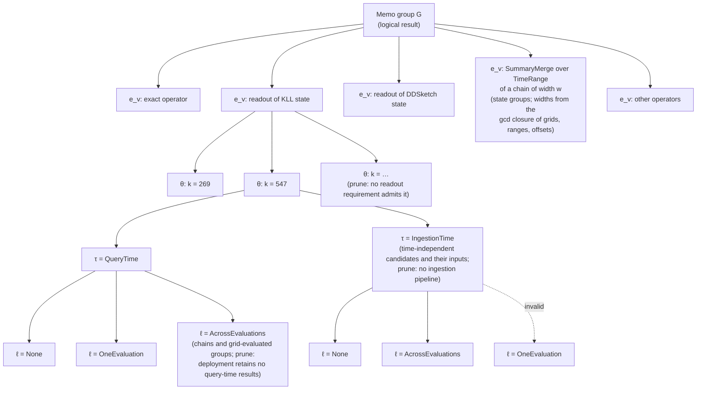

# Memo groups, properties and requirements

This document explains how the optimizer represents alternatives, checks whether they can be composed, and selects an executable plan. It follows the optimization problem formulation (paper, "Optimization Problem Formulation") for the baseline model and labels additional design work **Extension (#1207)**.

The Rust blocks are interface sketches, not compilable code. Paths name today's code; issue numbers name the work that changes it.

## 1. Model and running example

A **workload** contains query expressions, their evaluation schedules, and their accuracy targets. An accuracy target belongs to a query; an aggregate's measures inside the query carry none. A **memo group** represents one logical result or one intermediate summary state over specified input data. A **candidate** is one way to compute that result: one operator over input groups, together with its properties.

Input groups leave producer choices open. Selecting a candidate does not select its entire input plan. Each consumer input chooses a producer separately, and several inputs may choose the same producer.

**Summary terminology.** A summary state is described at three levels:

| Term | What it is | Code | Example |
|---|---|---|---|
| Family | the kind of summary | a `FieldDataType` variant: `ExactAggregate`, `Sketch`, `SummarySample`, `Wavelet`, `StatModel` | `Sketch` |
| Algorithm | one structure within a family | `SketchAlgorithm` (`Kll`, `DDSketch`, `Cms`, `HydraKll`, …); `ExactKind`, `SamplingKind`, … for the other families | `Kll` |
| Summary type | family and algorithm together: one `FieldDataType` value | `FieldDataType::Sketch(SketchAlgorithm)` | `Sketch(Kll)` |
| Parameters θ | the structure's sizes | `SketchParams` (and the other families' parameter types), on the candidate's `LogicalProperties` | `Kll { k: 547 }` |

The summary type is an operator argument (the `summary_type` field of `SummaryAgg` and of the chain), so it is part of the expression; θ is not. KLL and DDSketch states are therefore separate state groups, and builds that differ only in θ are candidates of one group. A final-result group can offer readout candidates over either state group. The decision tree's first level (Section 2) chooses the expression, summary type included; a state group never mixes summary types. Which statistics a summary type answers, and whether its states merge, is its row of `SummaryTypeCapability`.

### Running example

Query A requests the p95 latency over one minute with a rank-error target. Query B requests p99 divided by p50 over the same input with a relative-error target. Both run every ten seconds.

| Group | Result | Candidate expressions |
|---|---|---|
| G1 | Raw latency input | `Scan latency[1m]` |
| G2 | KLL state over G1 | `SummaryAgg[Sketch(Kll)](G1)` with `k = 269` or `k = 547` |
| G2′ | DDSketch state over G1 | `SummaryAgg[Sketch(DDSketch)](G1)` with `alpha = 0.01` or `alpha = 0.02` |
| G3 | Query A output | `SummaryEstimate[q=0.95](G2)` |
| G4 | p99 latency | `SummaryEstimate[q=0.99](G2′)` |
| G5 | p50 latency | `SummaryEstimate[q=0.50](G2′)` |
| G6 | Query B output | `Divide(G4, G5)` |

KLL and DDSketch states are separate groups because the summary type is part of the expression. The metric rule of Section 4 decides which consumer may read which: KLL bounds **rank** error, which does not bound a quantile's value error or a ratio's relative error, so B's operands read the DDSketch state (relative value error), and A reads the KLL state.

G4 and G5 choose a G2′ producer independently. If both choose the same materialized physical producer, they reuse one computed state when their schedules and windows are compatible. An unmaterialized candidate may instead execute separately in different contexts; Section 5 explains that distinction.

### Notation used by the baseline model

Symbols are collected here and in the sections that use equations. The prose and code use descriptive names.

| Symbol | Meaning |
|---|---|
| $\mathcal W$, $\mathcal Q$, $H$ | Workload, query set, and common evaluation horizon |
| $\mathcal T_q$, $A_q$ | Query evaluation schedule and accuracy target |
| $G$, $G_q$ | Memo group and query-output group |
| $v$, $u$, $c$, $i$ | Candidate, producer candidate, consumer candidate, and consumer input index |
| $e_v$, $p_v$ | Candidate expression and properties |
| $\boldsymbol\theta_v$, $\tau_v$, $\ell_v$ | Parameters (structure only), execution timing, and result lifetime |
| $\mathcal I(c)$, $G_{c,i}$ | Consumer input indices and required group for one input |
| $r_{c,i}$ | Logical requirement (required accuracy, readout inputs only) and physical requirement of one input |
| $n_q$ | Number of values one evaluation of query q returns |
| $\mathcal C$ | Physical candidate set |
| $\alpha^{\mathrm{log}}_{u,c,i}$, $\alpha^{\mathrm{phys}}_{u,c,i}$ | Fixed logical and physical compatibility indicators |

The candidate and property definitions are:

$$
v=(e_v,p_v), \qquad e_v=\operatorname{op}_v(G_{v,1},\ldots,G_{v,n_v}).
$$

$$
p_v=(p_v^{\mathrm{log}},p_v^{\mathrm{phys}}),\qquad
p_v^{\mathrm{log}}=\boldsymbol\theta_v,\qquad
p_v^{\mathrm{phys}}=(\tau_v,\ell_v).
$$

The formulation's text defines the producer set after the requirement check, and its notation table before it. This document follows the table and constraints (G)–(H), and names the filtered set separately:

$$
P_{c,i}=G_{c,i}\cap\mathcal C,
\qquad
P^{\mathrm{adm}}_{c,i}
=\{u\in P_{c,i}:\alpha^{\mathrm{log}}_{u,c,i}=\alpha^{\mathrm{phys}}_{u,c,i}=1\}.
$$

$$
\mathcal E=\{(u,c,i):c\in\mathcal C,\ i\in\mathcal I(c),\ u\in P_{c,i}\}.
$$

Here, group membership denotes the physical candidates belonging to that group. Property satisfaction means that both checks succeed; it is not a universal numerical ordering.

## 2. Properties and input requirements

A property describes what a candidate delivers. An input requirement describes what a consumer can accept. Workload requirements such as final accuracy and latency apply to the composed plan.

### Property dimensions

This is the single reference table for property dimensions. Stage descriptions below explain when these choices are made without repeating their definitions.

| Dimension | Values and meaning | Code reference or target |
|---|---|---|
| Parameters θ | The structure of a summary, from a predefined list per algorithm, `parameter_list(algorithm)`: KLL and KMV `k`; DDSketch `alpha`; HLL `precision`; CMS and CountSketch `width` and `depth`; heap variants also `heap_size`; UnivMon its L2 column count and distinct-count heap size. θ is structure only: no field records the error or failure probability a configuration was sized for, and equality is derived over all fields. The lists span today's sizing over ε = 0.1 down to 0.001 (KMV's and UnivMon's distinct-count entries stop at ε = 0.01). Where δ is set by a structural parameter, the list covers the δ levels with it: CMS lists each width with depths 5, 7, 10 and 12 (δ = e^−d ≤ 1e-2, 1e-3, 1e-4, 1e-5). CountSketch reads the median of its rows, each wrong with probability about 1/3, so δ = P(Binomial(d, 1/3) ≥ (d+1)/2), defined for odd d: it lists each width with depths 47, 81, 117 and 155 for the same δ levels. UnivMon's list has 40 entries: each of the 7 L2 column counts with each of the 4 distinct-count heap sizes, each of them alone, and the baseline. A heap variant combines each width × depth with heap sizes from the 1-2-5 series 10, 20, 50, …, 10 000, so the smallest heap that holds a top-k's k is at most 2.5× too large. A sketch build's θ must be in its algorithm's list; exact operators have none. A candidate that passes states on without building them (`SummaryMerge`, and a `Filter`, `TimeRange` or `TimeShift` over states) carries the θ of the states it reads: Pass 2 adds one such candidate per θ among its input group's candidates, and its input edges connect only to producers with the same θ (Section 3, "Logical edges"). So every candidate of a sketch state group has a θ, and a readout's guarantee is that of its producer's θ. Algorithms without an error model (the Hydra algorithms among them) have empty lists, so no build of theirs is a valid candidate until their error models exist (#1228). | `SketchParams` in `crates/types/src/ir/schema/sketch.rs`; `parameter_list` |
| Timing | `IngestionTime` or `QueryTime` | `ExecutionTiming` |
| Lifetime | `None`: discard after the consuming execution; `OneEvaluation`: retain until consumers within that evaluation finish; `AcrossEvaluations`: retain across evaluations in the specified period. A non-`None` lifetime means materialized. | `Lifetime`; #1200 |
| Storage medium — Extension | `Memory` or `Disk`, carried by a materialized lifetime | `StorageMedium` |

An error guarantee is not a property: it depends on the summary type, θ and the statistic a readout reads, and is checked on the edge from a state candidate (a build, or a merge with the θ it carries) to a readout (below). It has an error metric, a bound, and a failure probability; exact computation introduces no approximation error.

The properties are the formulation's, $p_v^{\mathrm{log}}=\boldsymbol\theta_v$ and $p_v^{\mathrm{phys}}=(\tau_v,\ell_v)$; in code, `LogicalProperties { parameters }` and `PhysicalProperties { timing, lifetime }`.

**Tumbling windows are expressions, not properties.** A tumbling-window chain is its own memo group, `SummaryTumblingWindowChain[w](X)`, with the window width $w$ as an operator argument (Section 3, "Chain groups"). Every grid is anchored at phase 0 (the epoch), so the width alone fixes it. A query over a range reads the chain through `TimeRange` and `TimeShift` groups and merges the selected windows with `SummaryMerge`, which carries the chain build's θ. No property carries the width, and two queries with different ranges or offsets share one chain group. Sliding merge/subtraction layouts remain future work; how many windows a chain retains is $h_v$ (Section 5).

### Logical requirements

A logical requirement is the accuracy a consumer input needs from its producer. Only a readout's input (`SummaryEstimate`, `FinalizeExactAccumulator`, `EvaluatePopulation` over an approximate state) carries one:

```rust
pub struct LogicalRequirements {
    /// None on every input that is not a readout's, and on a readout's input
    /// when no accuracy target reaches it.
    pub required_accuracy: Option<RequiredAccuracy>,
}

pub struct RequiredAccuracy {
    pub metric: AccuracyMetric,
    /// ε_r, in the metric's units.
    pub max_error: f64,
    /// δ_r, per value; 1 when the target sets none.
    pub failure_probability: f64,
}
```

**One rule for every algorithm.** A build u satisfies readout r's requirement when u's guarantee for r's statistic, evaluated at the required failure probability, is within the required error:

$$
\alpha^{\log}_{u,r,0}=1
\iff
\operatorname{guarantee}(\text{summary type},\ \boldsymbol\theta_u,\ \text{statistic}_r)\big|_{\delta=\delta_r}\le\varepsilon_r\ \text{in metric}_r,
$$

and, for a top-k readout, `heap_size` ≥ k. An exact producer has error 0 and satisfies every requirement. Some algorithms set ε and δ with separate parameters, as CMS's width and depth do; in others one parameter sets both, as KLL's k does. The rule is the same: evaluate the guarantee at δ_r and compare it with ε_r.

**Example: KLL, where k sets both.** A requirement of rank error 0.01. KLL's rank error is 2.296 / k^0.9723 at δ = 0.01, scaled by z(1 − δ/2) / z(0.995) below it (1.90 at δ = 1e-6):

| k | rank error at δ = 1e-2 | rank error at δ = 1e-6 | meets (0.01, 1e-2) | meets (0.01, 1e-6) |
|---|---|---|---|---|
| 269 | 0.0100 | 0.0189 | yes | no |
| 547 | 0.0050 | 0.0095 | yes | yes |
| 1404 | 0.0020 | 0.0038 | yes | yes |

**Example: CMS, where width sets ε and depth sets δ.** A point-count requirement of 0.01 of the stream's L1 norm. Width 272 gives ε = e / 272 = 0.0100; depth d gives δ = e^−d:

| θ | ε (× L1) | δ | meets (0.01, 1e-2) | meets (0.01, 1e-4) |
|---|---|---|---|---|
| width 272, depth 5 | 0.0100 | 6.7e-3 | yes | no |
| width 272, depth 10 | 0.0100 | 4.5e-5 | yes | yes |

**Where the guarantee comes from.** `guarantee` is `AccuracyEvidence::measured_guarantee(summary type, θ, statistic, δ_r)` when the deployment's evidence has a measurement for that configuration, and `theoretical_guarantee(summary type, θ, statistic, δ_r, distinct bound)` (the algorithm's error formula) otherwise. Each returns the error bound that holds at failure probability δ_r, or `None` when θ cannot fail that rarely (no edge). The bound is compared with ε_r through `target_limit(ε_r)`, which admits only floating-point noise above ε_r. The source is decided before Pass 2 builds the logical edges, so (K) always has every readout's bound, and nothing is checked again after Stage 3.

```rust
/// The theoretical error bound of reading `statistic` from a state of
/// `summary_type` with parameters θ at `failure_probability`; a distinct
/// count from classic HLL only over at most `max_distinct_per_evaluation`
/// items (`Memo::max_distinct_per_evaluation` of the state's group).
pub fn theoretical_guarantee(
    summary_type: &FieldDataType,
    parameters: &SketchParams,
    statistic: &SketchStatistic,
    failure_probability: f64,
    max_distinct_per_evaluation: Option<u64>,
) -> Option<AccuracyGuarantee>;

/// The deployment's measured accuracy, read before the theoretical bound.
pub trait AccuracyEvidence {
    fn measured_guarantee(
        &self,
        summary_type: &FieldDataType,
        parameters: &SketchParams,
        statistic: &SketchStatistic,
        failure_probability: f64,
    ) -> Option<AccuracyGuarantee>;
}
/// Evidence with no measurement (the default).
pub struct NoMeasuredGuarantees;
impl AccuracyEvidence for NoMeasuredGuarantees { … } // always None

/// The largest evaluated error (or failure probability) that meets `limit`.
pub fn target_limit(limit: f64) -> f64;
```

**Sign conditions.** Some guarantees hold only for values of a known sign, read from the input group's `column_signs` (Section 3, "Value sign"): DDSketch's relative error on a quantile needs an input column of one sign, `NonNegative` or `NonPositive` (negated, all-negative values are all-positive).

**A readout's error is its requirement.** A readout candidate's output error is (ε_r, δ_r), a node property: every producer it may read meets it. Constraint (K) composes these errors to the query root (Section 4). Which requirements a readout group gets is Pass 2's choice (Section 4, "Readout requirements"): one per requirement level, each its own readout candidate.

The required input group's identity already constrains the summary type and data/window semantics. Inputs that are not a readout's have no requirement; their α^log is the metric rule (Section 4).

### Physical requirements

Physical requirements are derived from the consumer's timing and execution context, rather than stored redundantly. Stage 2 checks timing against lifetime (the table below). Stage 3 checks alignment per context (below), with the schedule of the context the consumer runs in.

| Consumer timing | QT, None | QT, OneEvaluation | QT, AcrossEvaluations | IT, None | IT, AcrossEvaluations |
|---|---|---|---|---|---|
| QueryTime | Allowed | Allowed | Allowed | Rejected | Allowed |
| IngestionTime | Rejected | Rejected | Rejected | Allowed | Allowed |

QT means QueryTime; IT means IngestionTime. Alignment, data coverage, and retention checks still apply to allowed combinations.

**Alignment.** There is no physical schedule property. When a result can be read follows from its lifetime and, for a chain, its window width:
- **None** and **OneEvaluation**: the result is computed inside one evaluation context κ (Section 5) and read there. A OneEvaluation result belongs to one context: queries on the same evaluation grid, a range query's steps included, are evaluated together, and that evaluation's consumers share the result. When it runs is the context's schedule, and Stage 3 chooses it through $x_{\kappa,v}$, just as for ℓ = None. Sharing across differently scheduled queries through a gcd schedule is not offered: it is rarely beneficial and wastes runs.
- **AcrossEvaluations** on a chain, `SummaryTumblingWindowChain[w](X)`: the input is cut into tumbling windows (k·w, (k+1)·w], with the grid anchored at phase 0 (the epoch). Windows are left-open and right-closed like a PromQL range, which `m[r]` evaluated at t reads as (t − r, t]. Each window is built when it ends and can be read from then on. A `TimeRange` over the chain selects the windows that lie fully inside (t − range, t], so a consumer can read a range whose ends lie on window boundaries. With w = 10 s, a `[1m]` query evaluated every 30 s at phase 0 merges 6 windows; one evaluated at phase 15 s cannot, because its range ends inside a window; with that query in the workload, the gcd closure also offers w = 5 s, which both can read. The `TimeRange` and `TimeShift` groups over a chain are computed within one evaluation.
- **AcrossEvaluations** on a candidate of any other group evaluated on a known grid: a time-independent result (one that does not depend on the evaluation time t, such as a result under `@ T`) is stored as is and can be read at any time; a time-dependent result is stored per evaluation time, as a time-indexed result series computed at every time of its grid. A consumer reads the value stored for its own evaluation time, or, through a `TimeShift` above it, for a shifted time; so the consumer's evaluation times must lie on the producer's grid. Its grid is the greatest common divisor of the grids of the queries that reach it, as for chain widths: a result read by queries every 60 s and every 120 s is computed every 60 s, and both read it.

A grid phase is not needed: a phase is absorbed by the width, because width candidates come from the gcd closure of the queries' grids, ranges and offsets (Section 3). For example, phases 0 and 5 s with w = 10 s give w = 5 s. Alignment alone does not ensure sufficient retained history; that is $h_v$ (Section 5).

**Why a chain needs a declared phase.** Take `sum_over_time(m[5m])` evaluated every 60 s, and a 60 s chain with windows (12:00:00, 12:01:00], (12:01:00, 12:02:00], …

| Case | Evaluation at | Data needed | Windows |
|---|---|---|---|
| Phase 0 declared | 12:05:00 | (12:00:00, 12:05:00] | exactly the 5 windows (12:00, 12:01] … (12:04, 12:05]: the merge is correct |
| No phase declared; the engine actually evaluates at second 17 | 12:05:17 | (12:00:17, 12:05:17] | (12:00, 12:01] holds only 43 s of the range and (12:05, 12:06] only 17 s: merging only full windows misses (12:00:17, 12:01:00] and (12:05:00, 12:05:17]; adding the partial windows counts (12:00:00, 12:00:17] and (12:05:17, 12:06:00] too. Both answers are wrong |
| Phase 15 s declared | 12:05:15 | (12:00:15, 12:05:15] | the widths divide gcd(60 s, 5 m, 15 s) = 15 s; with w = 15 s the range is exactly 20 windows |

Prometheus staggers rule-group evaluations by a hash of the group, so a fixed interval without a declared phase does not mean phase 0. One rule decides both sides: `QueryRecurrence::evaluation_grid_ms` returns `None` for a `FixedInterval` without a phase. Pass 2 then offers that query no chain width, and `delivers_on` lets it read no chain. Workloads declare the phase with `FixedIntervalAt { interval, evaluation_phase }` to use chains.

An evaluation context κ is a grid of evaluation times, derived from the workload's recurrence and range evaluation (Section 5). Let a chain producer have tumbling width $w$. A consumer running in κ can read the producer when $w$ divides every evaluation time of κ:

| Producer lifetime, or κ's recurrence for a chain producer with ℓ = AcrossEvaluations | Required alignment |
|---|---|
| None | Always: runs in κ |
| OneEvaluation | The result belongs to κ |
| `FixedIntervalAt { interval, evaluation_phase }`, range step $s$ | $w \mid \gcd(\text{interval}, s, \text{phase})$, the evaluation grid; $s$ counts only for a range evaluation of more than one step |
| `Scheduled(times)` | $w$ divides every time (and $s$) |
| `OneTime { execute_at: Some(t) }` | $w \mid t$ (and $s$) |
| `FixedInterval` without a phase, `OneTime { execute_at: None }`, `EstimatedRate`, `Unknown` | Never: the evaluation times are not known, and `evaluation_grid_ms` is `None` |
| A time-dependent result series with ℓ = AcrossEvaluations, computed on grid $g$ | every evaluation time of κ (shifted by the reading path's `TimeShift`s) lies on $g$ |
| A time-independent result with ℓ = AcrossEvaluations | Always |

The evaluation grid is `QueryRecurrence::evaluation_grid_ms(range_evaluation)` in `crates/types/src/workload/query.rs`, which Pass 2's chain widths and `delivers_on` both use. One-off queries are supported: each is a context of its own recurrence, run `invocations` times.

### Invalid combinations

The checked constructor rejects one combination:

| Combination | Reason |
|---|---|
| IngestionTime with OneEvaluation | No query evaluation lifetime at ingestion time |

A tumbling grid's width is an argument of the chain operator, part of the expression, and its phase is 0, so no property repeats or extends it.

### Decision tree and order of decisions

A memo group's candidates are the leaves of a tree. The first level chooses the expression $e_v$ (operator and summary type); each later level decides one property dimension. A path from the root to a leaf is one physical candidate.



| Level | Decides | Stage | Values offered | Pruned when |
|---|---|---|---|---|
| 1 | expression $e_v$, including a merge over a chain of width $w$ | Pass 1 and Pass 2 rules | each way to compute the group; chain widths from the gcd closure of the reaching queries' grids, ranges and offsets | no reaching query has a known grid (no chain is offered) |
| 2 | $\boldsymbol\theta_v$ | Pass 1 | the algorithm's predefined list | dead-candidate elimination (Section 3): no readout requirement it could serve admits it |
| 3 | $\tau_v$ | Stage 2 | QueryTime; IngestionTime only for a candidate that is time-independent or an input of one, and for a counter state only when the source's out-of-order bound is known (Stage 2) | the source has no ingestion pipeline; QueryTime over raw rows the deployment does not retain; a Count-Min build whose weights are not proven non-negative |
| 4 | $\ell_v$ | Stage 2 | None, OneEvaluation, AcrossEvaluations; AcrossEvaluations for chains and for candidates of groups evaluated on a known grid, and Disk only where the deployment offers it | invalid with $\tau_v$; the deployment retains no query-time results |

The planner does not check whether an executor implements an operator or summary type: every candidate the rules produce is offered, and an executor that lacks one is extended. A value outside a dimension's declared value set (IngestionTime on a time-dependent candidate, AcrossEvaluations on a candidate of a group with no known grid, Disk where the deployment has no disk storage) is not offered, so it is not recorded as pruned. Nor is (IngestionTime, None) for a summary build (`SummaryAgg`, `SummaryTumblingWindowChain`, `MaintainPopulation`): a build fed at ingestion time keeps its state between batches, so it is materialized; the plan's validation rejects an unmaterialized one. A candidate one of whose consumers reads it under `@ T` with no known horizon end gets no materialized alternative (its retention need, the horizon end − T + range, is unbounded); its query-time alternatives stay.

The tree does not decide which producer each consumer input reads ($y$), in which context a candidate with ℓ = None or OneEvaluation runs (Section 5), or how much an AcrossEvaluations candidate retains ($h_v$). Those are Stage 3 choices.

**The order does not change the candidate set.** The leaves are the product of the dimensions' values minus invalid combinations and pruned values. Each prune rule reads only the value it removes and values decided above it, so any order that keeps each prune rule below the dimensions it reads yields the same leaves.

**The order changes how many nodes enumeration visits:** $\sum_d \prod_{d' \le d} \lvert \text{values left at } d' \rvert$. Dimensions that prune much go early; dimensions that multiply without pruning go late. The order above follows four rules:

1. **Logical before physical.** Stage 1 hash-conses groups and computes $\alpha^{\log}$ once, before Stage 2 multiplies each logical candidate by its physical alternatives.
2. **Strong prunes early.** Dead-candidate elimination acts before physical properties multiply the tree.
3. **Dependent dimensions adjacent.** $\tau \to \ell$ rejects the invalid combination at the first level that can detect it.
4. **Deployment-wide prunes as early as possible.** Without an ingestion pipeline the IngestionTime subtree is pruned once per candidate; moving $\tau$ above $\boldsymbol\theta$ would prune it once per group, with the same leaves.

Alternative orders worth measuring: $\tau$ first, when most sources lack an ingestion pipeline; and requirement-driven (top-down) enumeration, which visits fewer nodes but must take the union of all consumers' requirements so that sharing is not lost.

### Node, input or edge: where each quantity lives

Every quantity the optimizer uses is one of three kinds, and is stored where its dependencies are:

- a **node property** depends only on one candidate (θ, τ, ℓ, a readout's error) or one group (schema, lineage, `column_signs`);
- an **input requirement** depends only on the consumer's input (`RequiredAccuracy`; the physical requirement, derived from the consumer's timing);
- a **pair quantity** depends on both producer and consumer, so it lives on the edge (u, c, i); when it also depends on the execution context, on (edge, κ).

Each quantity is computed once, at the earliest stage that knows everything it depends on, and later stages read it. Nothing pair-dependent is stored on a node, where it would need a representative producer or consumer.

**Example.** A DDSketch build u with alpha = 0.01 over `latency` (declared non-negative), read by the p50 readout r of query B, whose requirement is relative error 0.01 at δ = 1e-2:

| Quantity | Kind | Depends on | Computed at | Value |
|---|---|---|---|---|
| θ_u | node property | u | Pass 1 | alpha = 0.01 |
| `column_signs` of the build's input | group property | the input group | Stage 0 | `NonNegative` |
| `RequiredAccuracy` of r's input; r's output error | input requirement; node property | r | Pass 2 | relative, 0.01, 1e-2 |
| α^log_{u,r,0} | pair | u, r | Pass 2 | 1: DDSketch's guarantee for p50 at alpha 0.01 is relative 0.01 at δ = 0, and the input is non-negative |
| α^phys_{u,r,0} | pair | τ_u, ℓ_u, τ_r | Stage 2 | 1 for u at query time with ℓ = None and r at query time |
| `delivers_on(u, κ)` | (edge, κ) | ℓ_u, κ | Stage 3 | true: ℓ = None runs in κ |
| edge cost $c_{\kappa,u,r,0}$ | (edge, κ) | u's output size, κ | Stage 3, from `asap-cost` | reading one alpha-0.01 DDSketch per execution of κ |
| $\operatorname{need}_{\kappa,u,r,0}$ | (edge, κ) | the reading path, κ | Stage 3 | none: u is not time-indexed (for a chain producer, the path's offset plus range) |

## 3. Pipeline: interfaces and rules

| Stage | Input | Output | Responsibility |
|---|---|---|---|
| Stage 0 | Query IR, each query with its accuracy target and $n_q$; the data workload's source facts | `Memo` (groups without candidates) | Hash-cons logical expressions; derive group properties |
| Stage 1, Pass 1 | Group DAG | `Memo` | Add initial logical candidates and intermediate groups |
| Stage 1, Pass 2 | Memo | `LogicalASAPMemoCandidates` | Add rollup, top-k and chain alternatives, give readouts their requirements, eliminate dead candidates, and compute logical edges |
| Stage 2 | Logical memo candidates | `PhysicalASAPMemoCandidates` | Expand physical alternatives and compute compatibility |
| Stage 3 | Physical memo candidates | `PlanOutput { plan: PhysicalASAPDAG }`, and a `Selection` report | Select implementations, dependencies, and executions, and build the plan |

Enumeration follows the decision tree in Section 2. Accuracy pruning uses the readout requirements and caps of Section 4.

Rules add groups through `find_or_add_group` and candidates through `add_candidate`. They match group expressions, avoid duplicating an existing expression/property pair, and do not copy consumers to make a new producer visible. After logical generation finishes, edge construction records the possible producer choices.

### Stage 0: groups

`memo_of_queries` in `crates/stage0-memo` starts from `Memo::new(data)`, which stores the data workload's source facts (`DataWorkload::sources`) at construction, and builds the groups bottom-up from the queries' nodes: each node's operator, over its children's groups, goes through `Memo::find_or_add_group`, so identical sub-expressions are one group; each query is then added with `Memo::add_query` as a `MemoQuery`: its root, its accuracy target and $n_q$, the number of values one evaluation returns (Pass 2 turns a whole-result failure probability into a per-value one with it). Stage 0 and Stage 1 share one type, `Memo`: Stage 0 returns it with every group's candidate list empty, and Stage 1 fills the lists.

```rust
// crates/types/src/stages/logical/group.rs
pub struct MemoGroupId(pub u32);

pub struct MemoGroup {
    /// What it computes: one operator, with its arguments. Each
    /// `MemoGroupId` in it is an input group, never this group's own id. θ
    /// is no argument of an operator, so it is not part of a group.
    pub expression: Operator<MemoGroupId>,
    /// Derived once when the group is created, from its input groups; never
    /// changes.
    pub group_properties: GroupProperties,
    /// The groups that read it (`parent_groups()`) through their expression
    /// or a candidate's: kept up to date by `find_or_add_group` and
    /// `add_candidate`.
    pub(super) parents: Vec<MemoGroupId>,
    /// The queries whose roots reach it (`reached_by_queries()`), ascending:
    /// kept up to date by `add_query` and `add_candidate`.
    pub(super) queries: Vec<usize>,
    /// Its candidates: empty after Stage 0, filled by Stage 1.
    pub candidates: Vec<CandidateForMemoGroup>,
}

impl MemoGroup {
    pub fn parent_groups(&self) -> &[MemoGroupId];
    pub fn reached_by_queries(&self) -> &[usize];
}

pub struct GroupProperties {
    pub schema: Schema,
    pub result_kind: OperatorResultKind,
    /// Per output column, in schema order: the sign of its values, from the
    /// input groups' and, for a `Scan`, the declared ones ("Value sign").
    pub column_signs: Vec<ValueSign>,
    /// Whether the result changes with the evaluation time: true for a
    /// group under a `TimeRange` relative to the evaluation time
    /// (`sum_over_time(m[5m])`) or reading it (`time()`, `now()`), false
    /// for one under a fixed `@ T` or reading no time. A result that does
    /// not depend on it is the same at every evaluation, so a stored copy
    /// delivers on every grid.
    pub depends_on_evaluation_time: bool,
    /// What an aggregate group covers: a summary state, a chain, a
    /// `TimeRange`/`TimeShift` over a chain or a merge over one, or an exact
    /// `Aggregate` result; `None` for any other group.
    pub aggregate_coverage: Option<AggregateCoverage>,
    /// Whether two equal expressions return the same rows for the same
    /// input rows, so they may be one group (not an unordered `LIMIT`).
    pub shareable_when_equal: bool,
    /// The sources the `Scan`s below this group read: a `Scan`'s own, else
    /// the union over its input groups.
    pub scanned_sources: BTreeSet<Source>,
}

// crates/types/src/stages/logical/aggregate_coverage.rs
/// What an aggregate computes, with every lifted selection removed.
pub struct AggregateDefinition {
    /// The group the unlifted operators read: the first input under the
    /// `SummaryAgg` or exact `Aggregate` that is not a `Filter`, a range
    /// `TimeRange`, a `TimeShift` without `@ start()`/`@ end()` or a
    /// direct-column `Project`. `None` when that input is a `Scan` with a
    /// liftable predicate (a PromQL label matcher): it is lifted too, and the
    /// `Scan` with the rest of its predicates is the last unlifted operator,
    /// so states over one source with different matchers may merge.
    pub input_group: Option<MemoGroupId>,
    /// The operators not lifted into the selection, listed top down from the
    /// `SummaryAgg` or `Aggregate`, each with only its residual arguments. `None` marks an
    /// operator's main input (the next unlifted operator, or input_group);
    /// `Some(g)` is another input group it reads, such as the group a scalar
    /// subquery in a Filter reads. Two states may merge only if input_group
    /// and these operators are equal.
    pub unlifted_operators: Vec<Operator<Option<MemoGroupId>>>,
}

pub struct AggregateCoverage {
    pub(crate) definition: AggregateDefinition,
    /// Union of boxes over the output rows of the unlifted operators' input.
    pub(crate) selection: Vec<SelectionBox>,
}

/// The coverage of what a memo group computes with `operator` over its
/// input groups; `CoverageError::NoCoverage` when it is no aggregate (or a
/// `TimeRange`/`TimeShift` over a chain whose windows are not one interval
/// on the timestamp column), and the merge errors (`EmptyMerge`,
/// `DefinitionMismatch`, `InputsOverlap`, …) for an invalid merge.
pub(super) fn aggregate_coverage(
    operator: &Operator<MemoGroupAsInput<'_>>,
) -> Result<AggregateCoverage, CoverageError>;

// crates/types/src/stages/logical/memo/mod.rs
pub struct Memo {
    /// The groups, by id (`groups()`); added only through
    /// `find_or_add_group`.
    groups: Vec<MemoGroup>,
    /// The queries, by index in the workload (`queries()`); added only
    /// through `add_query`.
    queries: Vec<MemoQuery>,
    /// The groups `find_or_add_group` may return, by `expression_hash` of
    /// their expression: every group whose sharing is legal
    /// (`GroupProperties::shareable_when_equal`).
    groups_by_expression_hash: HashMap<u64, Vec<(MemoGroupId, String)>>,
    /// The data workload's facts per source (`DataWorkload::sources`), fixed
    /// at construction: a `Scan` group's column signs read them.
    pub(super) source_facts: BTreeMap<String, SourceFacts>,
}

/// One query of the memo: its root over groups, its accuracy target and
/// $n_q$.
pub struct MemoQuery {
    pub root: QueryRoot<MemoGroupId>,
    /// $A_q$; `None` for a query without one (every query when accuracy is
    /// not enforced).
    pub accuracy_target: Option<AccuracyTarget>,
    /// $n_q$, the number of values one evaluation returns; `None` when the
    /// data workload does not bound it. Pass 2 turns a whole-result failure
    /// probability into a per-value one with it.
    pub number_of_values_per_query_evaluation: Option<u64>,
}

impl Memo {
    /// A memo without groups over the sources `data` describes: a `Scan`
    /// group's column signs are the ones `data` declares for its source
    /// (`GroupProperties::column_signs`).
    pub fn new(data: &DataWorkload) -> Self;
    /// The groups, by id.
    pub fn groups(&self) -> &[MemoGroup];
    /// The queries, by index in the workload.
    pub fn queries(&self) -> &[MemoQuery];
    /// Adds `query` and returns its index: its root's groups and every
    /// group below them list it (`MemoGroup::reached_by_queries`). Stage 0
    /// adds each query once.
    pub fn add_query(&mut self, query: MemoQuery) -> usize;
}
```

Not yet in the code: `Memo::max_distinct_per_evaluation(group)`, the most distinct items one distinct-count summary over `group`'s rows counts in one evaluation, the sum of the scanned sources' declared `max_distinct_per_evaluation` (`None` when one has none), and `GroupProperties::column_lineage` (Column lineage, below).

How the definition and selection are derived, with examples: `docs/design_docs/proposals/asap-primitive-schema.md` §4.2.2.

The rules read an operator's inputs through one trait, so the same rules derive a front-end node's schema and a group's `GroupProperties`:

```rust
// crates/types/src/ir/operator/input.rs
pub trait OperatorInput: Sized + Clone {
    fn schema(&self) -> &Schema;
    fn result_kind(&self) -> OperatorResultKind;
    /// The input's own operator, its children as inputs again.
    fn operator(&self) -> Operator<Self>;
    /// What the input covers when it is an aggregate group in the memo;
    /// `None` for any other input.
    fn aggregate_coverage(&self) -> Option<&AggregateCoverage>;
    /// The sources the `Scan`s at or below the input read
    /// (`sources_scanned_by` of its operator): a memo group's stored
    /// `GroupProperties::scanned_sources`, recomputed for a node tree.
    fn scanned_sources(&self) -> BTreeSet<Source>;
}
/// A front-end node tree. Node trees carry no aggregate coverage.
impl OperatorInput for Rc<OperatorNode> { … }

// crates/types/src/stages/logical/group.rs
/// A memo group read as an operator's input: its `group_properties` and
/// its `expression`, whose inputs are read the same way.
pub(super) struct MemoGroupAsInput<'m> {
    pub(super) memo: &'m Memo,
    pub(super) group_id: MemoGroupId,
}
impl OperatorInput for MemoGroupAsInput<'_> { … }

// The existing rules, generic over the input; existing names kept.
impl<I: OperatorInput> Operator<I> {
    pub(crate) fn output_schema(&self) -> Result<Schema, SchemaDerivationError>;
    pub(crate) fn output_kind(&self) -> OperatorResultKind;
    pub(crate) fn validate_inputs(&self) -> Result<(), SchemaDerivationError>;
    pub(crate) fn is_shareable_when_equal(&self) -> bool;
}
/// Whether `operator` is a valid expression over its input groups, never a
/// node tree: its output schema derives, its inputs pass validation, and a
/// merge reads only states it may merge. Returns the output schema and,
/// for a merge, the coverage its check derived.
pub(super) fn validate_expression_over_input_groups(
    operator: &Operator<MemoGroupAsInput<'_>>,
) -> Result<(Schema, Option<AggregateCoverage>), SchemaDerivationError>;
/// The properties of a group computing `expression` over its input
/// groups, once it is valid over them.
pub(super) fn derive_group_properties(
    memo: &Memo,
    expression: &Operator<MemoGroupId>,
) -> Result<GroupProperties, SchemaDerivationError>;
```

Aggregate coverage exists only in the memo: a node tree has none, and `AggregateCoverage` has no type parameter. Identity has two scopes. In the memo, coverages compare by `AggregateDefinition` `==` (it holds `MemoGroupId`s); nothing in the memo needs an id. The plan carries `ViewCoverage::definition_id` (`crates/types/src/plan/materialized_view.rs`), a content id of what the view computes: its definition with every input group expanded recursively to its expression down to the `Scan`s, with no group or node ids, canonically serialized and hashed, so it is equal across plans and processes that compute the same thing and different when they do not.

A group is its expression: one operator, with its arguments, over input groups. Hash-consing compares and hashes the expression directly, so two expressions are one group when their operators and arguments are equal and their input groups are the same. θ is not an operator argument, so builds that differ only in θ share one group. An expression whose copies may return different rows (an unordered `LIMIT`) always gets a new group.

Everything that was computed on operator-node trees is computed on groups. `find_or_add_group` derives `GroupProperties` once, when the group is created, with `derive_group_properties`: the rules that check operator nodes (schema derivation, input validation, merge check: `validate_expression_over_input_groups`), applied to the expression over `MemoGroupAsInput`s, which read only the input groups' `expression` and `group_properties`, never a node tree:

- `schema` and `result_kind` from the operator and its input groups' schemas and result kinds; a scalar subquery reads the referenced group's schema.
- `aggregate_coverage`, for a summary state or an exact `Aggregate` result: walking down from the SummaryAgg or Aggregate through the input groups' expressions while each is a Filter, a TimeRange, a TimeShift (an offset or `@ T`; `TimeShift { at: End | Start }` is not lifted, see below) or a direct-column Project, lifting their predicates into the selection; a TimeRange or TimeShift becomes an interval on the timestamp column (below). The group below them is the definition's `input_group`. A Scan's predicates (PromQL label matchers, SQL filters, including absolute timestamp filters) are lifted too; the Scan with its residual predicates is then the last unlifted operator and `input_group` is `None`. The operators not lifted, each with its residual arguments, are `unlifted_operators`. A chain `SummaryTumblingWindowChain[w](X)` has the definition of a build over X and leaves the timestamp column unconstrained; a `TimeRange` or `TimeShift` over a chain constrains it as over raw rows. A merge's coverage comes from its inputs' stored coverage; a merge is valid only over inputs with equal definitions and disjoint selections, or over one time-indexed state. So the coverage of `SummaryMerge(TimeRange(TimeShift(Chain[w](X))))` equals that of `SummaryAgg(TimeRange(TimeShift(X)))`, and `add_candidate` accepts the merge in the original state group.
- The checks that read an input's operator (a merge over a time-indexed state reads a `TimeRange` over a chain; a selected build) read the input group's `expression`.
- `shareable_when_equal`: a `LIMIT` is shareable over a `Sort` with the same partitions (the input group's `expression`); a `Dedup` on every column (the input group's schema).
- `column_signs` and, once added, `column_lineage` (below), per output column.
- `scanned_sources`: a `Scan`'s own source; any other operator's is the union over its input groups'. A node tree computes the same rule through its children (`OperatorInput::scanned_sources`), so the rule is written once. A rule that needs time-series rows (a PromQL top-k ranks one row per series; a counter state reads in time order) checks that every scanned source `Source::is_time_series`.

`add_candidate` derives a candidate's properties with the same `derive_group_properties` and requires its schema and result kind to equal the group's. `OperatorNode` recursively contains chosen child nodes and therefore describes a fixed plan fragment; `Operator<MemoGroupId>` contains input group IDs and leaves their implementations open. A candidate needs its own expression because a group may offer several ways to compute the same result.

Removing the one-field `CandidateExpression` wrapper is possible but not adopted.

#### Column lineage

Its key is decided in PR 2b (`SourceColumn` was removed in #1230). Every output column of a group has a **lineage**: the source column its values are copied from, or none when the column is computed. It is a group property, derived once from the input groups' lineage (as optd's column-reference property is), and it replaces the table qualifier that schema fields carried. A schema field keeps only its name, type and nullability; a front end resolves a qualified name such as `f.src` with its own binding scope while it lowers the query, and the IR never needs the qualifier again.

```rust
pub struct GroupProperties {
    pub schema: Schema,                          // fields: name, type, nullability; no table qualifier
    pub result_kind: OperatorResultKind,
    /// One entry per output column, in schema order.
    pub column_lineage: Vec<ColumnLineage>,
    /// One entry per output column, in schema order (Value sign, below).
    pub column_signs: Vec<ValueSign>,
    pub aggregate_coverage: Option<AggregateCoverage>,
    pub shareable_when_equal: bool,
    pub scanned_sources: BTreeSet<Source>,
}

/// A column of a source (a Scan's table or metric), by name.
pub struct SourceColumn {
    pub source: String,
    pub column: String,
}

/// Where an output column's values come from.
pub enum ColumnLineage {
    /// Copied unchanged from a column of a source.
    SourceColumn(SourceColumn),
    /// Computed by an operator: a measure, an expression, a summary state or readout.
    Computed,
}

/// Aggregate coverage keys its selections by the same type. The timestamp
/// column is one of the columns; there is no separate time field.
pub struct SelectionBox {
    pub columns: BTreeMap<SourceColumn, Constraint>,
}

/// A constraint on one column of a selection.
pub enum Constraint {
    In(Vec<ScalarValue>),
    NotIn(Vec<ScalarValue>),
    /// Each end is `Included`, `Excluded` or `Unbounded`.
    Interval {
        lower: Bound<IntervalConstraintLimit>,
        upper: Bound<IntervalConstraintLimit>,
    },
}

/// An end of an interval. Two limits compare only within one variant.
pub enum IntervalConstraintLimit {
    /// A constant: `Float64(10.0)` for `price > 10`; `Timestamp(ms since the
    /// epoch)` for `@ T` or a SQL timestamp literal.
    FixedValue(ScalarValue),
    /// The evaluation time t plus this many ms (negative: before t); only on
    /// the timestamp column.
    EvaluationTimePlusMs(i64),
}
```

A repeatedly evaluated query covers different absolute times at every evaluation, so its group's coverage is written relative to the evaluation time t (`EvaluationTimePlusMs`); an `@ T` modifier or a SQL timestamp filter is absolute (`FixedValue(Timestamp)`). Both are intervals on the timestamp column, compared and lifted like any other column constraint; a value column such as `price` uses `FixedValue` ends. A PromQL range `m[r]` evaluated at t reads the samples in (t − r, t]: left-open, right-closed.

| Query fragment | `lower` | `upper` |
|---|---|---|
| `m[5m]` | `Excluded(EvaluationTimePlusMs(-300_000))` | `Included(EvaluationTimePlusMs(0))` |
| `m[5m] offset 1h` | `Excluded(EvaluationTimePlusMs(-3_900_000))` | `Included(EvaluationTimePlusMs(-3_600_000))` |
| `m[5m] @ end()` or `@ start()` | the subtree `m[5m]` is lifted as `m[5m]`; the `TimeShift { at: End \| Start }` above it is not lifted | |
| `m[5m] @ 1700000000` | `Excluded(FixedValue(Timestamp(1_699_999_700_000)))` | `Included(FixedValue(Timestamp(1_700_000_000_000)))` |
| SQL `WHERE ts >= '2026-11-01'` | `Included(FixedValue(Timestamp(..)))` | `Unbounded` |
| SQL `WHERE price > 10` (column `price`) | `Excluded(FixedValue(Float64(10.0)))` | `Unbounded` |

A range-evaluated query evaluates its expression at every step t of [start, end]. `@ end()` and `@ start()` pin a subtree to one end of that interval, so the subtree reads the same rows at every step. The front end lowers the subtree X without the `@`, so X is an ordinary group shared with any query over the same expression, and puts `TimeShift { at: End | Start }(X)` above it. In a range query, X runs once per request, in the evaluation context of the request's end times (for `@ start()`, end minus the span; Section 5), and its result is read at every step. In an instant query both equal t, so `TimeShift { at: End }(X)` is X.

**Derivation, per operator** (from the input groups' `column_lineage`):

| Operator | Output column lineage |
|---|---|
| `Scan` | each column: `SourceColumn(SourceColumn { source, column })` |
| `Filter`, `TimeRange`, `TimeShift`, `Sort`, `Limit`, `Dedup` | the input's, unchanged; also a `TimeRange` or `TimeShift` over a chain (it selects windows) and `TimeShift { at: End \| Start }` above a selector |
| `Project` | a column item, renamed or not: that input column's lineage; an expression item: `Computed` |
| `Aggregate`, `SummaryAgg`, readouts | group-by keys: the input's lineage of that key; measures, states and values: `Computed` |
| `SummaryTumblingWindowChain` | `window_end` (column 0): `Computed`; keys: the input's lineage of that key; state: `Computed` |
| `SummaryMerge` | per column: the inputs' lineage if they all agree, else `Computed`; over a chain's selected windows, the chain's build's (keys, then state); a regrouping merge: its keys', then the state |
| `Join` | the left input's columns, then the right input's |
| `SetOp`, `Concat` | per column: the inputs' lineage if they all agree, else `Computed` |
| `BinaryOp` (vector match) | label columns: the matched side's lineage; the value: `Computed` |

Lineage and sign (Value sign, below) are derived together, by one per-operator column layout: an output column that copies an input column keeps its lineage and sign; a computed one is `Computed`, with the sign the operator's rule gives.

**What reads it:**
- **Aggregate coverage.** A selection constrains columns keyed by their `SourceColumn` lineage, not by (qualifier, name). A predicate on a `Computed` column is not lifted; it stays in `unlifted_operators`. A merge's group keys must have equal lineage.
- **Candidate checks.** `add_candidate` compares a candidate's schema with its group's exactly: names, types, nullability, order. There is no qualifier to compare, so a readout renamed to the group's column name matches.

**Example 1: a SQL aggregate and its summary candidate.**

```sql
SELECT f.src, approx_distinct(f.dst) FROM flows f WHERE f.proto = 'tcp' GROUP BY f.src
```

| Group | Expression | Output columns | `column_lineage` |
|---|---|---|---|
| G1 | `Scan flows` | `src, dst, proto, ts` | `flows.src, flows.dst, flows.proto, flows.ts` |
| G2 | `Filter(proto = 'tcp')(G1)` | `src, dst, proto, ts` | same as G1 |
| G3 | `Aggregate(by src; approx_distinct(dst))(G2)` | `src, approx_distinct(dst)` | `flows.src, Computed` |
| G4 | `SummaryAgg[HLL](by src; dst)(G2)` | `src, state` | `flows.src, Computed` |
| G5 | `SummaryEstimate[cardinality](G4)` | `src, cardinality` | `flows.src, Computed` |
| — | candidate of G3: `Project(src, cardinality AS approx_distinct(dst))(G5)` | `src, approx_distinct(dst)` | `flows.src, Computed` |

The candidate's schema equals G3's, so `add_candidate` accepts it. Before lineage, G3's key carried the qualifier `flows` and the renaming `Project` could not keep it on one column while renaming another, so this candidate was rejected.

**Example 2: renames keep lineage.**

```sql
SELECT source, count(*) FROM (SELECT f.src AS source FROM flows f) GROUP BY source
```

The inner `Project` renames `src` to `source`; its lineage stays `flows.src`. Two summary states, one grouped by `source` here and one grouped by `src` in another query, have keys of equal lineage, so a merge of the two may pass the group-key check. Compared by (qualifier, name), `source` and `flows.src` looked like different columns.

**Example 3: the same name from two sources.**

```sql
SELECT s.region, count(*) FROM sales s JOIN users u ON s.user = u.id GROUP BY s.region
```

After the join, `region` may exist on both sides. The front end resolves `s.region` to the left input's column while lowering; in the IR the two columns have lineage `sales.region` and `users.region`, so a selection on `sales.region` is never confused with one on `users.region`.

**Example 4: PromQL label matchers.** `quantile_over_time(0.9, latency{job="api"}[1m])` and the same with `job="web"`. Each Scan's `job` column has lineage `latency.job`. The lifted matchers become selections `latency.job ∈ {api}` and `latency.job ∈ {web}`: disjoint selections on the same column, so the two KLL states may merge.


#### Value sign

Some error contracts hold only for values of a known sign: a relative error of a sum or average, DDSketch's relative error on a quantile, and Count-Min's estimates, which need non-negative weights. Each output column of a group has a sign, a group property derived once from the input groups, like lineage:

```rust
// crates/types/src/stages/logical/column_properties.rs
/// GroupProperties::column_signs holds one per output column.
pub enum ValueSign {
    /// Every non-NaN value is ≥ 0.
    NonNegative,
    /// Every non-NaN value is ≤ 0.
    NonPositive,
    /// Neither is known.
    Unknown,
}
```

A NaN does not break either sign: `NonNegative` means every non-NaN value is ≥ 0.

A source's signs are declared per column in the data workload's source facts (for example, `latency`'s value is non-negative). A PromQL counter's value is non-negative without a declaration. A column without a declaration is `Unknown`. `Memo::new(data)` stores the data workload's source facts at construction, and `find_or_add_group` reads their signs for a `Scan` (a histogram's or summary's series reads its family's).

| Operator | Output column sign |
|---|---|
| `Scan` | the declared sign of each source column; `Unknown` when none is declared |
| `Filter`, `TimeRange`, `TimeShift`, `Sort`, `Limit`, `Dedup`, column `Project` | the input's, unchanged |
| `Join`; `SetOp`, `Concat`; label rewrite (`label_replace`); SQL window function | the left input's columns then the right's (a semi or anti join: the left's only); per column, the inputs' sign when they all agree, else `Unknown`; the input's, the written label `Unknown`; the input's, the window value `Unknown` |
| `abs` | `NonNegative` |
| negation | flipped: `NonNegative` ↔ `NonPositive` |
| numeric literal, numeric cast | the literal's sign; the operand's sign |
| arithmetic, scalar (`x / 1000`, SQL `value * 8`) or vector (`a / b`), one rule | `+`: both `NonNegative` → `NonNegative`, both `NonPositive` → `NonPositive`; `*` and `/`: same sign → `NonNegative`, opposite → `NonPositive`; `-`, `%`, `^`, `atan2`, or an operand of `Unknown` sign → `Unknown` |
| `vector(s)` | the sign of the expression `s` (`vector(1000)`: `NonNegative`) |
| sum, avg, min, max, top-k, `first_over_time`, `last_over_time`; quantile with 0 ≤ q ≤ 1 | the input value's sign; a quantile with q outside [0, 1]: `Unknown` |
| count, distinct count, and the other counts and spreads (`count_values`, `changes`, `resets`, `group`, `absent`, `absent_over_time`, `present_over_time`, `stddev`, `stdvar`, frequency L2 norm and entropy) | `NonNegative` |
| `rate`, `irate`, `increase` | `NonNegative` over a `NonNegative` input (a counter); else `Unknown`, since a decrease reads as a reset |
| vector comparison, `and`, `unless`; `or`; comparison with `bool` | the left side's value sign; the sides' sign when they agree; `NonNegative` (0 or 1) |
| `SummaryAgg`, chain | the state records the sign of the values it is updated with (a constant weight: its sign; a tuple or entity identity: `Unknown`); keys keep theirs (`window_end` is `Unknown`) |
| `SummaryMerge` | the inputs' sign when they all agree, else `Unknown`; over a chain's windows, the chain's build's |
| readouts | the state's recorded sign; a distinct count, frequency L2 norm or entropy, and an exact count's finalization: `NonNegative`; a quantile with q outside [0, 1]: `Unknown`; a point count or top-k of a Count Sketch or UnivMon (and their variants, `SummaryTypeCapability::estimates_may_flip_sign`): `Unknown`, since a median of signed counters can be negative over non-negative weights (Count-Min keeps the state's sign); a readout whose output does not keep the state's layout: `Unknown` |
| any other expression | `Unknown` |

**Example.** `topk(5, sum by (host)(gauge))` over a gauge with no declared sign: the sum's sign is `Unknown`, so Stage 2 prunes the Count-Min heap builds (`CountMinWeightsNotProvenNonNegative`) and the query uses an exact top-k. Over `rate(requests_total[1m])`, the sum is `NonNegative` and the Count-Min builds stay.

### Stage 1, Pass 1: initial candidates

Implementation locations: `crates/stage1-pass1-per-computation-candidates/src/lib.rs` (`pass1_memo`) and `computation_targets.rs`; the memo methods below are in `crates/types/src/stages/logical/memo/mod.rs`. The #1203 target gives every intermediate result its own group; candidates contain one operator rather than private operator chains.

| Alternative | Added representation |
|---|---|
| Exact | Exact candidate in the result group |
| Exact accumulator | Accumulator-state group plus a finalize candidate in the result group |
| Summary | One state group per supported summary type; one build candidate per listed θ; separate readout candidates |
| Fused build | Several operators of one sub-DAG pattern, in one appearance of the sub-expression, fused into one candidate operator; `fused_groups` lists the groups of the operators it replaces |

Pass 1 candidates carry no input requirements: Pass 2 gives readouts their requirements once all candidates exist.

```rust
pub struct CandidateForMemoGroupId {
    pub group: MemoGroupId,
    /// Position in the group's `candidates` list.
    pub index_in_group: usize,
}

impl Memo {
    /// The group of `expression` (operator, arguments and input groups),
    /// added if new. Fails, leaving the memo unchanged, when the expression
    /// is not valid over its input groups
    /// (`validate_expression_over_input_groups`: schema derivation, input
    /// validation, merge check).
    pub fn find_or_add_group(
        &mut self,
        expression: Operator<MemoGroupId>,
    ) -> Result<MemoGroupId, SchemaDerivationError>;

    /// Adds `candidate` to `group`, or returns the id of the candidate there
    /// with the same expression and logical properties. The candidate's
    /// expression is checked by `validate_expression_over_input_groups`, as
    /// a group's is, and its
    /// output schema and kind must equal the group's; a rejected candidate
    /// leaves the memo unchanged.
    pub fn add_candidate(
        &mut self,
        group: MemoGroupId,
        candidate: CandidateForMemoGroup,
    ) -> Result<CandidateForMemoGroupId, CandidateError>;

    pub fn candidate(&self, id: CandidateForMemoGroupId) -> &CandidateForMemoGroup;

    /// Replaces candidate `id`'s input requirements r^log_{c,i}, one per
    /// input group. The only way to change a candidate's r^log: Pass 2 sets
    /// a readout's required accuracy after the rules have run. Panics when
    /// the vector does not have one entry per input group.
    pub fn set_candidate_input_requirements(
        &mut self,
        id: CandidateForMemoGroupId,
        input_requirements: Vec<LogicalRequirements>,
    );
}

pub enum CandidateError {
    /// The candidate's expression is not valid over its input groups (its
    /// output schema does not derive, an input fails validation, or a merge
    /// reads states it may not merge): a bug in the rule that built it.
    NotValidOverInputGroups(SchemaDerivationError),
    /// Its output schema or output kind differs from the group's: it does
    /// not compute the group's result.
    OutputDiffersFromGroup { group: MemoGroupId },
}

pub struct CandidateExpression {
    pub operator: Operator<MemoGroupId>,
}

pub struct CandidateForMemoGroup {
    pub expression: CandidateExpression,
    pub logical_properties: LogicalProperties,
    /// r^log_{c,i}, one per input group; changed only through
    /// `Memo::set_candidate_input_requirements`.
    pub input_requirements: Vec<LogicalRequirements>,
    /// The groups of the operators this candidate fuses: a sub-DAG pattern
    /// of several operators, in one appearance of the sub-expression,
    /// computed by this one operator. Empty for a candidate that fuses
    /// nothing.
    pub fused_groups: Vec<MemoGroupId>,
    // Diagnostic provenance; not a planning decision.
    pub origin: OriginOfCandidateForMemoGroup,
}

pub struct LogicalProperties {
    parameters: Option<SketchParams>,
}

impl LogicalProperties {
    /// Rejects parameters missing on a sketch build (a chain included),
    /// present on an exact operator, or not in the algorithm's list (which
    /// also rejects another algorithm's parameters).
    pub fn new(
        expression: &CandidateExpression,
        parameters: Option<SketchParams>,
    ) -> Result<Self, LogicalPropertiesError>;

    pub fn parameters(&self) -> Option<&SketchParams>;
}

pub fn parameter_list(algorithm: SketchAlgorithm) -> &'static [SketchParams];

/// What a summary type answers and how its states combine; one row per
/// summary type.
pub struct SummaryTypeCapability { /* … */ }

/// α^log of one edge (Section 2): for a readout's input, guarantee(summary
/// type, θ_u, statistic) at the required δ is within the required error, and
/// a top-k's heap holds k; for any other input, the metric rule (Section 4).
pub fn producer_satisfies_logical_requirements(
    memo: &Memo,
    producer: CandidateForMemoGroupId,
    consumer: CandidateForMemoGroupId,
    input_index_of_consumer: usize,
    evidence: &dyn AccuracyEvidence,
) -> bool;
```

`LogicalRequirements` and `RequiredAccuracy` are defined in Section 2. Error-model interfaces are grouped with accuracy in Section 4.

**Fused groups.** A fused candidate computes, as one operator, a sub-DAG pattern of several operators in one appearance of the sub-expression; `fused_groups` lists the groups of the operators it replaces. Reusing a common sub-expression across appearances is Pass 2's reuse, not fusion. Fusion rules:
- top-k (a sort and limit over an aggregate, as one heap summary);
- sum over sum, min over min, max over max (distributive aggregates, as one aggregate).

Hydra is not a fusion: it is a rollup strategy of the finest-common-group rule (Pass 2, Example 4).

TODO: revisit each fused candidate's inputs and outputs to check that the fusing rules are correct.

Migration targets: remove private `root_node` chains, duplicate `input_groups`, and `accuracy_budget_parts`. The proposed predefined parameter lists replace sizing one candidate per budget partition.

### Stage 1, Pass 2: reuse rules and logical edges

Pass 2 (`crates/stage1-pass2-reuse-candidates`) runs these steps in order:

| Step | What it does | Why it is here |
|---|---|---|
| 1. Rollup from the finest common group | Adds candidates that compute a coarser group from a finer one, and synthesizes one finest common group per cluster of equal definitions | Its candidates are new consumers that later steps must see |
| 2. Top-k reuse | Reads a compatible larger top-k result with an exact-input requirement | Same reason |
| 3. Reach, caps and readout requirements | Computes which queries reach each candidate along candidate edges, the validity and pruning caps (Section 4), and each readout group's requirement levels: one readout candidate per level, its `RequiredAccuracy` written with `Memo::set_candidate_input_requirements` | Needs every consumer added by steps 1 and 2 |
| 4. Dead-candidate elimination | Removes candidates no query can use, transitively, and records the root cause of each | Needs the requirements; keeps step 5 from building windows for dead candidates |
| 5. Chain groups | Adds tumbling-window chain groups and the merges that read them, with widths from the queries that reach each state group, then repeats step 4 over the memo with the chains | Needs the reach of step 3, including rollup consumers, and only the survivors of step 4; the repeat prunes a merge whose θ serves no consumer |
| 6. Logical edges | Records every (producer, consumer, input) and whether it satisfies the input's logical requirement | Runs on the final memo |

Rules match group expressions, add groups with `find_or_add_group` and candidates with `add_candidate`, and never copy consumers to make a new producer visible.

#### Rollup from the finest common group

One rule computes a coarse group $G_c$ from a finer group $G_f$. It covers coarser SQL aggregates, coarser summary states, filtered sketch rollups, rollups of finalized values, and scan widening. $G_c$ can be computed from $G_f$ when all of these hold:

1. **Equal definition.** Both have an `aggregate_coverage` and equal `definition`s: the same computation over the same input rows, apart from the selection.
2. **Rows are a subset.** $G_c$'s selection is inside $G_f$'s. Where it is narrower, the narrowing constrains only columns that are group-by keys of $G_f$ (matched by column lineage), so a compensating `Filter` over $G_f$'s output can select those rows. A `Filter` over state rows keeps them states.
3. **Keys are coarser.** $G_c$'s keys are a subset of $G_f$'s keys, by lineage.
4. **A rollup exists.** States roll up with `SummaryMerge(group_by)`. Finalized values roll up as follows; anything else rolls up only from states:

   | Finer measure | Coarser measure |
   |---|---|
   | sum | sum |
   | count | sum |
   | min / max | min / max |
   | avg, quantile, top-k, distinct count | only from states |
5. **Equal time constraints.** The constraints on the timestamp column are equal. A longer range is read from a shorter one's windows through a shared chain (below), not by this rule.

The candidate added to $G_c$ is `Rollup(by keys of Gc)(Filter(compensation, Gf))`, without the `Filter` when the selections are equal. The compensation must use only key columns because each output row of $G_f$ has already combined all raw rows of its key: a predicate on any other column, or on a computed value, cannot separate them.

**Finest common group.** For every cluster of at least two groups with equal definitions and equal time constraints, the rule synthesizes one group $G^*$ that every member can roll up from:
- its selection is, per column, the union of the members' constraints;
- its keys are the union of the members' keys, plus every column on which some member's selection is narrower than $G^*$'s, so each member's compensation uses only $G^*$'s keys.

$G^*$ is added with `find_or_add_group`, so it is an existing group when one matches, and each member gets a rollup candidate from it. Only this finest group is synthesized; intermediate groupings are not enumerated. $G^*$ is no query's output: Stage 3 selects it only when it is cheaper, and it is eliminated in step 4 when nothing reads it.

A Scan has no aggregation, so for scans every column is a key and the rollup step is empty: the finest common Scan reads the union of the members' label or column selections, and each member reads it through a compensating `Filter`/`Project`.

**Example 1: filtered sketch rollup.** F = `quantile by (job, host)(…latency[5m])`, C = `quantile by (host)(…latency{job="api"}[5m])`.

| Group | Expression | Coverage (definition, selection) | Keys | Candidates |
|---|---|---|---|---|
| G1 | `Scan latency` | | | |
| G2 | `TimeRange(5m, G1)` | | | |
| G3 | `SummaryAgg[KLL, by job, host](G2)` | D, `ts` ∈ (t − 5m, t] | job, host | builds |
| G4 | `Scan latency{job="api"}` | | | |
| G5 | `TimeRange(5m, G4)` | | | |
| G6 | `SummaryAgg[KLL, by host](G5)` | D, `ts` ∈ (t − 5m, t], `job` ∈ {api} | host | builds; **`SummaryMerge(by host)(G7)`** |
| G7 | `Filter(job = "api", G3)` | | | its own expression; output is states |

The definitions are equal, the narrowing `job ∈ {api}` is on a key of G3, {host} ⊆ {job, host}, and KLL states merge. G3 is already the finest group of the cluster {G3, G6}, so $G^*$ = G3. A query `quantile by (host)(…latency{status="500"}[5m])` gets no such candidate: `status` is not a key of G3, and every state already mixes status 200 and 500 samples.

**Example 2: rollup of a finer finalized sum.** F = `sum by (job, instance)(rate(x[1m]))`, C = `sum by (job)(rate(x[1m]))`.

| Group | Expression | Keys | Candidates |
|---|---|---|---|
| G3 | `rate(x[1m])` per series | | |
| G4 | `Aggregate(by job, instance; sum)(G3)` | job, instance | exact; finalize of an exact accumulator state |
| G5 | `Aggregate(by job; sum)(G3)` | job | exact; finalize of an exact accumulator state; **`Aggregate(by job; sum)(G4)`** |

Both are exact `Aggregate` groups with equal definitions and selections, so they have `aggregate_coverage` too. Stage 3 chooses by cost between reading F's finalized result (cheap when it is materialized) and merging accumulator states.

**Example 3: finest common group that no query asks for.** Q1 = `quantile by (host)(latency[5m])`, Q2 = `quantile by (job)(latency{host="xxx"}[5m])`.

| Group | Expression | Coverage (definition, selection) | Keys | Candidates |
|---|---|---|---|---|
| G1 | `SummaryAgg[KLL, by host](TimeRange 5m, Scan latency)` | D, all | host | builds; **`SummaryMerge(by host)(G*)`** |
| G2 | `SummaryAgg[KLL, by job](TimeRange 5m, Scan latency{host="xxx"})` | D, `host` ∈ {xxx} | job | builds; **`SummaryMerge(by job)(G3)`** |
| **G\*** | `SummaryAgg[KLL, by job, host](TimeRange 5m, Scan latency)` | D, all | job, host | builds |
| G3 | `Filter(host = "xxx", G*)` | | | its own expression |

The hull of {all, host ∈ {xxx}} is all; the keys are {host} ∪ {job} ∪ {host}, where the last `host` is the column on which G2 is narrower. Stage 3 chooses between two KLL builds and one build of G\* with job × host states.

**Rollup by subpopulation readout (Hydra).** When $G^*$ is built with an algorithm that answers any subset of its keys directly (the Hydra algorithms: `HydraKll`, `HydraCms`, `HydraCountSketch`; a capability in `SummaryTypeCapability`), a member does not need a `SummaryMerge`: its **readout group** gets a candidate that reads the subpopulation straight from $G^*$'s state. A KLL rollup happens at the state level (merge the states, then read); a Hydra rollup happens at the readout level (read each subpopulation from one shared structure). This needs `SummaryEstimate` to name the keys it reads the subpopulation by (`subpopulation_keys`), which it cannot express today; both are added when Hydra is back in scope.

**Example 4: Hydra as a rollup strategy.** Q1 = `quantile by (job)(0.99, latency[5m])`, Q2 = `quantile by (host)(0.99, latency[5m])`, Q3 = `quantile by (job, host)(0.99, latency[5m])`; 10 jobs, 1 000 hosts, 5 000 (job, host) pairs present.

| Group | Expression | Candidates |
|---|---|---|
| G2 | `TimeRange(5m, Scan latency)` | |
| S_jh (= G\*) | `SummaryAgg[by job, host](G2)` | one `Sketch(Kll)` build per θ (one KLL per pair); one `Sketch(HydraKll)` build per θ (one shared structure) |
| S_j | `SummaryAgg[by job](G2)` | `Sketch(Kll)` builds; **`SummaryMerge(group_by job)(S_jh)`** (valid when S_jh is built with KLL) |
| S_h | `SummaryAgg[by host](G2)` | `Sketch(Kll)` builds; **`SummaryMerge(group_by host)(S_jh)`** (KLL) |
| R_jh ← Q3 | `SummaryEstimate(p99)(S_jh)` | reads S_jh |
| R_j ← Q1 | `SummaryEstimate(p99)(S_j)` | reads S_j; **`SummaryEstimate(p99, subpopulation_keys: [job])(S_jh)`** (valid when S_jh is built with Hydra) |
| R_h ← Q2 | `SummaryEstimate(p99)(S_h)` | reads S_h; **`SummaryEstimate(p99, subpopulation_keys: [host])(S_jh)`** (Hydra) |

Stage 3 chooses among:

| Plan | Built | States | Extra work per query |
|---|---|---|---|
| ① separate | S_jh, S_j, S_h with KLL | 5 000 + 10 + 1 000 KLLs | none |
| ② KLL and merge | S_jh with KLL; S_j, S_h merged from it | 5 000 KLLs | Q1 merges 5 000 KLLs into 10, Q2 into 1 000 |
| ③ Hydra | S_jh with HydraKll; all three read it | one structure, its size set by θ, not by the number of pairs | one subpopulation query per group |

With many pairs and queries ③ is cheapest; with few pairs ① or ② can be. A subpopulation readout has a required accuracy like any readout, and α^log checks Hydra's guarantee for it at θ.

#### Reach, caps and readout requirements

A query reaches a candidate when a path of candidate edges leads from the query's output group to it; this is the reach $a_{q,v}$, computed top down after steps 1 and 2 so that rollup consumers count. Section 4 defines the caps from it, and which requirement levels each readout group gets ("Readout requirements"). Pass 1's readout candidate takes the first level and `add_candidate` adds one readout candidate per further level; `Memo::set_candidate_input_requirements` writes each one's `RequiredAccuracy`, and nothing else changes a candidate's r^log. Two readout candidates with the same expression and different requirements are different candidates.

#### Dead-candidate elimination

A candidate that is not a query output is **dead** when it never had a consumer, or when every edge to a consumer fails: the producer's guarantee misses the input's required accuracy, the metric rule cuts the edge (Section 4), or the consumer is dead. Any candidate, a query output included, is also dead when every edge on one of its inputs is cut or reads a dead producer. The metric rule cuts edges, not candidates: a candidate dies of it only through one of these two conditions. Elimination repeats until nothing changes, and runs once more after chain groups (step 5). Dead candidates get no logical edges and Stage 2 does not expand them; each is recorded with its root causes. Pass 2 also records each group's evaluation grid, which `delivers_on` reads for a stored result that is not a chain. Example: X = `sum_over_time(m[5m])` is read by a query every 60 s and by another every 120 s, both at phase 0; X's grid is 60 s @ 0. X materialized across evaluations is stored every 60 s, so it delivers on `Evaluation { 60 s @ 0 }` and `Evaluation { 120 s @ 0 }` but not on `Evaluation { 30 s @ 0 }`. X under `@ T` does not depend on the evaluation time and delivers on every context.

```rust
pub struct LogicalASAPMemoCandidates {
    pub memo: Memo,
    pub edges: Vec<LogicalEdge>,
    pub pruned: Vec<PrunedLogicalCandidate>,
    /// Per group: the grid its result is evaluated on, the coarsest grid
    /// holding every evaluation time of the queries reaching it; `None`
    /// when those times are not on one known grid. Pass 2 fills it.
    pub evaluation_grid_of_group: Vec<Option<EvaluationGrid>>,
}

/// A candidate eliminated by Pass 2.
pub struct PrunedLogicalCandidate {
    pub candidate: CandidateForMemoGroupId,
    /// Every cause: one per failing edge it is cut off by, so mixed causes
    /// (a missed requirement on one edge, the metric rule on another) are
    /// all listed.
    pub causes: Vec<PruneCause>,
}

/// One path from the candidate, through candidates that are themselves
/// eliminated, to the edge that fails. One shortest path per failing edge.
pub struct PruneCause {
    /// The eliminated candidates on the path, nearest first: consumers
    /// above, or, for a candidate cut off from an input, producers below.
    pub through_pruned_candidates: Vec<CandidateForMemoGroupId>,
    pub root: RootPruneReason,
}

pub enum RootPruneReason {
    /// The producer's guarantee, at the required failure probability,
    /// exceeds the consumer input's required error.
    BelowRequiredAccuracy {
        consumer: CandidateForMemoGroupId,
        input: usize,
        required: RequiredAccuracy,
    },
    /// The metric rule (Section 4): the producer is a readout whose metric
    /// the consumer does not accept on that input; or, on a readout's own
    /// input, the readout's metric is not one its output accepts.
    MetricRule {
        consumer: CandidateForMemoGroupId,
        input: usize,
        producer_metric: AccuracyMetric,
        /// The metrics accepted on that input (for a readout's own input:
        /// at its output).
        accepted_metrics: Vec<AccuracyMetric>,
    },
    /// A top-k readout's `k` exceeds the producer's heap size.
    HeapSmallerThanTopK {
        consumer: CandidateForMemoGroupId,
        input: usize,
        k: usize,
    },
    /// A readout reached by query `query`, whose whole-result failure
    /// probability has no per-value one: n_q is unknown.
    ValuesPerEvaluationUnknown {
        consumer: CandidateForMemoGroupId,
        query: usize,
    },
    /// The candidate never had a consumer and is not a query output. A
    /// candidate whose consumers were eliminated is traced to their causes.
    NoConsumer,
}
```

**Example: ratio of quantiles.** `quantile_over_time(0.99, m[5m]) / quantile_over_time(0.5, m[5m])` with relative error 0.05, no failure probability, and `m` declared non-negative.

| Group | Expression | Candidates |
|---|---|---|
| G1 | `Scan m` | |
| G2 | `TimeRange(5m, G1)` | |
| G3 | `SummaryAgg[Sketch(Kll)](G2)` | #0 … #6: k = 26 … 2863 |
| G3′ | `SummaryAgg[Sketch(DDSketch)](G2)` | #0 … #6: alpha = 0.1, 0.05, 0.02, 0.01, 0.005, 0.002, 0.001 |
| G4 | p99 | #0 exact; #1 `SummaryEstimate[q=0.99](G3)`; #2–#6 `SummaryEstimate[q=0.99](G3′)` requiring relative 0.02, 0.01, 0.005, 0.002, 0.001 |
| G5 | p50 | #0 exact; #1 `SummaryEstimate[q=0.5](G3)`; #2–#6 `SummaryEstimate[q=0.5](G3′)` requiring relative 0.02 … 0.001 |
| G6 | `Divide(G4, G5)` | #0, the query output |

The Divide carries only relative error. Its inputs' cap is 0.05 / 1.111 = 0.045 (Section 4), so the readouts of G3′ get the relative levels 0.02 … 0.001 of the error grid; 0.1 and 0.05 are looser than the cap. The KLL readouts are shown once: the metric rule removes them whatever their level. Pass 2 records:

```
G4#1 SummaryEstimate[q=0.99](G3)
  G4#1 → G6#0 input 0: MetricRule { producer_metric: Rank, accepted_metrics: [Relative] }
G5#1 SummaryEstimate[q=0.5](G3)
  G5#1 → G6#0 input 1: MetricRule { producer_metric: Rank, accepted_metrics: [Relative] }
G3#0 SummaryAgg[Sketch(Kll)] k=26          (and likewise G3#1 … G3#6)
  G3#0 → G4#1 input 0: MetricRule { producer_metric: Rank, accepted_metrics: [Relative] }
  G3#0 → G5#1 input 0: MetricRule { producer_metric: Rank, accepted_metrics: [Relative] }
G3′#0 SummaryAgg[Sketch(DDSketch)] alpha=0.1  (and likewise G3′#1, alpha=0.05)
  G3′#0 → G4#2 input 0: BelowRequiredAccuracy { required: relative 0.02 }
  G3′#0 → G5#2 input 0: BelowRequiredAccuracy { required: relative 0.02 }
  (and one cause per looser readout, G4#3 … G4#6, G5#3 … G5#6)
```

The KLL builds' edges into the KLL readouts are cut too: a KLL readout's metric, rank, is not one its output accepts (only relative reaches G4 and G5), so the readout has no requirement and reads no state. The exact candidates, every DDSketch readout, and the DDSketch builds with alpha ≤ 0.02 survive; each build connects only to the readouts whose level it meets (alpha 0.01 to the levels 0.02 and 0.01).

#### Chain groups

A state group whose expression is `SummaryAgg(TimeRange(W, TimeShift*(X)))` can be computed from a chain of tumbling windows over X:

```rust
// The chain: one row per window and key, (window_end, keys…, state): a State
// with a time index. Column 0, `window_end`, is the time index, computed
// (lineage `Computed`); the build's own time column is dropped; the unique
// key is (window_end, keys). No range and no window count: how much it
// retains is h_v.
SummaryTumblingWindowChain { child: X, summary_type, input, reduction, filter,
                             tumbling_window_width_ms: u64 }
// Merges every input state, or regroups them; no window-selection field.
SummaryMerge { children, group_by }
```

`TimeRange` and `TimeShift` accept a time-indexed state: over a chain, `TimeRange(W)` at evaluation time t selects the windows lying fully inside (t − W, t], and `TimeShift(o)` moves that interval to (t − o − W, t − o]. A `TimeRange` over a chain must be a range (`TimeRangeKind::Range`); an instant one is a validation error. This needs w to divide W and o, and t to lie on the grid; the widths below and `delivers_on` (Section 2) ensure both. The `TimeRange` and `TimeShift` groups over a chain have their own expression as candidates, one per θ of the chain's builds, and are computed within one evaluation; only the chain is materialized across evaluations.

**The rule, for each width w of a state group S:**
1. Walk down from S: `SummaryAgg` → `TimeRange(W)` → zero or more `TimeShift`s → X.
2. `find_or_add_group(SummaryTumblingWindowChain[w](X))` → $G_w$, with one build per θ of S's builds that survived step 4. The shifts are stripped, so queries with different ranges and offsets over the same X get the same $G_w$.
3. Re-wrap the stripped shifts and then the `TimeRange` around $G_w$, in their original order, each with `find_or_add_group` and one candidate per θ of the group it reads.
4. `add_candidate(S, SummaryMerge[θ](…))` over the outermost re-wrapped group, one per θ of that group's candidates. Its coverage equals S's (Section 3, Stage 0), so the candidate is accepted.

There is one chain per width, shared by every state group over the same X and summary type. Steps 3 and 4 run after step 2 has run for every state group, so a chain shared by state groups whose surviving builds differ offers each of them every θ it has. Dead-candidate elimination then runs again over the memo with the chains (below), so a merge whose θ meets no consumer's requirement is pruned.

**Widths.** Each query q that reaches S (step 3) and repeats with a known evaluation grid $g_q$ (`evaluation_grid_ms` is `Some`) gives the width $\gcd(g_q, W, o_1, \ldots)$, with the offsets $o_j$ on its path; S's widths are the gcd closure of these. Queries without a known grid give none, so a group read only by such queries gets no chain. `@` modifiers:
- `@ end()` and `@ start()`: the anchored subtree X is lowered without the `@` (Section 3), so a state group inside X is an ordinary state group. In a range query it is reached in the evaluation context of the request's end times, whose grid gives its widths like any query's.
- `@ T` (absolute) contributes no widths: S gets a merge only over chains that other queries' widths created, and only for widths that divide T. Whether reusing the chain is cheaper than computing the result once and materializing it is Stage 3's choice; its retention need is in Section 5.

**Example: three queries share one chain.** A = `sum_over_time(m[5m])`, B = `sum_over_time(m[5m] offset 1h)`, C = `sum_over_time(m[1h])`, each `FixedIntervalAt { 60 s, phase 0 }`. The widths are gcd(60 s, 5m) = gcd(60 s, 5m, 1h) = gcd(60 s, 1h) = 60 s.

| Group | Expression | Candidates |
|---|---|---|
| G1 | `Scan m` | |
| G3a | `SummaryAgg[Sum](TimeRange(5m, G1))` | build; **`SummaryMerge(Ga)`** |
| G3b | `SummaryAgg[Sum](TimeRange(5m, TimeShift(1h, G1)))` | build; **`SummaryMerge(Gb)`** |
| G3c | `SummaryAgg[Sum](TimeRange(1h, G1))` | build; **`SummaryMerge(Gc)`** |
| **Gw** | `SummaryTumblingWindowChain[Sum, w = 60 s](G1)` | one build per θ |
| Ga | `TimeRange(5m, Gw)` | its own expression, per θ |
| Gs | `TimeShift(1h, Gw)` | its own expression, per θ |
| Gb | `TimeRange(5m, Gs)` | its own expression, per θ |
| Gc | `TimeRange(1h, Gw)` | its own expression, per θ |

At t = 12:00, Ga selects the 5 windows (11:55, 11:56] … (11:59, 12:00], Gb the 5 windows (10:55, 10:56] … (10:59, 11:00], and Gc 60 windows. Each sample updates one chain instead of three, and the chain retains max(5m, 1h + 5m, 1h) = 65m, 65 windows (Section 5).

**Example: the rule step by step, for B.** Before the rule:

| Group | Expression |
|---|---|
| G1 | `Scan m` |
| G2 | `TimeShift(1h, G1)` |
| G3 | `TimeRange(5m, G2)` |
| G4 | `SummaryAgg[Sum](G3)`: B's state group, one build candidate |

1. Walk down from G4: `SummaryAgg` reads G3; G3 is `TimeRange(W = 5m)` over G2; G2 is `TimeShift(1h)` over G1; G1 is not a shift. So W = 5m, the shifts are [`TimeShift(1h)`], X = G1.
2. `find_or_add_group(SummaryTumblingWindowChain[Sum, w = 60 s](G1))` → Gw. A and C get the same Gw.
3. `find_or_add_group(TimeShift(1h, Gw))` → Gs; `find_or_add_group(TimeRange(5m, Gs))` → Gb.
4. `add_candidate(G4, SummaryMerge(Gb))`. (`Sum` is an exact accumulator: there is no θ, so one candidate per step.)

After the rule, G4 has two candidates, the build and `SummaryMerge(Gb)`; G2 and G3 stay. With widths {30 s, 60 s}, steps 2–4 run once per width, giving two chains and two merge candidates in G4; Stage 3 chooses.

**Example: a merge carries its θ.** P = `quantile_over_time(0.9, m[5m])` with rank error 0.005 and Q = `quantile_over_time(0.9, m[10m])` with rank error 0.01, both every 60 s. Each state group keeps the KLL builds that meet its readout: P's from k = 547, Q's from k = 269. Both read one chain $G_w$ over `m` (w = 60 s), which therefore has the builds k = 269, 547, … . `TimeRange(5m, G_w)` has one candidate per θ, and P's state group gets `SummaryMerge[k=269]` and `SummaryMerge[k=547]` (and so on). The edge from `SummaryMerge[k=547]` to P's readout holds; the edge from `SummaryMerge[k=269]` fails with `BelowRequiredAccuracy { required: rank 0.005 }`, so that merge is pruned, and `TimeRange(5m, G_w)[k=269]` with it (its only consumer is). The chain build k = 269 survives: Q's merge reads it.

#### Logical edges

```rust
fn apply(memo: &mut Memo) -> Result<(), Pass2RuleError>;

pub struct LogicalEdge {
    pub producer_candidate_id: CandidateForMemoGroupId,
    pub consumer_candidate_id: CandidateForMemoGroupId,
    pub input_index_of_consumer: usize,
    pub satisfies_logical_requirement: bool,
}
```

A candidate that carries a θ without building (a merge, or a `Filter`, `TimeRange` or `TimeShift` over states) has edges only from producers with the same θ; any other pair of a consumer and a candidate of its input group is an edge. An edge satisfies the logical requirement when α^log = 1 (`producer_satisfies_logical_requirements`): into a readout's input, the guarantee of the producer's θ meets the required accuracy (Section 2), and the readout's metric is one its own output accepts; into any other input, the metric rule: a readout producer's metric is one the consumer accepts on that input (Section 4). An edge from any other producer satisfies it.

### Stage 2: physical alternatives

`enumerate_candidate_configurations` in `crates/stage2-physical-optimization` expands each logical candidate that survived Pass 2 using the dimensions and checks in Section 2. It offers τ = IngestionTime only to a candidate that is time-independent (its output does not depend on the evaluation time t, as a chain's does not) or that is an input of one. It offers ℓ = AcrossEvaluations to chains and to the candidates of any group evaluated on a known grid: a time-independent result is materialized as is, a time-dependent one per evaluation time, as a time-indexed result series. Values not offered are not recorded. It creates no new logical candidates. Each logical edge is expanded between the relevant physical alternatives.

Stage 2 reads the logical candidates, the data workload (per-source arrival, below) and the deployment's capabilities:

```rust
// crates/stage2-physical-optimization/src/lib.rs
pub fn generate_physical_asap_memo_candidates(
    logical: &LogicalASAPMemoCandidates,
    data: &DataWorkload,
    capabilities: &DeploymentCapabilities,
) -> PhysicalASAPMemoCandidates;   // Stage 2 cannot fail
```

#### Data arrival

```rust
// crates/types/src/workload/data.rs
pub enum DataArrival {
    /// Every row is already stored; no build runs at ingestion time.
    AtRest,
    /// Rows keep arriving while the queries run.
    Ingesting { rows_per_second: f64, max_out_of_order_ms: Option<u64> },
    /// Older rows are stored and new rows keep arriving.
    Mixed { rows_per_second: f64, max_out_of_order_ms: Option<u64> },
    /// Not declared: no build runs at ingestion time.
    Unknown,
}
```

`max_out_of_order_ms` bounds how late a row may arrive relative to the newest row of its series.

**Counter states at ingestion time.** A counter state (`rate`, `increase`, `irate`) needs each series' samples in timestamp order to detect resets. It may still run at ingestion time: the ingestion data plane keeps a per-series reorder buffer that holds `max_out_of_order_ms` of rows and releases them in order. The buffer's memory, about rows per second × out-of-order bound × bytes per row, is part of that build's cost. For `rate(c_total[5m])` with 100,000 samples/s, a 2 s bound and 16 B per row, the buffer is about 100,000 × 2 × 16 B ≈ 3.2 MB. When `max_out_of_order_ms` is `None`, a PromQL source is taken to arrive in order (bound 0, no buffer); a SQL source gets no ingestion-time counter build, because SQL rows have no ordering guarantee.

**Filtered builds at ingestion time.** A filtered build needs no extra rule. α^phys already requires an ingestion-time build's input to be produced at ingestion time; the build reads each input row with all its columns and evaluates the filter before updating the state. For SQL `sum(x) FILTER (WHERE region = 'eu')` over `Join(events, hosts)`, the build runs at ingestion time only when the join does; it then reads each joined row, checks `region`, and adds `x` for the rows that pass.

#### Prune reasons

Stage 2 records every alternative it rejects, with one of these reasons; Stage 3 adds its own.

| Reason | Rejects |
|---|---|
| `NoIngestionPipeline` | IngestionTime when the source has no ingestion pipeline |
| `RawDataNotRetained` | a Scan of raw rows the deployment does not retain, at QueryTime or AcrossEvaluations |
| `QueryTimeResultsNotRetained` | (QueryTime, AcrossEvaluations) when the deployment retains no query-time results; (QueryTime, OneEvaluation) is kept, since it lives within one evaluation |
| `InputHasNoBuildableProducer` | a candidate for which some input has no surviving producer that satisfies α^phys |
| `ReachesNoQueryOutput` | a candidate from which no admissible path leads to a query root |
| `CountMinWeightsNotProvenNonNegative` | a Count-Min build (`Cms`, `CmsWithHeap`, `HydraCms`) whose weight column's `column_signs` is not `NonNegative`: its estimates are bounds only for non-negative weights |

These are the only reasons. The planner does not check executor support, so no reason names it.

```rust
// crates/types/src/ir/properties/execution_data_state.rs
pub enum ExecutionTiming {
    IngestionTime,
    QueryTime,
}

pub enum StorageMedium {
    Memory,
    Disk,
}

pub enum Lifetime {
    None,
    OneEvaluation(StorageMedium),
    AcrossEvaluations(StorageMedium),
}
pub struct PhysicalProperties {
    timing: ExecutionTiming,
    lifetime: Lifetime,
}
impl PhysicalProperties {
    /// Rejects only (IngestionTime, OneEvaluation).
    pub fn new(
        timing: ExecutionTiming,
        lifetime: Lifetime,
    ) -> Result<Self, PhysicalPropertiesError>;
    pub fn timing(&self) -> ExecutionTiming;
    pub fn lifetime(&self) -> Lifetime;
    pub fn is_materialized(&self) -> bool;
}

impl PhysicalCandidate {
    /// Whether a consumer running in `context` can read this producer
    /// (Section 2's alignment table): for a chain producer with
    /// ℓ = AcrossEvaluations, w (the chain operator's width) divides every
    /// evaluation time of the context (`evaluation_grid_ms`); for a
    /// materialized time-dependent result series, every evaluation time of
    /// the context lies on its grid; true for ℓ = None, for OneEvaluation in
    /// the same context, and for a materialized time-independent result.
    /// `IngestionPipeline` and `Materialized(v)` contexts are handled the
    /// same way, with their own schedules (v's read from `candidates`). A
    /// result's grid is `evaluation_grid_of_group`; whether it depends on
    /// the time, `GroupProperties::depends_on_evaluation_time`.
    pub fn delivers_on(
        &self,
        candidates: &PhysicalASAPMemoCandidates,
        context: &ExecutionContext,
    ) -> bool;
}
/// α^phys: timing and lifetime only (Section 2's table). Alignment is
/// checked per context in Stage 3 with `delivers_on`.
pub fn producer_satisfies_physical_requirements(
    producer: &PhysicalCandidate,
    consumer_timing: ExecutionTiming,
) -> bool;
pub struct PhysicalCandidateId(pub usize);
pub struct PhysicalEdgeId(pub usize);

pub struct PhysicalCandidate {
    pub logical_candidate_id: CandidateForMemoGroupId,
    pub physical_properties: PhysicalProperties,
}
pub struct PhysicalEdge {
    pub producer_candidate_id: PhysicalCandidateId,
    pub consumer_candidate_id: PhysicalCandidateId,
    pub input_index_of_consumer: usize,
    pub satisfies_logical_requirement: bool,
    pub satisfies_physical_requirement: bool,
}
pub struct PhysicalASAPMemoCandidates {
    pub logical_candidates: LogicalASAPMemoCandidates,
    pub physical_candidates: Vec<PhysicalCandidate>,
    pub pruned_candidates: Vec<PrunedCandidate<PhysicalCandidate>>,
}
/// A rejected alternative and why; the candidate names its group
/// through its logical candidate, so no separate group field.
pub struct PrunedCandidate<C> {
    pub candidate: C,
    pub reason: PruneReason,
}
impl PhysicalASAPMemoCandidates {
    /// Query roots are read from `logical_candidates`, not copied.
    pub fn new(
        logical_candidates: LogicalASAPMemoCandidates,
        physical_candidates: Vec<PhysicalCandidate>,
        edges: Vec<PhysicalEdge>,
        pruned_candidates: Vec<PrunedCandidate<PhysicalCandidate>>,
    ) -> Self;
    pub fn edges(&self) -> impl Iterator<Item = (PhysicalEdgeId, PhysicalEdge)>;
    pub fn admissible_edges_into(
        &self,
        consumer: PhysicalCandidateId,
        input_index_of_consumer: usize,
    ) -> &[PhysicalEdgeId];
    pub fn admissible_edges_out_of(
        &self,
        producer: PhysicalCandidateId,
    ) -> &[PhysicalEdgeId];
}
```

`PhysicalCandidateId` indexes an emitted candidate. A pruned alternative is stored as its `PhysicalCandidate` value, which has no ID, so diagnostics can explain each prune. The admissible-edge accessor returns edge IDs, not the unfiltered producer set from Section 1. `delivers_on` takes a candidate and Stage 2's candidates rather than bare properties because a tumbling grid's width is an argument of the chain operator in the candidate's expression, a stored result's grid is its group's `evaluation_grid_of_group`, and a `Materialized(v)` context's times are v's.

Migration targets include replacing `Materialization` and duplicated physical fields with checked properties, and replacing `ReaderConstraint::{IncompatibleOutputs, AllowedOutputs}` with compatibility and alignment checks. `ReaderConstraint::{MinimumQueryReaders, HighestSharedQueryMaterialization}` are deleted too; see Section 5.

### Stage 3: baseline selection and plan output

The baseline uses the formulation's variables and constraints. Stage 3 adds no candidates or potential dependencies.

| Variable | Meaning |
|---|---|
| $x_v$ | Candidate selected |
| $y_{u,c,i}$ | Producer supplies the specified consumer input |
| $z_{q,v}$ | Candidate supplies the query output |
| $t_v$ | Topological rank |

| Constraint | Meaning | Encoding |
|---|---|---|
| (A) | One producer per selected consumer input | $\sum_{u\in P_{c,i}}y_{u,c,i}=x_c$ |
| (B) | Chosen producers are selected | $y_{u,c,i}\le x_u$ |
| (C) | One output per query | $\sum_{v\in G_q}z_{q,v}=1$ |
| (D) | Output candidates are selected | $z_{q,v}\le x_v$ |
| (E) | Acyclic dependencies, only on edges inside a strongly connected component of the admissible edges (below) | $t_u+1\le t_c+n(1-y_{u,c,i})$, $n$ = the component's size |
| (F) | Selected candidates are used | $x_v\le\sum_{(v,c,i)\in\mathcal E}y_{v,c,i}+\sum_{q:v\in G_q}z_{q,v}$ |
| (G) | Logical compatibility | $y_{u,c,i}\le\alpha^{\mathrm{log}}_{u,c,i}$ |
| (H) | Physical compatibility | $y_{u,c,i}\le\alpha^{\mathrm{phys}}_{u,c,i}$ |
| (I) | Domains | $x_v,y_{u,c,i},z_{q,v}\in\{0,1\}$; $0\le t_v\le\lvert\mathcal C\rvert-1$ |

Constraints are applied for every relevant candidate, input, query, or potential edge. An implementation may allocate edge variables only on admissible edges, making (G) and (H) implicit without changing the baseline feasible set.

The baseline objective charges each selected candidate its own cost and each selected edge the cost of that read, over the common horizon:

$$
\min\sum_{v\in\mathcal C}w_vx_v+\sum_{(u,c,i)\in\mathcal E}c_{u,c,i}\,y_{u,c,i}.
$$

A cost term goes on the edge exactly when it changes if another producer of the same group is chosen: reading or transferring u's output, and the part of c's work that scales with u's form (its θ, its number of windows). Everything else is in $w_v$: v's own build or ingestion from the logical size of its inputs (the most any producer v may read, on an admissible edge, outputs; an ingestion-time consumer reads one batch of raw data, also from a Scan materialized at ingestion time), its own storage $\pi_v h_v$, and its own output. So no producer has to stand for the others, and every term is exact. Section 5 indexes both terms by execution context.

#### When the candidate graph has a cycle

Group expressions only reference input groups, so the graph of groups has no cycle. Candidates are different: a rule may add to a group a candidate that reads another group, and when two groups can each be computed from the other, their candidates form a cycle. A plan may use either direction, but not both: if each reads the other, neither is computed. Constraint (E) rules that out. Rejecting one direction when the memo is built would lose plans: which direction is cheaper is a cost question only the MILP can answer.

**Example.** A readout group whose column names differ from its consumer's gets a renaming `Project`:

| Group | Candidates |
|---|---|
| Ga: `(job, p99)` | ① its own expression; ② `Project(value → p99)(Gb)` |
| Gb: `(job, value)` | ① its own expression; ② `Project(p99 → value)(Ga)` |

Ga ① with Gb ② is a valid plan, and so is Gb ① with Ga ②; Ga ② with Gb ② is a cycle and (E) forbids it.

Cycles can appear when two groups compute **equivalent results** that rules can derive from each other: renamings in both directions, rollups between groups with equal definitions, selections and keys, or any future rewrite that has an inverse. Today's rules add one direction only, so in practice the admissible edges have no cycle.

$t_v$ and (E) are therefore built only for candidates inside a strongly connected component of the admissible edges, with $n$ the component's size; outside one, no edge can close a cycle. When there is no cycle, $t$ is all `None` and (E) adds no constraint. Merging groups proven equivalent into one group (as Cascades-style memos do) would remove such cycles without losing candidates; it needs an equivalence rule and is not part of this design.

```rust
struct SelectionVariables {
    x: Vec<Variable>,
    y: HashMap<PhysicalEdgeId, Variable>,
    z: HashMap<(QueryId, PhysicalCandidateId), Variable>,
    /// t_v only for candidates on a cycle of admissible edges; None elsewhere.
    t: Vec<Option<Variable>>,
}

// Schematic constraint-building entry points; signatures omitted.
// input_satisfaction_constraints: (A)
// producer_selection_constraints: (B)
// query_coverage_constraints: (C), (D)
// acyclicity_constraints: (E)
// utilization_constraints: (F)
// Compatibility is enforced when allocating y on admissible edges.

```

#### Plan output

Stage 3 builds the plan directly as its last step: one `PhysicalASAPDAG` node per selected execution, its inputs from the selected edges. The plan is the only plan structure, in memory and, serialized, in the plan file installed on the executor:

```rust
pub struct PlanOutput {
    pub plan: PhysicalASAPDAG,
}

pub struct PhysicalASAPDAGNode {
    // operator, inputs, timing, lifetime, …
    /// How long the node's time-indexed rows are retained (h_v); set on
    /// materialized nodes.
    pub retention_ms: Option<u64>,
    // A materialized view's coverage is not a node field: the plan derives
    // it per view (`MaterializedView::coverage`, a `ViewCoverage`: the
    // content `definition_id` and the selection) from the node's memo
    // group's `aggregate_coverage`.
    /// The physical candidate the node was built from: in-memory provenance
    /// for validation and tools, not part of the plan file; None for a plan
    /// built by a custom pass.
    #[serde(skip)]
    pub selected_physical_candidate: Option<PhysicalCandidateId>,
}

/// What Stage 3 reports about its own run, beside the plan.
pub struct Selection {
    pub accepted_accuracy_per_query: Vec<AcceptedAccuracy>,
    pub pruned_candidates: Vec<PrunedCandidate<PhysicalCandidate>>,
    pub milp_variables: usize,
    pub milp_constraints: usize,
    pub milp_construction_ms: u64,
    pub milp_solve_ms: u64,
}

// Signature schematic.
pub fn select_plan(
    physical: &PhysicalASAPMemoCandidates,
    // cost inputs, …
) -> Result<(PhysicalASAPDAG, Selection), ErrorSelectingPlan>;
```

The plan's cost is `plan_cost(&plan)`; `Selection` does not repeat it. Validation checks the DAG's structure and, through `selected_physical_candidate`, that every node and input is admissible in the memo. Under the context extension, several nodes may come from one physical candidate, one per context it runs in; they are not merged by candidate.

**Scans and windows.** A `Scan` is an ordinary node. The time window a consumer reads is the `TimeRange` and `TimeShift` nodes above it; the executor pushes their time bounds into the source read. How long raw data is retained is the Scan node's retention, $h_v$ under (R) (Section 5); a scan's read cost is on its edges.

#### Executing the plan

The executor keeps one time-indexed, append-only store with retention for every materialized node with a time index: raw data (a Scan, or a `TimeShift` by an offset over one, materialized at ingestion time), chain states, and results stored per evaluation time. Each is read only through `TimeRange` and `TimeShift` nodes, which select its rows by time, and rows older than the node's `retention_ms` are dropped. A `TimeShift { at: End | Start }` node evaluates its child once per request. Summary operators are constructed with their θ; a summary node without θ is an error.

## 4. Accuracy and safe pruning — Extension (#1207)

The formulation checks logical requirements per edge. This extension also checks composed accuracy at each query root. This section gives the error model, how readouts get their requirements, and the MILP encoding; error is not a property dimension.

### Local propagation

For a consumer, an error function bounds output error from input errors:

$$
\varepsilon_c\le g_c(\varepsilon_{c,1},\ldots,\varepsilon_{c,n}).
$$

Use **beta** for local input factors and **lambda** only for factors composed to a query root:

$$
g_c(\varepsilon_{c,1},\ldots,\varepsilon_{c,n})
\le\sum_i\beta_{c,i}\varepsilon_{c,i}.
$$

| Operation and metric | Applicable bound or condition |
|---|---|
| Exact pass-through (column `Project`, `Sort`, `TimeRange`, `TimeShift`, `Concat`, readouts, finalize, `SummaryMerge`) | Preserves the input guarantee only when it preserves the metric's semantics; β = 1 in any metric |
| `Filter` whose predicate reads only columns copied from a source (lineage `SourceColumn`: labels and keys, which are exact) | β = 1 in any metric: it selects whole rows and never compares an approximate value |
| abs, clamp, clamp_min, clamp_max, negation | Absolute error, β = 1 (1-Lipschitz) |
| Sum/difference, absolute error | Sum of the operands' absolute error bounds |
| Sum over a known number of values | Sum of their bounds; a common per-value bound can be multiplied by that count |
| min / max aggregate | Absolute or relative error, β = 1 |
| avg aggregate, absolute error | β = 1 |
| Ratio, relative error | Requires nonzero true denominator and denominator relative error below one; bound given below |
| Product, relative error | (1 + b) for the left operand and 1 for the right, whose relative error is capped at b: $(1+x)(1+y)-1\le(1+b)x+y$ when $y\le b$ |
| sum / avg, relative error | β = 1 when the input column's `column_signs` is `NonNegative` or `NonPositive` (all values of one sign); no contract when it is `Unknown` |

A constant contract is unconditional: it needs no row count or sign. A filter does not automatically preserve every accuracy guarantee; a `Filter` that compares an approximate value (an alert threshold such as `quantile_over_time(…) > 0.5`) has no contract. Group counts may need metadata beyond the expression syntax. Each factor must follow from the operator's error contract.

**Metric rule.** Every local guarantee states its metric: absolute (in value units, or a multiple of a stream norm), relative, or rank. A factor $\beta_{c,i}$ is defined for one input metric and one output metric. An input whose metric the consumer's error contract cannot convert gives no edge ($\alpha^{\log} = 0$); the conversion is never assumed. For example, a relative-error ratio cannot read a KLL quantile (rank error) unless a declared distribution assumption supplies the conversion.

Pass 2 applies it per edge, from the metrics each group's output may be off in for the queries with a target that reach it (`asap_accuracy::accepted_metrics`): a query's root accepts its target's metric (every metric when the target names none); a candidate's input $i$ accepts the metrics $m$ its output accepts for which `error_propagation(c, m)` is `Some`; a group accepts the union over its consumers. An edge is cut when its producer is a readout whose metric its consumer's input does not accept, and a readout's own input edges are cut when its metric is not one its output accepts (so no surviving readout a targeted query reaches lacks a requirement). Only readouts introduce error, so only their edges are cut; a candidate dies only when dead-candidate elimination finds no edge left on one of its inputs. A group no query with a target reaches has no metric rule (accuracy not enforced).

Example: `avg by (job)(q0.5 / q0.5 + q0.9)` with absolute error. The `+` carries absolute error, so the division's output accepts only absolute; the division carries only relative, so its inputs accept nothing. The edges from the DDSketch readouts (relative) into the division are cut and the exact division stays, read from its exact producers; before, the division itself was pruned because a DDSketch path existed below it.

For a ratio, let the operand relative-error bounds be $\varepsilon_X$ and $\varepsilon_Y$. If the numerator's relative error is defined and the denominator is nonzero, then:

$$
\varepsilon_{X/Y}\le
\frac{\varepsilon_X+\varepsilon_Y}{1-\varepsilon_Y}.
$$

Choosing a fixed validity cap $b<1$ for the denominator gives a linear upper bound within that region. The design fixes $b = 0.1$, for a ratio's denominator and a product's right operand alike: 0.1 is the weakest ε in every algorithm's list, so the cap itself never excludes a listed configuration and only raises β by about 11%:

$$
\varepsilon_Y\le b
\quad\Longrightarrow\quad
\varepsilon_{X/Y}\le\frac{1}{1-b}(\varepsilon_X+\varepsilon_Y).
$$

Both local factors are then `1 / (1 - b)` = 1.111. This is a sufficient bound, not an exact equality or a claim that all feasible nonlinear plans remain represented.

Interface:

```rust
pub struct ErrorPropagation {
    /// β_{c,i} per input, for that input's metric.
    pub factor_per_input: Vec<f64>,
    /// b_{c,i} per input: the cap under which the linear bound holds; None
    /// when the bound holds everywhere (e.g. a ratio caps only its denominator).
    pub validity_cap_per_input: Vec<Option<f64>>,
}

impl LogicalRequirements {
    /// g_c's linear bound for errors in `metric`, each input's and the
    /// output's. `None` when the consumer has no error contract for `metric`:
    /// an input whose error is in `metric` then gives no edge (metric rule).
    pub fn error_propagation(
        consumer: &Operator<MemoGroupId>,
        metric: AccuracyMetric,
    ) -> Option<ErrorPropagation>;
}
```

`factor_per_input` holds the local β factors and `validity_cap_per_input` the per-input caps, aligned by input index. An operator without an error contract for a metric returns `None`; no factor is guessed. Every contract keeps the metric: the input's and the output's are the same. For the ratio query of Section 3, `error_propagation(Divide, Relative)` is `Some { factor_per_input: [1.111, 1.111], validity_cap_per_input: [None, Some(0.1)] }`, and the absolute and rank calls return `None`. The key-only `Filter` contract reads the input group's column lineage.

### Readout requirements

Errors enter a plan only at readouts, and a readout's error is its requirement (Section 2). Pass 2 decides which requirements each readout group gets:

- **A query with one readout** on its path gets one readout candidate, whose requirement is the query target divided by the path's factor λ (1 through pass-through operators).
- **A readout group that feeds a composed query** (several readouts combined, such as a ratio) gets one readout candidate per requirement level of the grid ε ∈ {0.1, 0.05, 0.02, 0.01, 0.005, 0.002, 0.001} × δ ∈ {1e-2, 1e-3, 1e-4, 1e-5, …}, minus the levels looser than the input's cap (below) or than the query's per-value δ. The δ levels continue in powers of ten below 1e-5 down to the first one at or below a tenth of the query's per-value δ, so up to ten readouts each find a level and their sum stays within it: `quantile_over_time(0.9, data[1h]) / quantile_over_time(0.5, data[1h])` with δ = 0.01 over 10 000 series has a per-value δ of 1e-6, and its two readouts get the levels 1e-6 and 1e-7. A target without a failure probability gives one δ level, δ = 1. Constraint (K) then chooses how the query's error is split among its readouts, together with the producers.
- A readout group reached by several queries gets the union of their levels.

**Failure probability per value.** A target's δ covers the whole result unless its scope is per value. A query enters the memo with $n_q$, the number of values one evaluation returns, and Pass 2 turns a whole-result δ_q into the per-value δ_q / n_q for the readout requirements; Stage 3 needs no $n_q$. When $n_q$ is unknown no per-value δ follows: the readouts the query reaches are pruned with `RootPruneReason::ValuesPerEvaluationUnknown { consumer, query }` (no state is required to fail with probability 0). Example: a target δ = 0.01 over the whole result of a query whose number of series is not declared.

**Example: allocation in a ratio.** Query B = p99 / p50 with relative error 0.03, no failure probability, over `latency` declared non-negative. Each operand's cap is 0.03 / 1.111 = 0.027, so G4 (p99) and G5 (p50) each get readouts at the levels 0.02, 0.01, 0.005, 0.002 and 0.001. A DDSketch build with alpha ≤ ε meets the level ε (Section 2). (K) requires 1.111 (ε_p99 + ε_p50) ≤ 0.03:

| p99 level | p50 level | Composed bound | Meets 0.03 | Builds it can read |
|---|---|---|---|---|
| 0.02 | 0.02 | 0.044 | no | |
| 0.02 | 0.01 | 0.033 | no | |
| 0.01 | 0.01 | 0.022 | yes | one alpha-0.01 build read by both |
| 0.02 | 0.005 | 0.028 | yes | alpha 0.02 for p99 and alpha 0.005 for p50, or one alpha-0.005 build |
| 0.005 | 0.02 | 0.028 | yes | the mirror of the row above |

Stage 3 chooses the cheapest feasible row with its producers: usually one shared alpha-0.01 build.

**Ignoring accuracy.** When accuracy is not enforced, the facade sets every query's target to "no accuracy target" before Pass 2: readouts get no requirement, every θ connects (a top-k's heap still holds k), and (K) has no rows.

### Query composition and root checks

An **error source** is a selected readout, with its requirement's error $\varepsilon_s$ and failure probability $\delta_s$. Define $\lambda_{q,s}$ as the sum, over paths from that source to the query output, of products of local beta factors, and $a_{q,s}$ as a binary indicator that query q's selected dependency graph uses that source.

The intended root conditions are:

$$
\sum_s\lambda_{q,s}\varepsilon_s a_{q,s}\le\varepsilon_q,
\qquad
\sum_s\delta_s a_{q,s}\le\delta_q.
$$

Here, $\varepsilon_q$ is the query target's error and $\delta_q$ its per-value failure probability. Repeated paths can amplify error and therefore contribute to lambda.

**MILP encoding.** Path factors $\lambda_{q,s}$ depend on which edges are selected, so the MILP does not use them directly. It carries an error bound per selected candidate and per metric m instead, which needs no path enumeration and is the same for every query reading that candidate:

$$
E_{c,m} \ge \varepsilon_{c}\,[m = m_c] + \sum_{i} \beta_{c,i,m} F_{c,i,m},
\qquad
F_{c,i,m} \ge E_{u,m} - M_{c,i}\,(1 - y_{u,c,i}) \quad \forall (u,c,i)\in\mathcal E,
$$

$$
D_c \ge \delta_c + \sum_{i} H_{c,i},
\qquad
H_{c,i} \ge D_u - (1 - y_{u,c,i}) \quad \forall (u,c,i)\in\mathcal E,
$$

$$
E_{u,m} \le M_{c,i}\,(1 - y_{u,c,i})\quad\text{when } c\text{'s contract has no metric } m,
$$

$$
E_{v,m_q} \le \varepsilon_q + M_q\,(1 - z_{q,v}),
\qquad
E_{v,m} \le M_q\,(1 - z_{q,v})\ \ (m \ne m_q),
\qquad
D_v \le \delta_q + (1 - z_{q,v})
\qquad \forall q,\ v\in G_q. \tag{K}
$$

- $E_{c,m}, F_{c,i,m}, D_c, H_{c,i} \ge 0$ are continuous. $(\varepsilon_c, \delta_c)$ is a readout's requirement, in its metric $m_c$; it is zero for every other candidate. $\beta_{c,i,m}$ and the metric rule come from `error_propagation(consumer, m)`.
- $M_{c,i}$ is any upper bound on $E_{u,m}$ over the producers of input $i$; $M_q$ likewise for the root. Exactly one $y_{u,c,i} = 1$ per selected input (constraint (A)), so $F_{c,i,m}$ equals the chosen producer's bound.
- The third line is the metric rule on the selected path: a consumer whose contract has no metric m can read only a producer with no error in m. The root accepts error only in the target's metric.
- A producer reached by two paths contributes on both, which is the worst-case sum. The failure probabilities add by a union bound; a failure event reached twice is counted twice, which is conservative. This affects only the error bounds, not cost. Being conservative can only make the MILP pass over a cheaper plan that would in fact meet the target; it never accepts one that does not. Counting a shared failure event once needs failure-event identities, left for later.
- Under the context extension (Section 5), the variables are indexed by context, $E_{\kappa,c,m}$, and the edges by $y_{\kappa,u,c,i}$.

**Example: why the bound is per metric.** `sort(quantile_over_time(0.99, latency[1m])) / quantile_over_time(0.5, latency[1m])` with relative error 0.03.

| Group | Expression | Candidates |
|---|---|---|
| G4 | p99 | a readout of the KLL state, rank 0.001; readouts of the DDSketch state, relative ε |
| G7 | `Sort(G4)` | value-preserving: β = 1 in every metric |
| G5 | p50 | readouts of the DDSketch state, relative ε |
| G6 | `Divide(G7, G5)`, the query output | relative contract only |

The Divide → Sort edge survives Pass 2: the Sort may carry relative error. With one number per candidate, choosing KLL would give $E_{G7}$ = 0.001 and a composed bound (0.001 + ε_p50) / 0.9 ≤ 0.03, accepted, which is wrong: a rank error bounds no relative error. Per metric, $E_{G7,\mathrm{rank}}$ = 0.001, and since the Divide's contract has no rank, $E_{G7,\mathrm{rank}} \le M(1 - y)$ forces that edge off when G7 reads KLL; only the DDSketch readout remains.

$\lambda_{q,c,i}$ is still used, but only for the caps below, where a fixed lower bound suffices.

### Validity caps and pruning caps

A **validity cap** ensures that a chosen local bound applies. A **pruning cap** bounds the requirement levels a readout group gets: a level whose error alone exceeds every query target it could serve is not offered. Neither reserves an error-budget share for one input.

For an input whose error can be expressed in the same metric, let $Q_{c,i}$ be the queries that could use it. Let $\lambda_{q,c,i}$ denote that input's query-level factor, and let $b_{c,i}$ denote its validity cap, or infinity when no cap is required. With fixed positive factors, a safe cap is:

$$
\operatorname{cap}_{c,i}
=\min\left(b_{c,i},\ \max_{q\in Q_{c,i}}
\frac{\varepsilon_q}{\lambda_{q,c,i}}\right).
$$

A zero factor gives no pruning restriction for that query. If a factor depends on the eventual plan, use a proven lower bound over all feasible downstream alternatives, or offer every level. Using an arbitrary path's larger factor could discard a feasible plan. The maximum over queries protects levels that can serve at least one query.

For example, with relative error 0.05 at a ratio, each operand's cap is 0.05 / 1.111 = 0.045 and the denominator's is min(0.1, 0.045) = 0.045, so the readouts get the levels 0.02 and tighter. Root checks still couple all contributing errors and determine feasibility.

## 5. Execution contexts and other selection extensions — #1207

These extensions go beyond constraints (A)–(I) and the formulation's fixed-cost assumption. They are separated here so that the baseline reads on its own.

### Execution contexts, by example

The cost of a plan is how often each computation runs and what one run costs. Choosing candidates does not say either: a candidate may run at every evaluation of one query, at the evaluations of several queries, as data arrives, or on its own schedule. Whether two consumers of one candidate share a run depends on whether they need it at the same times. An **execution context** κ names a class of executions that happen at the same times: within one κ, a computation runs once and every consumer in κ shares that run.

There are three kinds of context:

| Context | When its executions happen | Executions per second ($\rho_\kappa$) | Example |
|---|---|---|---|
| `Evaluation { grid }` | at every time of an evaluation grid (phase + k·period), answering queries | 1000 / period (ms) | an alert every 10 s at phase 0: grid 10 s @ 0 |
| `IngestionPipeline(RefreshWindow)` | as data arrives, in batches of one refresh window `{ width_ms, phase_ms }` | 1000 / width | samples fed into the current window of a chain every 5 s |
| `Materialized(v)` | the own computation of a candidate v materialized across evaluations, on v's schedule, whoever reads it | v's (e.g. one build per window) | a query-time chain built when each window ends |

```rust
pub enum ExecutionContext {
    Evaluation { grid: EvaluationGrid },
    IngestionPipeline(RefreshWindow),
    Materialized(PhysicalCandidateId),
}
pub struct EvaluationGrid { pub period_ms: u64, pub phase_ms: u64 }
```

**Evaluation grids, and range queries.** An evaluation context is a grid of evaluation times, not a query. A range query is expanded into evaluations on its grid: with step 10 s, phase 0, each of its steps is an evaluation at a time of grid 10 s @ 0, so its steps and an instant query on the same grid are the same context and share runs. How many requests cover each grid time (61 for a 1 h span at 1 min steps refreshed every minute) multiplies the cost; it does not create another context. The subtree under `TimeShift { at: End }` in a range query runs on the grid of request end times, the one an instant query with the request's recurrence uses (Section 3, `@` handling).

**Lifetimes and contexts.** A candidate with ℓ = None or OneEvaluation runs inside a context: once per execution of every context that selects it ($x_{\kappa,v}$). A candidate with ℓ = AcrossEvaluations runs once, in its own context `Materialized(v)` ($x^{\mathrm{mat}}_v$); consumers in other contexts read what it has stored, through edges whose producer must deliver on the consumer's context (`delivers_on`, Section 2). Its inputs run in its context at query time; at ingestion time they run in the ingestion pipeline of its refresh window (its chain width, else its group's evaluation grid), so the ingestion-time builds of one window share them. `delivers_on` of a producer read in `Materialized(v)` uses v's own times: every window end of a chain v, else its group's evaluation grid. A ℓ = None producer has at most one consumer per context ($\sum_{c,i} y_{\kappa,u,c,i} \le x_{\kappa,u}$); consumers that share a result in one context read a OneEvaluation producer, or a materialized one. The constraints of Section 3 hold per execution: (A) for each execution of a consumer and each input, with $y$ indexed by the consumer's context; $t$ and (E) per execution, again only inside a strongly connected component of the selectable edges.

| Variable | Meaning |
|---|---|
| $x_{\kappa,v}$ | candidate v (ℓ = None or OneEvaluation) runs in context κ |
| $x^{\mathrm{mat}}_v$ | candidate v (ℓ = AcrossEvaluations) is selected and runs in `Materialized(v)` |
| $y_{\kappa,u,c,i}$ | in context κ, input i of consumer c reads producer u |
| $z_{q,v}$ | query q's output is v |
| $h_v$ | how long a materialized v retains its rows (windows, results, raw data) |

**Example.** Q_A = `quantile_over_time(0.99, latency[1m])` and Q_B = `quantile_over_time(0.50, latency[1m])`, both every 10 s at phase 0; Q_C = Q_A's expression every 30 s at phase 0.

| Group | Expression | Candidates |
|---|---|---|
| G1 | `Scan latency` | |
| G2 | `TimeRange(1m, G1)` | |
| G3 | `SummaryAgg[KLL](G2)` | ① a build at query time; ② `SummaryMerge(TimeRange(1m, Gw))` |
| Gw | `SummaryTumblingWindowChain[KLL, w = 10 s](G1)` | a build at ingestion time, materialized across evaluations |
| G4 / G5 | p99 / p50 readouts of G3 | |

Contexts: κ10 = `Evaluation{10 s @ 0}` (Q_A, Q_B), κ30 = `Evaluation{30 s @ 0}` (Q_C), κw = `Materialized(Gw)`.

Plan 1, build at query time:

| Execution | Runs per second | Why |
|---|---|---|
| G3① in κ10 | 0.1 | read by G4 and G5 in κ10, so G3 is OneEvaluation and runs once for both |
| G3① in κ30 | 0.033 | Q_C's own run |
| G2, G1 in κ10 and κ30 | 0.1 and 0.033 | each build scans 1 minute of raw data |

Plan 2, a shared chain:

| Execution | Runs per second | Why |
|---|---|---|
| Gw in κw | one window per 10 s, built from the samples as they arrive | one computation, whoever reads it |
| G3② in κ10 | 0.1 | Q_A and Q_B; Gw delivers on κ10 (10 s divides 10 s) |
| G3② in κ30 | 0.033 | Q_C; Gw delivers on κ30 (10 s divides 30 s) |
| $h_{Gw}$ | 1 min, 6 windows | (R): the longest need of its selected consumers |

The MILP compares the two plans' cost per second. With much data, plan 2's single incremental build is usually cheaper; with little data, plan 1 can be.

### Cost and retention

| Symbol | Definition |
|---|---|
| $W_v^{\mathrm{mat}}$ | cost per second of v's own computation in `Materialized(v)` (e.g. one build per window), excluding retention |
| $c_{\kappa,v}$ | cost of one run of v in context κ, from v's own operator and the logical size of its inputs; it does not depend on which producer v reads |
| $c_{\kappa,u,c,i}$ | cost, per run of κ, of consumer c reading input i from producer u: transferring or reading u's output, and the part of c's work that changes with u's physical form (u's θ, its number of windows). Everything that does not change when another producer of the same group is chosen is in $c_{\kappa,c}$ |
| $\rho_\kappa$ | executions of κ per second; for an evaluation grid, times the number of requests covering each grid time. A candidate's run rate in κ counts only the queries of κ that reach it |
| $h_v$, $\pi_v$ | retained amount and its cost per unit per second |
| $\operatorname{need}_{\kappa,v,c,i}$ | how much of v's rows this edge reads back: for a time-indexed producer (raw data, a chain, results stored per evaluation time) the reading path's offset plus range |

$$
\min\left(
\sum_{v}W_v^{\mathrm{mat}}x_v^{\mathrm{mat}}
+\sum_{\kappa,v}\rho_\kappa c_{\kappa,v}x_{\kappa,v}
+\sum_{\kappa,u,c,i}\rho_\kappa c_{\kappa,u,c,i}\,y_{\kappa,u,c,i}
+\sum_{v}\pi_v h_v
\right),
\qquad
h_v\ge\operatorname{need}_{\kappa,v,c,i}\,y_{\kappa,v,c,i}\ \ (\mathrm{R}).
$$

Every term is exact: no producer is chosen to stand for others. In the example of Section 3, the edges to A's, B's and C's paths need 5m, 1h + 5m and 1h, so the shared 60 s chain retains 65 windows. A Scan's raw data is a time-indexed producer like any other: its retention is its $h_v$ under the same (R). So are raw rows a `TimeShift` by an offset materializes at ingestion time: in o11y q21, `sum(rate(m[5m] offset 1h))` as a 1 h range query, that store retains 1 h 5 m of rows and its `TimeRange` reads 5 m of them, in the MILP and in `plan_cost` alike. `@ T` needs the end of the horizon − T + range; with an unbounded horizon that candidate is not offered. Query latency is left for later: a result is taken to be read when its evaluation starts. $h_v$ has no upper bound here: it is minimized, and per-candidate bounds belong to resource budgets, outside this design; a candidate with an unbounded need (a consumer whose reach has no bound) gets no $h_v$ and is not offered materialized.

**Memory held while computing.** A query-time execution holds its output in memory only while it computes: its cost $c_{\kappa,v}$ includes bytes$_v$ × work$_v$ (s) × the memory cost per byte-second, per run. Example: a KLL state of 2 MB whose own work takes 3 ms, run 0.1 times per second, holds 2 MB × 0.003 s × 0.1/s = 600 byte·s per second. Query latency does not enter it. `plan_cost` charges the same term, so the MILP objective equals `plan_cost` of the selected plan.

**Scan reads.** A query-time Scan keeps its retention (offset + range + range-evaluation span) but reads, per execution, the largest offset + range among its selected consumers (no span). In the MILP an execution of the Scan in context κ is costed reading the most any consumer it may have in κ reads, a constant of the execution, so the objective equals `plan_cost` when that consumer is selected (a variable read amount, linear in the selected consumers, made the MILP of example 3a intractable): a 1 h range query with step 1 s over an instant selector keeps 3,601,000 ms of samples and reads 1 s per step. Stage 3 and `plan_cost` share one function for it. A range query's `@ end()` / `@ start()` subtree runs once per request, in Stage 3 and in `plan_cost` alike.

### No consumer-count policies

`ReaderConstraint` (formerly `crates/types/src/stages/physical/graph.rs`) is deleted with all four variants. `IncompatibleOutputs` and `AllowedOutputs` are replaced by the alignment check of Section 2. `MinimumQueryReaders` (keep a candidate only if enough queries reach it) and `HighestSharedQueryMaterialization` (materialize where sharing stops) are left to the cost model: materializing for one query, or below the point where sharing stops, costs more and is not chosen. There is no constraint (J).

### Out of this design

Latency bounds (L) and resource budgets need an execution and critical-path model, and accounting units, that this document does not define. They are left to a later design; no interface for them is part of this one.

## Appendix A. Enumerating DAGs for debugging

This is an inspection tool for small memos, not a planning stage. The MILP selects a plan without listing all alternatives.

A logical DAG has one selected root candidate, one compatible producer per input of every reached candidate, no unused nodes, and no cycles. Producer choices are per consumer input, not per group. Two consumers can choose different candidates of the same group; choosing the same candidate shares one logical node.

Rust-style pseudocode follows. Helpers such as `cartesian_product` are schematic; `reaches` follows the stored consumer-to-producer dependency direction and is reflexive. This direction makes the cycle test precise.

```rust
/// One logical DAG: its nodes and, for each node's inputs, the chosen producer.
#[derive(Clone)]
struct LogicalDag {
    root: CandidateForMemoGroupId,
    /// For each node c in the DAG, one producer per input i, in input order.
    producers: BTreeMap<CandidateForMemoGroupId, Vec<CandidateForMemoGroupId>>,
}

/// Every logical DAG rooted at `root_group`, each exactly once.
fn logical_dags(memo: &Memo, root_group: MemoGroupId) -> Vec<LogicalDag> {
    let mut all = Vec::new();
    for root in candidates_of(memo, root_group) {
        let dag = LogicalDag { root, producers: BTreeMap::new() };
        expand(memo, dag, VecDeque::from([root]), &mut all);
    }
    all
}

/// Choose producers for the inputs of every node in `pending`, in FIFO order.
/// Each DAG is reached by exactly one sequence of choices, so none repeats.
fn expand(
    memo: &Memo,
    dag: LogicalDag,
    mut pending: VecDeque<CandidateForMemoGroupId>,
    all: &mut Vec<LogicalDag>,
) {
    let Some(consumer) = pending.pop_front() else {
        all.push(dag); // Every reached input has a producer.
        return;
    };
    let candidate = memo.candidate(consumer);
    let inputs: Vec<MemoGroupId> = candidate.expression.operator.children().copied().collect();
    // Every way to choose one producer per input of `consumer`: the product over i
    // of the admissible producers in G_{c,i}.
    for choice in cartesian_product(inputs.iter().enumerate().map(|(i, &group)| {
        candidates_of(memo, group)
            // α^log, read from the logical edge (u, consumer, i).
            .filter(|&u| satisfies_logical_requirement(u, consumer, i))
            .collect::<Vec<_>>()
    })) {
        // In the stored consumer-to-producer direction, this would close a cycle.
        if choice.iter().any(|&u| reaches(&dag, u, consumer)) {
            continue;
        }
        let mut next = dag.clone();
        next.producers.insert(consumer, choice.clone());
        let mut next_pending = pending.clone();
        for &u in &choice {
            // A producer already in the DAG is shared, not expanded again.
            if !next.producers.contains_key(&u) && !next_pending.contains(&u) && u != next.root {
                next_pending.push_back(u);
            }
        }
        expand(memo, next, next_pending, all);
    }
}

fn candidates_of(
    memo: &Memo,
    group: MemoGroupId,
) -> impl Iterator<Item = CandidateForMemoGroupId> + '_ {
    (0..memo.groups()[group.0 as usize].candidates.len())
        .map(move |index_in_group| CandidateForMemoGroupId { group, index_in_group })
}

/// α^log of the logical edge (u, consumer, i): `satisfies_logical_requirement`
/// of `LogicalEdge`.
fn satisfies_logical_requirement(
    u: CandidateForMemoGroupId,
    consumer: CandidateForMemoGroupId,
    i: usize,
) -> bool;

/// Whether `from` reaches `to` through the producers chosen so far
/// (true when `from == to`, so a candidate never reads itself).
fn reaches(dag: &LogicalDag, from: CandidateForMemoGroupId, to: CandidateForMemoGroupId) -> bool;

/// Print one DAG as an indented tree; a node read a second time is printed as a
/// reference to its first occurrence, so sharing is visible.
fn print(memo: &Memo, dag: &LogicalDag) {
    fn node(
        memo: &Memo,
        dag: &LogicalDag,
        c: CandidateForMemoGroupId,
        depth: usize,
        seen: &mut HashSet<CandidateForMemoGroupId>,
    ) {
        let candidate = memo.candidate(c);
        if !seen.insert(c) {
            println!("{}↑ G{}[{}] (shared)", "  ".repeat(depth), c.group.0, c.index_in_group);
            return;
        }
        println!("{}G{}[{}] {} {:?}", "  ".repeat(depth), c.group.0, c.index_in_group,
                 candidate.expression.operator.name(), candidate.logical_properties);
        for &u in dag.producers.get(&c).into_iter().flatten() {
            node(memo, dag, u, depth + 1, seen);
        }
    }
    node(memo, dag, dag.root, 0, &mut HashSet::new());
}
```

For a workload, choose one root candidate per query and initialize the pending queue with the distinct chosen roots. Deduplicate that queue before expansion so a shared root is processed once.

Before accuracy filtering, the running example has two alternatives for A (the two G2 builds) and four for B: G4 and G5 choose independently between the two G2′ builds. Joint enumeration therefore has eight choices. These are structural choices only; constraint (K) decides which meet each target.

| B's p99 producer | B's p50 producer | State sharing within B |
|---|---|---|
| `alpha = 0.01` | `alpha = 0.01` | One logical state candidate |
| `alpha = 0.01` | `alpha = 0.02` | Two state candidates |
| `alpha = 0.02` | `alpha = 0.01` | Two state candidates |
| `alpha = 0.02` | `alpha = 0.02` | One logical state candidate |

The printer marks repeated candidates as references rather than expanding them twice. Physical sharing and cost additionally depend on lifetime and execution context.

For an acyclic candidate-dependency space, a tree-expansion count bounds the number of DAGs:

$$
N(G)=\sum_{v\in G}N(v),\qquad
N(v)=\prod_i\sum_{u\in P^{\mathrm{log,adm}}_{v,i}}N(u).
$$

Here, $P^{\mathrm{log,adm}}_{v,i}$ is the set of logically compatible producers for that input, and a leaf has count one. The bound overcounts shared subgraphs. For a cyclic memo, this recurrence is not well-founded; use cycle-aware enumeration or an explicitly bounded unfolding instead.

For physical inspection, replace logical candidates and compatibility checks with physical candidates and admissible edges. Under the execution-context extension, candidate-level listing alone is not a list of executable plans: instantiate contexts and apply alignment, retention, root-accuracy, and other enabled constraints before comparing results with Stage 3.
