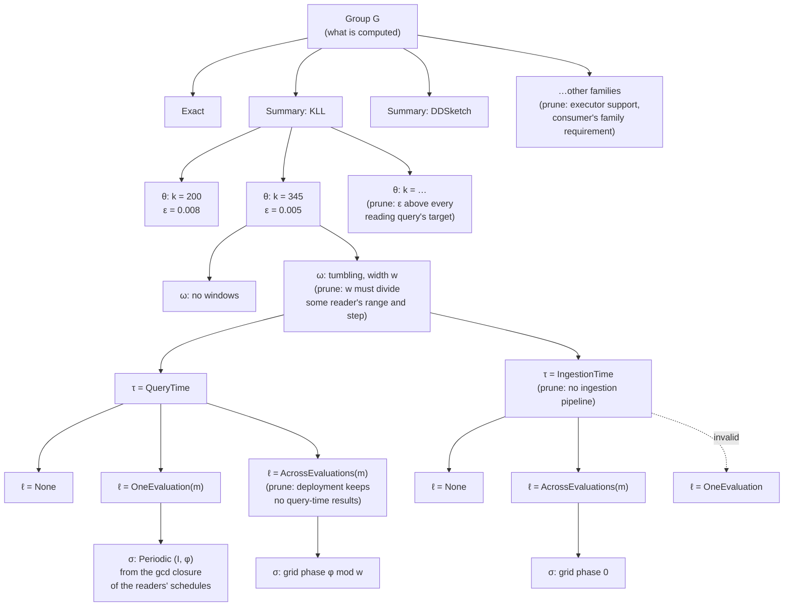

# Memo groups, properties and requirements

This page defines the memo's main data structures: groups, candidates, properties and requirements. It also lists every property and requirement, and gives the decision tree Stage 1 and Stage 2 walk to enumerate candidates. The symbols follow the planner formulation:
- a candidate is $v = (e_v, p_v)$;
- its logical properties are $p^{\log}$ and its physical properties are $p^{\mathrm{phys}}$;
- a consumer input's requirements are $r^{\log}_{c,i}$ and $r^{\mathrm{phys}}_{c,i}$;
- whether a producer satisfies them is $\alpha^{\log}$ and $\alpha^{\mathrm{phys}}$.

## Example

Query A: `quantile_over_time(0.95, latency[1m])` with `max_error 0.01`. Query B: `quantile_over_time(0.99, latency[1m]) / quantile_over_time(0.50, latency[1m])` with the same target.

```
G1   Scan latency[1m]
       producers: v1 = Scan                     (QueryTime, None)
G2   KLL state over G1                          one group, whatever the size
       producers: v2 = SummaryAgg[KLL](G1)  θ = {k = 200}   ε = 0.008   δ = 0.01
                  v3 = SummaryAgg[KLL](G1)  θ = {k = 345}   ε = 0.005   δ = 0.01
                  (each also expanded by Stage 2 into its (τ, ℓ, σ) alternatives)
G3   p95 of G2      producers: SummaryEstimate[q=0.95](G2)
G4   p99 of G2      producers: SummaryEstimate[q=0.99](G2)
G5   p50 of G2      producers: SummaryEstimate[q=0.50](G2)
G6   G4 / G5        producers: Divide(G4, G5)    input requirement: error_cap on each input
Query roots: A → G3, B → G6
```

The ε values are illustrative.

- G2 is one group: the KLL state over `latency[1m]`. Its sizes are candidates of G2, not separate groups.
- G3, G4 and G5 are consumers of G2. They are not stored in G2; each is a group with its own producers whose expression reads G2.
- A meets 0.01 with either size. B adds its two operands' errors (0.016 with `k = 200`, 0.010 with `k = 345`) and needs `k = 345` for both, so a plan where all three read v3 builds one KLL state.

## 1. Properties and requirements over properties

### Properties

A property is a value a candidate has. Every property is one dimension of a product: a struct with one field per dimension, never a flat enum that lists the combinations. Invalid combinations are rejected by the struct's checked constructor.

| Dimension | Values | Logical or physical | Fixed by | Code |
|---|---|---|---|---|
| Which family to use (operator) | `Exact` (exact accumulator kinds: Sum, Count, Min, Max, Increase, Rate, IRate), or `Summary { family }` with family in KLL, DDSketch, CMS, CountSketch, CMS with heap, CountSketch with heap, UnivMon, HLL, KMV, the Hydra variants | logical | enumerated | `FieldDataType::{ExactAggregate, Sketch}` in the candidate's operator ([`schema/mod.rs`](../../../crates/types/src/ir/schema/mod.rs)); `SketchAlgorithm` |
| Parameter configuration $\theta$ | per family, from a predefined list: KLL `k`; DDSketch `alpha`; CMS / CountSketch `width × depth`; CMS / CountSketch with heap `width × depth × heap_size`; UnivMon `heap_size × rows × cols × layers`; HLL `precision`; KMV `k` | logical | enumerated | `SketchParams` inside `SketchKind` ([`sketch.rs`](../../../crates/types/src/ir/schema/sketch.rs)), sized by `size_params` per `accuracy_budget_parts` |
| Error bound $(\varepsilon_v, \delta_v)$ | computed on demand from $\theta$ and the statistic, in the family's accuracy metric (below); exact is $(0, 0)$ | logical | derived from $\theta$, not stored or chosen | `local_guarantee` → `AccuracyGuarantee` ([`estimators`](../../../crates/accuracy/src/estimators/mod.rs)) |
| Window configuration $\omega$ | none; or tumbling windows of width $w$ and count $n$, with $w$ from the gcd closure of the readers' ranges and steps. Later: sliding windows by merge or by subtraction | logical | enumerated | `SummaryTumblingWindowChain` arguments, added by Pass 2 ([`window_candidates.rs`](../../../crates/logical-asap-optimization/src/pass2/memo/window_candidates.rs)) |
| Timing $\tau$ | `IngestionTime`, `QueryTime` | physical | enumerated | `ExecutionTiming` ([`execution_data_state.rs`](../../../crates/types/src/ir/properties/execution_data_state.rs)); `PhysicalCandidate::timing` |
| Lifetime $\ell$ | `None`, `OneEvaluation(Medium)`, `AcrossEvaluations(Medium)`, with `Medium` in `Memory`, `Disk` | physical | enumerated | `Materialization` on main; `Lifetime`, `Medium` in #1214 ([`physical/`](../../../crates/types/src/physical)) |
| Schedule $\sigma$ | only when $\ell \ne$ None. `Periodic { interval, phase }` for `OneEvaluation`; `TumblingWindowGrid { phase }` for `AcrossEvaluations` | physical | enumerated from the readers' schedules | not a property: schedule groups `z[m, G]` in the MILP ([`cost_terms.rs`](../../../crates/plan-selection/src/milp/cost_terms.rs)); a property in #1200 PR 2 |

A candidate is materialized when $\ell \ne$ None. This is derived, not stored.

Invalid combinations, rejected by `PhysicalProperties::new` (the list in #1200; #1214 implements the first, the others come with the schedule in #1200 PR 2):

| Combination | Why |
|---|---|
| (IngestionTime, OneEvaluation) | there is no evaluation at ingestion time |
| $\ell$ = None with a schedule | where an unmaterialized result runs is its reader's execution context, not a property |
| $\ell \ne$ None without a schedule | a materialized result must say on which times or grid it is delivered |
| OneEvaluation with a grid, AcrossEvaluations with a periodic schedule | each lifetime has one kind of schedule |
| a phase at or above the grid width or interval, or interval 0 | the phase is taken modulo the width or interval |
| IngestionTime with a grid phase ≠ 0 | ingestion-time grids are anchored at the epoch today: the plan carries no origin |

Valid physical states: (QueryTime, None), (IngestionTime, None), (QueryTime, OneEvaluation(m)), (QueryTime, AcrossEvaluations(m)), (IngestionTime, AcrossEvaluations(m)), for each medium $m$.

### Requirements over properties

A requirement is a constraint that a consumer, a query or the deployment puts on producers. One requirement can constrain several property dimensions, and one dimension can be constrained by several requirements.

| Requirement | Who states it | Values | Constrains | Checked where |
|---|---|---|---|---|
| Accuracy | each query, at its root | metric: absolute (in the value's units, or times the stream's L1 or L2 norm), relative, rank; bound $\varepsilon_q$; failure probability $\delta_q$; scope: per value, whole result, or groups above a share of the records | operator family and $\theta$ of every approximate candidate the query reads, through their $(\varepsilon_v, \delta_v)$ | Stage 3, row (K): the composed error at the root. Not per edge, because a per-input bound would fix each input's share of the budget |
| Validity cap `error_cap` | a non-linear consumer (ratio, product), per input | $\varepsilon$ cap | $\theta$ of the producer | per edge, $\alpha^{\log}$: row (K)'s linear bound holds only below the cap |
| Summary family | a consumer that reads summary state, per input | a family, e.g. KLL for a quantile readout | operator family | per edge, $\alpha^{\log}$ |
| Window | a consumer that reads windows, per input | the reader's range and step | window configuration: the width must divide both | per edge, $\alpha^{\log}$ |
| Capability of ingestion-time compute | the deployment and the data workload | the source has an ingestion pipeline; the executor supports the family; query-time results may be kept across evaluations | timing; operator family; (QueryTime, AcrossEvaluations) | candidate generation: such candidates are not offered |
| Reader timing and evaluation | a consumer, per input | when it reads (ingestion or query time) and from which evaluation (same or later) | timing and lifetime of the producer | per edge, $\alpha^{\mathrm{phys}}$ |
| Reader schedule | a periodic consumer, per input | its interval and phase $(I_c, \varphi_c)$ | schedule of the producer | per edge, $\alpha^{\mathrm{phys}}$ |
| Latency, resource budgets | the workload | per-query latency bound; memory and CPU budgets | the whole plan | Stage 3, rows (L) and (B) |

Accuracy metrics that may be added later, when a primitive needs them: top-k recall or precision, and a false-positive rate for membership summaries.

How requirements map to property dimensions:

```
Accuracy (query)             ──► operator family, θ          (through ε_v, δ_v; row (K))
error_cap (edge)             ──► θ
Summary family (edge)        ──► operator family
Window (edge)                ──► window configuration
Ingestion capability (deploy)──► timing, operator family, lifetime
Reader timing/evaluation     ──► timing, lifetime
Reader schedule              ──► schedule
Latency, budgets (workload)  ──► every dimension, through cost
```

## 2. Decision tree of properties

Each memo group's candidates are the leaves of a tree. Every level decides one property dimension, and each edge out of a node is one value of that dimension. A path from the root to a leaf is one candidate.



The levels, top to bottom:

| Level | Dimension | Stage | Values offered | Pruned when | Code |
|---|---|---|---|---|---|
| 1 | family (operator) | Stage 1, Pass 1 and Pass 2 rules | each way to compute the group | the executor cannot build the family; no consumer's family requirement accepts it | Pass 1 ([`per_computation_candidates.rs`](../../../crates/logical-asap-optimization/src/pass1/per_computation_candidates.rs)); Pass 2 rules ([`rules/`](../../../crates/logical-asap-optimization/src/pass2/memo/rules)) |
| 2 | $\theta$ | Stage 1, Pass 1 | the family's predefined list | $\varepsilon_v$ alone exceeds every reading query's target | Pass 1 sizing per `accuracy_budget_parts` ([`memo_population.rs`](../../../crates/logical-asap-optimization/src/pass1/memo_population.rs)); a predefined list in #1203 PR 2 |
| 3 | window configuration $\omega$ | Stage 1, Pass 2 | tumbling widths from the gcd closure of readers' ranges and steps | no reader's range and step is a multiple of the width | Pass 2 ([`window_candidates.rs`](../../../crates/logical-asap-optimization/src/pass2/memo/window_candidates.rs), [`state_groups.rs`](../../../crates/logical-asap-optimization/src/pass2/memo/state_groups.rs)) |
| 4 | timing $\tau$ | Stage 2 | QueryTime; IngestionTime | the source has no ingestion pipeline | Stage 2 `enumerate_candidate_configurations` ([`configurations.rs`](../../../crates/physical-asap-optimization/src/catalog/configurations.rs)) |
| 5 | lifetime $\ell$ | Stage 2 | None, OneEvaluation(m), AcrossEvaluations(m) | invalid with $\tau$; the deployment keeps no query-time results across evaluations | same function, with `DeploymentCapabilities::query_time_results_retained` |
| 6 | schedule $\sigma$ | Stage 2 | the gcd closure $\Sigma$ of the readers' schedules | only offered when $\ell \ne$ None | Stage 3 MILP today; Stage 2 in #1200 PR 2 |

What the tree does not decide:
- **Which producer each consumer input reads.** That is the edge choice $y_{u,c,i}$ in Stage 3. Two consumers of one group may read different leaves, e.g. A reads `k = 200` and B reads `k = 345`.
- **Where an unmaterialized candidate runs.** A candidate with $\ell$ = None runs inside each reader's execution context; Stage 3 chooses it.
- **How much a materialized candidate retains.** The amount $h_v$ depends on the readers' longest range; Stage 3 chooses it.

### Order of decisions

**The order does not affect correctness.** The set of leaves is the product of the dimensions' value sets, minus the invalid combinations and the pruned values. Every prune rule depends only on the value it removes and on values already decided above it, so any order that decides a pruned dimension after the dimensions its prune rule reads yields the same set of leaves.

**The order affects the efficiency of enumeration.** The number of nodes visited is $\sum_{d} \prod_{d' \le d} |\text{values kept at } d'|$, so a dimension that prunes much should come early, and a dimension whose values multiply without pruning should come late. Four considerations set the order above:

1. **Logical before physical.** Logical dimensions (operator family, $\theta$, $\omega$) change the result's values or error; physical dimensions ($\tau$, $\ell$, $\sigma$) change only when and how long it is computed. Deciding logical dimensions first lets Stage 1 hash-cons groups and check $\alpha^{\log}$ on edges once, before Stage 2 multiplies each logical candidate by its physical alternatives.
2. **Strong prunes early.** The family is pruned by the executor and by consumers' family requirements, and $\theta$ by the accuracy target, before the window and physical levels multiply them.
3. **Dependent dimensions adjacent.** $\ell$ is constrained by $\tau$ (no OneEvaluation at ingestion), and $\sigma$ exists only when $\ell \ne$ None and its kind follows $\ell$. Deciding them in the order $\tau \to \ell \to \sigma$ means each invalid combination is pruned at the first level where it can be detected.
4. **Deployment-wide prunes as early as they can go.** If the deployment has no ingestion pipeline, the IngestionTime subtree is pruned once per candidate. Moving $\tau$ above $\omega$ would prune it once per group instead; this is an alternative order with the same leaves.

Alternative orders worth comparing:
- **$\tau$ first.** In a deployment where most sources have no ingestion pipeline, deciding timing at the group level prunes half the tree before $\theta$ and $\omega$ multiply it.
- **$\theta$ last among logical dimensions.** $\theta$ has the most values. Deciding $\omega$ before $\theta$ visits fewer nodes when many widths are pruned by readers' ranges.
- **Requirement-driven (top-down) vs producer-driven (bottom-up).** Top-down enumeration starts from each consumer's requirement and offers only the values it accepts; bottom-up offers every value and lets $\alpha$ filter edges. Top-down visits fewer nodes but must union the requirements of all consumers of a group, so that sharing between consumers is not lost.

## 3. Modeling a memo group  

A memo group stores its **producers**: all candidate ways to compute its result, before Stage 3 selects any. A consumer of $G$ is a candidate of another group whose expression reads $G$; the producer–consumer edges $(u, c, i)$ connect them. Here, `consumers(G)` is derived from those input references rather than stored in the group.

> Side note: [CMU-DB's optd-original](https://github.com/cmu-db/optd-original) stores the list of children as input producers to a memo group; while storing consumers vs storing producers in the memo group structure to form the DAG are equivalent in terms of correctness and efficiency. 

Candidate enumeration efficiency depends on:

- **Property and requirement fields:** which dimensions are represented, their legal values, which values are derived, and which constraints permit pruning or sharing (Section 1).
- **Decision-tree order:** when each dimension is decided and its requirements are checked, so invalid combinations can be pruned before later dimensions multiply them (Section 2).

Groups found by hash-consing expose the same producer alternatives to all their readers. Stage 3 decides whether readers use the same producer candidate or different ones. **Reusing a computation alternative in the memo is distinct from reusing its computed result at runtime. Selecting the same candidate for multiple readers does not by itself mean computing it only once.**

- **Materialized candidate** ($\ell \ne$ None): its result is retained. Readers connected to the same materialized producer can reuse that result instead of computing it separately, subject to its lifetime and schedule.
- **Unmaterialized candidate** ($\ell =$ None): no independent shared result is retained. The computation runs as part of each reader's execution, so multiple readers selecting the same candidate may each execute it separately.

For example, if p50 and p99 select the same KLL candidate, a shared materialized producer builds and retains one KLL state for both readouts within the applicable lifetime and schedule. With an unmaterialized candidate, the p50 execution can build its own KLL state and the p99 execution another, even though both builds use the same candidate configuration.

### Memo group data structure

A memo group holds three things:
- **Query semantics:** its expression, and the producer groups the expression reads.
- **Eligibility:** for each input, the requirement a producer must meet.
- **Candidates:** the ways to compute it.

In the code, these three parts are stored in two places: the group itself ([`MemoGroup`](../../../crates/types/src/stages/memo.rs)) holds the query semantics, and the memo ([`Memo`](../../../crates/types/src/stages/candidates.rs)) holds each group's candidates by group index. Eligibility is not stored yet.

```rust
// crates/types/src/stages/memo.rs
pub struct MemoGroup {
    // Query semantics.
    /// Its logical node as the frontends see it; its children are other
    /// groups' nodes.
    pub logical_node: Rc<OperatorNode>,
    /// Its child groups (the producer groups G_i), in the node's child order.
    pub child_groups: Vec<MemoGroupId>,
    // Derived, kept for traversal.
    pub parents: Vec<MemoGroupId>,
    pub queries: Vec<usize>,
}

// crates/types/src/stages/candidates.rs
pub struct Memo {
    pub groups: Vec<MemoGroup>,
    pub query_roots: Vec<QueryRoot<MemoGroupId>>,
    // Candidates: one list per group, by group index; x_v in the MILP.
    pub candidates: Vec<Vec<CandidateForMemoGroup>>,
}
```

| Part | Code | Target |
|---|---|---|
| Expression | `MemoGroup::logical_node`, an [`OperatorNode`](../../../crates/types/src/ir/operator/node.rs) whose [`Operator`](../../../crates/types/src/ir/operator/node.rs) is a `NonASAPOp` or `ASAPOp` variant with its own arguments | unchanged: the existing IR, no new identity type |
| Producer groups $G_i$ | `MemoGroup::child_groups` | unchanged |
| Eligibility $r_{G,i}$ | not stored: each candidate's private node chain fixes its producer | one logical requirement (#1203) and one physical requirement (#1200) per consumer input; see "Property requirement definition" |
| Candidates | `Memo::candidates[g]` | unchanged place; each candidate restructured (#1203) |
| Consumers | `MemoGroup::parents` (derived) | unchanged: derived from the producer groups |

Hash-consing finds or inserts a group by its logical node: the operator, its arguments and its child groups. Stage 0 does this today (`hash_consed` in [`stage0.rs`](../../../crates/logical-asap-optimization/src/stage0.rs)); #1203 makes Pass 1 look up existing groups the same way. A different source, filter or query window gives a different group. A requested query window belongs to the logical node; the internal window layout used to compute it does not.

The group's logical node is the frontend's operator, e.g. `quantile_over_time(0.95, latency[1m])`. It names no family and no sketch parameters: those are chosen by the candidates. A candidate's own operator (below) is an `ASAPOp` such as `SummaryAgg`, whose `FieldDataType::Sketch(SketchKind, …)` carries the family and $\theta$. Today the KLL state is not its own group: it is a private node inside each reader's candidate. #1203 makes every intermediate result its own group, so the KLL state over `latency[1m]` becomes a group, and `k = 200` and `k = 345` become two candidates of it. Its identity drops the sketch parameters, $\delta$ and the tumbling-window layout (#1203, decision 1).

### Candidate data structure definition

A candidate is one way to compute its group: an operator over producer groups, plus its properties.

```rust
// crates/types/src/stages/candidates.rs (code today)
pub struct CandidateForMemoGroup {
    pub fused_groups: Vec<MemoGroupId>,
    /// The implementation's operator, and its private nodes down to
    /// `input_groups`. Family and θ are inside it (FieldDataType).
    pub root_node: Rc<OperatorNode>,
    pub input_groups: Vec<MemoGroupId>,
    pub origin: OriginOfCandidateForMemoGroup,
    pub accuracy_budget_parts: usize,
}
```

```rust
// Target (#1203): e_v and p_v^log as separate fields, one operator, no private nodes.
pub struct CandidateForMemoGroup {
    pub expression: CandidateExpression,          // e_v
    pub logical_properties: LogicalProperties,    // p_v^log
    pub input_requirements: Vec<LogicalRequirement>, // r^log_{c,i}, one per input group
    pub origin: OriginOfCandidateForMemoGroup,
    pub fused_groups: Vec<MemoGroupId>,
}
pub struct CandidateExpression { pub operator: Operator<MemoGroupId> }
```

Stage 2 expands each operator node of a logical candidate into physical candidates, one per valid physical property value:

```rust
// crates/types/src/stages/physical/memo_candidates.rs, after #1200 PR 1 (#1214)
pub struct PhysicalCandidate {
    pub operator_node: OperatorNodeOfCandidateForMemoGroupId,
    pub properties: PhysicalProperties,           // p_v^phys; was timing + materialization
    /// Per input, the candidates that may produce it (filtered by α^phys).
    pub producer_candidates_per_input: Vec<ProducerCandidates>,
    pub may_produce_query_output: bool,
    pub may_keep_across_evaluations_per_sole_reader_query: Vec<bool>,
}
```

| Formulation | Code today | Target |
|---|---|---|
| $e_v$ | `root_node` + `input_groups` (may hold private nodes) | `expression: Operator<MemoGroupId>` (#1203) |
| $p^{\log}_v$ | inside `root_node`'s `FieldDataType`; sized per `accuracy_budget_parts` | `logical_properties` (#1203) |
| $p^{\mathrm{phys}}_v$ | `PhysicalCandidate::{timing, materialization}` on main | `PhysicalCandidate::properties` (#1200 PR 1, #1214) |
| edges $(u, c, i)$ | `producer_candidates_per_input` (sets, no edge ids) | `LogicalEdge`, `PhysicalEdge` (#1201) |

### Property definition

Each property is a struct with one field per dimension, each its own enum.

**Logical properties** (#1203 target; today inside `root_node`):

```rust
pub struct LogicalProperties {
    representation: Representation,       // family and θ
    window_layout: Option<WindowLayout>,  // ω_v
}
/// Reuses the code's checked types: `SketchKind::new` already rejects
/// parameters of another algorithm.
pub enum Representation {
    Exact(ExactKind),                     // crates/types/src/ir/schema/sketch.rs
    Summary(SketchKind),                  // SketchKind { algorithm, params }
}
pub enum WindowLayout { Tumbling { width_ms: u64, count: u32 } }  // sliding variants: #1206
```

Today these values are the `FieldDataType` of the candidate's summary operator: `ExactAggregate(ExactKind, ExactParams)` or `Sketch(SketchKind, GroupingStrategy)` ([`schema/mod.rs`](../../../crates/types/src/ir/schema/mod.rs)). The tumbling-window layout is the `SummaryTumblingWindowChain` operator's arguments.

`error_bound` is derived when needed, not stored in `LogicalProperties`. Reuse [`estimators::local_guarantee`](../../../crates/accuracy/src/estimators/mod.rs) for parameters → guarantee and [`estimators::size_params`](../../../crates/accuracy/src/estimators/mod.rs) for target → parameters. These existing crate-private functions dispatch to the family's accuracy and sizing implementations. [`sizing::default_size_params`](../../../crates/accuracy/src/sizing.rs) already delegates to `size_params`. If another crate needs direct access, expose the existing implementation through the accuracy crate rather than duplicate its formulas. (#1203 currently proposes storing `error_bound`; this page derives it instead.)

```rust
// crates/accuracy/src/estimators/mod.rs (code today)
pub(crate) fn local_guarantee(family: &FieldDataType, query: &SketchStatistic) -> Option<AccuracyGuarantee>;
pub(crate) fn size_params(kind: SketchAlgorithm, intent: &AggIntent, eps: f64, delta: f64) -> SketchParams;
```

Deriving a guarantee also needs the statistic being read: one family's parameters can give different guarantees for different statistics. Exact values yield an exact guarantee; an unsupported statistic or missing error model yields `None`. Target → parameters is a sizing operation with discrete values and family limits, not an exact mathematical inverse; validate the derived guarantee against the target rather than assume the target is achievable.

**Physical properties** (#1200). PR 1 (#1214) adds timing and lifetime; PR 2 adds the schedule.

```rust
// crates/types/src/ir/properties/execution_data_state.rs (code today)
pub enum ExecutionTiming { IngestionTime, QueryTime }

// crates/types/src/physical/properties.rs (#1214)
pub enum Medium { Memory, Disk }
pub enum Lifetime { None, OneEvaluation(Medium), AcrossEvaluations(Medium) }
pub struct PhysicalProperties {
    timing: ExecutionTiming,               // τ
    lifetime: Lifetime,                    // ℓ
    // schedule: Option<Schedule>,         // σ, #1200 PR 2
}
impl PhysicalProperties {
    pub fn new(timing: ExecutionTiming, lifetime: Lifetime) -> Result<Self, InvalidPhysicalProperties>;
    pub fn timing(self) -> ExecutionTiming;
    pub fn lifetime(self) -> Lifetime;
    pub fn is_materialized(self) -> bool;  // ℓ ≠ None
}

// #1200 PR 2
pub enum Schedule {
    Periodic { interval_ms: u64, phase_ms: u64 },  // OneEvaluation
    TumblingWindowGrid { phase_ms: u64 },          // AcrossEvaluations
}
```

On main, timing and lifetime are still folded into one enum, [`Materialization`](../../../crates/types/src/physical/materialization.rs) (`NotMaterialized`, `MatAtQuery`, `MatAtQueryKeptAcrossEvaluations`, `MatAtIngestion`), next to `PhysicalCandidate::timing`. #1214 deletes it. The schedule is chosen in the MILP today (schedule groups `z[m, G]`, [`cost_terms.rs`](../../../crates/plan-selection/src/milp/cost_terms.rs)); #1200 PR 2 makes it a property.

### Property requirement definition

A requirement is stated per consumer input $(c, i)$, in two parts that follow the two property parts. Each is a struct with one field per dimension.

```rust
/// r^log_{c,i} (#1203): one optional constraint per dimension; None accepts any value.
pub struct LogicalRequirement {
    pub family: Option<SummaryFamily>,
    pub window: Option<WindowRequirement>,   // the reader's range and step
    pub error_cap: Option<f64>,              // validity of row (K)'s linear bound
}
/// α^log
pub fn satisfies(producer: &LogicalProperties, requirement: &LogicalRequirement) -> bool;

/// r^phys_{c,i} (#1200): when the consumer reads the input, and on which times.
/// `new` rejects (IngestionTime, Later): ingestion has no evaluations.
pub struct PhysicalRequirement {
    reader_timing: ExecutionTiming,
    reads_from: Evaluation,                  // which evaluation's output the reader reads
    reader_schedule: Option<ReaderSchedule>, // (I_c, φ_c); None for a non-periodic reader
}
pub enum Evaluation { Same, Later }
/// α^phys
pub fn satisfies_physical(producer: PhysicalProperties, requirement: PhysicalRequirement) -> bool;
```

| Requirement | Code today | Target |
|---|---|---|
| $r^{\log}_{c,i}$ | not represented | `LogicalRequirement` (#1203) |
| $\alpha^{\log}$ | not computed | `satisfies` (#1203) |
| $r^{\mathrm{phys}}_{c,i}$ | the consumer's timing | `PhysicalRequirement` (#1200 PR 2) |
| $\alpha^{\mathrm{phys}}$ | [`compatible_timing`](../../../crates/physical-asap-optimization/src/catalog/configurations.rs) on main; `PhysicalProperties::readable_at(reader_timing)` in #1214 | `satisfies_physical` (#1200 PR 2) |
| accuracy | [`AccuracyTarget`](../../../crates/types/src/ir/properties/accuracy.rs) at the query root, split into equal shares by `accuracy_budget_parts` | `AccuracyTarget` at the query root, checked by row (K) (#1204) |
| deployment capability | [`DeploymentCapabilities`](../../../crates/logical-asap-optimization/src/deployment_capabilities.rs): `supported_summaries`, `raw_data_retained`, `query_time_results_retained` | unchanged; prunes during generation |

The set of legal properties is a function of the requirement, $\text{legal}(r) = f(r)$. One requirement can be written at different levels. For example, the same accuracy requirement can be stated two ways:

| Requirement | Mapped to properties | Producer candidates enumerated |
|---|---|---|
| Accuracy = 95% rank accuracy | every family with rank error, and every configuration of it that meets 95% rank accuracy | (KLL, `k = 100`), (KLL, `k = 200`), … |
| Accuracy = KLL's `k ≥ 100` | KLL with `k ≥ 100` | (KLL, `k = 100`), (KLL, `k = 200`), … |

In the code, the first form is the query's `AccuracyTarget`; Pass 1 maps it to parameters with `size_params`. The second form is what a sized candidate's `SketchParams` fixes today. #1203 keeps the first form at the query root and adds only `error_cap` per edge.

What goes into a property requirement affects only the efficiency of enumeration, not correctness:
- **Some requirements already hold by the query semantics.** The expression and its producer groups already fix the input data and its fields, so no requirement needs to restate them.
- **It depends on how rules generate the candidate space.** A rule that only generates legal candidates needs no requirement for that dimension; a rule that generates every value needs the requirement to filter them.
- **A requirement prunes; it does not decide the plan.** A tighter requirement removes candidates earlier. Each query's composed error is still checked at its root in Stage 3 (row (K)), so a requirement that is too loose costs enumeration time, not a wrong plan.

### Extensibility

**Add a value to a property dimension**, e.g. a new summary family or `Medium::Disk`:
1. Add the enum variant.
2. Every exhaustive `match` on the dimension stops compiling until it handles the new value. This is why matches on properties name every value and never use a `_` arm.
3. For a family: add its predefined $\theta$ list, its error-bound function, its cost, and the readouts it answers.
4. Add any new invalid combinations to `new`.

**Add a property dimension**, e.g. a compression codec or a partitioning:
1. Decide whether it is logical (it changes the result's values or error) or physical (it changes only when, where or how long the result is computed). Add a field (a new enum) to `LogicalProperties` or `PhysicalProperties`.
2. If consumers can constrain it, add an optional field to `LogicalRequirement` or `PhysicalRequirement` and one check to `satisfies` or `satisfies_physical`.
3. Add its invalid combinations with the other dimensions to `new`.
4. Add a level to the decision tree, with its prune rule, and place it by the considerations in "Order of decisions".
5. Add its cost terms.

**Add a requirement:**
1. If it constrains one edge (a consumer input), add a field to `LogicalRequirement` or `PhysicalRequirement`, set it where the consumer is created, and check it in `satisfies` or `satisfies_physical`.
2. If it constrains a whole query or the whole plan (accuracy, latency, budgets), add it to the query's or workload's requirements and a row to Stage 3. Do not split it into per-edge requirements: that fixes each input's share in advance.
3. If it comes from the deployment, prune the values it rules out during candidate generation.

**Add a rule:**
1. A rule matches over groups and their candidates' expressions, never over a reader's private operators.
2. It adds candidates to an existing group, or adds a new group with its candidates. It never copies a reader: every existing consumer of the group sees the new candidate through edges.
3. A candidate whose result has the same meaning as an existing group is added to that group, so hash-consing keeps sharing.
4. Each new candidate states its input requirements.

## 4. Data structures and interfaces per stage

This section gives the target interface of each stage after the formulation refactor (#1207). Each stage's boundary type carries the notation that stage defines, and no stage reads a notation a later stage defines: logical stages carry no physical properties.

| Stage | Input | Output (boundary type) | Notation it defines | Sub-issue |
|---|---|---|---|---|
| Stage 0: frontends, hash-consing | queries | `DagOfLogicalMemoGroups` | $G$, query roots | — |
| Stage 1, Pass 1 | `DagOfLogicalMemoGroups` | `Memo` | $v = (e_v, p^{\log}_v)$, $r^{\log}_{c,i}$, $\theta$ list | #1203 |
| Stage 1, Pass 2 | `Memo` | `LogicalASAPMemoCandidates` | rule-added candidates; logical edges with $\alpha^{\log}$ | #1203, #1201 |
| Stage 2 | `LogicalASAPMemoCandidates` | `PhysicalASAPMemoCandidates` | $p^{\mathrm{phys}}_v = (\tau, \ell, \sigma)$, $r^{\mathrm{phys}}_{c,i}$, physical edges $\mathcal E$ with $\alpha^{\mathrm{phys}}$ | #1200, #1201 |
| Stage 3 | `PhysicalASAPMemoCandidates` | `DagOfSelectedCandidates` | contexts $\kappa$; cost $w_v$ (`asap-cost`); $x$, $y$, $z$, $t$, $h$; rows (A)–(K), (R), (L), (B) | #1204 |
| Realizer, export | `DagOfSelectedCandidates` | `PhysicalASAPDAG` | — | #1200 (export fields) |

### Stage 0: frontends and hash-consing

No change. One group per distinct logical sub-expression; the queries' roots point at groups.

```rust
// crates/types/src/stages/memo.rs
pub struct MemoGroupId(pub u32);

/// G: one logical result or one state family over specified input data.
pub struct MemoGroup {
    pub logical_node: Rc<OperatorNode>,   // expression; no physical fields (#1200)
    pub child_groups: Vec<MemoGroupId>,   // producer groups G_i
    pub parents: Vec<MemoGroupId>,        // derived: consumers' groups
    pub queries: Vec<usize>,              // derived: queries that reach it
}

pub struct DagOfLogicalMemoGroups {
    pub groups: Vec<MemoGroup>,
    pub query_roots: Vec<QueryRoot<MemoGroupId>>,
}
```

### Stage 1, Pass 1: candidates of each group

Pass 1 adds every way to compute each group as candidates. Every intermediate result is its own group (no private nodes), and a summary family's sizes are candidates of one state group.

```rust
// crates/types/src/stages/candidates.rs
pub struct CandidateForMemoGroupId { pub group: MemoGroupId, pub index: usize }

pub struct Memo {
    pub groups: Vec<MemoGroup>,
    pub query_roots: Vec<QueryRoot<MemoGroupId>>,
    pub candidates: Vec<Vec<CandidateForMemoGroup>>,   // by group
}
impl Memo {
    /// Hash-consing: the group with this expression, added if new.
    pub fn find_or_add_group(&mut self, expression: Operator<MemoGroupId>) -> MemoGroupId;
    pub fn add_candidate(&mut self, group: MemoGroupId, candidate: CandidateForMemoGroup) -> CandidateForMemoGroupId;
    pub fn candidate(&self, id: CandidateForMemoGroupId) -> &CandidateForMemoGroup;
}

/// v = (e_v, p_v^log)
pub struct CandidateForMemoGroup {
    pub expression: CandidateExpression,              // e_v
    pub logical_properties: LogicalProperties,        // p_v^log
    pub input_requirements: Vec<LogicalRequirement>,  // r^log_{c,i}, one per input group
    pub fused_groups: Vec<MemoGroupId>,
}
/// e_v = op_v(G_{v,1}, …, G_{v,n}): one operator, its children are groups.
pub struct CandidateExpression { pub operator: Operator<MemoGroupId> }

pub struct LogicalProperties {
    representation: Representation,       // family and θ, from the predefined list
    window_layout: Option<WindowLayout>,  // ω_v
}
impl LogicalProperties {
    pub fn new(representation: Representation, window_layout: Option<WindowLayout>) -> Result<Self, InvalidLogicalProperties>;
    /// (ε_v, δ_v) for `statistic`, derived through `local_guarantee`.
    pub fn error_bound(&self, statistic: &SketchStatistic) -> Option<AccuracyGuarantee>;
}
pub enum Representation { Exact(ExactKind), Summary(SketchKind) }
pub enum WindowLayout { Tumbling { width_ms: u64, count: u32 } }

pub struct LogicalRequirement {
    pub family: Option<SketchAlgorithm>,
    pub window: Option<WindowRequirement>,  // reader's range and step: a width must divide both
    pub error_cap: Option<f64>,             // validity of row (K)'s linear bound
}
/// α^log_{u,c,i}
pub fn satisfies(producer: &LogicalProperties, requirement: &LogicalRequirement) -> bool;
```

Deleted: `root_node` with private nodes, `input_groups` (the expression's children), `accuracy_budget_parts`, the `SharedBuild` and `SummaryResult` origins.

### Stage 1, Pass 2: rules and logical edges

Rules add candidates to existing groups, or add groups. A rule never copies a reader. After the last rule, Pass 2 builds the logical edges once.

```rust
// crates/logical-asap-optimization/src/pass2
/// A rule: reads the memo, adds candidates or groups.
fn apply(memo: &mut Memo) -> Result<(), Pass2RuleError>;

// crates/types/src/stages/logical_memo_candidates.rs
/// (u, c, i) over logical candidates: u is a candidate of G_{c,i}.
pub struct LogicalEdge {
    pub producer: CandidateForMemoGroupId,
    pub consumer: CandidateForMemoGroupId,
    pub input: usize,
    pub satisfies_logical_requirement: bool,   // α^log
}
pub struct LogicalASAPMemoCandidates {
    pub memo: Memo,
    pub edges: Vec<LogicalEdge>,               // grouped by (consumer, input)
}
```

### Stage 2: physical candidates and edges

Stage 2 expands each logical candidate into one physical candidate per valid $(\tau, \ell, \sigma)$, gives each input its physical requirement, and turns each logical edge into the physical edges between the two candidates' physical alternatives.

```rust
// crates/types/src/physical/properties.rs
pub enum ExecutionTiming { IngestionTime, QueryTime }
pub enum Medium { Memory, Disk }
pub enum Lifetime { None, OneEvaluation(Medium), AcrossEvaluations(Medium) }
pub enum Schedule {
    Periodic { interval_ms: u64, phase_ms: u64 },  // OneEvaluation
    TumblingWindowGrid { phase_ms: u64 },          // AcrossEvaluations
}
/// p_v^phys = (τ, ℓ, σ); `new` rejects the invalid combinations (Section 1).
pub struct PhysicalProperties { timing: ExecutionTiming, lifetime: Lifetime, schedule: Option<Schedule> }
impl PhysicalProperties {
    pub fn new(timing: ExecutionTiming, lifetime: Lifetime, schedule: Option<Schedule>) -> Result<Self, InvalidPhysicalProperties>;
    pub fn timing(&self) -> ExecutionTiming;
    pub fn lifetime(&self) -> Lifetime;
    pub fn schedule(&self) -> Option<&Schedule>;
    pub fn is_materialized(&self) -> bool;          // ℓ ≠ None
}

/// r^phys_{c,i}; `new` rejects (IngestionTime, Later).
pub struct PhysicalRequirement {
    reader_timing: ExecutionTiming,
    reads_from: Evaluation,
    reader_schedule: Option<ReaderSchedule>,        // (I_c, φ_c)
}
pub enum Evaluation { Same, Later }
/// α^phys_{u,c,i}
pub fn satisfies_physical(producer: &PhysicalProperties, requirement: &PhysicalRequirement) -> bool;

// crates/types/src/stages/physical
pub struct PhysicalCandidateId(pub usize);
pub struct PhysicalEdgeId(pub usize);

/// One physical alternative of a logical candidate.
pub struct PhysicalCandidate {
    pub logical: CandidateForMemoGroupId,             // e_v and p_v^log
    pub properties: PhysicalProperties,               // p_v^phys
    pub input_requirements: Vec<PhysicalRequirement>, // r^phys_{c,i}
}
/// (u, c, i) over physical candidates.
pub struct PhysicalEdge {
    pub producer: PhysicalCandidateId,
    pub consumer: PhysicalCandidateId,
    pub input: usize,
    pub satisfies_logical_requirement: bool,    // α^log
    pub satisfies_physical_requirement: bool,   // α^phys
}
pub struct PhysicalASAPMemoCandidates {
    pub logical: LogicalASAPMemoCandidates,
    pub candidates: Vec<PhysicalCandidate>,     // C
    pub query_roots: Vec<QueryRoot<MemoGroupId>>,
    pub pruned_candidates: Vec<PrunedCandidate<PhysicalCandidateKey>>,
    // edges stored per (consumer, input); see `edges()`
}
impl PhysicalASAPMemoCandidates {
    pub fn edges(&self) -> impl Iterator<Item = (PhysicalEdgeId, PhysicalEdge)>;             // E
    pub fn admissible_edges_into(&self, consumer: PhysicalCandidateId, input: usize) -> &[PhysicalEdgeId]; // P_{c,i}
    pub fn admissible_edges_out_of(&self, producer: PhysicalCandidateId) -> &[PhysicalEdgeId];
}
```

Deleted: `Materialization`, `PhysicalCandidate::{timing, materialization, operator_node}`, `producer_candidates_per_input` as the interface, `compatible_timing`, `ReaderConstraint::{IncompatibleOutputs, AllowedOutputs}` (now $\alpha^{\mathrm{phys}}$ through $\sigma$), `may_keep_across_evaluations_per_sole_reader_query`.

### Stage 3: the MILP

Stage 3 reads the physical candidates and edges and selects the DAG. Variables and rows are named after the formulation.

```rust
// crates/plan-selection/src/milp/model.rs
/// κ: where an ℓ = None candidate runs. Only those candidates are indexed by it.
/// `ContextId` indexes the workload's contexts; the id types inside are illustrative.
pub struct ContextId(pub usize);
pub enum Context {
    QueryEvaluation(QueryId),               // κ_q
    IngestionPipeline(RefreshWindowId),     // I_r
    Materialized(PhysicalCandidateId),      // κ_m: inside a materialized m's computation
}

struct SelectionVariables {
    x_materialized: Vec<Variable>,                                     // x_v, ℓ ≠ None
    x_in_context: HashMap<(ContextId, PhysicalCandidateId), Variable>, // x_{κ,v}, ℓ = None
    y: HashMap<(Option<ContextId>, PhysicalEdgeId), Variable>,         // y_{u,c,i} on admissible edges
    z: Vec<Variable>,                                                  // z_{q,v}
    t: Vec<Variable>,                                                  // t_v, cyclic components only
    h: Vec<Variable>,                                                  // h_v, ℓ ≠ None
    latency: LatencyVariables,                                         // (L)
}
fn input_satisfaction_rows(..);   // (A) Σ_u y_{u,c,i} = x_c
fn producer_selection_rows(..);   // (B) y_{u,c,i} ≤ x_u
fn query_coverage_rows(..);       // (C), (D)
fn acyclicity_rows(..);           // (E)
fn utilization_rows(..);          // (F)
fn reader_constraint_rows(..);    // (J)
fn accuracy_rows(..);             // (K) Σ λ_{q,u} ε_u a_{q,u} ≤ ε_q, Σ δ_u a_{q,u} ≤ δ_q
fn retention_rows(..);            // (R) h_v ≥ need_{c,i} · y_{v,c,i}
fn latency_rows(..);              // (L)
fn resource_budget_rows(..);      // (B) budgets
// Objective: min Σ w_v x_v + Σ ρ_κ w_v x_{κ,v} + Σ π_v h_v

// crates/types/src/stages/physical/graph.rs (unchanged)
pub struct SelectedEdge { pub producer: SelectedNodeId, pub consumer: SelectedNodeId, pub input: usize }
pub struct DagOfSelectedCandidates {
    pub candidate_of_node: Vec<PhysicalCandidateId>,
    pub edges: Vec<SelectedEdge>,                  // decoded from y = 1
    pub node_of_output_reference: Vec<SelectedNodeId>,
}
```

(G) $y \le \alpha^{\log}$ and (H) $y \le \alpha^{\mathrm{phys}}$ are not rows: $y$ exists only on admissible edges. Deleted: `ResultSlot`, `slot_of`, the `e` binaries, schedule groups `z[m, G]`, `N[q]`, `A[q, parts]`, and `p[ctx, c]` for materialized candidates.

### Realizer and export

The realizer builds the plan from `DagOfSelectedCandidates`; each node's physical properties come from its `PhysicalCandidate`. The export writes timing and lifetime (and later the schedule) per node of `PhysicalASAPDAG`, changed together with the backend.
