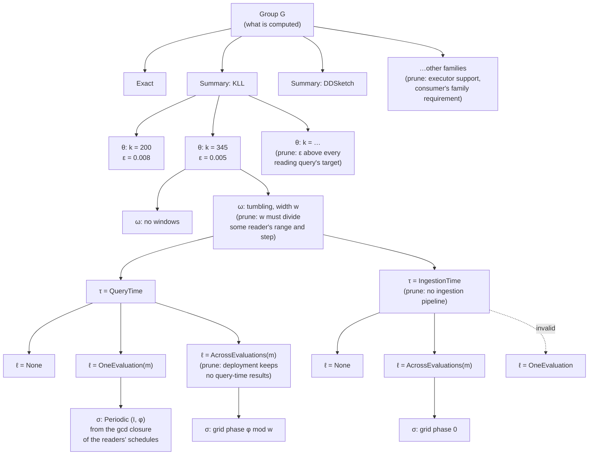

# Memo groups, properties and requirements

This page defines the memo's main data structures: groups, candidates, properties and requirements. It also lists every property and requirement, and gives the decision tree Stage 1 and Stage 2 walk to enumerate candidates. The symbols follow the planner formulation:
- a candidate is $v = (e_v, p_v)$;
- its logical properties are $p^{\log}$ and its physical properties are $p^{\mathrm{phys}}$;
- a consumer input's requirements are $r^{\log}_{c,i}$ and $r^{\mathrm{phys}}_{c,i}$;
- whether a producer satisfies them is $\alpha^{\log}$ and $\alpha^{\mathrm{phys}}$.

## Example

Query A: `quantile_over_time(0.95, latency[1m])` with `max_error 0.01`. Query B: `quantile_over_time(0.99, latency[1m]) / quantile_over_time(0.50, latency[1m])` with the same target.

```
G1   Scan latency[1m]
       producers: v1 = Scan                     (QueryTime, None)
G2   KLL state over G1                          one group, whatever the size
       producers: v2 = SummaryAgg[KLL](G1)  θ = {k = 200}   ε = 0.008   δ = 0.01
                  v3 = SummaryAgg[KLL](G1)  θ = {k = 345}   ε = 0.005   δ = 0.01
                  (each also expanded by Stage 2 into its (τ, ℓ, σ) alternatives)
G3   p95 of G2      producers: SummaryEstimate[q=0.95](G2)
G4   p99 of G2      producers: SummaryEstimate[q=0.99](G2)
G5   p50 of G2      producers: SummaryEstimate[q=0.50](G2)
G6   G4 / G5        producers: Divide(G4, G5)    input requirement: error_cap on each input
Query roots: A → G3, B → G6
```

The ε values are illustrative.

- G2 is one group: the KLL state over `latency[1m]`. Its sizes are candidates of G2, not separate groups.
- G3, G4 and G5 are consumers of G2. They are not stored in G2; each is a group with its own producers whose expression reads G2.
- A meets 0.01 with either size. B adds its two operands' errors (0.016 with `k = 200`, 0.010 with `k = 345`) and needs `k = 345` for both, so a plan where all three read v3 builds one KLL state.

## 1. Properties and requirements

### Properties

A property is a value a candidate has. Every property is one dimension of a product: a struct with one field per dimension, never a flat enum that lists the combinations. Invalid combinations are rejected by the struct's checked constructor.

| Dimension | Values | Logical or physical | Fixed by |
|---|---|---|---|
| Which sketch to use (representation) | `Exact` (exact accumulator kinds: Sum, Count, Min, Max, Increase, Rate, IRate), or `Summary { family }` with family in KLL, DDSketch, CMS, CountSketch, CMS with heap, CountSketch with heap, UnivMon, HLL, KMV, the Hydra variants | logical | the operator $\operatorname{op}_v$ |
| Sketch parameters $\theta$ | per family, from a predefined list: KLL `k`; DDSketch `alpha`; CMS / CountSketch `width × depth`; CMS / CountSketch with heap `width × depth × heap_size`; UnivMon `heap_size × rows × cols × layers`; HLL `precision`; KMV `k` | logical | enumerated |
| Error bound $(\varepsilon_v, \delta_v)$ | precomputed per $\theta$, in the family's accuracy metric (below); exact is $(0, 0)$ | logical | derived from $\theta$, not chosen |
| Window configuration $\omega$ | none; or tumbling windows of width $w$ and count $n$, with $w$ from the gcd closure of the readers' ranges and steps. Later: sliding windows by merge or by subtraction | logical | enumerated |
| Timing $\tau$ | `IngestionTime`, `QueryTime` | physical | enumerated |
| Lifetime $\ell$ | `None`, `OneEvaluation(Medium)`, `AcrossEvaluations(Medium)`, with `Medium` in `Memory`, `Disk` | physical | enumerated |
| Schedule $\sigma$ | only when $\ell \ne$ None. `Periodic { interval, phase }` for `OneEvaluation`; `TumblingWindowGrid { phase }` for `AcrossEvaluations` | physical | enumerated from the readers' schedules |

A candidate is materialized when $\ell \ne$ None. This is derived, not stored.

Invalid combinations, rejected by `new`:

| Combination | Why |
|---|---|
| (IngestionTime, OneEvaluation) | there is no evaluation at ingestion time |
| $\ell$ = None with a schedule | where an unmaterialized result runs is its reader's execution context, not a property |
| $\ell \ne$ None without a schedule | a materialized result must say on which times or grid it is delivered |
| OneEvaluation with a grid, AcrossEvaluations with a periodic schedule | each lifetime has one kind of schedule |
| `Exact` with a non-zero error bound | exact is $(0, 0)$ |

Valid physical states: (QueryTime, None), (IngestionTime, None), (QueryTime, OneEvaluation(m)), (QueryTime, AcrossEvaluations(m)), (IngestionTime, AcrossEvaluations(m)), for each medium $m$.

### Requirements

A requirement is a constraint that a consumer, a query or the deployment puts on producers. One requirement can constrain several property dimensions, and one dimension can be constrained by several requirements.

| Requirement | Who states it | Values | Constrains | Checked where |
|---|---|---|---|---|
| Accuracy | each query, at its root | metric: absolute (in the value's units, or times the stream's L1 or L2 norm), relative, rank; bound $\varepsilon_q$; failure probability $\delta_q$; scope: per value, whole result, or groups above a share of the records | representation and $\theta$ of every approximate candidate the query reads, through their $(\varepsilon_v, \delta_v)$ | Stage 3, row (K): the composed error at the root. Not per edge, because a per-input bound would fix each input's share of the budget |
| Validity cap `error_cap` | a non-linear consumer (ratio, product), per input | $\varepsilon$ cap | $\theta$ of the producer | per edge, $\alpha^{\log}$: row (K)'s linear bound holds only below the cap |
| Summary family | a consumer that reads summary state, per input | a family, e.g. KLL for a quantile readout | representation | per edge, $\alpha^{\log}$ |
| Window | a consumer that reads windows, per input | the reader's range and step | window configuration: the width must divide both | per edge, $\alpha^{\log}$ |
| Capability of ingestion-time compute | the deployment and the data workload | the source has an ingestion pipeline; the executor supports the family; query-time results may be kept across evaluations | timing; representation; (QueryTime, AcrossEvaluations) | candidate generation: such candidates are not offered |
| Reader timing and evaluation | a consumer, per input | when it reads (ingestion or query time) and from which evaluation (same or later) | timing and lifetime of the producer | per edge, $\alpha^{\mathrm{phys}}$ |
| Reader schedule | a periodic consumer, per input | its interval and phase $(I_c, \varphi_c)$ | schedule of the producer | per edge, $\alpha^{\mathrm{phys}}$ |
| Latency, resource budgets | the workload | per-query latency bound; memory and CPU budgets | the whole plan | Stage 3, rows (L) and (B) |

Accuracy metrics that may be added later, when a primitive needs them: top-k recall or precision, and a false-positive rate for membership summaries.

How requirements map to property dimensions:

```
Accuracy (query)             ──► representation, θ          (through ε_v, δ_v; row (K))
error_cap (edge)             ──► θ
Summary family (edge)        ──► representation
Window (edge)                ──► window configuration
Ingestion capability (deploy)──► timing, representation, lifetime
Reader timing/evaluation     ──► timing, lifetime
Reader schedule              ──► schedule
Latency, budgets (workload)  ──► every dimension, through cost
```

## 2. Decision tree of properties

Each memo group's candidates are the leaves of a tree. Every level decides one property dimension, and each edge out of a node is one value of that dimension. A path from the root to a leaf is one candidate.



The levels, top to bottom:

| Level | Dimension | Stage | Values offered | Pruned when |
|---|---|---|---|---|
| 1 | representation (operator) | Stage 1, Pass 1 and Pass 2 rules | each way to compute the group | the executor cannot build the family; no consumer's family requirement accepts it |
| 2 | $\theta$ | Stage 1, Pass 1 | the family's predefined list | $\varepsilon_v$ alone exceeds every reading query's target |
| 3 | window configuration $\omega$ | Stage 1, Pass 2 | tumbling widths from the gcd closure of readers' ranges and steps | no reader's range and step is a multiple of the width |
| 4 | timing $\tau$ | Stage 2 | QueryTime; IngestionTime | the source has no ingestion pipeline |
| 5 | lifetime $\ell$ | Stage 2 | None, OneEvaluation(m), AcrossEvaluations(m) | invalid with $\tau$; the deployment keeps no query-time results across evaluations |
| 6 | schedule $\sigma$ | Stage 2 | the gcd closure $\Sigma$ of the readers' schedules | only offered when $\ell \ne$ None |

What the tree does not decide:
- **Which producer each consumer input reads.** That is the edge choice $y_{u,c,i}$ in Stage 3. Two consumers of one group may read different leaves, e.g. A reads `k = 200` and B reads `k = 345`.
- **Where an unmaterialized candidate runs.** A candidate with $\ell$ = None runs inside each reader's execution context; Stage 3 chooses it.
- **How much a materialized candidate retains.** The amount $h_v$ depends on the readers' longest range; Stage 3 chooses it.

### Order of decisions

**The order does not affect correctness.** The set of leaves is the product of the dimensions' value sets, minus the invalid combinations and the pruned values. Every prune rule depends only on the value it removes and on values already decided above it, so any order that decides a pruned dimension after the dimensions its prune rule reads yields the same set of leaves.

**The order affects the efficiency of enumeration.** The number of nodes visited is $\sum_{d} \prod_{d' \le d} |\text{values kept at } d'|$, so a dimension that prunes much should come early, and a dimension whose values multiply without pruning should come late. Four considerations set the order above:

1. **Logical before physical.** Logical dimensions (representation, $\theta$, $\omega$) change the result's values or error; physical dimensions ($\tau$, $\ell$, $\sigma$) change only when and how long it is computed. Deciding logical dimensions first lets Stage 1 hash-cons groups and check $\alpha^{\log}$ on edges once, before Stage 2 multiplies each logical candidate by its physical alternatives.
2. **Strong prunes early.** The family is pruned by the executor and by consumers' family requirements, and $\theta$ by the accuracy target, before the window and physical levels multiply them.
3. **Dependent dimensions adjacent.** $\ell$ is constrained by $\tau$ (no OneEvaluation at ingestion), and $\sigma$ exists only when $\ell \ne$ None and its kind follows $\ell$. Deciding them in the order $\tau \to \ell \to \sigma$ means each invalid combination is pruned at the first level where it can be detected.
4. **Deployment-wide prunes as early as they can go.** If the deployment has no ingestion pipeline, the IngestionTime subtree is pruned once per candidate. Moving $\tau$ above $\omega$ would prune it once per group instead; this is an alternative order with the same leaves.

Alternative orders worth comparing:
- **$\tau$ first.** In a deployment where most sources have no ingestion pipeline, deciding timing at the group level prunes half the tree before $\theta$ and $\omega$ multiply it.
- **$\theta$ last among logical dimensions.** $\theta$ has the most values. Deciding $\omega$ before $\theta$ visits fewer nodes when many widths are pruned by readers' ranges.
- **Requirement-driven (top-down) vs producer-driven (bottom-up).** Top-down enumeration starts from each consumer's requirement and offers only the values it accepts; bottom-up offers every value and lets $\alpha$ filter edges. Top-down visits fewer nodes but must union the requirements of all consumers of a group, so that sharing between consumers is not lost.

## 3. Modeling a memo group by its producers

### Producers, not consumers

A memo group stores its **producers**: the candidates that compute it. It does not store its consumers. A consumer of $G$ is a candidate of another group whose expression reads $G$; the producer–consumer edges $(u, c, i)$ connect them.

| | Group stores its producers (chosen) | Group stores each consumer's own producer |
|---|---|---|
| Group identity | what is computed: operator and input groups, without properties | what is computed **for one reader** |
| Two readers of the same state | one group, two edges | two copies, joined only by an extra "shared build" candidate |
| A rule adds a new way to compute | one new producer in the group; every reader sees it | the rule must copy every reader that could use it |
| Where requirements live | on the consumer's input, $r_{c,i}$ | on the producer, so a producer is fixed to one reader |
| Accuracy | checked at each query root over the chosen edges | fixed per producer as a share of one query's budget |

Groups found by hash-consing are therefore shared automatically. Two queries that read the same state read one group, and Stage 3 decides through edges whether they read the same producer.

Consumers of a group are derived, not stored: `consumers(G)` is the set of candidates whose expression has $G$ as an input.

### Memo group data structure

```rust
/// The memo: every group, and each query's root over groups.
pub struct Memo {
    pub groups: Vec<MemoGroup>,
    pub query_roots: Vec<QueryRoot<MemoGroupId>>,
}

/// G: one logical result, or one state family, over specified input data.
/// Groups are hash-consed on `identity`, so an identical sub-expression of two
/// queries is one group.
pub struct MemoGroup {
    pub id: MemoGroupId,
    /// What is computed, without any property: the operator kind, its input
    /// groups, and the arguments that change the result's meaning (family,
    /// reduction, grouping, filter, query window). Sketch parameters, error
    /// bounds and window layout are not part of it.
    pub identity: GroupIdentity,
    /// The producers of this group: every way to compute it.
    pub candidates: Vec<CandidateForMemoGroup>,
}
```

### Property definition

```rust
/// p_v^log: one field per dimension. `new` rejects `Exact` with a non-zero
/// error bound.
pub struct LogicalProperties {
    representation: Representation,       // which sketch, and θ
    error_bound: ErrorBound,              // (ε_v, δ_v), precomputed per θ
    window_layout: Option<WindowLayout>,  // ω_v
}
pub enum Representation {
    Exact,
    Summary { family: SummaryFamily, parameters: SummaryParameters },
}
pub struct ErrorBound { metric: AccuracyMetric, epsilon: f64, delta: f64 }
pub enum WindowLayout { Tumbling { width_ms: u64, count: u32 } }  // sliding variants later

/// p_v^phys: one field per dimension. `new` rejects the invalid combinations.
pub struct PhysicalProperties {
    timing: ExecutionTiming,               // τ
    lifetime: Lifetime,                    // ℓ
    schedule: Option<Schedule>,            // σ, only when ℓ ≠ None
}
pub enum ExecutionTiming { IngestionTime, QueryTime }
pub enum Lifetime { None, OneEvaluation(Medium), AcrossEvaluations(Medium) }
pub enum Medium { Memory, Disk }
pub enum Schedule {
    Periodic { interval_ms: u64, phase_ms: u64 },
    TumblingWindowGrid { phase_ms: u64 },
}
```

### Property requirement definition

```rust
/// r^log_{c,i}: one optional constraint per dimension; `None` accepts any value.
pub struct LogicalRequirement {
    pub family: Option<SummaryFamily>,
    pub window: Option<WindowRequirement>,   // the reader's range and step
    pub error_cap: Option<f64>,              // validity of row (K)'s linear bound
}

/// r^phys_{c,i}: one field per dimension. `new` rejects (IngestionTime, Later).
pub struct PhysicalRequirement {
    reader_timing: ExecutionTiming,
    reads_from: Evaluation,                  // Same or Later
    reader_schedule: Option<ReaderSchedule>, // (I_c, φ_c) of a periodic reader
}

/// α^log and α^phys: one check per dimension, joined by "and".
pub fn satisfies(producer: &LogicalProperties, requirement: &LogicalRequirement) -> bool;
pub fn satisfies_physical(producer: &PhysicalProperties, requirement: &PhysicalRequirement) -> bool;

/// The accuracy target stays at the query root; Stage 3 checks it (row (K)).
pub struct QueryRequirement { pub accuracy: AccuracyTarget }
```

### Candidate data structure definition

```rust
/// v = (e_v, p_v^log): one producer of a memo group, from Stage 1.
pub struct CandidateForMemoGroup {
    pub expression: CandidateExpression,          // e_v
    pub logical_properties: LogicalProperties,    // p_v^log
    /// r^log_{c,i}: one per input group of `expression`.
    pub input_requirements: Vec<LogicalRequirement>,
}

/// e_v = op_v(G_{v,1}, …, G_{v,n}): one operator with its arguments, whose
/// children are groups. No private nodes.
pub struct CandidateExpression { pub operator: Operator<MemoGroupId> }

/// One physical alternative of a logical candidate, from Stage 2.
pub struct PhysicalCandidate {
    pub logical: (MemoGroupId, usize),            // which logical candidate
    pub properties: PhysicalProperties,           // p_v^phys
    pub input_requirements: Vec<PhysicalRequirement>,  // r^phys_{c,i}
}

/// (u, c, i): producer u may serve input i of consumer c, when α^log and α^phys hold.
pub struct Edge { pub producer: CandidateId, pub consumer: CandidateId, pub input: usize }
```

### Extensibility

**Add a value to a property dimension**, e.g. a new summary family or `Medium::Disk`:
1. Add the enum variant.
2. Every exhaustive `match` on the dimension stops compiling until it handles the new value. This is why matches on properties name every value and never use a `_` arm.
3. For a family: add its predefined $\theta$ list, its error-bound function, its cost, and the readouts it answers.
4. Add any new invalid combinations to `new`.

**Add a property dimension**, e.g. a compression codec or a partitioning:
1. Decide whether it is logical (it changes the result's values or error) or physical (it changes only when, where or how long the result is computed). Add a field to `LogicalProperties` or `PhysicalProperties`.
2. If consumers can constrain it, add an optional field to the matching requirement struct and one check to `satisfies` or `satisfies_physical`.
3. Add its invalid combinations with the other dimensions to `new`.
4. Add a level to the decision tree, with its prune rule, and place it by the considerations in "Order of decisions".
5. Add its cost terms.

**Add a requirement:**
1. If it constrains one edge (a consumer input), add an optional field to `LogicalRequirement` or `PhysicalRequirement`, set it where the consumer is created, and check it in `satisfies`.
2. If it constrains a whole query or the whole plan (accuracy, latency, budgets), add it to the query's or workload's requirements and a row to Stage 3. Do not split it into per-edge requirements: that fixes each input's share in advance.
3. If it comes from the deployment, prune the values it rules out during candidate generation.

**Add a rule:**
1. A rule matches over groups and their candidates' expressions, never over a reader's private operators.
2. It adds candidates $(e, p^{\log})$ to an existing group, or adds a new group with its candidates. It never copies a reader: every existing consumer of the group sees the new candidate through edges.
3. A candidate whose result has the same meaning as an existing group is added to that group, so hash-consing keeps sharing.
4. Each new candidate states its input requirements.
