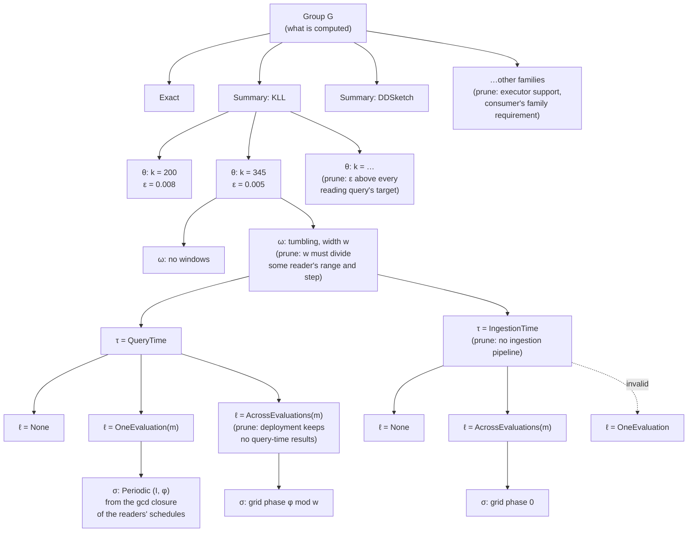

# Memo groups, properties and requirements

This page defines the memo's main data structures: groups, candidates, properties and requirements. It also lists every property and requirement, and gives the decision tree Stage 1 and Stage 2 walk to enumerate candidates. The symbols follow the planner formulation:
- a group has an expression $e_G$ over its producer groups, and a candidate $v$ of it has properties $p_v$;
- its logical properties are $p^{\log}$ and its physical properties are $p^{\mathrm{phys}}$;
- a consumer input's requirements are $r^{\log}_{c,i}$ and $r^{\mathrm{phys}}_{c,i}$;
- whether a producer satisfies them is $\alpha^{\log}$ and $\alpha^{\mathrm{phys}}$.

## Example

Query A: `quantile_over_time(0.95, latency[1m])` with `max_error 0.01`. Query B: `quantile_over_time(0.99, latency[1m]) / quantile_over_time(0.50, latency[1m])` with the same target.

```
G1   Scan latency[1m]
       producers: v1 = Scan                     (QueryTime, None)
G2   KLL state over G1                          one group, whatever the size
       producers: v2 = SummaryAgg[KLL](G1)  θ = {k = 200}   ε = 0.008   δ = 0.01
                  v3 = SummaryAgg[KLL](G1)  θ = {k = 345}   ε = 0.005   δ = 0.01
                  (each also expanded by Stage 2 into its (τ, ℓ, σ) alternatives)
G3   p95 of G2      producers: SummaryEstimate[q=0.95](G2)
G4   p99 of G2      producers: SummaryEstimate[q=0.99](G2)
G5   p50 of G2      producers: SummaryEstimate[q=0.50](G2)
G6   G4 / G5        producers: Divide(G4, G5)    input requirement: error_cap on each input
Query roots: A → G3, B → G6
```

The ε values are illustrative.

- G2 is one group: the KLL state over `latency[1m]`. Its sizes are candidates of G2, not separate groups.
- G3, G4 and G5 are consumers of G2. They are not stored in G2; each is a group with its own producers whose expression reads G2.
- A meets 0.01 with either size. B adds its two operands' errors (0.016 with `k = 200`, 0.010 with `k = 345`) and needs `k = 345` for both, so a plan where all three read v3 builds one KLL state.

## 1. Properties and requirements over properties

### Properties

A property is a value a candidate has. Every property is one dimension of a product: a struct with one field per dimension, never a flat enum that lists the combinations. Invalid combinations are rejected by the struct's checked constructor.

| Dimension | Values | Logical or physical | Fixed by |
|---|---|---|---|
| Which family to use (operator) | `Exact` (exact accumulator kinds: Sum, Count, Min, Max, Increase, Rate, IRate), or `Summary { family }` with family in KLL, DDSketch, CMS, CountSketch, CMS with heap, CountSketch with heap, UnivMon, HLL, KMV, the Hydra variants | logical | enumerated |
| Parameter configuration $\theta$ | per family, from a predefined list: KLL `k`; DDSketch `alpha`; CMS / CountSketch `width × depth`; CMS / CountSketch with heap `width × depth × heap_size`; UnivMon `heap_size × rows × cols × layers`; HLL `precision`; KMV `k` | logical | enumerated |
| Error bound $(\varepsilon_v, \delta_v)$ | computed on demand from $\theta$ and the statistic, in the family's accuracy metric (below); exact is $(0, 0)$ | logical | derived from $\theta$, not stored or chosen |
| Window configuration $\omega$ | none; or tumbling windows of width $w$ and count $n$, with $w$ from the gcd closure of the readers' ranges and steps. Later: sliding windows by merge or by subtraction | logical | enumerated |
| Timing $\tau$ | `IngestionTime`, `QueryTime` | physical | enumerated |
| Lifetime $\ell$ | `None`, `OneEvaluation(Medium)`, `AcrossEvaluations(Medium)`, with `Medium` in `Memory`, `Disk` | physical | enumerated |
| Schedule $\sigma$ | only when $\ell \ne$ None. `Periodic { interval, phase }` for `OneEvaluation`; `TumblingWindowGrid { phase }` for `AcrossEvaluations` | physical | enumerated from the readers' schedules |

A candidate is materialized when $\ell \ne$ None. This is derived, not stored.

Invalid combinations, rejected by `new`:

| Combination | Why |
|---|---|
| (IngestionTime, OneEvaluation) | there is no evaluation at ingestion time |
| $\ell$ = None with a schedule | where an unmaterialized result runs is its reader's execution context, not a property |
| $\ell \ne$ None without a schedule | a materialized result must say on which times or grid it is delivered |
| OneEvaluation with a grid, AcrossEvaluations with a periodic schedule | each lifetime has one kind of schedule |

Valid physical states: (QueryTime, None), (IngestionTime, None), (QueryTime, OneEvaluation(m)), (QueryTime, AcrossEvaluations(m)), (IngestionTime, AcrossEvaluations(m)), for each medium $m$.

### Requirements over properties

A requirement is a constraint that a consumer, a query or the deployment puts on producers. One requirement can constrain several property dimensions, and one dimension can be constrained by several requirements.

| Requirement | Who states it | Values | Constrains | Checked where |
|---|---|---|---|---|
| Accuracy | each query, at its root | metric: absolute (in the value's units, or times the stream's L1 or L2 norm), relative, rank; bound $\varepsilon_q$; failure probability $\delta_q$; scope: per value, whole result, or groups above a share of the records | operator family and $\theta$ of every approximate candidate the query reads, through their $(\varepsilon_v, \delta_v)$ | Stage 3, row (K): the composed error at the root. Not per edge, because a per-input bound would fix each input's share of the budget |
| Validity cap `error_cap` | a non-linear consumer (ratio, product), per input | $\varepsilon$ cap | $\theta$ of the producer | per edge, $\alpha^{\log}$: row (K)'s linear bound holds only below the cap |
| Summary family | a consumer that reads summary state, per input | a family, e.g. KLL for a quantile readout | operator family | per edge, $\alpha^{\log}$ |
| Window | a consumer that reads windows, per input | the reader's range and step | window configuration: the width must divide both | per edge, $\alpha^{\log}$ |
| Capability of ingestion-time compute | the deployment and the data workload | the source has an ingestion pipeline; the executor supports the family; query-time results may be kept across evaluations | timing; operator family; (QueryTime, AcrossEvaluations) | candidate generation: such candidates are not offered |
| Reader timing and evaluation | a consumer, per input | when it reads (ingestion or query time) and from which evaluation (same or later) | timing and lifetime of the producer | per edge, $\alpha^{\mathrm{phys}}$ |
| Reader schedule | a periodic consumer, per input | its interval and phase $(I_c, \varphi_c)$ | schedule of the producer | per edge, $\alpha^{\mathrm{phys}}$ |
| Latency, resource budgets | the workload | per-query latency bound; memory and CPU budgets | the whole plan | Stage 3, rows (L) and (B) |

Accuracy metrics that may be added later, when a primitive needs them: top-k recall or precision, and a false-positive rate for membership summaries.

How requirements map to property dimensions:

```
Accuracy (query)             ──► operator family, θ          (through ε_v, δ_v; row (K))
error_cap (edge)             ──► θ
Summary family (edge)        ──► operator family
Window (edge)                ──► window configuration
Ingestion capability (deploy)──► timing, operator family, lifetime
Reader timing/evaluation     ──► timing, lifetime
Reader schedule              ──► schedule
Latency, budgets (workload)  ──► every dimension, through cost
```

## 2. Decision tree of properties

Each memo group's candidates are the leaves of a tree. Every level decides one property dimension, and each edge out of a node is one value of that dimension. A path from the root to a leaf is one candidate.



The levels, top to bottom:

| Level | Dimension | Stage | Values offered | Pruned when |
|---|---|---|---|---|
| 1 | family (operator) | Stage 1, Pass 1 and Pass 2 rules | each way to compute the group | the executor cannot build the family; no consumer's family requirement accepts it |
| 2 | $\theta$ | Stage 1, Pass 1 | the family's predefined list | $\varepsilon_v$ alone exceeds every reading query's target |
| 3 | window configuration $\omega$ | Stage 1, Pass 2 | tumbling widths from the gcd closure of readers' ranges and steps | no reader's range and step is a multiple of the width |
| 4 | timing $\tau$ | Stage 2 | QueryTime; IngestionTime | the source has no ingestion pipeline |
| 5 | lifetime $\ell$ | Stage 2 | None, OneEvaluation(m), AcrossEvaluations(m) | invalid with $\tau$; the deployment keeps no query-time results across evaluations |
| 6 | schedule $\sigma$ | Stage 2 | the gcd closure $\Sigma$ of the readers' schedules | only offered when $\ell \ne$ None |

What the tree does not decide:
- **Which producer each consumer input reads.** That is the edge choice $y_{u,c,i}$ in Stage 3. Two consumers of one group may read different leaves, e.g. A reads `k = 200` and B reads `k = 345`.
- **Where an unmaterialized candidate runs.** A candidate with $\ell$ = None runs inside each reader's execution context; Stage 3 chooses it.
- **How much a materialized candidate retains.** The amount $h_v$ depends on the readers' longest range; Stage 3 chooses it.

### Order of decisions

**The order does not affect correctness.** The set of leaves is the product of the dimensions' value sets, minus the invalid combinations and the pruned values. Every prune rule depends only on the value it removes and on values already decided above it, so any order that decides a pruned dimension after the dimensions its prune rule reads yields the same set of leaves.

**The order affects the efficiency of enumeration.** The number of nodes visited is $\sum_{d} \prod_{d' \le d} |\text{values kept at } d'|$, so a dimension that prunes much should come early, and a dimension whose values multiply without pruning should come late. Four considerations set the order above:

1. **Logical before physical.** Logical dimensions (operator family, $\theta$, $\omega$) change the result's values or error; physical dimensions ($\tau$, $\ell$, $\sigma$) change only when and how long it is computed. Deciding logical dimensions first lets Stage 1 hash-cons groups and check $\alpha^{\log}$ on edges once, before Stage 2 multiplies each logical candidate by its physical alternatives.
2. **Strong prunes early.** The family is pruned by the executor and by consumers' family requirements, and $\theta$ by the accuracy target, before the window and physical levels multiply them.
3. **Dependent dimensions adjacent.** $\ell$ is constrained by $\tau$ (no OneEvaluation at ingestion), and $\sigma$ exists only when $\ell \ne$ None and its kind follows $\ell$. Deciding them in the order $\tau \to \ell \to \sigma$ means each invalid combination is pruned at the first level where it can be detected.
4. **Deployment-wide prunes as early as they can go.** If the deployment has no ingestion pipeline, the IngestionTime subtree is pruned once per candidate. Moving $\tau$ above $\omega$ would prune it once per group instead; this is an alternative order with the same leaves.

Alternative orders worth comparing:
- **$\tau$ first.** In a deployment where most sources have no ingestion pipeline, deciding timing at the group level prunes half the tree before $\theta$ and $\omega$ multiply it.
- **$\theta$ last among logical dimensions.** $\theta$ has the most values. Deciding $\omega$ before $\theta$ visits fewer nodes when many widths are pruned by readers' ranges.
- **Requirement-driven (top-down) vs producer-driven (bottom-up).** Top-down enumeration starts from each consumer's requirement and offers only the values it accepts; bottom-up offers every value and lets $\alpha$ filter edges. Top-down visits fewer nodes but must union the requirements of all consumers of a group, so that sharing between consumers is not lost.

## 3. Modeling a memo group  

A memo group stores its **producers**: all candidate ways to compute its result, before Stage 3 selects any. A consumer of $G$ is a candidate of another group whose expression reads $G$; the producer–consumer edges $(u, c, i)$ connect them. Here, `consumers(G)` is derived from those input references rather than stored in the group.

> Side note: [CMU-DB's optd-original](https://github.com/cmu-db/optd-original) stores the list of children as input producers to a memo group; while storing consumers vs storing producers in the memo group structure to form the DAG are equivalent in terms of correctness and efficiency. 

Candidate enumeration efficiency depends on:

- **Property and requirement fields:** which dimensions are represented, their legal values, which values are derived, and which constraints permit pruning or sharing (Section 1).
- **Decision-tree order:** when each dimension is decided and its requirements are checked, so invalid combinations can be pruned before later dimensions multiply them (Section 2).

Groups found by hash-consing expose the same producer alternatives to all their readers. Stage 3 decides whether readers use the same producer candidate or different ones. **Reusing a computation alternative in the memo is distinct from reusing its computed result at runtime. Selecting the same candidate for multiple readers does not by itself mean computing it only once.**

- **Materialized candidate** ($\ell \ne$ None): its result is retained. Readers connected to the same materialized producer can reuse that result instead of computing it separately, subject to its lifetime and schedule.
- **Unmaterialized candidate** ($\ell =$ None): no independent shared result is retained. The computation runs as part of each reader's execution, so multiple readers selecting the same candidate may each execute it separately.

For example, if p50 and p99 select the same KLL candidate, a shared materialized producer builds and retains one KLL state for both readouts within the applicable lifetime and schedule. With an unmaterialized candidate, the p50 execution can build its own KLL state and the p99 execution another, even though both builds use the same candidate configuration.

### Memo group data structure

A memo group holds three things:
- **Query semantics:** its expression, and the producer groups the expression reads.
- **Eligibility:** for each input, the requirement a producer must meet.
- **Candidates:** the ways to compute it.

```rust
/// The memo: every group, and each query's root over groups.
pub struct Memo {
    pub groups: Vec<MemoGroup>,
    pub query_roots: Vec<QueryRoot<MemoGroupId>>,
}

pub struct MemoGroup {
    // Query semantics.
    /// The logical operator, from the existing IR. Its children are the
    /// producer groups G_i it reads, in order (`expression.children()`), which
    /// fix the input data and schema.
    pub expression: Operator<MemoGroupId>,
    // Eligibility.
    /// r_i: one requirement per producer group, by input index i.
    pub input_requirements: Vec<PropertyRequirement>,
    // Candidates.
    /// The ways to compute this group; x_v in the MILP.
    pub candidates: Vec<Candidate>,
}
```

The expression is the existing IR's [`Operator<C>`](../../../crates/types/src/ir/operator/node.rs), with `C = MemoGroupId`. It wraps [`NonASAPOp<C>`](../../../crates/types/src/ir/operator/non_asap.rs) or [`ASAPOp<C>`](../../../crates/types/src/ir/operator/asap.rs), and each variant carries its own arguments and its inputs. For example, `Scan` carries the source, predicates and schema, and `Filter` carries a predicate and its child. No new identity type is needed.

Hash-consing finds or inserts a group by its expression: the operator, its arguments and its input group ids. For example, the KLL state over one source and query window is one group for `k = 200` and `k = 345`; these are two candidates of that group. A different source, filter or query window gives a different group. Properties are not part of the expression: the family, sketch parameters, window layout, timing, lifetime and schedule belong to candidates. A requested query window belongs to the expression; the internal window layout used to compute it does not.

`MemoGroupId` is the handle of an interned group. Looking up an existing expression returns that group's id instead of adding a second group.

### Candidate data structure definition

```rust
/// v: one way to compute its group. The group's expression says what is
/// computed; the candidate's properties say how.
pub struct Candidate {
    /// One value per property dimension.
    pub properties: Properties,
}
```

Stage 1 decides the logical dimensions of each candidate, and Stage 2 expands each one into its physical alternatives:

```rust
pub struct Properties {
    pub logical: LogicalProperties,     // Stage 1
    pub physical: PhysicalProperties,   // Stage 2
}

/// (u, c, i): producer u may serve input i of consumer c when u's properties
/// satisfy c's group's input_requirements[i].
pub struct Edge { pub producer: CandidateId, pub consumer: CandidateId, pub input: usize }
```

### Property definition

A property is a struct with one field per dimension (P1, P2, …), each its own enum:

```rust
/// p_v^log.
pub struct LogicalProperties {
    family: Family,                                // which sketch, or exact
    parameter_configuration: Option<SketchParams>, // θ; None for exact
    window_layout: Option<WindowLayout>,           // ω_v
}
pub enum Family { Exact(ExactKind), Sketch(SketchAlgorithm) }
pub enum WindowLayout { Tumbling { width_ms: u64, count: u32 } }  // sliding variants later

/// p_v^phys. `new` rejects the invalid combinations.
pub struct PhysicalProperties {
    timing: ExecutionTiming,               // τ
    lifetime: Lifetime,                    // ℓ
    schedule: Option<Schedule>,            // σ, only when ℓ ≠ None
}
pub enum ExecutionTiming { IngestionTime, QueryTime }
pub enum Lifetime { None, OneEvaluation(Medium), AcrossEvaluations(Medium) }
pub enum Medium { Memory, Disk }
pub enum Schedule {
    Periodic { interval_ms: u64, phase_ms: u64 },
    TumblingWindowGrid { phase_ms: u64 },
}

// Reuse the existing family-specific conversions in asap_accuracy.
// Parameter configuration → error bound (including metric and failure probability).
// `family` describes the exact value or sketch, including its parameters;
// `query` identifies the statistic read from it.
pub(crate) fn local_guarantee(
    family: &FieldDataType,
    query: &SketchStatistic,
) -> Option<AccuracyGuarantee>;

// Error target → parameter configuration for the chosen family and intent.
pub(crate) fn size_params(
    kind: SketchAlgorithm,
    intent: &AggIntent,
    eps: f64,
    delta: f64,
) -> SketchParams;
```

`new` checks that `parameter_configuration` belongs to `family`, as [`SketchKind::new`](../../../crates/types/src/ir/schema/sketch.rs) does today, and reuses the existing `SketchParams` type.

`error_bound` is derived when needed, not stored in `LogicalProperties`. Reuse [`estimators::local_guarantee`](../../../crates/accuracy/src/estimators/mod.rs) for parameters → guarantee and [`estimators::size_params`](../../../crates/accuracy/src/estimators/mod.rs) for target → parameters. These existing crate-private functions dispatch to the family's accuracy and sizing implementations; the declarations above document those interfaces, not new implementations. [`sizing::default_size_params`](../../../crates/accuracy/src/sizing.rs) already delegates to `size_params`. If another crate needs direct access, expose the existing implementation through the accuracy crate rather than duplicate its formulas.

Deriving a guarantee also needs the statistic being read: one family's parameters can give different guarantees for different statistics. Exact values yield an exact guarantee; an unsupported statistic or missing error model yields `None`. Target → parameters is a sizing operation with discrete values and family limits, not an exact mathematical inverse; validate the derived guarantee against the target rather than assume the target is achievable.

### Property requirement definition

A property requirement is also a struct with one field per dimension (R1, R2, …), each its own enum. `None` accepts any value.

```rust
/// r_i: what input i's producer must satisfy.
pub struct PropertyRequirement {
    pub accuracy: Option<AccuracyRequirement>,
    pub family: Option<SummaryFamily>,
    pub window: Option<WindowRequirement>,       // the reader's range and step
    pub reader_timing: Option<ExecutionTiming>,
    pub reads_from: Option<Evaluation>,          // Same or Later
    pub reader_schedule: Option<ReaderSchedule>, // (I_c, φ_c) of a periodic reader
}

/// The set of legal properties for an input: legal_properties(r) = f(r).
pub fn satisfies(producer: &Properties, requirement: &PropertyRequirement) -> bool;
```

The set of legal properties is a function of the requirement, $\text{legal}(r) = f(r)$. One requirement can be written at different levels. For example, the same accuracy requirement can be stated two ways:

| Requirement | Mapped to properties | Producer candidates enumerated |
|---|---|---|
| Accuracy = 95% rank accuracy | every family with rank error, and every configuration of it that meets 95% rank accuracy | (KLL, `k = 100`), (KLL, `k = 200`), … |
| Accuracy = KLL's `k ≥ 100` | KLL with `k ≥ 100` | (KLL, `k = 100`), (KLL, `k = 200`), … |

```rust
pub enum AccuracyRequirement {
    /// Stated on the result: a metric, bound and failure probability. The
    /// legal properties are derived through `size_params` / `local_guarantee`.
    Target(AccuracyTarget),
    /// Stated on the properties directly, e.g. KLL with k ≥ 100.
    Parameters { family: SketchAlgorithm, at_least: SketchParams },
}
```

What goes into a property requirement affects only the efficiency of enumeration, not correctness:
- **Some requirements already hold by the query semantics.** The expression and its producer groups already fix the input data and its fields, so no requirement needs to restate them.
- **It depends on how rules generate the candidate space.** A rule that only generates legal candidates needs no requirement for that dimension; a rule that generates every value needs the requirement to filter them.
- **A requirement prunes; it does not decide the plan.** A tighter requirement removes candidates earlier. Each query's composed error is still checked at its root in Stage 3 (row (K)), so a requirement that is too loose costs enumeration time, not a wrong plan.

### Extensibility

**Add a value to a property dimension**, e.g. a new summary family or `Medium::Disk`:
1. Add the enum variant.
2. Every exhaustive `match` on the dimension stops compiling until it handles the new value. This is why matches on properties name every value and never use a `_` arm.
3. For a family: add its predefined $\theta$ list, its error-bound function, its cost, and the readouts it answers.
4. Add any new invalid combinations to `new`.

**Add a property dimension**, e.g. a compression codec or a partitioning:
1. Decide whether it is logical (it changes the result's values or error) or physical (it changes only when, where or how long the result is computed). Add a field (a new enum) to `LogicalProperties` or `PhysicalProperties`.
2. If consumers can constrain it, add an optional field to `PropertyRequirement` and one check to `satisfies`.
3. Add its invalid combinations with the other dimensions to `new`.
4. Add a level to the decision tree, with its prune rule, and place it by the considerations in "Order of decisions".
5. Add its cost terms.

**Add a requirement:**
1. If it constrains one edge (a consumer input), add an optional field to `PropertyRequirement`, set it where the consumer's group is created, and check it in `satisfies`.
2. If it constrains a whole query or the whole plan (accuracy, latency, budgets), add it to the query's or workload's requirements and a row to Stage 3. Do not split it into per-edge requirements: that fixes each input's share in advance.
3. If it comes from the deployment, prune the values it rules out during candidate generation.

**Add a rule:**
1. A rule matches over groups and their candidates' expressions, never over a reader's private operators.
2. It adds candidates to an existing group, or adds a new group with its expression, input requirements and candidates. It never copies a reader: every existing consumer of the group sees the new candidate through edges.
3. A candidate whose result has the same meaning as an existing group is added to that group, so hash-consing keeps sharing.
4. Each new group states its input requirements.
