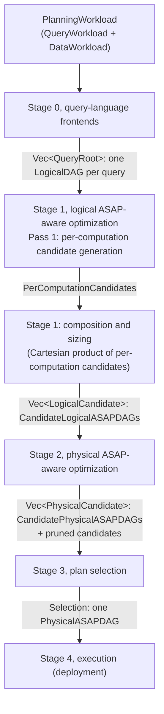

# Planner Layering: Stage Components, Algorithms and Code Interfaces

Status: describes `main` @ `6665fcc3`. Audience: developers of ASAPPlanner who
read [ASAPPlanner Planning Stages Design](proposals/planner-layering.md)
and need to know how each stage is built today.

planner-layering.md defines the stages and passes and their algorithms. This
document follows the same order and, for every stage, describes its core
components, the algorithm as implemented on `main`, and its code interface.
Where `main` differs from the design or does not implement it yet, the stage
says so.

## 1. Pipeline



Pass 2 (ASAP-aware CSE) runs after Pass 1 and before sizing in the design; it
is not wired into the pipeline on `main` (Section 3.3).

Every stage of the pipeline is one plain function over one workload. The
`asap-planner` facade runs Stage 0 and then an `OptimizationPass`; the default
pass, `Stage1ToStage3Pass`, calls `run_stage1_to_stage3`, which runs Stage 1,
Stage 2 and Stage 3 in order and keeps every stage's candidates in a
`Stage1ToStage3Run`:

```text
run_stage1_to_stage3(roots, targets, data, models):
    inventory ← generate_per_computation_candidates(roots)          // Stage 1, Pass 1
    combinations ← Π_t |inventory.targets[t].choices.candidates|    // saturating
    for each choice in the Cartesian product (mixed radix, last target fastest):
        L_n ← compose_logical_candidate(inventory, choice)            // Stage 1, composition + sizing
        if L_n composed:
            P_n ← optimize_physical_asap(L_n) or prune L_n with the error   // Stage 2
    selection ← select_plan(all P_n, targets, data, models)          // Stage 3
```

Only a Pass 1 error fails the run. A candidate that does not compose keeps its
error in the run, a candidate Stage 2 cannot implement is pruned with a reason,
and a failed selection is reported as the Stage 3 result. Every combination is
enumerated and priced; nothing is capped; a search that avoids building every
candidate is future work.

### Code interface

```rust
// crates/planner/src/lib.rs
pub async fn e2e_plan(input: UserInput<'_>) -> Result<PlanOutput, PlanError> {

// crates/asap-aware-mapping/src/pass/mod.rs
pub struct PlanningModels<'a> {
    pub cost: &'a dyn CostModel,
    pub accuracy: &'a dyn AccuracyModel,
    pub evidence: &'a dyn AccuracyEvidenceProvider,
}

// crates/asap-aware-mapping/src/pass/stage1_to_stage3.rs
pub fn run_stage1_to_stage3<Id: Clone + std::fmt::Debug>(
    roots: Vec<(Id, QueryRoot)>,
    targets: &[Option<AccuracyTarget>],
    data: &DataWorkload,
    models: PlanningModels<'_>,
) -> Result<Stage1ToStage3Run<Id>, PerComputationCandidateError> {

pub struct Stage1ToStage3Run<Id> {
    pub stage1_pass1_per_computation: PerComputationCandidates<Id>,
    pub combinations: usize,
    pub stage1_logical_asap_optimization: Vec<LogicalCandidate>,
    pub stage2_physical_asap_optimization: Vec<PhysicalCandidate>,
    pub stage2_pruned: Vec<PrunedCandidate>,
    pub stage3_plan_selection: Result<Selection, SelectionError>,
}
```

## 2. Stage 0, query-language frontends

Design: [0. Language-specific frontends](proposals/planner-layering.md#0-language-specific-frontends).

### Core components

| Component | What it does |
|---|---|
| PromQL frontend (`crates/frontend-promql`) | Parses PromQL and builds the shared name-based operator tree in canonical shape. |
| SQL frontend (`crates/frontend-sql`) | Parses and plans SQL through DataFusion, then builds the same tree. |
| MetricsQL frontend (`crates/frontend-metricsql`) | Converts the MetricsQL AST into the same tree. |
| Shared resolver (`crates/frontend-common`) | `UnresolvedOp` tree with name-based column references; `resolve_root` binds each name to a positional `ColumnId` and derives every schema. |
| Unified IR (`crates/types/src/ir/`) | One operator DAG type for every stage: `OperatorNode` with `NonASAPOp` or `ASAPOp` operators. |
| Workload (`crates/types/src/workload.rs`) | `QueryWorkload` (queries, recurrence, accuracy and latency requirements) and `DataWorkload` (arrival, ingestion interval, volume, rate, cardinality, distribution, each as `Evidence<T>`). |

### Core algorithm

```text
for each entry q of the QueryWorkload, in entries() order:
    tree ← LANGUAGE_FRONTEND(q.query)   // name-based UnresolvedOp tree, canonical shape
    root ← resolve_root(tree)           // bottom-up: bind names, derive schemas
    emit QueryRoot::Operator(root) or QueryRoot::Scalar(expr)
reject the workload if any query cannot be represented
```

The output is one `LogicalDAG` per query: a `QueryRoot` whose operators are all
`NonASAPOp` (`Scan`, `Filter`, `Project`, `Aggregate`, `Join`, `TimeRange`, …),
with no ASAP summary choice, timing or materialization. An aggregation records
its computation as an `AggIntent` per measure, carrying the query's accuracy
target. The facade fails the whole call if one query fails, because the output
is aligned with the workload's entries. The design's `CandidateLogicalDAGs` is
one candidate on `main`: the frontends produce a single logical form per query.

### Code interface

```rust
// crates/frontend-promql/src/lib.rs
pub fn lower_promql_query_workload(
    workload: &PlanningWorkload,
    now_ms: u64,
) -> Result<Vec<asap_types::ir::QueryRoot>, PromqlError> {

// crates/frontend-sql/src/lib.rs
pub async fn lower_sql_dialect(
    query: &str,
    catalog: &SqlCatalog,
    dialect: SqlDialect,
    accuracy: AccuracyTarget,
) -> Result<Rc<OperatorNode>, SqlError> {

// crates/frontend-metricsql/src/lib.rs
pub fn lower_metricsql_query_workload(
    workload: &PlanningWorkload,
    now_ms: u64,
) -> Result<Vec<asap_types::ir::QueryRoot>, MetricsqlError> {

// crates/types/src/ir/query.rs
pub enum QueryRoot<C = Rc<OperatorNode>> {
    Operator(C),
    Scalar(ScalarExpr<C>),
}
```

## 3. Stage 1, logical ASAP-aware optimization

Design: [1. Logical ASAP-aware optimization](proposals/planner-layering.md#1-logical-asap-aware-optimization).

### Core components

| Component | What it does |
|---|---|
| Pass 1 (`crates/asap-aware-mapping/src/per_computation_candidates.rs`, `generate_per_computation_candidates`) | Finds every computation target and its unranked, unsized candidates, with pruned candidates and reasons. |
| Composition (same file, `compose_logical_candidate`) | Builds one whole-workload candidate DAG from one choice per target, sizes its summaries and gives every node a guarantee. |
| Summary realization (`crates/asap-aware-mapping/src/realization.rs`) | The summary families per intent (`summary_candidates`), the `(ε, δ)` budget of a target, and default sizing. |
| Accuracy model (`crates/asap-aware-mapping/src/accuracy/`) | `DefaultAccuracyModel`: local error bounds of sized families, propagation rules (`composition.rs`), and per-family sizing (`estimators/`). |
| Enumeration (`crates/asap-aware-mapping/src/pass/stage1_to_stage3.rs`) | Walks the Cartesian product of per-computation candidates into `LogicalCandidate`s `L1, L2, …`. |

### 3.1 Pass 1: Per-computation candidate generation

Design: [Pass 1](proposals/planner-layering.md#pass-1-per-computation-candidate-generation),
Algorithms 1 and 1.1.

#### Core algorithm

On `main`, a computation target is one measure of an `Aggregate`, and
Algorithm 1.1's `MATCH` is reading that measure's `AggIntent`: the intent
binds the input column, grouping (`Reduction`), filter and parameters such as
`k` or `q`. The rule templates are fixed per candidate kind (Section 3.2), and
the families that fill a summary slot come from a static table,
`summary_candidates(intent)`:

| Intent | Summary families |
|---|---|
| `Quantile` | KLL, DDSketch |
| `Cardinality` | HLL, Theta, KMV, UnivMon (not UnivMon over a tuple) |
| `FrequencyL2`, `FrequencyEntropy` | UnivMon |
| `TopK` | CMS with heap, Count Sketch with heap |
| `Count` | CMS, Count Sketch, UnivMon |

```text
generate_per_computation_candidates(roots):
    reject a root that contains ASAP operators, timing or a materialization
    for each Aggregate node a reachable from the roots (once, shared or not):
        record a's HAVING entries:
            a's own having, and each consumer Filter directly above a
            placement ← BelowAggregate if the predicate reads only group keys
                        (and, for a consumer Filter, every consumer applies it)
                        else AboveOutput
        for each measure m of a, with intent i:
            choices ← computation_candidates_for_intent(i)
            skip m if its only option is plain Exact
            if i is avg over a possibly-null input: prune AvgAsSumCount (NullableAvgInput)
            emit target (a, m, choices, filter of m, HAVING entries)

computation_candidates_for_intent(i):
    exact option ← ExactAccumulator(kind)  for Count, Sum, Min, Max, Rate, IRate, Increase
                   AvgAsSumCount           for avg
                   Exact                   otherwise
    if i has an accuracy target:
        if the target is Exact: prune every summary_candidates(i) (RequiresExact)
        else: check ε, δ ∈ (0, 1); add Summary(f) for every f in summary_candidates(i)
```

Each target thus has exactly one exact option, and pruning happens only for a
provable reason. Nested aggregates are separate targets, and their options
multiply in composition. Pass 1 uses no cost or accuracy model.

Differences from the design: candidates are not checked against a family's
capability beyond the table, and the design's Hydra template for `TopK`
("one summary over all groups") is not in the table.

#### Code interface

```rust
// crates/asap-aware-mapping/src/per_computation_candidates.rs
pub fn generate_per_computation_candidates<Id: std::fmt::Debug>(
    roots: Vec<(Id, QueryRoot)>,
) -> Result<PerComputationCandidates<Id>, PerComputationCandidateError> {

pub struct PerComputationCandidates<Id> {
    pub roots: Vec<(Id, QueryRoot)>,
    pub targets: Vec<ComputationTarget>,
}

pub struct ComputationTarget {
    pub target: Rc<OperatorNode>,
    pub measure: usize,
    pub choices: ComputationChoices,
    pub filter: Option<Predicate>,
    pub having: Vec<HavingEntry>,
}

pub struct ComputationChoices {
    pub candidates: Vec<ComputationCandidate>,
    pub pruned: Vec<(ComputationCandidate, PruneReason)>,
}

pub enum ComputationCandidate {
    Exact,
    ExactAccumulator {
        kind: ExactKind,
        params: ExactParams,
    },
    Summary(SketchAlgorithm),
    AvgAsSumCount,
}
```

### 3.2 Composition, sizing and guarantees

Design: Algorithm 1, lines 18–21 (`SUBSTITUTE`), and sizing after Pass 2.

#### Core algorithm

`run_stage1_to_stage3` enumerates the Cartesian product of the targets'
candidates. `choice[t]` indexes `targets[t].choices.candidates`; the choice
vector is incremented in mixed radix, last target fastest, and `L<n>` is the
`n`-th choice. The run records the product's size in `combinations`
(saturating at `usize::MAX`). For each choice, `compose_logical_candidate`
rewrites the workload bottom-up:

```text
compose_logical_candidate(inventory, choice):
    for each aggregate a with a chosen candidate other than Exact:
        replace a measure by measure, over a's input:
            ExactAccumulator → SummaryAgg(exact family) → FinalizeExactAccumulator
            Summary(f)       → SummaryAgg(SIZED(f, acc(m))) → SummaryEstimate
            AvgAsSumCount    → finalized sum and count, divided
            Exact            → a single-measure Aggregate
        join several measures back on the group keys; keep a's column names
        measure filter → SummaryAgg.filter
        HAVING BelowAggregate → Filter below the state (consumer Filter dropped)
        HAVING AboveOutput   → Filter above the output
    keep sub-DAGs shared between roots shared
    for each node, bottom-up: node.guarantee ← COMPOSED_GUARANTEE(node)

SIZED(f, acc):
    (ε, δ) ← accuracy_budget(acc)            // δ defaults to 0.01
    params ← default_size_params(f, intent, ε, δ)   // accuracy/estimators: invert f's error bound

COMPOSED_GUARANTEE(node):
    FinalizeExactAccumulator over exact input      → exact
    SummaryEstimate over exact input, bound applies → DefaultAccuracyModel.local_guarantee(f, query)
    Project of plain columns                       → the child's guarantee
    non-ASAP operator over exact inputs            → exact
    anything else (incl. any value computed from an approximate input) → None
```

A summary estimate's bound "applies" unless the query is Top-K (a heap sketch
bounds item frequencies, not membership) or the family is Count-Min over
weights not proven non-negative. A `None` guarantee does not reject the
candidate here; Stage 3 decides.

Differences from the design: with no Pass 2, each summary is sized for its own
measure's requirement, which is the post-Pass-2 sizing with nothing shared.
Guarantees are not yet propagated through operators over approximate values
(`AccuracyModel::propagate` exists but composition does not call it).

#### Code interface

```rust
// crates/asap-aware-mapping/src/per_computation_candidates.rs
pub fn compose_logical_candidate<Id: Clone>(
    inventory: &PerComputationCandidates<Id>,
    choice: &[usize],
) -> Result<Vec<(Id, QueryRoot)>, PerComputationCandidateError> {

// crates/asap-aware-mapping/src/realization.rs
pub fn default_size_params(
    kind: SketchAlgorithm,
    intent: &AggIntent,
    eps: f64,
    delta: f64,
) -> SketchParams {

// crates/asap-aware-mapping/src/pass/stage1_to_stage3.rs
pub struct LogicalCandidate {
    pub id: String,
    pub display_name: String,
    pub choice: Vec<usize>,
    pub roots: Result<Vec<QueryRoot>, PerComputationCandidateError>,
}
```

### 3.3 Pass 2: ASAP-aware common-subexpression elimination

Design: [Pass 2](proposals/planner-layering.md#pass-2-asap-aware-common-subexpression-elimination),
Algorithm 2 (identical-expression, summary-capability and window-composition
rules).

#### Core algorithm

Not implemented on `main`: `run_stage1_to_stage3` goes from Pass 1 straight to
composition, so no candidate shares a summary across computations, and a sub-DAG
is shared only when the frontends already produced it once. Two building
blocks exist outside the pipeline:

- **Structural CSE** (`crates/types/src/ir/cse.rs`, `share_common_sub_dags`):
  bottom-up hash-consing of the IR; a hash narrows the search and typed
  equality decides sharing. It is the structural core of the
  identical-expression rule; only the legacy search calls it today.
- **Summary coverage** (`crates/types/src/ir/summary_coverage.rs`,
  `SummaryCoverage::derive`): what a summary state computes (`definition`) and
  which rows it took (`selection`), the comparison of summary input data that
  the sharing rules need.

#### Code interface

```rust
// crates/types/src/ir/cse.rs
pub fn share_common_sub_dags<Id>(
    roots: Vec<(Id, Rc<OperatorNode>)>,
) -> Vec<(Id, Rc<OperatorNode>)> {
```

## 4. Stage 2, physical ASAP-aware optimization

Design: [2. Physical ASAP-aware optimization](proposals/planner-layering.md#2-physical-asap-aware-optimization),
Algorithm 3.

### Core components

| Component | What it does |
|---|---|
| Physical ASAP-aware optimization (`crates/asap-aware-mapping/src/stage2_physical_asap_optimization.rs`, `optimize_physical_asap`) | Implements every operator and assigns materialization for one logical candidate. |
| Materialization options (`crates/types/src/post_asap/execution_data_state.rs`) | `Materialization`: `NotMaterialized`, `MatAtIngestion(Medium)`, `MatAtQuery(Medium)`; `Medium` is `Memory` or `Disk`. |
| Timing (`crates/types/src/ir/timing.rs`) | `MaterializationAssignment` and `apply_materialization_timings`, which write every node's `ExecutionTiming` and `Materialization`. |
| Physical export (`crates/types/src/ir/physical_export.rs`) | Flattens the timed roots into a `PhysicalASAPDAG` with stable node ids. |

### Core algorithm

```text
optimize_physical_asap(L_n.roots):
    // physical operator implementation, one memo for the whole workload
    for each node, bottom-up:
        if node is Aggregate with a TopK measure:
            if it is a plain grouped top-k: Project(Limit(Sort per group)) restoring [keys.., topk_k]
            else: fail ExactTopK                  // per-entity reduction, other measures, filter, HAVING
        else: keep the node (SummaryAgg → SummaryEstimate already is build → estimate)
    // materialization
    m ← MaterializationAssignment::with_default(NotMaterialized)
    timed ← apply_materialization_timings(roots, m)
    dag ← compile_physical_asap_workload_with_node_ids(timed)
    return PhysicalCandidate { from_logical: L_n, roots: timed, dag }
```

The caller names the result `P<n>` after `L<n>`; on error, it records a
`PrunedCandidate` with the error as its reason. These are the only candidates
Stage 2 removes, and each is provably invalid (it cannot be implemented).

Differences from the design: materialization offers one option, so each logical
candidate yields exactly one physical candidate. Algorithm 3's enumeration of
`MatAtIngestion(medium)` and `MatAtQuery(medium)` per sub-DAG, its
ingestion-time upstream constraint and retention are not implemented. Parallelism,
partitioning and resource management are TODO in the design as well.

### Code interface

```rust
// crates/asap-aware-mapping/src/stage2_physical_asap_optimization.rs
pub fn optimize_physical_asap(
    from_logical: &str,
    roots: &[QueryRoot],
) -> Result<PhysicalCandidate, PhysicalASAPOptimizationError> {

pub struct PhysicalCandidate {
    pub id: String,
    pub from_logical: String,
    pub display_name: String,
    pub roots: Vec<QueryRoot>,
    pub dag: PhysicalASAPDAG,
}

// crates/types/src/post_asap/execution_data_state.rs
pub enum Materialization {
    NotMaterialized,
    MatAtIngestion(Medium),
    MatAtQuery(Medium),
}
```

## 5. Stage 3, plan selection

Design: [3. Plan selection](proposals/planner-layering.md#3-plan-selection).

### Core components

| Component | What it does |
|---|---|
| Plan selection (`crates/asap-aware-mapping/src/stage3_plan_selection.rs`, `select_plan`) | Rejects candidates that miss an accuracy target, prices the rest over their physical DAG and selects the cheapest. |
| Accuracy model (`AccuracyModel::satisfies`, `crates/asap-aware-mapping/src/accuracy/mod.rs`) | Decides whether a guarantee meets an `AccuracyTarget`. |
| Accuracy evidence (`AccuracyEvidenceProvider`, `crates/asap-aware-mapping/src/accuracy/evidence.rs`) | The deployment's empirical accuracy; `output_guarantee` gives evidence for one candidate's whole query output. `NoAccuracyEvidence` supplies none. |
| Analytical cost (`crates/asap-aware-mapping/src/analytical_cost.rs`) | `estimate_operator`: resource estimate (CPU ops, scan bytes, retained bytes) of one physical operator over edge statistics (`physical_operator_statistics.rs`); `ResourceCalibration` turns it into one number. |

### Core algorithm

```text
select_plan(candidates, targets, data, models):
    for each candidate P:
        // accuracy check (output-level)
        for each query q with a target T:
            if q reads a Count-Min SummaryAgg whose weights are not proven non-negative:
                reject P (valid = false)
            g ← root guarantee of q (composed in Stage 1)
            if not (g satisfies T under models.accuracy
                    or models.evidence.output_guarantee(q) satisfies T):
                reject P (valid = false)
        // cost
        cost(P) ← PRICE(P.dag, data)
    selected ← the valid candidate with the least cost (the first on ties)
    every other valid candidate → rejected (valid = true, "costlier: …")
    no valid candidate → SelectionError::NoValidCandidate

PRICE(dag, data):
    series, rows/ms ← data.input_cardinality, data.ingestion_rate (or defaults)
    for each node, children first:
        estimate ← estimate_operator(physical operator, edge statistics)
                   // Scan, HashAggregate, Sort, Limit, …; SummaryAgg: rows × sketch depth;
                   // SummaryEstimate: groups × k
        multiplier ← 1 if materialized, else the number of consumers that reach it
                     (queries, and materialized nodes, without looking through one)
        node cost ← estimate.calibrated_cost(calibration) × multiplier
    return Σ node costs
```

The check is on the query output, not on the summaries inside the plan: a
certified estimate is not enough on its own, since a difference or ratio of
estimates can be unbounded. Cost is computed for the whole workload, so a
node shared by several queries is charged per computation; with every node
`NotMaterialized`, a shared node is charged once per query.

Differences from the design: pricing uses a fixed illustrative
`ResourceCalibration` (`illustrative-v1`) and default statistics
(`DEFAULT_GROUP_COUNT` groups and default series and rates when the
`DataWorkload` declares none), so prices are not calibrated; `select_plan` does
not read `PlanningModels::cost`. A binary, join or concat node is priced from
its first input only. Latency bounds and deployment capabilities are not
checked yet.

### Code interface

```rust
// crates/asap-aware-mapping/src/stage3_plan_selection.rs
pub fn select_plan(
    cands: &[PhysicalCandidate],
    targets: &[Option<AccuracyTarget>],
    data: &DataWorkload,
    models: PlanningModels<'_>,
) -> Result<Selection, SelectionError> {

pub struct Selection {
    pub selected: String,
    pub costs: BTreeMap<String, CandidateCost>,
    pub rejected: Vec<Rejection>,
}

pub struct Rejection {
    pub id: String,
    pub valid: bool,
    pub reason: String,
}

// crates/asap-aware-mapping/src/accuracy/evidence.rs
    fn output_guarantee(&self, _output: &QueryRoot) -> Option<ResultGuarantee> {

// crates/asap-aware-mapping/src/analytical_cost.rs
pub fn estimate_operator(
    operator: PhysicalOperator,
    statistics: OperatorStatistics,
) -> Result<ResourceEstimate, AnalyticalCostError> {
```

## 6. Stage 4, execution

Design: [4. Execution](proposals/planner-layering.md#4-execution) and
[Physical Planning, Summary Maintenance, and Deployment](physical-planning-and-deployment.md).

### Core components

| Component | What it does |
|---|---|
| Physical ASAP DAG (`crates/types/src/ir/physical_export.rs`) | The hand-off: nodes with operator payload, output data state and materialization; edges with schema and data state; one root per query. |
| Physical operators (`crates/asap-physical-operators`) | The operator DAG runtime shared by ingestion time and query time; `physical_planner::compile` lowers a `PhysicalASAPDAG` to native operators. |

### Core algorithm

The planner hands off the selected candidate's `PhysicalASAPDAG`
(`PhysicalCandidate::dag`; through the facade, `PlanOutput` and its
`execution_timed_dag`). The deployment runs it as given: it does not choose
among summaries or change materialization. Ingestion-time nodes form the
precompute DAG and the rest the query DAG; `compile` builds native operators
with typed inputs, which the deployment binds to its data sources.

### Code interface

```rust
// crates/types/src/ir/physical_export.rs
pub struct PhysicalASAPDAG {
    pub nodes: Vec<PhysicalASAPDAGNode>,
    pub edges: Vec<PhysicalASAPDAGEdge>,
    pub roots: Vec<PhysicalASAPNodeId>,
    // ...
}

// crates/asap-physical-operators/src/physical_planner/mod.rs
pub fn compile(
    dag: &PhysicalASAPDAG,
    inputs: BTreeMap<NodeId, InputContract>,
    roots: &[NodeId],
) -> Result<CompiledPhysicalDAG, Error> {
```

## 7. Tooling and legacy code

- `run_planning_stages` (`crates/devtools/src/planning_stages.rs`) runs Stage 0
  through Stage 3 for one workload; the `stage_pipeline` binary writes every
  stage's candidates as an `asap-stage-pipeline/v1` document, and the
  planner-layering acceptance tests use the same function.
- `tools/dag-viewer` is the browser viewer; on `main` its server plans through
  the `dag_export` binary.
- Legacy, to be deleted once the stages implement what it does: `replacement.rs`
  (the old candidate search, `search_workload`), `accuracy/reconciliation.rs`,
  the modules only that search uses, and `dag_export`. The stage pipeline
  does not call them.

## 8. Not yet on main

- **Pass 2, ASAP-aware CSE.** None of the three sharing rules runs in the
  pipeline; summaries are sized per computation, never for the strictest
  requirement among shared consumers.
- **Guarantee composition.** Guarantees are not propagated through arithmetic
  or comparisons over approximate values; such outputs carry no guarantee and
  are admitted only with deployment evidence.
- **Materialization.** Stage 2 assigns `NotMaterialized` everywhere; the
  per-sub-DAG choice of ingestion time or query time and medium is not
  enumerated.
- **Cost.** Stage 3 prices with fixed illustrative statistics and calibration,
  does not price retained state by its size, and does not use the deployment's
  cost model; latency bounds and capabilities are not checked.
- **Layout and tooling.** Crates and modules are not yet organized by stage,
  and the viewer does not yet plan through `stage_pipeline`.
