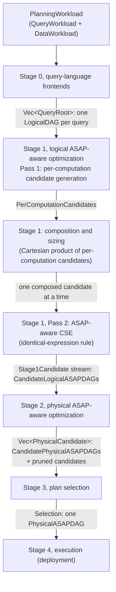

# Planner Layering: Stage Components, Algorithms and Code Interfaces

Status: describes `main` @ `80fc72e1`. Audience: developers of ASAPPlanner who
read [ASAPPlanner Planning Stages Design](proposals/planner-layering.md) and
need to know how each stage is built today.

planner-layering.md defines the stages and passes and their algorithms. This
document follows the same order and, for every stage, describes its core
components, the algorithm as implemented on `main`, and its code interface.
Where `main` differs from the design or does not implement it yet, the stage
says so.

## 1. Pipeline



Every stage is one plain function over one workload. The `asap-planner` facade
runs Stage 0 and then an `OptimizationPass`; the default pass,
`Stage1ToStage3Pass`, reads one accuracy target and one recurrence per
workload entry and calls `run_stage1_to_stage3`:

```text
run_stage1_to_stage3(roots, targets, recurrence, data, models):
    inventory ← generate_per_computation_candidates(roots)             // Stage 1, Pass 1
    stage1 ← stage1_logical_asap_optimization(inventory)                // lazy stream:
        for each choice in the Cartesian product (mixed radix, last target fastest):
            skip choices that differ only inside a target an absorbing candidate removes
            L ← compose_logical_candidate(inventory, choice)              // composition + sizing
            yield L, then each Pass 2 identical-expression candidate of L
    for each L_n in stage1:                                              // Stage 2
        P_n ← optimize_physical_asap(L_n) or prune L_n with the error
    selection ← select_plan(all P_n, targets, recurrence, data, models)  // Stage 3
```

Only a Pass 1 error fails the run. A candidate that does not compose keeps its
error, a candidate Stage 2 cannot implement is pruned with a reason, and a
failed selection is reported as the Stage 3 result. The library enumerates and
prices every candidate and never caps. Because Stage 1 is a lazy stream, a
caller can count candidates as they are produced and stop early:
`run_stage1_to_stage3_from_pass1` takes a finished Pass 1 inventory, and
`run_stage2_and_stage3` takes the Stage 1 candidates a caller enumerated.

### Code interface

```rust
// crates/asap-aware-mapping/src/pass/stage1_to_stage3.rs
pub fn run_stage1_to_stage3<Id: Clone + std::fmt::Debug>(
    roots: Vec<(Id, QueryRoot)>,
    targets: &[Option<AccuracyTarget>],
    recurrence: &[QueryRecurrence],
    data: &DataWorkload,
    models: PlanningModels<'_>,
) -> Result<Stage1ToStage3Run<Id>, PerComputationCandidateError> {

pub struct Stage1ToStage3Run<Id> {
    pub stage1_pass1_per_computation: PerComputationCandidates<Id>,
    pub combinations: usize,
    pub stage1_pass2_identical_expression: Vec<IdenticalExpressionCandidate>,
    pub stage1_logical_asap_optimization: Vec<LogicalCandidate>,
    pub stage2_physical_asap_optimization: Vec<PhysicalCandidate>,
    pub stage2_pruned: Vec<PrunedCandidate>,
    pub stage3_plan_selection: Result<Selection, SelectionError>,
    pub stage3_selected_logical: Option<Vec<QueryRoot>>,
}

// crates/asap-aware-mapping/src/pass/mod.rs
pub struct PlanningModels<'a> {
    pub cost: &'a dyn CostModel,
    pub accuracy: &'a dyn AccuracyModel,
    pub evidence: &'a dyn AccuracyEvidenceProvider,
}
```

## 2. Stage 0, query-language frontends

Design: [0. Language-specific frontends](proposals/planner-layering.md#0-language-specific-frontends).

### Core components

| Component | What it does |
|---|---|
| PromQL frontend (`crates/frontend-promql`) | Parses PromQL and builds the shared name-based operator tree in canonical shape. |
| SQL frontend (`crates/frontend-sql`) | Parses and plans SQL through DataFusion, then builds the same tree. |
| MetricsQL frontend (`crates/frontend-metricsql`) | Converts the MetricsQL AST into the same tree. |
| Shared resolver (`crates/frontend-common`) | `UnresolvedOp` tree with name-based column references; `resolve_root` binds each name to a positional `ColumnId` and derives every schema. |
| Unified IR (`crates/types/src/ir/`) | One operator DAG type for every stage: `OperatorNode` with `NonASAPOp` or `ASAPOp` operators. |
| Workload (`crates/types/src/workload.rs`) | `QueryWorkload` (queries, recurrence, accuracy and latency requirements) and `DataWorkload` (arrival, ingestion interval, volume, rate, cardinality, distribution, stream norms, per-source distinct bounds, declared metric types). |

### Core algorithm

```text
for each entry q of the QueryWorkload, in entries() order:
    tree ← LANGUAGE_FRONTEND(q.query)   // name-based UnresolvedOp tree, canonical shape
    root ← resolve_root(tree)           // bottom-up: bind names, derive schemas
    emit QueryRoot::Operator(root) or QueryRoot::Scalar(expr)
reject the workload if any query cannot be represented
```

The output is one `LogicalDAG` per query: a `QueryRoot` whose operators are all
`NonASAPOp` (`Scan`, `Filter`, `Project`, `Aggregate`, `Join`, `TimeRange`, …),
with no ASAP summary choice, timing or materialization. An aggregation records
its computation as an `AggIntent` per measure, carrying the query's accuracy
target. The facade fails the whole call if one query fails, because the output
is aligned with the workload's entries. The design's `CandidateLogicalDAGs` is
one candidate on `main`: the frontends produce a single logical form per query.

### Code interface

```rust
// crates/frontend-promql/src/lib.rs
pub fn lower_promql_query_workload(
    workload: &PlanningWorkload,
    now_ms: u64,
) -> Result<Vec<asap_types::ir::QueryRoot>, PromqlError> {

// crates/frontend-sql/src/lib.rs
pub async fn lower_sql_dialect(
    query: &str,
    catalog: &SqlCatalog,
    dialect: SqlDialect,
    accuracy: AccuracyTarget,
) -> Result<Rc<OperatorNode>, SqlError> {

// crates/frontend-metricsql/src/lib.rs
pub fn lower_metricsql_query_workload(
    workload: &PlanningWorkload,
    now_ms: u64,
) -> Result<Vec<asap_types::ir::QueryRoot>, MetricsqlError> {

// crates/types/src/ir/query.rs
pub enum QueryRoot<C = Rc<OperatorNode>> {
    Operator(C),
    Scalar(ScalarExpr<C>),
}
```

## 3. Stage 1, logical ASAP-aware optimization

Design: [1. Logical ASAP-aware optimization](proposals/planner-layering.md#1-logical-asap-aware-optimization).

### Core components

| Component | What it does |
|---|---|
| Pass 1 (`crates/asap-aware-mapping/src/per_computation_candidates.rs`, `generate_per_computation_candidates`) | Finds every computation target and its unranked, unsized candidates, with pruned candidates and reasons. |
| Composition (same file, `compose_logical_candidate`) | Builds one whole-workload candidate from one choice per target, sizes its summaries and composes every node's guarantee. |
| Pass 2 (`crates/asap-aware-mapping/src/asap_aware_cse.rs`) | The identical-expression rule: `sharing_groups` and `identical_expression_variants`. |
| Enumeration (`crates/asap-aware-mapping/src/pass/stage1_to_stage3.rs`, `stage1_logical_asap_optimization`) | Streams composed candidates, each followed by its Pass 2 candidates. |
| Summary realization (`crates/asap-aware-mapping/src/realization.rs`) | The summary families per intent (`summary_candidates`), the `(ε, δ)` budget of a target, and default sizing. |
| Accuracy model (`crates/asap-aware-mapping/src/accuracy/`) | `DefaultAccuracyModel`: local error bounds of sized families, composition rules (`composition.rs`), and per-family sizing and confidence (`estimators/`). |

### 3.1 Pass 1: Per-computation candidate generation

Design: [Pass 1](proposals/planner-layering.md#pass-1-per-computation-candidate-generation),
Algorithms 1 and 1.1.

#### Core algorithm

On `main`, a computation target is one measure of an `Aggregate`, and
Algorithm 1.1's `MATCH` is reading that measure's `AggIntent`: the intent
binds the input column, grouping (`Reduction`), filter and parameters such as
`k` or `q`. The families that fill a summary slot come from a static table,
`summary_candidates(intent)`:

| Intent | Summary families |
|---|---|
| `Quantile` | KLL, DDSketch |
| `Cardinality` | HLL, KMV, UnivMon (not UnivMon over a tuple) |
| `FrequencyL2`, `FrequencyEntropy` | UnivMon |
| `TopK` | CMS with heap, Count Sketch with heap |
| `Count` | CMS, Count Sketch, UnivMon |

```text
generate_per_computation_candidates(roots):
    reject a root that contains ASAP operators, timing or a materialization
    for each Aggregate node a reachable from the roots (once, shared or not):
        record a's HAVING entries:
            a's own having, and each consumer Filter directly above a
            placement ← BelowAggregate if the predicate reads only group keys
                        (and, for a consumer Filter, every consumer applies it)
                        else AboveOutput
        for each measure m of a, with intent i:
            choices ← computation_candidates_for_intent(i)
            skip m if its only option is plain Exact
            if i is avg over a possibly-null input: prune AvgAsSumCount (NullableAvgInput)
            samples_of ← the metric whose raw samples (or plain sums of them) a reads
            emit target (a, m, choices, filter of m, HAVING entries, samples_of)
    ADD_WHOLE_EXPRESSION_CANDIDATES(targets)

computation_candidates_for_intent(i):
    exact option ← ExactAccumulator(kind)  for Count, Sum, Min, Max, Rate, IRate, Increase
                   AvgAsSumCount           for avg
                   Exact                   otherwise
    if i has an accuracy target:
        if the target is Exact: prune every summary_candidates(i) (RequiresExact)
        else: check ε, δ ∈ (0, 1); add Summary(f) for every f in summary_candidates(i)

ADD_WHOLE_EXPRESSION_CANDIDATES(targets):
    for each top-k target t directly over a per-item sum or count target u:
        if u has no other consumer, neither has a filter or HAVING,
           and the keyed-additive rule realizes a heap over u's input:
            replace t's heap candidates by WholeExpression(same family)
            t.absorbs ← u          // choosing one removes u's aggregate
```

Each target has exactly one exact option, and pruning happens only for a
provable reason. Nested aggregates are separate targets, and their options
multiply in composition. A whole-expression top-k ranks items over the raw
input, weighted by the summed value; when those weights are the samples of a
metric, the summary carries the open requirement that the metric's samples are
non-negative, which Stage 3 confirms. Pass 1 uses no cost or accuracy model.

Differences from the design: candidates are not checked against a family's
capability beyond the table, and the design's Hydra template for `TopK`
("one summary over all groups") is not in the table.

#### Code interface

```rust
// crates/asap-aware-mapping/src/per_computation_candidates.rs
pub fn generate_per_computation_candidates<Id: std::fmt::Debug>(
    roots: Vec<(Id, QueryRoot)>,
) -> Result<PerComputationCandidates<Id>, PerComputationCandidateError> {

pub struct PerComputationCandidates<Id> {
    pub roots: Vec<(Id, QueryRoot)>,
    pub targets: Vec<ComputationTarget>,
}

pub struct ComputationTarget {
    pub target: Rc<OperatorNode>,
    pub measure: usize,
    pub choices: ComputationChoices,
    pub filter: Option<Predicate>,
    pub having: Vec<HavingEntry>,
    pub absorbs: Option<usize>,
    pub samples_of: Option<String>,
}

pub enum ComputationCandidate {
    Exact,
    ExactAccumulator {
        kind: ExactKind,
        params: ExactParams,
    },
    Summary(SketchAlgorithm),
    AvgAsSumCount,
    WholeExpression(SketchAlgorithm),
}
```

### 3.2 Composition, sizing and guarantees

Design: Algorithm 1, lines 18–21 (`SUBSTITUTE`), and sizing after Pass 2.

#### Core algorithm

Composition enumerates the Cartesian product of the targets' candidates.
`choice[t]` indexes `targets[t].choices.candidates`; the choice vector is
incremented in mixed radix, last target fastest. A choice that picks a
whole-expression candidate and anything but the first candidate of the target
it absorbs gives the same candidate as with the first, so it is skipped.
`PerComputationCandidates::combinations` counts the rest without enumerating
them: an absorbing pair with `n` candidates over `m`, `w` of them
whole-expression, counts `(n − w) · m + w` (saturating at `usize::MAX`).

```text
compose_logical_candidate(inventory, choice):
    for each aggregate a with a chosen candidate other than Exact:
        replace a measure by measure, over a's input:
            ExactAccumulator   → SummaryAgg(exact family) → FinalizeExactAccumulator
            Summary(f)         → SummaryAgg(SIZED(f, acc(m))) → SummaryEstimate
            WholeExpression(f) → SummaryAgg(SIZED(f)) over the absorbed aggregate's input → SummaryEstimate
            AvgAsSumCount      → finalized sum and count, divided
            Exact              → a single-measure Aggregate
        join several measures back on the group keys; keep a's column names
        measure filter → SummaryAgg.filter
        HAVING BelowAggregate → Filter below the state (consumer Filter dropped)
        HAVING AboveOutput   → Filter above the output
    keep sub-DAGs shared between roots shared
    for each node, bottom-up: node.guarantee ← COMPOSED_GUARANTEE(node)

SIZED(f, acc):
    (ε, δ) ← accuracy_budget(acc)                     // δ defaults to 0.01
    params ← default_size_params(f, intent, ε, δ)    // accuracy/estimators: invert f's error bound
                                                      // (KLL: scaled for δ by a Gaussian quantile ratio)

COMPOSED_GUARANTEE(node):            // built-in DefaultAccuracyModel; no data or evidence
    non-ASAP operator over exact inputs                 → exact
    FinalizeExactAccumulator over exact input           → exact
    FinalizeExactAccumulator over approximate input     → its function's rule (sum, extremum, rate, …)
    SummaryEstimate whose family bound applies          → local_guarantee(f, query),
                                                          composed with its input's if approximate
    Aggregate / arithmetic over approximate values      → the function's or arithmetic composition rule
    Project of plain columns                            → the child's guarantee
    comparison or value predicate over approximate      → None
```

A rule that needs a statistic Stage 1 does not have (an input row count, a
source's stream norm, a metric's sign, an operand domain, classic HLL's
distinct bound) keeps it symbolic as an `Unknown` leaf of the guarantee's
`BoundExpr` or `ProbabilityExpr`; Stage 3 binds it. A family bound does not
apply to Top-K membership (a heap sketch bounds item frequencies), and a
Count-Min bound assumes non-negative weights. A `None` guarantee does not
reject the candidate here; Stage 3 decides.

Differences from the design: summaries are sized per measure, before Pass 2,
because the only Pass 2 rule on `main` shares identical nodes, which already
have the same size. A guarantee holds per output point and is not scaled by the
number of output groups.

#### Code interface

```rust
// crates/asap-aware-mapping/src/per_computation_candidates.rs
pub fn compose_logical_candidate<Id: Clone>(
    inventory: &PerComputationCandidates<Id>,
    choice: &[usize],
) -> Result<Vec<(Id, QueryRoot)>, PerComputationCandidateError> {

impl<Id> PerComputationCandidates<Id> {
    pub fn combinations(&self) -> usize {

// crates/asap-aware-mapping/src/realization.rs
pub fn default_size_params(
    kind: SketchAlgorithm,
    intent: &AggIntent,
    eps: f64,
    delta: f64,
) -> SketchParams {

// crates/types/src/post_asap/guarantee.rs
pub struct AccuracyGuarantee {
    pub metric: ErrorMetric,
    pub bound: BoundExpr,
    pub failure_probability: ProbabilityExpr,
    pub provenance: Vec<GuaranteeSource>,
}
```

### 3.3 Pass 2: ASAP-aware common-subexpression elimination

Design: [Pass 2](proposals/planner-layering.md#pass-2-asap-aware-common-subexpression-elimination),
Algorithm 2.

#### Core algorithm

Of the three rules, only the identical-expression rule is implemented. It runs
on each composed candidate:

```text
sharing_groups(roots):
    intern the roots with share_common_sub_dags      // hash narrows, typed equality decides
    group the original nodes by interned representative, children first
    keep groups of two or more legal-to-share nodes   // ASAP nodes and nodes with a unique key

identical_expression_variants(roots, groups):
    // Algorithm 2, line 31: one candidate per non-empty subset of the groups.
    // Sharing a group also shares every group whose nodes all lie below it,
    // so many subsets give the same candidate. The distinct candidates are the
    // closed subsets; enumerate them directly with Ganter's Next Closure
    // (one closure per step and group) instead of trying all 2^g subsets.
    for each closed subset S, in binary-counter order:
        emit roots with every group in S made one node serving all its consumers
```

The independent (unshared) candidate is kept beside its Pass 2 candidates, so
Stage 3 compares sharing against not sharing. Each Pass 2 candidate is recorded
as an `IdenticalExpressionCandidate` naming the candidate it derives from and
its shared groups.

Differences from the design: the summary-capability and window-composition
rules are not implemented, so no summary serves several different estimates or
windows. `SummaryCoverage::derive` (`crates/types/src/ir/summary_coverage.rs`),
which compares the summary input data of two states, exists for those rules.

#### Code interface

```rust
// crates/asap-aware-mapping/src/asap_aware_cse.rs
pub fn sharing_groups(roots: &[QueryRoot]) -> Vec<SharingGroup> {

pub fn identical_expression_variants(
    roots: &[QueryRoot],
    groups: &[SharingGroup],
) -> Vec<IdenticalExpressionVariant> {

pub struct IdenticalExpressionVariant {
    pub shared_groups: Vec<usize>,
    pub roots: Vec<QueryRoot>,
}

// crates/asap-aware-mapping/src/pass/stage1_to_stage3.rs
pub fn stage1_logical_asap_optimization<Id: Clone>(
    per_computation: &PerComputationCandidates<Id>,
) -> impl Iterator<Item = Stage1Candidate> + '_ {
```

## 4. Stage 2, physical ASAP-aware optimization

Design: [2. Physical ASAP-aware optimization](proposals/planner-layering.md#2-physical-asap-aware-optimization),
Algorithm 3.

### Core components

| Component | What it does |
|---|---|
| Physical ASAP-aware optimization (`crates/asap-aware-mapping/src/stage2_physical_asap_optimization.rs`, `optimize_physical_asap`) | Implements every operator and assigns materialization for one logical candidate. |
| Materialization options (`crates/types/src/post_asap/execution_data_state.rs`) | `Materialization`: `NotMaterialized`, `MatAtIngestion(Medium)`, `MatAtQuery(Medium)`; `Medium` is `Memory` or `Disk`. |
| Timing (`crates/types/src/ir/timing.rs`) | `MaterializationAssignment` and `apply_materialization_timings`, which write every node's `ExecutionTiming` and `Materialization`. |
| Physical export (`crates/types/src/ir/physical_export.rs`) | Flattens the timed roots into a `PhysicalASAPDAG` with stable node ids. |

### Core algorithm

```text
optimize_physical_asap(L_n.roots):
    // physical operator implementation, one memo for the whole workload
    for each node, bottom-up:
        if node is Aggregate with a TopK measure:
            if it is a plain grouped top-k: Project(Limit(Sort per group)) restoring [keys.., topk_k]
            else: fail ExactTopK                  // per-entity reduction, other measures, filter, HAVING
        else: keep the node (SummaryAgg → SummaryEstimate already is build → estimate)
    // materialization
    m ← MaterializationAssignment::with_default(NotMaterialized)
    timed ← apply_materialization_timings(roots, m)
    dag ← compile_physical_asap_workload_with_node_ids(timed)
    return PhysicalCandidate { from_logical: L_n, roots: timed, dag }
```

The caller names the result `P<n>` after `L<n>`; on error, it records a
`PrunedCandidate` with the error as its reason. These are the only candidates
Stage 2 removes, and each is provably invalid (it cannot be implemented).

Differences from the design: materialization offers one option, so each logical
candidate yields exactly one physical candidate. Algorithm 3's enumeration of
`MatAtIngestion(medium)` and `MatAtQuery(medium)` per sub-DAG, its
ingestion-time upstream constraint and retention are not implemented.
Parallelism, partitioning and resource management are TODO in the design as
well.

### Code interface

```rust
// crates/asap-aware-mapping/src/stage2_physical_asap_optimization.rs
pub fn optimize_physical_asap(
    from_logical: &str,
    roots: &[QueryRoot],
) -> Result<PhysicalCandidate, PhysicalASAPOptimizationError> {

pub struct PhysicalCandidate {
    pub id: String,
    pub from_logical: String,
    pub display_name: String,
    pub roots: Vec<QueryRoot>,
    pub dag: PhysicalASAPDAG,
}

// crates/types/src/post_asap/execution_data_state.rs
pub enum Materialization {
    NotMaterialized,
    MatAtIngestion(Medium),
    MatAtQuery(Medium),
}
```

## 5. Stage 3, plan selection

Design: [3. Plan selection](proposals/planner-layering.md#3-plan-selection).

### Core components

| Component | What it does |
|---|---|
| Plan selection (`crates/asap-aware-mapping/src/stage3_plan_selection.rs`, `select_plan`) | Confirms weight requirements, binds symbolic statistics, rejects candidates that miss an accuracy target, prices the rest per second and selects the cheapest. |
| Accuracy model (`AccuracyModel::satisfies`, `crates/asap-aware-mapping/src/accuracy/mod.rs`) | Decides whether a bound guarantee meets an `AccuracyTarget`; an unknown statistic never meets one. |
| Accuracy evidence (`AccuracyEvidenceProvider`, `crates/asap-aware-mapping/src/accuracy/evidence.rs`) | The deployment's contracts and empirical accuracy: `operand_domain` (enforced value range of an operand), `output_guarantee` (evidence for one candidate's whole query output). `NoAccuracyEvidence` supplies none. |
| Data workload (`DataWorkload`) | Statistics Stage 3 binds: input cardinality, `stream_norms`, `max_distinct_per_evaluation`, `metric_types`. |
| Analytical cost (`crates/asap-aware-mapping/src/analytical_cost.rs`) | `estimate_operator`: CPU operations, scanned bytes and peak memory of one physical operator over edge statistics; `ResourceCalibration` turns them into a price. |

### Core algorithm

```text
select_plan(candidates, targets, recurrence, data, models):
    for each candidate P:
        // accuracy check (output-level)
        for each query q with a target T:
            for each Count-Min SummaryAgg q reads:
                weights ← confirmed_weights(weight domain, data)   // samples of a declared counter → proven
                if weights are not proven non-negative: reject P (valid = false)
            g ← root guarantee of q (composed in Stage 1)
            g ← g.bind(statistic ↦ value)       // from never-expiring DataWorkload evidence
                                                // and models.evidence.operand_domain
            if not (g satisfies T under models.accuracy
                    or models.evidence.output_guarantee(q) satisfies T):
                reject P (valid = false)
        cost(P) ← PRICE(P.dag, recurrence, data, illustrative_calibration())
    selected ← the valid candidate with the least cost (the first on a tie)
    every other valid candidate → rejected (valid = true, "costlier" or "tied")
    plan ← the selected candidate's roots with confirmed weights
    no valid candidate → SelectionError::NoValidCandidate

PRICE(dag, recurrence, data, calibration):          // cost per second of wall time
    for each node, children first:
        estimate ← estimate_operator(physical operator, edge statistics)
            // SummaryAgg: rows × update operations per row (sketch depth; +1 per heap;
            //             UnivMon: expected layers updated); state bytes from the sketch's params
            // SummaryEstimate: groups × k
        per_second ← how often the node is computed:
            NotMaterialized: once per consumer that reaches it, at that consumer's rate
            MatAtQuery:      once, at the combined rate of the queries reaching it
            MatAtIngestion:  once per second of arriving rows
            // a query repeating every I ms runs 1000 / I times per second;
            // one-off and unknown queries are spread over calibration.horizon_s
        cost ← estimate.calibrated_cost(CPU ops, scanned bytes) × per_second
        cost += kept state bytes × cost_per_retained_byte_second   // materialized nodes only
    return Σ node costs
```

The check is on the query output, not on the summaries inside the plan: a
certified estimate is not enough on its own, since a difference or ratio of
estimates can be unbounded. Cost is computed for the whole workload, so a
shared `NotMaterialized` node is charged for each consumer that recomputes it,
and queries with different recurrences add up.

Differences from the design: pricing uses a fixed `illustrative_calibration`
(`illustrative-v2`) and default statistics (a default group count, and default
series and rates when the `DataWorkload` declares none), so prices are not
calibrated; `select_plan` does not read `PlanningModels::cost`. Memory is
charged only as state kept between computations, not as peak capacity. A
binary, join or concat node is priced from its first input only. Latency
bounds and deployment capabilities are not checked.

### Code interface

```rust
// crates/asap-aware-mapping/src/stage3_plan_selection.rs
pub fn select_plan(
    cands: &[PhysicalCandidate],
    targets: &[Option<AccuracyTarget>],
    recurrence: &[QueryRecurrence],
    data: &DataWorkload,
    models: PlanningModels<'_>,
) -> Result<Selection, SelectionError> {

pub struct Selection {
    pub selected: String,
    pub plan: Vec<QueryRoot>,
    pub costs: BTreeMap<String, CandidateCost>,
    pub rejected: Vec<Rejection>,
}

pub struct NodeCost {
    pub cost: f64,
    pub multiplier: u64,
    pub per_second: f64,
    pub detail: String,
}

// crates/asap-aware-mapping/src/accuracy/evidence.rs
    fn operand_domain(&self, _operand: &OperatorNode) -> Option<OperandDomain> {
    fn output_guarantee(&self, _output: &QueryRoot) -> Option<AccuracyGuarantee> {

// crates/types/src/post_asap/guarantee.rs
    pub fn bind(&self, value: &dyn Fn(&str) -> Option<f64>) -> Self {

// crates/asap-aware-mapping/src/analytical_cost.rs
pub struct ResourceCalibration {
    pub cost_per_cpu_op: f64,
    pub cost_per_scan_byte: f64,
    pub cost_per_retained_byte: f64,
    pub cost_per_retained_byte_second: f64,
    pub horizon_s: f64,
    pub version: String,
}
```

## 6. Stage 4, execution

Design: [4. Execution](proposals/planner-layering.md#4-execution) and
[Physical Planning, Summary Maintenance, and Deployment](physical-planning-and-deployment.md).

### Core components

| Component | What it does |
|---|---|
| Physical ASAP DAG (`crates/types/src/ir/physical_export.rs`) | The hand-off: nodes with operator payload, output data state and materialization; edges with schema and data state; one root per query. |
| Physical operators (`crates/asap-physical-operators`) | The operator DAG runtime shared by ingestion time and query time; `physical_planner::compile` lowers a `PhysicalASAPDAG` to native operators. |

### Core algorithm

The planner hands off the selected candidate's `PhysicalASAPDAG`
(`PhysicalCandidate::dag`) together with `Selection::plan`, the selected roots
with every weight requirement Stage 3 confirmed, so the executor reads no data
workload. The deployment runs the plan as given: it does not choose among
summaries or change materialization. Ingestion-time nodes form the precompute
DAG and the rest the query DAG; `compile` builds native operators with typed
inputs, which the deployment binds to its data sources.

### Code interface

```rust
// crates/types/src/ir/physical_export.rs
pub struct PhysicalASAPDAG {
    pub nodes: Vec<PhysicalASAPDAGNode>,
    pub edges: Vec<PhysicalASAPDAGEdge>,
    pub roots: Vec<PhysicalASAPNodeId>,
    // ...
}

// crates/asap-physical-operators/src/physical_planner/mod.rs
pub fn compile(
    dag: &PhysicalASAPDAG,
    inputs: BTreeMap<NodeId, InputContract>,
    roots: &[NodeId],
) -> Result<CompiledPhysicalDAG, Error> {
```

## 7. Tooling and legacy code

- `run_planning_stages` (`crates/devtools/src/planning_stages.rs`) runs Stage 0
  through Stage 3 for one workload with the built-in models. With
  `max_combinations`, it counts Stage 1 candidates as they are enumerated and
  refuses the workload once the count passes the limit; it never truncates.
- The `stage_pipeline` binary writes every stage's candidates as an
  `asap-stage-pipeline/v1` document (default limit 10^4 Stage 1 candidates).
  `tools/dag-viewer` plans through it and shows the stages.
- Legacy, to be deleted once the stages implement what it does: `replacement.rs`
  (the old candidate search, `search_workload`), `accuracy/reconciliation.rs`,
  and the modules only that search uses. The stage pipeline does not call them.

## 8. Not yet on main

- **Pass 2, summary sharing.** The summary-capability and window-composition
  rules are not implemented; no summary serves several estimates or windows,
  and no shared summary is sized for the strictest of its consumers.
- **Materialization.** Stage 2 assigns `NotMaterialized` everywhere; the
  per-sub-DAG choice of ingestion time or query time and medium is not
  enumerated.
- **Guarantees.** A guarantee is per output point and not scaled by the number
  of groups; comparisons and value predicates over approximate values have no
  composition rule.
- **Cost.** Stage 3 prices with illustrative statistics and calibration and
  does not use the deployment's cost model; peak memory capacity, latency
  bounds and capabilities are not checked.
- **Search.** Every candidate is built and priced; a large workload needs early
  pruning or a search that avoids enumerating the whole product.
- **Layout.** Crates and modules are not yet organized by stage.
