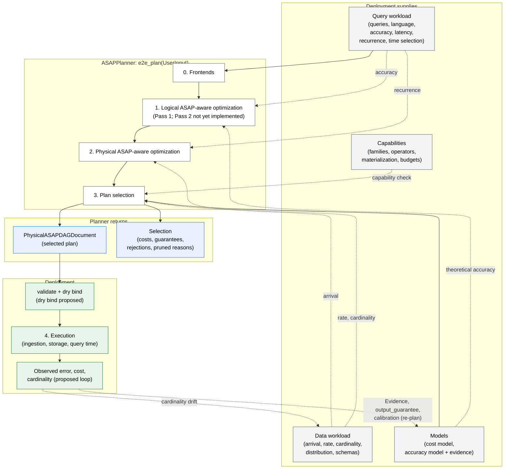

# ASAPPlanner End-to-End Use Case Design

Status: proposal. Tracking issue: [#685](https://github.com/ProjectASAP/ASAPPlanner/issues/685).
Audience: designers and developers of ASAPPlanner and of deployments such as
ASAPQuery-backend.

[planner-layering.md](planner-layering.md) designs the planning stages:
what each stage decides, how candidates are generated, pruned and selected.
This document designs how a deployment **uses** ASAPPlanner end to end: what it
must supply, which stage consumes each input, what it gets back, how it
executes the result, and which components are still missing before a real
deployment can rely on it. It builds on planner-layering.md (stages, stage
inputs table, Assumptions 1–8, pruning vs selection, Examples, Scenarios),
[asap-primitive-schema.md](asap-primitive-schema.md) (summary coverage,
maintained populations) and [decoupling_op_and_expr.md](decoupling_op_and_expr.md)
(operators vs scalar expressions), and does not repeat them.

"Implemented" and "not yet implemented" notes describe the planner when this
document was written; the tracking issue maps each missing component to its
work.

Read Problem Definition for why a deployment needs this design, ASAPPlanner
Design for the intuition, assumptions and the deployment ⇄ planner overview,
Detailed Design for each input, the outputs, the missing components and how a
new summary family is added across the stack, the examples for a concrete walk
through, and Scenarios for how the use case evolves.

## Contents

- [Problem Definition](#problem-definition)
  - [Motivation](#motivation)
  - [Design Requirements for ASAPPlanner](#design-requirements-for-asapplanner)
- [ASAPPlanner Design](#asapplanner-design)
  - [Design Intuition](#design-intuition)
  - [Assumptions](#assumptions)
  - [System Overview: Deployment and Planner](#system-overview-deployment-and-planner)
- [Detailed Design: Inputs, Outputs and Missing Components](#detailed-design-inputs-outputs-and-missing-components)
  - [Entry point](#entry-point)
  - [Query workload](#query-workload)
  - [Data workload](#data-workload)
  - [Cost model](#cost-model)
  - [Accuracy model](#accuracy-model)
  - [Deployment capabilities](#deployment-capabilities)
  - [Other inputs](#other-inputs)
  - [Outputs and the handoff contract](#outputs-and-the-handoff-contract)
  - [Missing components](#missing-components)
  - [Adding a new summary family end to end](#adding-a-new-summary-family-end-to-end)
  - [Matching workloads to summary capabilities](#matching-workloads-to-summary-capabilities)
- [End-to-end examples](#end-to-end-examples)
  - [Example 1: A dashboard workload from inputs to execution](#example-1-a-dashboard-workload-from-inputs-to-execution)
  - [Example 2: Adding a hypothetical summary family](#example-2-adding-a-hypothetical-summary-family)
- [Scenarios](#scenarios)
- [Open questions](#open-questions)

## Problem Definition

### Motivation

* planner-layering.md defines how ASAPPlanner plans a workload, but a
  deployment such as the ASAPQuery backend needs to plan a **real** workload
  end to end: hand over its queries, data description, prices and
  capabilities; receive one plan; install and run it; and keep it valid as the
  workload and data change.
* Today the inputs are spread over several types (`PlanningWorkload`,
  `FrontendInput`, `PlanningModels`, `DataWorkload`), some are declared but not
  yet read by the pipeline, and the defaults applied when an input is
  absent are documented only in code. A deployment cannot tell which of its
  inputs actually change the plan.
* The output a deployment executes (`PhysicalASAPDAGDocument`) carries the DAG
  but not the guarantees, costs or reasons behind it, and there is no defined
  loop from execution back to the models. Several components needed for a real
  deployment are not yet implemented, and some are not yet designed.

This document collects, for one deployment that wants to plan a workload end
to end, what it must supply, what it gets back, and what is still missing.

### Design Requirements for ASAPPlanner

1. **Deployment-agnostic planner.** ASAPPlanner plans one workload over named
   sources. Tenancy, dataset identity, the summary data store, storage engines
   and wire/persistence formats of stored state belong to the deployment,
   which composes them with the planner's output.
2. **Explicit inputs with defaults.** Every input has one type, one consuming
   stage (consistent with planner-layering.md's stage inputs table) and one
   documented default when the deployment does not supply it. An input that is
   declared but not read must be visible as such.
3. **The planner never executes.** Stage 4 is the deployment's
   (planner-layering.md Assumption 8); the planner does not measure execution
   either (Assumption 5). Measurements reach the planner only as model inputs.
4. **No execution fallback.** If no valid candidate exists, selection fails
   with reasons; the planner does not silently fall back to a different plan.
5. **Reproducible handoff.** The deployment can tell which plan it installed,
   which inputs and models produced it, and which guarantee each result
   carries, and can check that it is able to execute the plan before
   installing it.
6. **Safe evolution.** When queries are added or removed, or the data, prices
   or evidence change, the deployment can re-plan, and the transition between
   installed plans is defined.
7. **Local extension.** Adding a summary family touches only the places that
   declare, size, price, implement and measure it, not unrelated stages
   (planner-layering.md "Adding a new summary family").
8. **Explainable choice.** The deployment can show why a plan was chosen and
   why each alternative lost (accuracy miss, capability, cost).

## ASAPPlanner Design

### Design Intuition

* **A clean split between "what to plan" and "where it runs".** The planner
  receives only what changes the plan (workload, data statistics, models,
  capabilities) and returns only a plan and its explanation. Everything about
  where data and state live stays with the deployment. This is what lets the
  same planner serve the ASAPQuery backend and other deployments.
* **Every input is owned by one stage.** Following planner-layering.md's stage
  inputs table, each input is consumed by the stage that decides with it:
  query text by Stage 0 (the language-specific (query-language) frontends;
  "frontends" below), accuracy targets by Stage 1 (sizing, pruning) and
  Stage 3 (validity), recurrence and arrival by Stage 2 (materialization),
  prices and evidence by Stage 3. A missing input then has a clear
  consequence: the owning stage uses its default, and nothing else changes.
* **Models are the only feedback channel.** Because the planner does not
  measure, execution feedback must re-enter as model inputs (`Evidence`,
  `output_guarantee`, calibrated prices). This keeps planning deterministic
  given its inputs and makes re-planning reproducible.
* **The selected DAG is a contract, not a suggestion.** The deployment runs it
  as given (Assumption 8), so the handoff must carry enough to validate and
  explain it.

### Assumptions

This design relies on planner-layering.md's
[Assumptions](planner-layering.md#assumptions) 1–8 and adds:

9. **One planning call plans the whole workload.** A deployment that serves
   several tenants or datasets calls the planner once per workload it wants
   planned together; sharing across calls is not considered.
10. **Inputs are snapshots.** Each call sees one snapshot of the workload,
    data statistics (`Evidence` with freshness evaluated at `now_ms`) and
    models. Changes after the call require a re-plan.
11. **The deployment owns state transitions.** Installing a new plan, keeping
    or rebuilding materialized state, and backfilling are the deployment's;
    the planner only describes what the new plan needs.
12. **Summary implementations come from `asap_sketchlib`.** Executor kernels
    wrap the library; gaps are fixed upstream or by moving the pin, not with a
    local copy.

### System Overview: Deployment and Planner



Solid arrows are implemented; dashed arrows are consumed by a stage per
planner-layering.md but only partly implemented (see each input's
subsection). The table maps each input to the stage that consumes it; it
refines planner-layering.md's
[stage inputs table](planner-layering.md#asapplanner-detailed-design-planning-stages-and-their-decisionsstrategies).

| Input | Stage (planner-layering.md) | Read by the pipeline? | Detail |
|---|---|---|---|
| Queries, language, frontend context, source schemas | 0 | Yes | [Query workload](#query-workload), [Data workload](#data-workload) |
| Accuracy target | 1, 3 | Yes | [Query workload](#query-workload) |
| Time selection | 1 | Not yet (window segments) | [Query workload](#query-workload) |
| Recurrence, predictability | 2 | Not yet (Stage 2 materialization) | [Query workload](#query-workload) |
| Arrival, retention | 2, 3 | Not yet (Stage 2 materialization, deployment inputs) | [Data workload](#data-workload) |
| Rate, cardinality | 3 | Yes | [Data workload](#data-workload) |
| Latency requirement | 3 | Not yet (latency bounds in selection) | [Query workload](#query-workload) |
| Cost model | 3 | Built-in analytical only | [Cost model](#cost-model) |
| Accuracy model | 1 (theoretical), 3 (evidence) | Yes | [Accuracy model](#accuracy-model) |
| Deployment capabilities | 3 (prune earlier per planner-layering.md) | Not yet (capability check in selection) | [Deployment capabilities](#deployment-capabilities) |

## Detailed Design: Inputs, Outputs and Missing Components

Each input subsection gives what the input is, its type or "not yet
implemented", its default, who supplies it, which stage reads it, and the
rules that apply. The "Read by the pipeline?" column says whether the
implemented pipeline actually reads it.

### Entry point

Entry point: `asap_planner::e2e_plan(UserInput)` (`crates/planner/src/lib.rs`).
`UserInput { workload: &PlanningWorkload, frontend_specific: FrontendInput, models: PlanningModels, pass }`.
Stage 0 lowers each query; the default pass `Stage1ToStage3Pass` then calls
`run_stage1_to_stage3(roots, targets, data, models)`
(`crates/asap-aware-mapping/src/pass/stage1_to_stage3.rs`).

**Algorithm 1: End-to-end planning call**

```text
Input:  W   — PlanningWorkload { query_workload, data_workload }
        FI  — FrontendInput (catalog / now_ms / histograms)
        M   — PlanningModels { accuracy, evidence, cost }
        P   — optimization pass (default Stage1ToStage3Pass)
Output: PlanOutput (selected plan) or PlanError (with reasons)

1:  D ← ∅
2:  for each entry q in W.query_workload.entries() do
3:      D ← D ∪ FRONTEND(W.query_workload.language, FI).lower(q)   // Stage 0; unsupported → error for the call
4:  C1 ← PASS1(D, accuracy targets, M.accuracy)                      // Stage 1; Pass 2 not yet implemented
5:  C2 ← STAGE2(C1)                                                  // all NotMaterialized so far
6:  S  ← STAGE3(C2, W.data_workload, M.evidence)                     // analytical prices; latency, capabilities not yet checked
7:  if S has no valid candidate then return error with every rejection reason   // no fallback
8:  return PlanOutput for S.selected
```

### Query workload

`PlanningWorkload.query_workload: QueryWorkload` (`crates/types/src/workload.rs`).
Supplied by the user or dashboard owner; frontend context by the deployment.

| Input | Stage (planner-layering.md) | Type | Read by the pipeline? | Default when absent | Supplied by |
|---|---|---|---|---|---|
| Queries and language | 0 | `QueryWorkload.language: QueryLanguage` (`PromQL`, `MetricsQL`, `SQL(dialect)`, `DataFusion`); `query_batch: Vec<BatchEntry>`, `repeating_queries: Vec<RepeatingEntry>`, normalized by `entries()` into `QueryWorkloadEntry` | Yes (frontends) | none; an unsupported construct fails the whole call | user / dashboard owner |
| Frontend context | 0 | `FrontendInput::{Sql{catalog: SqlCatalog}, Promql{now_ms, histograms}, Metricsql{now_ms}}` | Yes | none (must match `language`) | deployment |
| Accuracy target | 1, 3 | `QueryRequirements.accuracy: AccuracyRequirement::{Explicit(AccuracyTarget), ImplicitExact}`; `AccuracyTarget::{Exact, Epsilon, EpsilonDelta}` | Yes: Pass 1 pruning and sizing, Stage 3 validity | `ImplicitExact` → `Exact`; `Epsilon` alone uses `DEFAULT_DELTA = 0.01` (`realization.rs`) | user |
| Latency requirement | 3 | `QueryRequirements.response_latency: LatencyRequirement::{ExplicitMaxMs, Unspecified}` | **Not yet**: not passed to `run_stage1_to_stage3`; Stage 3 says latency bounds are not checked yet | `Unspecified` | user |
| Recurrence / demand | 2 | `QueryRecurrence::{OneTime{invocations, execute_at}, Repeated(RepeatedDemand), Unknown}` | **Not yet**; Stage 2 materialization will use it, and Stage 3 pricing will use the evaluation rate | `Unknown` | user or deployment (observed) |
| Predictability | 2 | `Predictability::{AdHoc, Predictable{known_at}, Unknown}` | **Not yet**; Stage 2 materialization will use it | `Unknown` | user |
| Time selection | 1 | `TimeSelection { scope: QueryTimeScope, lookback, as_of }` | **Not yet** by the Stage 1→3 pipeline (window shape comes from the query text and `now_ms`); Pass 2 window segments will use it | `default()` (`Unknown`, none) | user |

Rules:

* An unsupported construct fails the whole call rather than dropping the
  query: a partial plan would silently change the workload's semantics.
* `ImplicitExact` is the default because an approximate answer must be opted
  into; a summary candidate is never valid for an `Exact` target.
* Until Stage 2 materialization is implemented, recurrence and predictability
  do not change the plan, so a deployment that declares them gets the same
  plan as one that does not.

### Data workload

`PlanningWorkload.data_workload: Option<DataWorkload>`. Supplied by the
deployment, declared or observed.

| Input | Stage (planner-layering.md) | Type | Read by the pipeline? | Default when absent | Supplied by |
|---|---|---|---|---|---|
| Arrival (at rest vs streaming) | 2 | `DataArrival::{AtRest, ContinuouslyIngesting, Mixed, Unknown}` | Not yet (Stage 2 materialization uses it for `MatAtIngestion`) | `Unknown` | deployment |
| Ingestion interval / volume / rate | 2, 3 | `Evidence<DurationMs>`, `Evidence<u64>`, `Evidence<Rate>` with `EvidenceSource` and freshness (`value_at`) | Rate and cardinality: Stage 3 edge statistics | `Evidence::default()` (no value) → Stage 3 defaults | deployment (declared or observed) |
| Input cardinality | 3 | `Evidence<u64>` | Yes, Stage 3 pricing | no value | deployment |
| Distribution | 3 | `Evidence<DataDistribution::{Zipf, Uniform, Bursty}>` | No by the Stage 1→3 pipeline | `Zipf` | deployment |
| Source schemas | 0 | `SqlCatalog` (SQL), PromQL series model; `HistogramCatalog` for classic histograms | Yes (frontends) | none for SQL; PromQL implicit | deployment |
| Raw-data retention | 2, 3 | not yet implemented | — | — | deployment (deployment inputs) |
| Value domains, sign, counter declarations | 1, 3 | partly: `WeightDomain` on the summary input (`post_asap/sketch.rs`, proven by the planner from the expression); evidence hooks `quantile_input_domain`, `estimator_contract`, `topk_max_distinct_items` on `AccuracyEvidenceProvider` | `WeightDomain` yes (CMS admission in Stage 3); evidence hooks: default `None` | `UnknownOrSigned` / `None` | deployment; a declared-domain input type is **proposed** |
| Distinct-count / population bounds | 1, 3 | `EstimatorContract` via `estimator_contract`; `ClassicHllConfidence { max_distinct }` | Compiled, not yet wired into sizing or selection | `None` → no certificate | deployment |

Rules:

* Statistics are `Evidence` with a source and freshness; an expired value is
  treated as absent at `now_ms`, so stale statistics fall back to the owning
  stage's default instead of steering the plan.
* A property the planner can prove from the expression (`WeightDomain`) is
  proven, not declared; a declared domain (proposed) would only add facts the
  expression cannot show, such as "this counter is non-negative".

### Cost model

Read by Stage 3 only. Supplied by the deployment; built-in defaults otherwise.

| Input | Stage | Implemented | Default | Design |
|---|---|---|---|---|
| Analytical prices | 3 | Stage 3 prices every node with `analytical_cost::estimate_operator` over edge statistics from `DataWorkload`; summaries as rows × depth (update) and groups × k (estimate); state size from `summary_shape` (`stage3_plan_selection.rs`). Charged once per computation × `NodeCost::multiplier`. | built-in; "illustrative, not calibrated" | — |
| `PlanningModels.cost: &dyn CostModel` | 3 | Field exists; **Stage 3 does not read it** (doc comment on `PlanningModels`) | `DefaultCostModel` | removed together with the legacy search |
| Deployment prices and calibration | 3 | not yet implemented | — | per-second cost, memory pricing and calibration; exact-state and KLL δ pricing |
| Cost model 1 (usage over time), cost model 2 (peak capacity), cost model 3 (own-cluster trade-offs) | 3 | not yet implemented | — | alternative Stage 3 objectives (rules below) |
| Measured costs (sketch-bench) | 3 | `empirical_cost.rs`, `empirical_resources.rs` compiled, not called | — | measured costs replace analytical prices; measured costs validated against analytical prices |

Rules:

* Cost is evaluated for the whole workload, and a shared computation is
  charged once with the demand of all its consumers (planner-layering.md
  Stage 3).
* Cost model 1, cost model 2 and cost model 3 are alternative objectives for
  the same candidates; a deployment chooses one, and only Stage 3's ranking
  changes (planner-layering.md "Adding a better cost or accuracy estimation").
* Measured costs replace analytical prices per operator where a measurement
  exists at the canonical shapes, and analytical prices remain the default.

### Accuracy model

Two sources with different owners and stages: the **built-in theoretical
model** (Stage 1) and **deployment evidence** (Stage 3).

| Input | Stage | Implemented | Default |
|---|---|---|---|
| Built-in theoretical model | 1 | `PlanningModels.accuracy: &dyn AccuracyModel` (`local_guarantee`, `propagate`); per-family estimators in `accuracy/estimators/` (CMS, Count Sketch, HLL, KLL, DDSketch, UnivMon, cardinality). Stage 1 composes each root's guarantee with it. | `DefaultAccuracyModel` |
| Deployment empirical evidence | 3 | `PlanningModels.evidence: &dyn AccuracyEvidenceProvider::output_guarantee(&QueryRoot)`: read only in Stage 3; admits a candidate without a theoretical guarantee meeting the target when evidence shows the output meets it | `NoAccuracyEvidence` (all `None`) |
| Estimator contracts | 1, 3 | `estimator_contract`, `topk_max_distinct_items`, `quantile_input_domain`, `propagation_stats` | `None` |
| HLL confidence | 1, 3 | `ClassicHllConfidence` compiled, not yet wired into sizing or selection | `None` |
| Composition through arithmetic/comparisons, top-k band | 1, 3 | not yet implemented (guarantee `None` above such nodes) | `None` |

Rules:

* Stage 1 sizes and prunes with the theoretical model only; pruning needs a
  proof, and evidence is not a proof (planner-layering.md pruning vs
  selection).
* Stage 3 accepts a candidate when its composed theoretical guarantee meets the
  target, or, failing that, when deployment evidence for that output does.
* A node above which composition is not defined carries guarantee `None`; such
  a root is valid for an approximate target only through evidence (extending
  composition through arithmetic and comparisons would change that).

### Deployment capabilities

| Input | Stage | Implemented | Design |
|---|---|---|---|
| Supported summary families and operators | 3 (prune earlier per planner-layering.md [Design Requirements](planner-layering.md#design-requirements-for-asapplanner)) | Executor-side checks exist in `asap-physical-operators/src/capability.rs` (`validate_summary_kernel`, `validate_native_family`, ...); Stage 3 does **not** check capabilities ("deployment capabilities are not checked yet") | deployment declares its capabilities as a planner input; Stage 3 rejects candidates it cannot run |
| Materialization media (memory, disk), `MatAtIngestion` / `MatAtQuery` support | 2 | Stage 2 emits only `NotMaterialized` | Stage 2 materialization chooses among the media and modes the deployment supports |
| Memory / disk budgets | 3 | not yet implemented | Stage 3 trades memory, disk and latency under the budgets |
| Executor support for scalar operator references | 4 | not yet implemented | executor runs scalar operator references in the physical DAG |

Rule: a candidate needing a capability the deployment lacks is invalid, so it
may be pruned as early as the capability is known; where it is pruned is open
question 4.

### Other inputs

| Input | Implemented | Design |
|---|---|---|
| Optimization pass override | `UserInput::with_pass`, `PassRegistry` | implemented |
| One bundle for all deployment inputs | separate `PlanningModels` fields and `DataWorkload` | one deployment-input bundle (not yet implemented) |
| Planning time `now_ms` (freshness of `Evidence`) | `FrontendInput::Promql{now_ms}`; `Evidence::value_at(now_ms)` | implemented |

### Outputs and the handoff contract

| Output | Implemented | Consumer |
|---|---|---|
| `CandidateLogicalASAPDAGs` | `Stage1ToStage3Run.stage1_logical_asap_optimization`: one whole-workload candidate per choice of a per-computation candidate for every target (Cartesian product, every one enumerated); a candidate that cannot compose carries its error | stage_pipeline, tests |
| Pass 1 pruned candidates | each with a `PruneReason` (only provably invalid) | stage_pipeline |
| `CandidatePhysicalASAPDAGs` | `stage2_physical_asap_optimization`: one per composed logical candidate (all `NotMaterialized`); unimplementable ones listed under `pruned` with the error | stage_pipeline |
| Selection | `stage3_plan_selection: Result<Selection, SelectionError>`: the selected id; rejected candidates with reasons (accuracy miss, CMS without non-negative weights); valid-but-costlier candidates; per-node `NodeCost { cost, multiplier, detail }` and `CandidateCost.total` | stage_pipeline, deployment |
| Per-node guarantees | every node keeps the guarantee Stage 1 composed for it | deployment, user explanations |
| Selected plan for execution | `PlanOutput { plans, scalar_roots, scalar_plans }`; `PlanOutput::execution_timed_dag()` → `PhysicalASAPDAG`, wrapped in `PhysicalASAPDAGDocument { schema_version, dag }` with `validate()` (`PHYSICAL_ASAP_DAG_WIRE_VERSION = 10`, `crates/types/src/ir/physical_export.rs`) | deployment (Stage 4) |
| Inspection document | `stage_pipeline` (`crates/devtools/src/bin/stage_pipeline.rs`) writes `asap-stage-pipeline/v1` with the four stages; a viewer redesign is planned | developers, reviewers |

**Handoff today.** The deployment calls `e2e_plan`, takes
`execution_timed_dag()`, validates the document, and executes it as given. The
ASAPQuery backend plan is to call the planner in-process, install the
document, and stop doing its own selection. Costs, guarantees and
rejection reasons are not part of the `PhysicalASAPDAGDocument`; only
`stage_pipeline` exposes them.

**Algorithm 2: Deployment handoff (proposed steps marked)**

```text
Input:  out — PlanOutput from Algorithm 1
        cap — the deployment's executor
Output: an installed plan, or a refusal with reasons

1:  doc ← PhysicalASAPDAGDocument(out.execution_timed_dag())
2:  doc.validate()                                    // implemented; schema_version must match
3:  cap.dry_bind(doc)                                 // proposed; planner-side capability check not yet implemented
4:  env ← envelope(doc, guarantees, costs, revision, input digest)   // proposed
5:  if installed plan exists then
6:      transition(old, new): keep / rebuild / backfill state        // proposed; deployment-owned (Assumption 11)
7:  install(doc) and execute as given                 // Stage 4, Assumption 8
```

### Missing components

#### Designed, not yet implemented

| Component | Design |
|---|---|
| Early search-space pruning without discarding a possibly-best plan | today every combination is enumerated and priced (planner-layering.md Assumption 7); prune earlier only where no possibly-best plan is lost |
| Plan search strategies (DP over nesting, MILP over shared DAGs) | replace exhaustive enumeration with search over the same candidate space |
| DataFusion optimizer rules in SQL lowering; rule-list API | SQL lowering applies a configurable list of DataFusion rules |
| Filter / HAVING push-down across levels for more candidates | push filters and key HAVING down so more computations get summary candidates |
| Pass 2 reuse rules: rollup, top-k reuse, nested sum merge | additional Pass 2 sharing rules |
| Pass 2 ASAP-aware CSE (identical expressions, summary capability, windows/panes, segments) | Pass 2 as designed in planner-layering.md ("Pass 2 is not planned yet" in the code) |
| Stage 2 materialization (`MatAtIngestion` / `MatAtQuery`, media) | Stage 2 as designed in planner-layering.md, using recurrence, predictability and arrival |
| Guarantee composition through arithmetic and comparisons; top-k band | Stage 1 composes guarantees above such nodes instead of `None` |
| HLL confidence in sizing and selection | `ClassicHllConfidence` sizes HLL and certifies it in Stage 3 |
| Measured costs; cost models 1/2/3; memory, disk, latency trade-offs | see [Cost model](#cost-model) |
| Deployment inputs and capabilities, raw-data retention | see [Deployment capabilities](#deployment-capabilities) and [Data workload](#data-workload) |
| Latency bounds in selection; reasons for losing candidates | Stage 3 enforces `LatencyRequirement` and reports why each candidate lost |
| Maintained-population top-k in Pass 1 | Pass 1 offers top-k over maintained populations ([asap-primitive-schema.md](asap-primitive-schema.md)) |
| Top-k output schema keeps item columns | top-k outputs carry their item columns |
| Executing scalar operator references in the physical DAG | executor support ([decoupling_op_and_expr.md](decoupling_op_and_expr.md)) |
| Grouped approximate counts via Hydra in Pass 1 | Pass 1 offers Hydra, one state over all groups |
| Docs after consolidation | design docs updated to match the stage-named code |

#### Proposed (not yet designed in detail)

| Component | Why it is needed end to end | Requirement | Status |
|---|---|---|---|
| **Plan handoff contract beyond the DAG.** A selected-plan envelope carrying, per root, the accuracy target and composed guarantee, per-node cost, the planner revision and a digest of the inputs/models used. Compatibility rules for `schema_version` bumps. | The deployment cannot today tell which guarantee a result carries, or whether an installed plan was made with stale inputs. Must stay format-agnostic (no tenancy or storage fields). | 1, 5 | proposed |
| **Validation that the deployment can execute the selected plan.** Planner-side capability check plus a deployment-side dry bind of the document before installation; per-operator timing in `validate`. | Assumption 8 needs the plan to be executable as given; today a failure surfaces only at bind time. | 5 | capability check and per-operator timing designed; dry-bind step proposed |
| **Re-planning when the workload or data changes.** What triggers a re-plan (query added/removed, `Evidence` expired, cardinality drift, new deployment prices), and how the new plan's materialized state relates to the old one (keep, rebuild, backfill). | planner-layering.md "Adding a new query to a workload" says the whole workload is re-planned; the transition between installed plans is undefined. | 6 | proposed |
| **Runtime feedback into the models.** Observed error, cost and cardinality from Stage 4 flow back as `Evidence` / `output_guarantee` / calibration. | Assumption 5 makes models the only channel; nothing defines the loop. | 3, 6 | error feedback and cost validation designed; cost and cardinality loop proposed |
| **Latency estimation.** A per-candidate query-time latency estimate, needed before `LatencyRequirement` can be enforced. | Stage 3 has prices, not latencies. | 2 | partly designed with latency bounds in selection |
| **User-facing explanations.** A stable, non-devtools summary of why a plan was chosen and why each alternative lost (accuracy miss, capability, cost). | `stage_pipeline` is for developers; a deployment UI needs a stable form. | 8 | proposed |
| **Declared value domains and counter semantics as data-workload inputs** (non-negative, bounded range, monotone counters with resets). | Required for CMS admission over signed inputs, DDSketch relative error, KLL/quantile domains, counter `rate`. | 2 | proposed |
| **End-to-end acceptance on a real deployment** (planner-layering.md Examples 1–4 executed by the backend and compared with the planner executor). | Proves the handoff works. | 5 | backend side planned; planner side proposed |

### Adding a new summary family end to end

This extends planner-layering.md's [Adding a new summary family](planner-layering.md#adding-a-new-summary-family)
(Given 1–6) with where each item lives in the code. Steps (a)–(c)
make the family **eligible** and **valid**; (d)–(f) make it executable and
priced; (g)–(h) make its guarantees and costs trustworthy.

**Algorithm 3: Adding a summary family across the stack**

| Step | What to declare or implement | Where in the code |
|---|---|---|
| (a) Capability declaration | Which `AggIntent` it answers (`Count`, `Quantile`, `TopK`, `Cardinality`, `FrequencyL2`, `FrequencyEntropy`, ...) and which `SketchStatistic` it reads out (`PointCount`, `Quantile`, `Cardinality`, `FrequencyL2`, `FrequencyEntropy`); input value types; weight domain (non-negative only?); grouping strategy (one state per group, or one state over all groups like Hydra); mergeability, subtractability, deletions (needed for Pass 2 sharing, panes, rollup); window support | `SketchAlgorithm` / `SketchParams` / `HydraKind` in `crates/types/src/post_asap/sketch.rs`; `WeightDomain`; Pass 2 sharing once implemented |
| (b) Pass 1 offer | Add it to `summary_candidates(intent)` so Pass 1 offers it, **unsized**, wherever the intent matches | `crates/asap-aware-mapping/src/realization.rs`; `per_computation_candidates.rs` |
| (c) Sizing and theoretical bound | Sizing formula in `default_size_params` (dispatches to `accuracy::estimators::size_params`), and the inverse error bound in `AccuracyModel::local_guarantee`. With no theoretical bound, the family is valid only where `output_guarantee` evidence shows the target is met | `realization.rs`, `accuracy/estimators/<family>.rs`, `accuracy/mod.rs` |
| (d) Stage 2 | Physical operator implementation; any rewrite the runtime needs (as for exact top-k) | `stage2_physical_asap_optimization.rs` |
| (e) Stage 3 | Update cost per row and state bytes in `summary_shape`; analytical pricing; later measured costs | `stage3_plan_selection.rs`, `analytical_cost.rs` |
| (f) Executor | Kernel that wraps `asap_sketchlib` (fix gaps upstream or by moving the pin, not with a local copy); build, merge, estimate semantics; capability checks; coverage ([asap-primitive-schema.md](asap-primitive-schema.md): definition + selection) so equal states are merged only over disjoint rows | `crates/asap-physical-operators` (`summary_kernels`, `capability.rs`), `crates/types/src/ir/summary_coverage.rs` |
| (g) Measurements | sketch-bench rows for empirical accuracy (accuracy metric per row) and cost (update, merge, query, bytes) at the canonical shapes | sketch-bench (outside this repo); feeds measured costs and `output_guarantee` |
| (h) Tests | Pass 1 catalog (offered, unsized; pruned with reason where invalid); composition/guarantee; Stage 3 validity and cost; executor results vs exact within the bound; one acceptance example through `stage_pipeline` | `crates/asap-aware-mapping/tests/logical_candidates.rs`, `crates/integration-tests`, `crates/devtools` |

What does **not** change: frontends, rewrite rules, the stage structure and
other families' candidates (planner-layering.md "Unchanged").
[Example 2](#example-2-adding-a-hypothetical-summary-family) walks through the
steps.

### Matching workloads to summary capabilities

A family is **eligible** when its intent matches (Pass 1), **valid** when it can
meet the target under the declared inputs (pruned in Pass 1 if provably not,
rejected in Stage 3 otherwise), and **worth selecting** when Stage 3 prices it
cheapest for the whole workload.

| Workload property | Summary property | Effect | Example |
|---|---|---|---|
| Intent and statistic | Answered `AggIntent`, read-out `SketchStatistic` | Eligible via `summary_candidates` | `Quantile` → KLL, DDSketch; `TopK` → CMS-with-heap, Count-Sketch-with-heap; multi-column `Cardinality` drops UnivMon |
| Accuracy target (ε, δ) | Sizing rule and error bound | Valid (sizing); `Exact` admits only exact candidates | KLL sized for δ (not yet implemented) |
| Value sign / weight domain | One-sided bound assumes non-negative weights | Valid only if `WeightDomain::NonNegative` is proven | Stage 3 rejects CMS otherwise |
| Distinct-count bound | Confidence certificate's `max_distinct` | Valid only with an enforced bound ≤ `max_distinct` | `ClassicHllConfidence` (not yet wired) |
| Value range / relative error | Input domain contract (`quantile_input_domain`) | Valid where the domain contract holds | DDSketch domain gaps |
| Grouping and cardinality | One state per group vs one state over all groups | Worth selecting: per-group state multiplies with groups; Hydra keeps one state at a collision cost (`hydra_shared_grid_collision_bound`) | Hydra in Pass 1 (not yet implemented) |
| Windows, recurrence, arrival | Mergeability, subtractability | Eligible for panes, sharing and rollup; ingestion-time materialization needs streaming arrival and repeated demand | Stage 2 materialization, Pass 2 windows/panes and segments, rollup (not yet implemented) |
| Filters and HAVING | Filtered summary input | Measure filter becomes `SummaryAgg.filter`; value HAVING stays above with guarantee `None` | implemented in Pass 1; push-down across levels not yet |
| Retention and at-rest data | Built at query time vs from stored state | Valid only where raw data is retained for query-time builds | raw-data retention input (not yet implemented) |

Concrete cases:

* **CMS and non-negative weights.** CMS-with-heap's one-sided error bound holds
  only for non-negative weights. Stage 3 rejects it, with a reason, unless the
  planner proves `WeightDomain::NonNegative` for the summary input; a signed or
  unknown input falls to Count-Sketch-with-heap or exact.
* **HLL and the distinct bound.** `ClassicHllConfidence { max_distinct }` gives
  a confidence only when the deployment enforces a distinct-count bound no
  larger than `max_distinct`; without it there is no certificate and HLL is
  valid only through evidence.
* **KLL and δ.** KLL is sized for ε; its failure probability δ must be priced
  too, so a tighter δ is a larger sketch.
* **DDSketch and value range.** Its relative-error guarantee depends on the
  input domain contract (`quantile_input_domain`); outside it, the guarantee
  does not hold.
* **Mergeability → panes and sharing.** Only mergeable families can be built
  per pane and merged per window, or shared across consumers in Pass 2
  (planner-layering.md Example 3, Example 4).
* **High cardinality: per-group vs Hydra.** With many groups, one sketch per
  group multiplies state by the number of groups; Hydra keeps one state over
  all groups and pays a collision cost. Both are valid; Stage 3 picks on cost.

## End-to-end examples

| Example | Shows |
|---|---|
| 1. A dashboard workload from inputs to execution | Every input of the use case, what each stage does with it today and once the missing components land |
| 2. Adding a hypothetical summary family | Algorithm 3 step by step |

### Example 1: A dashboard workload from inputs to execution

The deployment is the ASAPQuery backend serving
[planner-layering.md Example 1](planner-layering.md#example-1-aggregation-over-dimensions--the-candidate-set-through-every-stage)
over planner-layering.md's [shared data workload](planner-layering.md#shared-data-workload):

| Query | Repeats | `lookback` | `as_of` | Accuracy requirement | Latency requirement |
|---|---|---|---|---|---|
| Q1: `sum by (job) (rate(http_requests_total[1m]))` | every 10 s | 1 m | evaluation time | exact | none |
| Q2: `topk by (job) (10, sum_over_time(http_requests_total[1m]))` | every 10 s | 1 m | evaluation time | ε = 0.01, δ = 0.001 | ≤ 100 ms |

**Inputs and what the planner does with each.**

| Input supplied | Value | Today | Once missing components land |
|---|---|---|---|
| `language`, queries | PromQL, Q1 and Q2 | Stage 0 lowers both into one workload `LogicalDAG` | same |
| `FrontendInput::Promql{now_ms}` | planning time | evaluation time; `Evidence` freshness | same |
| Accuracy | Q1 `ImplicitExact`/`Exact`; Q2 `EpsilonDelta(0.01, 0.001)` | Q1 targets: exact accumulators only. Q2 top-*k*: exact, CMS-with-heap, Count-Sketch-with-heap, each summary sized for ε, δ | plus Hydra; KLL-style δ pricing where relevant |
| Latency | Q2 ≤ 100 ms | **ignored** | rejects candidates whose estimated latency exceeds 100 ms (latency bounds in selection, latency estimate proposed) |
| Recurrence | `Repeated` every 10 s | **ignored** | Stage 2 materialization at ingestion or query time; evaluation rate in pricing |
| Time selection | `lookback` 1 m, `as_of` evaluation time | window from query text | window segments, panes (Pass 2) |
| Arrival | `ContinuouslyIngesting` | **ignored** | enables `MatAtIngestion` (Stage 2 materialization) |
| Rate, cardinality | ≈ 66,667 samples/s, 1,000,000 series | Stage 3 edge statistics for analytical prices | same, with calibrated or measured prices |
| Distribution | `Zipf` | not read | — |
| Cost model | none supplied | built-in analytical prices; `PlanningModels.cost` not read | cost model 1, 2 or 3 chosen by the deployment |
| Accuracy evidence | none supplied (`NoAccuracyEvidence`) | theoretical guarantees only | observed error fed back as `output_guarantee` |
| Capabilities | backend executor | not checked in Stage 3 | candidates the backend cannot run pruned with a reason |

**Stages today.** Stage 0 gives 1 logical candidate. Pass 1 gives 1 option for
Q1 (exact accumulators for `rate` and `sum`) and 3 for Q2 (exact,
CMS-with-heap, Count-Sketch-with-heap), so 1 × 3 = 3 whole-workload
candidates; Pass 2 is not yet implemented, so stage 1 outputs 3. Stage 2 gives
one `NotMaterialized` physical candidate per logical one: 3. Stage 3 rejects
CMS-with-heap with a reason unless the planner proves non-negative weights for
`sum_over_time` over the counter samples (a declared value domain, proposed,
would let the backend state it), prices the rest analytically for 1,000,000
series, and selects the cheapest valid plan. Q2's 100 ms bound is not checked.

**Stages once the missing components land.** planner-layering.md Example 1
traces the full growth: 3 Pass 1 candidates (with Hydra), 54 after Pass 2, 156
after Stage 2, 1 selected, with latency and capabilities checked in Stage 3
and prices from the deployment's chosen cost model.

**Handoff and execution.** The backend takes `execution_timed_dag()`, wraps and
validates it as a `PhysicalASAPDAGDocument` (`schema_version` 10), and runs it
every 10 s as given. Today the backend cannot tell from the document that Q2's
answer carries ε = 0.01, δ = 0.001; the proposed envelope would carry it with
the costs and an input digest.

**Feedback and re-planning.** If the observed cardinality drifts from
1,000,000 to 5,000,000 series, or the backend's prices change, the backend
re-plans the whole workload with the new `Evidence`; Hydra may then beat
per-`job` CMS. When the trigger fires and what happens to state already
materialized for the old plan are proposed (re-planning, runtime feedback).

### Example 2: Adding a hypothetical summary family

A developer adds a hypothetical quantile sketch "QS" with a rank error bound,
mergeable, not subtractable, accepting any finite value.

| Step | For QS |
|---|---|
| (a) | `SketchAlgorithm::Qs` with its `SketchParams`; answers `AggIntent::Quantile`, reads out `SketchStatistic::Quantile`; any `WeightDomain`; one state per group; mergeable; not subtractable or deletable |
| (b) | `summary_candidates(Quantile)` becomes KLL, DDSketch, QS; Pass 1 offers QS unsized wherever a quantile appears |
| (c) | `default_size_params` sizes QS for ε, δ; `local_guarantee` inverts it. Without a bound, QS is valid only where `output_guarantee` evidence says so |
| (d) | Stage 2 physical operator for QS build/merge/estimate |
| (e) | `summary_shape` gives QS's update cost per row and state bytes; analytical pricing |
| (f) | QS kernel wraps `asap_sketchlib`; capability checks; coverage so two QS states are merged only over disjoint rows |
| (g) | sketch-bench rows for QS accuracy and cost at the canonical shapes, feeding measured costs |
| (h) | Catalog test (offered, unsized; pruned for `Exact`), guarantee composition, Stage 3 validity and cost, executor vs exact within the bound, one `stage_pipeline` acceptance example |

Effect on a workload with `quantile_over_time(0.99, latency_ms[5m])` at
ε = 0.01: Pass 1 now has four options (exact, KLL, DDSketch, QS) instead of
three. Because QS is mergeable, Pass 2 (once implemented) may build it per
pane and share it across windows like KLL in planner-layering.md Example 3;
Stage 3 picks QS only if it is the cheapest valid option. Frontends, rewrite
rules and other queries are unchanged.

## Scenarios

planner-layering.md's [Scenarios](planner-layering.md#scenarios) (adding a
query, a query construct, a summary family, a better cost or accuracy
estimation) describe what changes inside the planner. For the end-to-end use
case they add:

* **Adding a query to a deployed workload.** The deployment re-plans the whole
  workload (planner-layering.md) and installs the new plan through
  Algorithm 2; how existing materialized state carries over is the proposed
  re-planning component.
* **Data or prices change.** New `Evidence` or a new cost model re-enters as
  inputs; only Stage 3 changes unless sizing or evidence-only admission is
  affected (planner-layering.md "Adding a better cost or accuracy
  estimation").
* **A new deployment.** It supplies the inputs in
  [System Overview](#system-overview-deployment-and-planner), its capabilities
  and its executor; the planner does not change (Requirement 1).
* **A new summary family.** [Algorithm 3](#adding-a-new-summary-family-end-to-end).

## Open questions

1. Should the selected-plan envelope (guarantees, costs, input digest) live in
   ASAPPlanner as a format-agnostic type, or be composed by each deployment from
   `Selection` and the DAG?
2. Should value domains and counter semantics be declared in `DataWorkload`, or
   only through `AccuracyEvidenceProvider` hooks as today?
3. Who triggers re-planning: the deployment on its own rules, or the planner
   from `Evidence` freshness? And may a re-plan keep existing materialized state?
4. Should capability pruning run in Pass 1 / Stage 2 to shrink the candidate
   set, or stay in Stage 3 so rejected candidates keep their reasons?
5. Is a family with no theoretical bound and no evidence offered at all in
   Pass 1, or only when the deployment declares evidence for it?
6. Which sketch-bench shapes are canonical for measured costs, and how are
   they mapped to cost models 1/2/3?
