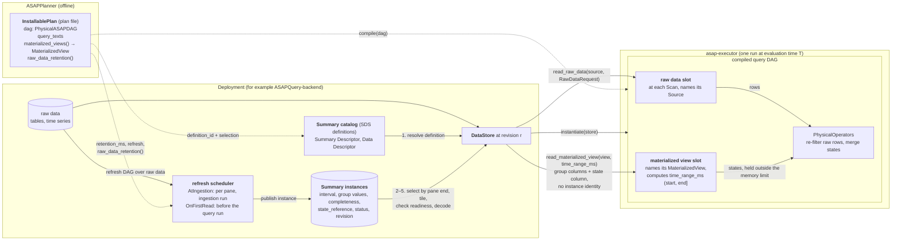

# Data store: reading raw data and materialized views

> **Status:** proposal. Today a deployment binds a run's inputs through
> `BindingDataSources { tables: DataSources, materialized_views:
> BTreeMap<NodeId, Arc<dyn TableProvider>> }`. This document proposes one
> trait, `DataStore`, with one method for raw data and one for materialized
> views, each keyed by what the plan names. The interface is Planner and
> executor work. How a store finds a view's instances (§4) is a reference for
> deployments; ASAPQuery's SummaryStore design
> (`summary-catalog-sds-architecture.md` in ASAPQuery-backend) owns the actual
> implementation.

**Audience:** designers of the executor ↔ deployment boundary, and backend
developers implementing a store.

## 1. Problem

KLL p50/p99 of `latency` over five 1-minute panes kept as materialized views
(the running example of
[Physical planning and deployment](../physical-planning-and-deployment.md)).
The installed DAG expands the pane chain into five pane nodes, `pane_0` …
`pane_4`. Each is a materialized view, and all five have the same
`coverage.definition_id`. The refresh DAG of each pane reads raw data through
`Scan(Source::TimeSeries { metric: "latency" })`.

Today, before every run, a deployment builds two routing maps:

```rust
let mut tables = DataSources::default();
tables.register(Source::TimeSeries { metric: "latency".into() }, Arc::new(SampleBuffer::new(..)))?;
let mut materialized_views = BTreeMap::new();
for view in plan.materialized_views()? {
    let states = store.states_for(&view.coverage);
    materialized_views.insert(view.node_id, Arc::new(StoreProvider::new(states)) as Arc<dyn TableProvider>);
}
query.instantiate(&BindingDataSources { tables, materialized_views })?;
```

The store's real questions are "read raw data of table `S` for this request"
and "read the stored states of definition D for time range R". The current
shape has four problems:

- **Three names for one thing.** `Source` names the table, `DataSources` is a
  `Source → TableProvider` map, and `TableProvider` reads it. A deployment
  registers one provider per table, although its storage already dispatches
  by name.
- **Node ids leak into the deployment.** The summary store is keyed by
  definition and interval, so node ids are only routing.
- **`TableProvider` does not fit a view.** A view's rows are not re-filtered,
  its `projection` and `predicates` are always empty, and its states are not
  charged to the run's memory. Implementing a table trait invites a provider
  to ignore the time range, which the contract then forbids in prose.
- **Both maps are rebuilt every run,** although they are fixed once a plan is
  installed.

## 2. Components and ownership



Arrows point the way data flows, from producer to consumer. An edge label
names the call that moves the data, and the consumer is the caller: the
executor calls `read_raw_data` and `read_materialized_view`, and the store
looks up the catalog and instances. Dashed edges happen once, at install;
solid edges happen in every run.

The interface between the executor and the deployment is one `DataStore`
handle per run. Raw data is read by the `Source` a `Scan` names, and a
materialized view by its `MaterializedView`. Everything right of it (catalog,
instances, refresh) is the deployment's.

| Component | Holds | Repository |
| --- | --- | --- |
| Plan file | `InstallablePlan`: the DAG, query texts, and from them `materialized_views()` and `raw_data_retention()` | ASAPPlanner (`asap-planner`) |
| Plan vocabulary | `Source`, `MaterializedView`, `ViewCoverage`, `RawDataWindow`, `ScanWindow` | ASAPPlanner (`asap-types`) |
| Executor | compiled DAGs, input slots, physical operators, `RunContext` | ASAPPlanner (`asap-executor`) |
| Store interface | the `DataStore` trait and `RawDataRequest` (`sources/data_store.rs`), and their contract (§3) | ASAPPlanner (`asap-executor`) |
| Store implementation | `impl DataStore`: raw data storage, and resolving a view read to stored states | deployment |
| Summary catalog and instances | definitions (descriptors) and instances (interval, group values, completeness, placement, state reference, status, revision) | deployment |
| Refresh, lifecycle, snapshot | refresh scheduling, retention, the revision a run reads | deployment |

Only definitions cross the interface. Instances never do:

| SDS part | Crosses the interface? | As |
| --- | --- | --- |
| Summary Descriptor (operator, parameters, fidelity, state schema) | yes, as the Planner states it | `MaterializedView.coverage.definition_id` and the slot's schema |
| Data Descriptor (source, population) | yes, as the Planner states it | `coverage.selection`; raw sources in `inputs.raw_data_windows` |
| Summary Instance (interval, group values, completeness, placement, `state_reference`, status, lifecycle) | **no** | resolved inside the store |

The time range in a view read is a predicate the store evaluates against
instance intervals. No instance identity, location or status reaches the
executor or the Planner.

## 3. Interface

```rust
/// A deployment's raw data and stored materialized views, as one run reads
/// them. The deployment passes one handle per run, fixed at one revision.
pub trait DataStore {
    /// Rows of the raw table or time series `source` names. `request` is a
    /// hint: the executor re-applies its time range and predicates.
    fn read_raw_data(
        &self,
        source: &Source,
        request: &RawDataRequest,
        context: RunContext,
    ) -> Result<OutputStream<'_, Batch>, Error>;

    /// The stored states of `view`: the instances of `view.coverage` whose
    /// pane ends in `time_range_ms` (`(start, end]`), in the view's schema
    /// (group columns and one state column). Exact: never re-filtered.
    fn read_materialized_view(
        &self,
        view: &MaterializedView,
        time_range_ms: (i64, i64),
        context: RunContext,
    ) -> Result<OutputStream<'_, Batch>, Error>;
}

/// What a raw data slot reads in one run (was `ScanRequest`).
pub struct RawDataRequest<'a> {
    /// `(start, end]`: the union of the windows the `Scan`'s readers read
    /// (`PhysicalASAPDAG::scan_window`); `None` when a reader reads outside a
    /// window.
    pub time_range_ms: Option<(i64, i64)>,
    /// The slot's columns, from the `Scan`'s schema. The store returns rows
    /// with these columns, in this order.
    pub schema: &'a SchemaRef,
    /// The `Scan`'s predicates over `schema`; a hint only.
    pub predicates: &'a [ScalarExpr<()>],
}

// CompiledDAG::instantiate(&self, store: Arc<dyn DataStore>) -> Result<Instance, Error>
```

The method names say what is read, raw data or a materialized view, because
the two contracts differ:

| | `read_raw_data` | `read_materialized_view` |
| --- | --- | --- |
| Keyed by | `Source` | `MaterializedView` |
| Time range | optional, a hint | always given, exact |
| Executor re-filters | yes | no |
| Charged to the run's memory | yes | no, held by the store |

- **Removed:** `TableProvider`, `ScanRequest`, `DataSources` and
  `BindingDataSources`. `TableProvider::schema` is replaced by
  `RawDataRequest::schema`: the store returns the slot's columns, and the
  executor checks each batch against them, instead of matching columns by
  name at bind time. `TableProvider::boundedness` was a hint no slot needed.
- **Executor side.** `compile` records, for each materialized view slot, the
  `MaterializedView` it stands for. At run time the slot computes
  `time_range_ms`. For a pane view (one range `TimeRange` under it), that is
  `RawDataWindow::bounds_ms(T)` of its window. For any other view, it is
  `(T - lookback, T]`, where `lookback` is the largest `lookback_ms` over the
  view's raw-data windows and the views it reads. A time range is therefore
  always given; there is no `None`.
- **Contract of `read_materialized_view`.** It returns exactly the instances
  that cover `time_range_ms` for the view's definition. The executor does not
  re-filter them, so the store must:
  - never count an observation twice;
  - never return an instance of another definition;
  - never treat missing state as empty.

  If it cannot prove that, it returns an error. The deployment decides the
  fallback, for example exact execution.
- **Snapshot.** All reads of one run see the same store revision. The
  deployment fixes it in the handle it passes (`store.at_revision(r)`). The
  executor never reads a revision, so `Scope::Ingestion` and `Scope::Query`
  drop their `revision` field, and `RunContext` keeps only what the executor
  uses: scope, limits, cancellation and the query range.
- **A deployment without materialized views** implements
  `read_materialized_view` as an error. `test-support` provides
  `InMemoryDataStore` (batches by `Source` and by view) for tests.

## 4. How a store resolves a materialized view read (reference algorithm)

### 4.1 At install

For each `view` in `plan.materialized_views()`:

1. **Definition.** Map `view.coverage.definition_id` to the store's summary
   definition. The Summary Descriptor comes from the view node's operator and
   state schema. The Data Descriptor comes from `view.inputs` (sources) and
   the non-time part of `view.coverage.selection` (value sets and ranges).
   Equal `definition_id` and equal non-time selection mean the same
   definition. That is how panes of one chain, and identical views of
   different plans, share instances.
2. **Lifecycle.** Keep each instance for `view.retention_ms` behind the newest
   evaluation time.
3. **Raw data.** Keep raw data per `plan.raw_data_retention()`.
4. **Refresh schedule.** For an `AtIngestion` view, schedule a refresh per
   pane: `compile(dag, {}, [view.node_id])`, run in an ingestion run over
   `(end - width, end]` of its raw-data window. Publish the result as an
   instance with interval `(end - width, end]`.

### 4.2 Per query run at evaluation time `T`

1. **Ensure on-first-read views.** For every `OnFirstRead` view the query DAG
   reads, compute its `time_range_ms` at `T` as the executor will (§3). If the
   store has no complete instance for it, run the view's refresh in a query
   run over the raw data, then publish it. Views are refreshed in
   `materialized_views()` order, so a view's inputs are refreshed first.
2. **Fix the snapshot.** Take one store revision `r` for the whole run.
3. **Instantiate and run** the query DAG with `store.at_revision(r)`. Each
   materialized view slot calls `read_materialized_view(view, time_range_ms,
   ctx)`; each raw data slot calls `read_raw_data(source, request, ctx)`.

### 4.3 `read_materialized_view(view, (start, end], ctx)`

1. **Resolve the definition** from `view.coverage` (§4.1, step 1) in the
   catalog generation the plan was installed with. If it is unknown, return an
   error.
2. **Select candidate instances** of that definition at the handle's revision
   whose pane end is in `(start, end]`, across all group values. Exclude
   instances of an older catalog generation, retired instances and expired
   ones.
3. **Check coverage.** For each group value, the selected intervals must tile
   `(start, end]` exactly: no gap and no overlap.
   - A gap is acceptable only when the store can prove the group had no
     samples there (closed-input proof). Otherwise return an error.
   - An overlap, for example a replaced snapshot next to the original, keeps
     only the current instance.
4. **Check readiness.** Every selected instance is published and not fenced
   by admitted-but-unpublished input overlapping the range. Otherwise return
   an error, or wait, as the deployment chooses.
5. **Decode** each instance's state into rows of the view's schema (group
   columns and the state column), and stream them.

Cost: one catalog lookup plus a range scan over the definition's instances by
pane end. With instances indexed by `(definition, pane end)`, this is
O(log n + k) for k returned instances.

### 4.4 Running example

At `T = 12:05`, the query DAG reads `pane_0` … `pane_4`. Pane `i` sits under
`TimeShift(i·1m)`.

```text
read_materialized_view(pane_0, (12:04, 12:05]) → instance kll-200-latency / (12:04,12:05]
read_materialized_view(pane_1, (12:03, 12:04]) → instance kll-200-latency / (12:03,12:04]
…
read_materialized_view(pane_4, (12:00, 12:01]) → instance kll-200-latency / (12:00,12:01]
NativeKllMerge merges the five states once → p50, p99
```

All five reads resolve to the same definition. Only the interval differs. The
ingestion run that built pane `(12:04, 12:05]` read its input with
`read_raw_data(TimeSeries { metric: "latency" }, (12:04, 12:05])`.

## 5. Alternatives considered

| Alternative | Why not |
| --- | --- |
| Keep `DataSources` and `NodeId → TableProvider` (today) | Three names for raw data, node ids in the deployment, per-run maps, and a table contract that does not fit views (§1) |
| Two traits, `TableStore` and `MaterializedViewStore` | Two handles to build and fix at one revision per run. The contracts differ per method, not per object, so one trait with two named methods is enough |
| One method `read(input)` over an enum of raw data and view | Hides which contract applies at the call site; the method names should say what is read |
| Key views by `definition_id` only | Two views can share a definition but differ in value selection, and panes differ in time. The read needs the full `MaterializedView` and a time range |
| Let the executor call SDS directly | Puts storage identity and instance lifecycle in the executor; SDS must stay in the deployment |
| Pass instances in the plan file | Instances exist only at run time; a plan file cannot name them |

## 6. Open points

- **Boundaries that are not views.** `precompute::compile` composes fragments
  whose `Scan` frontiers are bound by node id, and some tests cut at a
  `TimeRange`. Either keep a crate-internal or `test-support` node-id binding
  for them, or give each such boundary a `MaterializedView`.
- **Interval convention.** The executor's windows are `(start, end]`, and
  ASAPQuery's instances record `[start, end)`. An instance's contents follow
  the refresh DAG that built it. So the store must match by pane end and
  width, and record intervals with the executor's convention or convert them
  exactly.
- **Group completeness.** §4.3 step 3 needs the store to know which groups
  exist. For a closed population this is exact. For an open one, the store
  needs a closed-input proof per group, or returns an error.

## 7. Migration

This is a public API change in `asap_executor`:

- `instantiate` takes `Arc<dyn DataStore>` instead of `&BindingDataSources`;
- `TableProvider`, `ScanRequest`, `DataSources` and `BindingDataSources` are
  removed, and `RawDataRequest` replaces `ScanRequest`;
- `Scope` loses `revision`;
- a materialized view slot's request always carries a time range.

ASAPQuery-backend does not depend on `asap_executor` yet. Its integration
implements `DataStore` over its raw data storage and its SummaryStore
directly.
