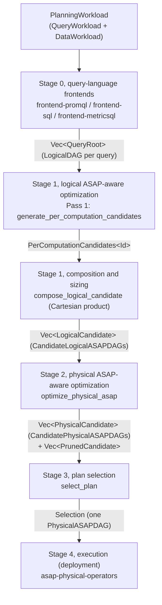

# Planner layering: code map

This page maps every stage and pass of
[ASAPPlanner Planning Stages Design](../design_docs/proposals/planner-layering.md)
(#509) onto the crates, modules and public interfaces that implement it. It
describes `main` @ `6665fcc3`. Paths are relative to the repository root.
Signatures are copied from the code, with bodies and doc comments trimmed.

It is a reference for finding code, not a design document: for the meaning of
a stage, pass or term, read planner-layering.md.

## Pipeline at a glance



Pass 2 (ASAP-aware CSE) runs after Pass 1 and before sizing in the design; it
is not implemented on `main` (see [Pass 2](#pass-2-asap-aware-common-subexpression-elimination)).

### Entry points

| Component | Role |
|---|---|
| `crates/planner/src/lib.rs` (`asap-planner`) | Library facade: `e2e_plan` runs Stage 0, builds a `ParsedWorkload`, then runs the optimization pass. |
| `crates/asap-aware-mapping/src/pass/mod.rs` | `OptimizationPass` trait, `optimize` (input validation + output contract check), `PlanningModels`, `PlanOutput`, `PassRegistry`. |
| `crates/asap-aware-mapping/src/pass/stage1_to_stage3.rs` | The planner pipeline: `run_stage1_to_stage3`, `Stage1ToStage3Run`, `Stage1ToStage3Pass`. |

```rust
// crates/planner/src/lib.rs
pub async fn e2e_plan(input: UserInput<'_>) -> Result<PlanOutput, PlanError> {

// crates/asap-aware-mapping/src/pass/mod.rs
pub fn optimize(
    pass: &dyn OptimizationPass,
    input: OptimizationInput<'_>,
) -> Result<PlanOutput, OptimizeError> {

pub struct PlanningModels<'a> {
    pub cost: &'a dyn CostModel,
    pub accuracy: &'a dyn AccuracyModel,
    pub evidence: &'a dyn AccuracyEvidenceProvider,
}
```

`run_stage1_to_stage3` takes the frontends' roots and runs Stage 1 → Stage 2
→ Stage 3. Only a Pass 1 failure is an error; non-composing or
unimplementable candidates and a failed selection are recorded in the run.

```rust
// crates/asap-aware-mapping/src/pass/stage1_to_stage3.rs
pub fn run_stage1_to_stage3<Id: Clone + std::fmt::Debug>(
    roots: Vec<(Id, QueryRoot)>,
    targets: &[Option<AccuracyTarget>],
    data: &DataWorkload,
    models: PlanningModels<'_>,
) -> Result<Stage1ToStage3Run<Id>, PerComputationCandidateError> {

pub struct Stage1ToStage3Run<Id> {
    pub stage1_pass1_per_computation: PerComputationCandidates<Id>,
    pub combinations: usize,
    pub stage1_logical_asap_optimization: Vec<LogicalCandidate>,
    pub stage2_physical_asap_optimization: Vec<PhysicalCandidate>,
    pub stage2_pruned: Vec<PrunedCandidate>,
    pub stage3_plan_selection: Result<Selection, SelectionError>,
}

pub struct Stage1ToStage3Pass;
```

`Stage1ToStage3Run::selected` returns the selected `PhysicalCandidate`.
`Stage1ToStage3Pass` is the `OptimizationPass` named `"stage1-to-stage3"`; its
`optimize` adds the PromQL series identity to each root,
reads one accuracy target per workload entry, runs `run_stage1_to_stage3` and
returns the selected physical candidate's roots as a `PlanOutput`.

## Stage 0, query-language frontends

Design: [0. Language-specific frontends](../design_docs/proposals/planner-layering.md#0-language-specific-frontends).

| Component | Role |
|---|---|
| `crates/frontend-promql` (`asap-frontend-promql`) | PromQL parse → `UnresolvedOp` tree → `resolve_root`. |
| `crates/frontend-sql` (`asap-frontend-sql`) | SQL parse and plan through DataFusion → `UnresolvedOp` tree (`SqlLowerer`, `SqlCatalog`). |
| `crates/frontend-metricsql` (`asap-frontend-metricsql`) | MetricsQL AST → `UnresolvedOp` tree. |
| `crates/frontend-common` (`asap-frontend-common`) | Shared name-based tree (`UnresolvedOp`, `UnresolvedScalar`), `SchemaResolver`, and `resolve_root`, which binds names to positional `ColumnId`s and returns the IR. |
| `crates/types/src/ir/` (`asap-types`) | The unified operator IR (#511) every stage reads and writes. |
| `crates/types/src/workload.rs` | `PlanningWorkload`, `QueryWorkload`, `DataWorkload`, accuracy and latency requirements. |
| `crates/types/src/parsed_workload.rs` | `ParsedWorkload`: the workload with one lowered root per entry. |

Frontend interfaces (workload in, one root per query out):

```rust
// crates/frontend-promql/src/lib.rs
pub fn lower_promql_query_workload(
    workload: &PlanningWorkload,
    now_ms: u64,
) -> Result<Vec<asap_types::ir::QueryRoot>, PromqlError> {

// crates/frontend-metricsql/src/lib.rs
pub fn lower_metricsql_query_workload(
    workload: &PlanningWorkload,
    now_ms: u64,
) -> Result<Vec<asap_types::ir::QueryRoot>, MetricsqlError> {

// crates/frontend-sql/src/lib.rs
pub async fn lower_sql_dialect(
    query: &str,
    catalog: &SqlCatalog,
    dialect: SqlDialect,
    accuracy: AccuracyTarget,
) -> Result<Rc<OperatorNode>, SqlError> {
```

Output IR (`crates/types/src/ir/`): a `LogicalDAG` is a `QueryRoot` whose
operators are all `Operator::NonASAP`.

```rust
// crates/types/src/ir/query.rs
pub enum QueryRoot<C = Rc<OperatorNode>> {
    Operator(C),
    Scalar(ScalarExpr<C>),
}

// crates/types/src/ir/node.rs
pub struct OperatorNode {
    pub operator: Operator,
    pub result_kind: OperatorResultKind,
    pub schema: Schema,
    pub guarantee: Option<ResultGuarantee>,
    pub timing: Option<ExecutionTiming>,
    pub materialization: Materialization,
    // ...
}
```

Operators are `NonASAPOp` (`ir/non_asap.rs`: `Scan`, `Filter`, `Project`,
`Aggregate`, `Join`, …) or, from Stage 1 on, `ASAPOp` (`ir/asap.rs`:
`SummaryAgg`, `SummaryEstimate`, `FinalizeExactAccumulator`,
`MaintainPopulation`, `SummaryMerge`, …); scalars are in `ir/scalar.rs`.

`DataWorkload` (arrival, ingestion interval, volume and rate, input
cardinality, distribution, each as `Evidence<T>`) is read by Stage 3 pricing.

## Stage 1, logical ASAP-aware optimization

Design: [1. Logical ASAP-aware optimization](../design_docs/proposals/planner-layering.md#1-logical-asap-aware-optimization).

| Component | Role |
|---|---|
| `crates/asap-aware-mapping/src/per_computation_candidates.rs` | Pass 1 (`generate_per_computation_candidates`) and the composition of whole-workload candidates with sizing and guarantees (`compose_logical_candidate`). |
| `crates/asap-aware-mapping/src/realization.rs` | Shared helpers: summary families per intent, accuracy target and `(ε, δ)` budget, default sizing. |
| `crates/asap-aware-mapping/src/accuracy/` | Accuracy model used for node guarantees (`DefaultAccuracyModel`), estimators and sizing rules. |
| `crates/asap-aware-mapping/src/pass/stage1_to_stage3.rs` | Enumerates the Cartesian product of per-computation candidates into `LogicalCandidate`s. |

### Pass 1: Per-computation candidate generation

Design: [Pass 1](../design_docs/proposals/planner-layering.md#pass-1-per-computation-candidate-generation)
(Algorithm 1). Input: the frontends' logical DAGs. Output: for every eligible
computation (one measure of an `Aggregate`), its unranked, unsized candidates
and the candidates pruned with a reason. No cost or accuracy model is
consulted.

```rust
// crates/asap-aware-mapping/src/per_computation_candidates.rs
pub fn generate_per_computation_candidates<Id: std::fmt::Debug>(
    roots: Vec<(Id, QueryRoot)>,
) -> Result<PerComputationCandidates<Id>, PerComputationCandidateError> {

pub struct PerComputationCandidates<Id> {
    pub roots: Vec<(Id, QueryRoot)>,
    pub targets: Vec<ComputationTarget>,
}

pub struct ComputationTarget {
    pub target: Rc<OperatorNode>,
    pub measure: usize,
    pub choices: ComputationChoices,
    pub filter: Option<Predicate>,
    pub having: Vec<HavingEntry>,
}

pub struct ComputationChoices {
    pub candidates: Vec<ComputationCandidate>,
    pub pruned: Vec<(ComputationCandidate, PruneReason)>,
}

pub enum ComputationCandidate {
    Exact,
    ExactAccumulator {
        kind: ExactKind,
        params: ExactParams,
    },
    Summary(SketchAlgorithm),
    AvgAsSumCount,
}

pub enum PruneReason {
    RequiresExact,
    NullableAvgInput,
}

// Errors of Pass 1 and composition.
pub enum PerComputationCandidateError {
    Structure(#[from] SchemaDerivationError),
    AssignedPhysicalAnnotation,
    ContainsAsap,
    InvalidAccuracy {
        root: Option<String>,
        measure: Option<usize>,
    },
    InvalidChoice,
    Unsupported(&'static str),
}
```

The summary families offered per intent come from
`realization::summary_candidates`.

### Composition, sizing and guarantees

Design: Algorithm 1's `SUBSTITUTE`, and sizing after Pass 2. On `main`,
`compose_logical_candidate` picks one candidate per target (`choice[i]`
indexes `targets[i].choices.candidates`) and builds one whole-workload
`CandidateLogicalASAPDAG`:

- `ExactAccumulator`: `SummaryAgg` → `FinalizeExactAccumulator`;
- `Summary`: `SummaryAgg` → `SummaryEstimate`;
- `AvgAsSumCount`: finalized `sum` and `count` divided;
- `Exact`: a single-measure `Aggregate`.

Each summary is **sized** here for its own measure's accuracy requirement
(the private `sized` helper calls `realization::default_size_params`, which
dispatches to `accuracy::estimators`). With no Pass 2 sharing, this is the
post-Pass-2 sizing step with nothing shared.

Every node gets a theoretical **guarantee** (the private `composed_guarantee`):
exact over exact inputs; a `SummaryEstimate` over exact input gets its sized
family's bound from `DefaultAccuracyModel::local_guarantee`; anything computed
from an approximate value gets `None` (composition through operators is #669).

```rust
// crates/asap-aware-mapping/src/per_computation_candidates.rs
pub fn compose_logical_candidate<Id: Clone>(
    inventory: &PerComputationCandidates<Id>,
    choice: &[usize],
) -> Result<Vec<(Id, QueryRoot)>, PerComputationCandidateError> {

// crates/asap-aware-mapping/src/realization.rs
pub fn default_size_params(
    kind: SketchAlgorithm,
    intent: &AggIntent,
    eps: f64,
    delta: f64,
) -> SketchParams {

// crates/asap-aware-mapping/src/accuracy/mod.rs
pub trait AccuracyModel {
    fn local_guarantee(
        &self,
        family: &FieldDataType,
        query: &SketchStatistic,
    ) -> Option<ResultGuarantee>;
    fn propagate(
        &self,
        op: &CompositionOperator,
        inputs: &[ResultGuarantee],
        local: Option<&ResultGuarantee>,
        stats: &PropagationStats,
    ) -> Result<ResultGuarantee, AccuracyError>;
    fn satisfies(&self, guarantee: &ResultGuarantee, target: &AccuracyTarget) -> bool;
}

pub struct DefaultAccuracyModel;
```

`accuracy/composition.rs` holds `DefaultAccuracyModel`'s registered
propagation rules (additive, multiplicative, …) behind `propagate`.

The whole-workload candidate set is the Cartesian product of the targets'
candidates, enumerated in mixed-radix order (last target fastest):

```rust
// crates/asap-aware-mapping/src/pass/stage1_to_stage3.rs
pub struct LogicalCandidate {
    pub id: String,
    pub display_name: String,
    pub choice: Vec<usize>,
    pub roots: Result<Vec<QueryRoot>, PerComputationCandidateError>,
}
```

### Pass 2: ASAP-aware common-subexpression elimination

Design: [Pass 2](../design_docs/proposals/planner-layering.md#pass-2-asap-aware-common-subexpression-elimination)
(Algorithm 2; identical-expression, summary-capability and window-composition
rules).

**Not implemented on `main`.** `run_stage1_to_stage3` goes straight from
Pass 1 to composition; no rule of Algorithm 2 runs in the stage pipeline.
Building blocks that exist:

| Component | Role |
|---|---|
| `crates/types/src/ir/cse.rs` | Structural CSE (hash-consing) over the IR: `share_common_sub_dags`. Called by the legacy search, not by the stage pipeline. |
| `crates/types/src/ir/summary_coverage.rs` | `SummaryCoverage::derive`: what a summary state covers (definition and selection), the comparison the sharing rules need. |

```rust
// crates/types/src/ir/cse.rs
pub fn share_common_sub_dags<Id>(
    roots: Vec<(Id, Rc<OperatorNode>)>,
) -> Vec<(Id, Rc<OperatorNode>)> {

// crates/types/src/ir/summary_coverage.rs
pub fn derive(node: &OperatorNode) -> Result<Self, CoverageError> {
```

## Stage 2, physical ASAP-aware optimization

Design: [2. Physical ASAP-aware optimization](../design_docs/proposals/planner-layering.md#2-physical-asap-aware-optimization)
(Algorithm 3).

| Component | Role |
|---|---|
| `crates/asap-aware-mapping/src/stage2_physical_asap_optimization.rs` | `optimize_physical_asap`: physical operator implementation and materialization for one logical candidate. |
| `crates/types/src/post_asap/execution_data_state.rs` | `Materialization`, `Medium`, `ExecutionTiming`. |
| `crates/types/src/ir/timing.rs` | `MaterializationAssignment`, `apply_materialization_timings`. |
| `crates/types/src/ir/physical_export.rs` | `compile_physical_asap_workload_with_node_ids` → `PhysicalASAPDAG`. |

Input: one `CandidateLogicalASAPDAG` (`&[QueryRoot]`). Output: one
`PhysicalCandidate` (`P<n>` from `L<n>`) or an error, which the caller records
as a `PrunedCandidate`.

```rust
// crates/asap-aware-mapping/src/stage2_physical_asap_optimization.rs
pub fn optimize_physical_asap(
    from_logical: &str,
    roots: &[QueryRoot],
) -> Result<PhysicalCandidate, PhysicalASAPOptimizationError> {

pub struct PhysicalCandidate {
    pub id: String,
    pub from_logical: String,
    pub display_name: String,
    pub roots: Vec<QueryRoot>,
    pub dag: PhysicalASAPDAG,
}

pub enum PhysicalASAPOptimizationError {
    Structure(#[from] SchemaDerivationError),
    Timing(#[from] ExecutionDataStateError),
    ExactTopK(String),
}

// crates/asap-aware-mapping/src/pass/stage1_to_stage3.rs
pub struct PrunedCandidate {
    pub from_logical: String,
    pub display_name: String,
    pub reason: String,
}
```

### Materialization

Design: [Materialization](../design_docs/proposals/planner-layering.md#materialization).
On `main`, Stage 2 offers one option: every sub-DAG is `NotMaterialized`
(`MaterializationAssignment::with_default(Materialization::NotMaterialized)`),
so each logical candidate yields exactly one physical candidate;
`apply_materialization_timings` then sets every node's execution timing. Enumerating
`MatAtIngestion(medium)` and `MatAtQuery(medium)` per sub-DAG is #604.

```rust
// crates/types/src/post_asap/execution_data_state.rs
pub enum Medium {
    Memory,
    Disk,
}

pub enum Materialization {
    NotMaterialized,
    MatAtIngestion(Medium),
    MatAtQuery(Medium),
}
```

### Physical operator implementation

Design: [Physical operator implementation](../design_docs/proposals/planner-layering.md#physical-operator-implementation).
The private `implement` / `implement_topk` helpers rewrite exact top-k
(`Aggregate{[TopK]}`) to a per-group sort, a per-group limit and a `Project`;
every other operator has one implementation, and `SummaryAgg` →
`SummaryEstimate` already is build → estimate. A top-k without that rewrite
fails with `ExactTopK` and the candidate is pruned.

### Pruning

Stage 2 prunes only candidates it cannot implement; each `PrunedCandidate`
carries the error as its `reason` (`Stage1ToStage3Run::stage2_pruned`). A
Stage 1 candidate whose composition failed keeps the error in
`LogicalCandidate::roots` and never reaches Stage 2.

## Stage 3, plan selection

Design: [3. Plan selection](../design_docs/proposals/planner-layering.md#3-plan-selection).

| Component | Role |
|---|---|
| `crates/asap-aware-mapping/src/stage3_plan_selection.rs` | `select_plan`: accuracy check, pricing, ranking. |
| `crates/asap-aware-mapping/src/accuracy/evidence.rs` | `AccuracyEvidenceProvider` (deployment evidence, incl. `output_guarantee`), `NoAccuracyEvidence`. |
| `crates/asap-aware-mapping/src/analytical_cost.rs` | `estimate_operator`, `PhysicalOperator`, `ResourceEstimate`, `ResourceCalibration`. |
| `crates/asap-aware-mapping/src/physical_operator_statistics.rs` | `EdgeStatistics`, `OperatorStatistics` fed to `estimate_operator`. |
| `crates/asap-aware-mapping/src/cost_model.rs` | `CostModel` trait carried in `PlanningModels::cost`. |
| `crates/asap-aware-mapping/src/pass/mod.rs` | `PlanningModels`: the cost model, accuracy model and evidence handed to the stages. |

Input: the Stage 2 candidates, one accuracy target per query, the
`DataWorkload`, and the models. Output: a `Selection` or a `SelectionError`.

```rust
// crates/asap-aware-mapping/src/stage3_plan_selection.rs
pub fn select_plan(
    cands: &[PhysicalCandidate],
    targets: &[Option<AccuracyTarget>],
    data: &DataWorkload,
    models: PlanningModels<'_>,
) -> Result<Selection, SelectionError> {

pub struct Selection {
    pub selected: String,
    pub costs: BTreeMap<String, CandidateCost>,
    pub rejected: Vec<Rejection>,
}

pub struct Rejection {
    pub id: String,
    pub valid: bool,
    pub reason: String,
}

pub enum SelectionError {
    TargetCount {
        candidate: String,
        roots: usize,
        targets: usize,
    },
    Cost {
        candidate: String,
        node: PhysicalASAPNodeId,
        error: AnalyticalCostError,
    },
    NoValidCandidate(Vec<Rejection>),
}
```

### Accuracy check

Each query's output meets its target when its root guarantee (composed in
Stage 1) satisfies it under `models.accuracy.satisfies`, or when the
deployment's evidence for that output does (`models.evidence.output_guarantee`,
read only in Stage 3). A miss rejects the candidate with `valid: false`.
Count-Min is admitted only over weights proven non-negative. Latency bounds
and deployment capabilities are not checked yet.

```rust
// crates/asap-aware-mapping/src/accuracy/evidence.rs
pub trait AccuracyEvidenceProvider {
    // ... estimator_contract, topk_max_distinct_items, quantile_input_domain,
    // propagation_stats
    fn output_guarantee(&self, _output: &QueryRoot) -> Option<ResultGuarantee> {
}

pub struct NoAccuracyEvidence;
```

### Cost

Every valid candidate is priced node by node over its `PhysicalASAPDAG` (the
private `price`): edge statistics are derived from the `DataWorkload` and
default constants, each node is estimated with `estimate_operator`, and
converted to one number by `ResourceEstimate::calibrated_cost` with an
illustrative `ResourceCalibration`. A node is charged once if materialized and
once per consumer otherwise (`NodeCost::multiplier`). The unit and source are
`COST_UNIT` (`"cpu_ms_per_workload_evaluation"`) and `COST_SOURCE`. On `main`,
`select_plan` does not read `PlanningModels::cost`.

```rust
// crates/asap-aware-mapping/src/stage3_plan_selection.rs
pub struct CandidateCost {
    pub total: f64,
    pub unit: &'static str,
    pub source: &'static str,
    pub per_node: BTreeMap<PhysicalASAPNodeId, NodeCost>,
}

pub struct NodeCost {
    pub cost: f64,
    pub multiplier: u64,
    pub detail: String,
}

// crates/asap-aware-mapping/src/analytical_cost.rs
pub fn estimate_operator(
    operator: PhysicalOperator,
    statistics: OperatorStatistics,
) -> Result<ResourceEstimate, AnalyticalCostError> {

pub struct ResourceCalibration {
    pub cost_per_cpu_op: f64,
    pub cost_per_scan_byte: f64,
    pub cost_per_retained_byte: f64,
    pub version: String,
}
```

### Ranking

`select_plan` keeps the cheapest valid candidate (the first on ties) as
`Selection::selected`; every other valid candidate is listed in `rejected`
with `valid: true` and a `"costlier: …"` reason. Every candidate is priced;
nothing is capped (a search that avoids building every candidate is #671).

## Stage 4, execution

Design: [4. Execution](../design_docs/proposals/planner-layering.md#4-execution).
Execution runs in the deployment. The planner hands off the selected
candidate's `PhysicalASAPDAG` (`PhysicalCandidate::dag`; through the facade,
`PlanOutput::execution_timed_dag`).

| Component | Role |
|---|---|
| `crates/types/src/ir/physical_export.rs` | `PhysicalASAPDAG`, its nodes and edges with data state and materialization; `PhysicalASAPDAGDocument` for serialization. |
| `crates/asap-physical-operators` | Physical operator DAG runtime shared by ingestion time and query time; `physical_planner` compiles a `PhysicalASAPDAG` to native operators. |

```rust
// crates/types/src/ir/physical_export.rs
pub struct PhysicalASAPDAG {
    pub nodes: Vec<PhysicalASAPDAGNode>,
    pub edges: Vec<PhysicalASAPDAGEdge>,
    pub roots: Vec<PhysicalASAPNodeId>,
    // ... scalar roots
}

// crates/asap-physical-operators/src/physical_planner/mod.rs
pub fn compile(
    dag: &PhysicalASAPDAG,
    inputs: BTreeMap<NodeId, InputContract>,
    roots: &[NodeId],
) -> Result<CompiledPhysicalDAG, Error> {
```

## Tooling

| Component | Role |
|---|---|
| `crates/devtools/src/planning_stages.rs` | `run_planning_stages`: Stage 0 roots plus `run_stage1_to_stage3`, as one `PlanningStagesRun`. Shared by `stage_pipeline` and the planner-layering acceptance tests. |
| `crates/devtools/src/bin/stage_pipeline.rs` | Writes an `asap-stage-pipeline/v1` JSON document with every stage's candidates (`--example planner-layering-1`, `--promql …`). |
| `crates/devtools/src/planner_layering_examples.rs` | The design doc's end-to-end examples as workloads. |
| `crates/devtools/tests/stage_pipeline.rs` | Acceptance tests over the examples. |
| `tools/dag-viewer/` | Browser viewer (`server.py`, `viewer.js`, `planner-ui.js`); on `main` its server plans through the `dag_export` binary. See its `README.md`. |

```rust
// crates/devtools/src/planning_stages.rs
pub fn run_planning_stages(
    workload: &PlanningWorkload,
    roots: Vec<QueryRoot>,
) -> Result<PlanningStagesRun, String> {

pub struct PlanningStagesRun {
    pub stage0_query_language_frontends: Vec<QueryRoot>,
    pub stage1_logical_asap_optimization: Vec<LogicalCandidate>,
    pub stage2_physical_asap_optimization: Vec<PhysicalCandidate>,
    pub stage2_pruned: Vec<PrunedCandidate>,
    pub stage3_plan_selection: Result<Selection, SelectionError>,
}
```

## Supporting modules

All in `crates/asap-aware-mapping/src/` unless noted.

| Component | Role |
|---|---|
| `accuracy/estimators/` (`cms.rs`, `count_sketch.rs`, `kll.rs`, `ddsketch.rs`, `hll.rs`, `univmon.rs`, `cardinality.rs`) | Per-family sizing rules and local error bounds (`size_params`). |
| `accuracy/allocation.rs` | `AccuracyBudgetAllocator`, `EqualSplitAllocator`: split an accuracy budget across composed parts. |
| `accuracy/evidence.rs` | Evidence types (`EstimatorContract`, `PropagationStats`, `WorkloadAccuracyEvidence`). |
| `physical_operator_statistics.rs` | Edge and operator statistics for `analytical_cost`. |
| `crates/types/src/post_asap/` | Summary families (`sketch.rs`), `ResultGuarantee` (`guarantee.rs`), data state and materialization (`execution_data_state.rs`). |

Legacy, to be deleted once the stages implement what they do: `replacement.rs`
(the old candidate search, `search_workload`), `accuracy/reconciliation.rs`,
and the modules that serve only that search; also the `dag_export` devtool.
The stage pipeline does not call them.

## Not yet on main

- #682: Stage 3 prices state by its size.
- #686: the viewer plans through `stage_pipeline`.
- #687: guarantee composition through arithmetic over approximate values (#669, part a).
- #604: Stage 2 materialization options.
- G4, Pass 2 identical-expression rule (earlier #588).
- #572: crate and module layout by stages and the unified IR.
- #677: doc updates after the consolidation.
